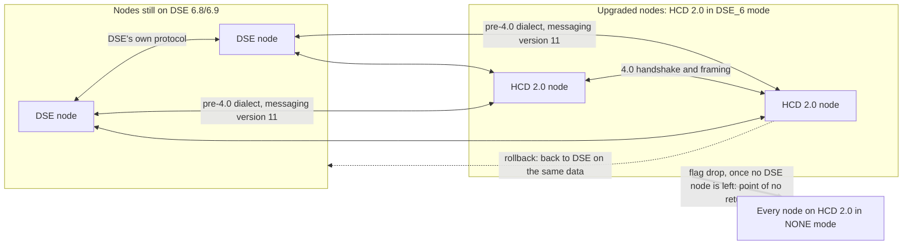
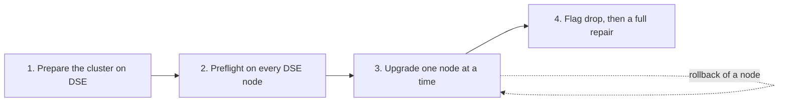

<!--
Copyright IBM Corp.

Licensed under the Apache License, Version 2.0 (the "License");
you may not use this file except in compliance with the License.
You may obtain a copy of the License at

http://www.apache.org/licenses/LICENSE-2.0

Unless required by applicable law or agreed to in writing, software
distributed under the License is distributed on an "AS IS" BASIS,
WITHOUT WARRANTIES OR CONDITIONS OF ANY KIND, either express or implied.
See the License for the specific language governing permissions and
limitations under the License.
-->

# Overview: the in-place upgrade from DSE 5.1, 6.8 and 6.9 to HCD 2.0

This page explains the design in one read, for people who did not follow the project. There are two upgrade paths,
one per source release, each with its own procedure: from DSE 6.8 or 6.9, [RUNBOOK.md](RUNBOOK.md), with its
reference, the rationale, the edge cases and what was validated, in [RUNBOOK-REFERENCE.md](RUNBOOK-REFERENCE.md); from
DSE 5.1.51, [RUNBOOK-DSE51.md](RUNBOOK-DSE51.md) (section 5 below says what differs). The security rules of both are
[SECURITY.md](SECURITY.md), and the checks of the preflight tool [PREFLIGHT.md](PREFLIGHT.md).

## 1. What it is

A **single-hop, rolling, in-place upgrade** from DataStax Enterprise (DSE) 6.8 or 6.9, or from DSE 5.1.51, to HCD 2.0
(the `main` code line). Only DSE core, the Cassandra workload, is in scope. There is no intermediate version: no DSE 6,
no HCD 1.2 and nothing else based on Cassandra 4.x in the upgrade path. Sections 2 to 4 describe the upgrade from DSE
6.8 and 6.9; section 5 what differs for DSE 5.1.

One node at a time stops DSE and starts HCD 2.0 on the same data, commit log, hints and metadata directories. The
other nodes keep serving clients. For a while the cluster runs both products: this is the *mixed phase*. When every
node runs HCD 2.0, one last rolling restart turns the compatibility mode off: the *flag drop*. A few settings of the
mode stay after it, and are changed later, one rolling restart each (see "The phases" below).

## 2. Why it needs new code

DSE 6 talks to non-DSE nodes only in the old Cassandra 3.0 internode protocol (the "pre-4.0 dialect"). The HCD 2.0 code
line removed that dialect (CASSANDRA-18314). So, out of the box, an HCD 2.0 node and a DSE node cannot talk, and a
rolling upgrade is impossible.

The documented way around it is two hops: DSE to HCD 1.2, then HCD 1.2 to HCD 2.0. That means two full rolling
upgrades. This project instead puts back, behind a configuration setting, what HCD 2.0 needs to live in a cluster
with DSE 6 nodes. The setting is transitional: it exists to be turned off after the upgrade.

## 3. How the compatibility mode works

Every upgraded node runs with two settings in `cassandra.yaml`:

```yaml
internode_compatibility_mode: DSE_6
storage_compatibility_mode: HCD_1
```

A node refuses to start with `DSE_6` unless `storage_compatibility_mode` is `HCD_1`. The default of
`internode_compatibility_mode` is `NONE`. The mode does four things.

**It speaks DSE's language.** An upgraded node recognises a DSE peer by its handshake or by gossip. With DSE nodes
it uses the pre-4.0 handshake and the Cassandra 3.0.14 dialect, messaging version 11. With other HCD 2.0 nodes it
uses the normal 4.0 handshake and framing. It never sends DSE a message type that DSE does not know, and it
translates gossip states into values DSE accepts.

**It writes only what DSE can read.** This is what makes a rollback possible. While in `DSE_6`, an upgraded node:

- writes sstables in the `bti` format at version `bb`, DSE's own trie format;
- writes SAI index files at the version DSE reads, pinned by the operator (`aa` for DSE 6.8, `ca` for DSE 6.9);
- runs Paxos v1 only (`paxos_variant: v1`), as DSE does.

In the other direction, HCD 2.0 reads what DSE left behind. At its first start it replays DSE's commit log, converts
DSE's hints files and delivers those hints.

**It freezes the cluster's shape.** Upgraded nodes refuse schema changes. They also refuse topology and on-disk changes,
such as bootstrap, replace, decommission, removenode, rebuild, repair and sstable import. One exception: a node, DSE or
HCD 2.0, that is gone for good, and that nothing has been heard of for a while, can be removed (the runbook's section 6,
not validated). DSE nodes cannot be changed, so they refuse none of these: the operator must make sure nobody runs them
through a DSE node. Upgraded nodes also refuse to start while some DSE access controls they cannot enforce still exist
(`RESTRICT` and row-level access control). The preflight tool blocks on the others, or the node drops them, which
removes access, never grants it ([SECURITY.md](SECURITY.md)). Upgraded nodes also refuse to start while DSE features
outside DSE core are in use.

**It keeps the way back open, until the flag drop.** Any upgraded node can go back to DSE on its own. The rollback
restores the node's system tables from a snapshot taken at its upgrade, and DSE's node metadata, if HCD 2.0 moved it,
from a copy taken with the snapshot. Its data stays as HCD 2.0 left it, because DSE reads those sstables. The node
should be down for less than the other nodes' hint window (3 hours by default), or it misses writes until a repair. DSE
nodes may already have stopped storing hints for a node that ran HCD 2.0 for more than 3 hours. Rolling back the last
upgraded node returns the cluster to all DSE. The flag drop is the point of no return: from the first node restarted in
`NONE` on, no node goes back to DSE. A node refuses to start in `NONE` while its upgrade marker file is present or it
still has a DSE peer on record; the flag drop deletes both.

The mixed cluster:



Every DSE node talks to every upgraded node in the pre-4.0 dialect.

## 4. The phases



1. **Prepare the cluster, on DSE** ([RUNBOOK.md](RUNBOOK.md) sections [1](RUNBOOK.md#s1) and [2](RUNBOOK.md#s2)). Bring
   every node to the latest DSE 6.8 or 6.9 patch release. Remove what HCD 2.0 does not support: DSE features outside DSE
   core, the access controls listed in [SECURITY.md](SECURITY.md), and the `VECTOR` columns of DSE 6.9. Configure every
   client driver to use native protocol version 4, which both products accept. Turn off the NodeSync flag of every
   replicated table (the NodeSync service itself goes off after the preflight). Choose the SAI version to pin. Give
   `system_auth` replicas in every data center; three (or as many as the nodes) are recommended, so that with three
   nodes or more an upgraded node can start while one node is down (the preflight blocks where an upgraded node could
   not start at all, a data center with no replica for example, and warns below the recommendation in a data center of
   three nodes or more; single-node and small development clusters can be upgraded as they are). With several data
   centers put the replicated system keyspaces in every data center (for those other than `system_auth`, the preflight
   warns where a data center lacks replicas, or, with three nodes or more, has fewer than recommended). Then restart
   every DSE node once, so the changes take effect; with internode TLS on DSE 6.9, turn on DSE's legacy TLS port in that
   restart (required: the preflight blocks without it).
2. **Run the preflight tool on every DSE node** ([section 1, item 0](RUNBOOK.md#s1-item0)). Fix every blocking finding
   and run it again, until every node and the whole cluster report `READY`. Then run a full repair.
3. **Upgrade the nodes one at a time** ([section 3](RUNBOOK.md#s3)). With several data centers, finish one data center
   before the next, with its seeds last. For each node: checks before the node ([section 3a](RUNBOOK.md#s3a)), then the
   node itself ([section 3b](RUNBOOK.md#s3b)): take the clients off, snapshot and copy DSE's node metadata aside, drain,
   stop DSE, start HCD 2.0, check it and pass a gate before the next node. After a failure between the drain and HCD
   2.0's start, DSE is started again (section 3b). If anything else goes wrong, stop and report; a node can be rolled
   back ([section 4](RUNBOOK.md#s4)).
4. **Drop the flag** ([section 5](RUNBOOK.md#s5)). Once every node runs HCD 2.0 and the checks pass, restart each node
   with `internode_compatibility_mode: NONE`. The mode is read only when a node starts, so this is a rolling restart: it
   cannot be changed on a running node, and the files of the upgrade that keep a node from starting with `NONE` are
   deleted while the node is stopped. Then run a full repair and rebuild the reverse index of the permissions (a copy
   made with CQL, before any `DROP`). HCD 2.0 has no NodeSync, so schedule regular repairs from then on. Some settings
   of the mode stay after the flag drop: `storage_compatibility_mode: HCD_1`, `paxos_variant: v1` and the `bb` sstable
   version among them. Each is changed later, with its own rolling restart, outside this procedure.

## 5. The upgrade from DSE 5.1

The same design, for DSE 5.1.51 (the Cassandra 3.11 based release), with its own procedure,
[RUNBOOK-DSE51.md](RUNBOOK-DSE51.md). What differs:

- **Two settings, set and dropped together.** Every upgraded node runs with `internode_compatibility_mode: DSE_5_1` and
  `storage_compatibility_mode: DSE_5_1`; neither is accepted without the other. DSE 5.1.51 is the only DSE 5.1 release:
  the preflight blocks on any other, and a cluster never holds DSE 5.1 and DSE 6 nodes at once.
- **Its language.** With DSE 5.1 nodes an upgraded node speaks the pre-4.0 dialect at messaging version 11, as with
  DSE 6, with DSE 5.1's own gossip states; it gossips the DSE version 5.1.51, the release the other nodes run.
- **What it writes for DSE 5.1.** Big sstables of version `me` (the newest DSE 5.1 reads, with numeric generations),
  hints files of version 1, and the transaction logs and sstable statistics DSE 5.1 reads; Paxos v1 only. So the cluster
  starts with every sstable at `me` (`nodetool upgradesstables` on DSE 5.1 first). A hint those files cannot hold (a
  time after 2038, or one larger than the hints buffer) is not stored, and its table is repaired after the flag drop. No
  SAI: DSE 5.1 has none, and an upgraded node refuses to create an SAI index until the flag drop, even with `allow_ddl`.
  A node that is refused on a compressor DSE 5.1 does not read can rewrite its sstables in the mode
  (`nodetool upgradesstables`), which the mode allows.
- **What it reads of DSE 5.1.** DSE 5.1's sstables, `system.local` and `system.peers` (DSE 5.1 has no node metadata
  files), commit log and hints files, at the first start.
- **More to remove first, on DSE 5.1.** Beyond what section 4 lists in its step 1: row-level access control on tables
  and on materialized views (never `UNRESTRICT ROWS` on a view), SASI indexes, `COMPACT STORAGE`,
  `DateTieredCompactionStrategy`, compressors other than LZ4, Snappy and Deflate, columns of a type the mode does not
  write for DSE 5.1 (a custom type), Thrift (`start_rpc`, on as installed), a second native port, and incremental
  repair, which the `me` sstables cannot take until they are rewritten after the flag drop.
- **The way back.** Any upgraded node goes back to DSE 5.1, a single-node cluster included, keeping its data. Before it,
  the preflight tool checks the node's files (`dsepreflight --rollback-check`) beside its open Paxos rounds. The hints
  an upgraded node holds for other upgraded nodes are delivered before it goes back where their targets are up: DSE 5.1
  sends hints only to a node with its own schema version, so those it keeps wait for their target's rollback or this
  node's next upgrade. The flag drop sets both settings back (`NONE` and `HCD_1`) in one restart and is the
  point of no return; from then on the nodes write big `nb`.
- **Validation.** The procedure was run end to end twice, each time on a test cluster of three DSE 5.1.51 nodes in one
  data center: the upgrade, the checks of the mixed phase, the rollback of one node to DSE 5.1, the full upgrade, the
  flag drop and the repairs, with the data unchanged and no failed or wrong read or write, other than requests to a
  coordinator while it restarted. It was not run with several data centers, with internode TLS or compression between
  the two products, or with a rollback while other nodes ran HCD 2.0; its data set was small, and it was not a test of
  performance or of scale. It also rests on files and bytes captured on real DSE 5.1.51 nodes, which the tests read, a
  trial on DSE 5.1.51 of the remedies for views restricted to rows, and the tests of HCD 2.0 in the mode (section 7).

## 6. Limits

The full list is [section 0 of RUNBOOK.md](RUNBOOK.md#s0); for DSE 5.1, [section 0 of
RUNBOOK-DSE51.md](RUNBOOK-DSE51.md#s0), with the differences of section 5 above.

- **Not for production.** The runbook is for review by the team of the upgrade owner, the person who decides
  for the upgrade.
- **DSE core only.** DSE Search, Graph, Analytics, DSEFS/CFS and Advanced Replication are not supported.
- **No vector search.** ANN workloads and tables with `VECTOR` columns, which only DSE 6.9 has, are not supported by
  the in-place upgrade from DSE 6.9 to HCD 2.0: remove those columns or tables, or move that data by other means, before
  the upgrade. The preflight tool blocks on them.
- **The latest DSE 6.8 or 6.9 patch release, or DSE 5.1.51, only.** Other releases must first be upgraded with DSE's
  own procedure.
- **No encrypted (TDE) tables, and no KMIP key provider.** Out of scope of this version. The preflight tool
  blocks on TDE.
- **No schema, role, grant or topology change** from the preflight to the flag drop, and no repair except the full
  repair right before the first node.
- **A deadline.** The whole mixed phase, the flag drop and its repair must finish within the smallest
  `gc_grace_seconds` of the tables that take deletes, counted from the start of the full repair before the first
  node.
- **Serial reads under contention.** A `SERIAL` or `LOCAL_SERIAL` read coordinated by an upgraded node can fail with
  a `WriteTimeout` (write type `CAS`) where DSE answers a `ReadTimeout`. Applications that handle one must handle the
  other the same way.
- **Not validated at scale.** The test clusters have three and six nodes; clusters of tens to hundreds of nodes are
  out of scope of this version.
- **No performance claim.** This work does not measure or claim performance parity between HCD 2.0 and DSE 6.8, 6.9 or
  5.1: throughput and latency may differ, in either direction, with the workload. Benchmark the workload on HCD 2.0,
  with the settings that stay after the flag drop (phase 4), before the upgrade, and size the cluster from that.
- **DSE 5.1: one data center validated, without internode TLS**, and no SAI during its mixed phase (section 5).

## 7. Status

- **Runbook version 2.2**, **not for production**: [RUNBOOK.md](RUNBOOK.md), the short operator runbook, and
  [RUNBOOK-REFERENCE.md](RUNBOOK-REFERENCE.md), its reference with the same section numbers: the full procedure, the
  rationale, the edge cases and what was validated. What each version changed is in the reference's
  [header history](RUNBOOK-REFERENCE.md#history).
- **Validated on DSE 6.9.26**: one data center of three nodes, and two data centers of three nodes each, with
  internode TLS off and with `internode_encryption` set to `dc`, `rack` and `all`. The full rolling upgrade,
  rollbacks and the flag drop all ran. Also, with `system_auth` at DSE's default of one replica, a single node upgraded
  as it is, flag drop included, and a data center of three nodes upgraded node by node.
- **Validated on DSE 6.8.65**, in one data center: without internode TLS the full rolling upgrade, the flag drop and
  rollbacks; with `internode_encryption: all`, the mixed phase with one node upgraded; on a smaller test cluster, the
  replay of the view updates DSE stored and the order of the restart and of the rewrite with `system_info_encryption`
  (as on DSE 6.9.26). In two data centers, development runs only.
- **Not validated:** several data centers on DSE 6.8; some rollback cases with internode TLS. The runbook's header
  lists every item, under ["Not validated"](RUNBOOK.md#not-validated).
- **Out of scope of this version:** TDE (and KMIP), upgrade tests with docker images of DSE and HCD 2.0, and
  validation at scale (tens to hundreds of nodes).
- **DSE 5.1.51**: [RUNBOOK-DSE51.md](RUNBOOK-DSE51.md), version 1.0, **not for production**. **Validated** twice, each
  time on one data center of three DSE 5.1.51 nodes, without internode TLS, on a small data set: the full rolling
  upgrade, the checks of the mixed phase, the rollback of one node and the flag drop all ran, with the data unchanged
  and no failed or wrong read or write, other than requests to a coordinator while it restarted. It also rests on the
  files and bytes DSE 5.1.51 writes, captured on real DSE 5.1.51 nodes and read by the tests of HCD 2.0 (sstables,
  system tables, schema and grants, commit log, hints, transaction logs, batches, Paxos rows, gossip and handshake
  bytes, DSE's configuration); a trial on a three-node DSE 5.1.51 cluster of the remedies for views restricted to rows
  and of the leftover row of a failed `UNRESTRICT ROWS`; and the unit and in-JVM tests of HCD 2.0 in `DSE_5_1` mode and
  of the preflight tool's DSE 5.1 checks. Not validated: several data centers, internode TLS and compression between the
  products, some rollback cases, larger clusters and data sets, and performance; the runbook's header lists every item,
  under ["Not validated"](RUNBOOK-DSE51.md#not-validated).
- **The build.** The runbooks require the HCD 2.0 release that contains the whole DSE compatibility work, its DSE 5.1
  part and its sync with the `main` code line included. The validated results above were taken with development builds
  of this work; no validation run has used that release yet.

## 8. Tools

- **`dsepreflight`** runs on a DSE node from the unpacked HCD 2.0 tarball, with JDK 17. It reads the node's files and
  asks its `nodetool`, and never changes either. It reports `READY` (exit 0) or blocking findings (exit 1), each with a
  remedy, or `INCOMPLETE` (exit 3) when the live state could not be read completely; exit 2 means it could not inspect
  the node. `dsepreflight --aggregate` checks the reports of every node together, each written at most 24 hours before
  it. `dsepreflight --paxos-rollback` lists the open Paxos rounds of a node being rolled back. On a DSE 5.1.51 node it
  takes a DSE 5.1 inspection of its own, and `dsepreflight --rollback-check` checks the files of a node going back to
  DSE 5.1. [PREFLIGHT.md](PREFLIGHT.md) describes every check it makes, and what it leaves to the operator.
- **`nodetool compatstatus`** runs against an HCD 2.0 node. It prints the compatibility modes, the sstable format
  written, each peer's messaging version, the DSE peers seen, the SAI version pinned, the DSE access controls not
  enforced and the requests refused during the upgrade, among others.

## 9. Code areas

The code of this work, by area. Java classes are named by their path under `src/java/org/apache/cassandra/`, for
example `net/Message`; other files by their path from the top of the repository. The "shared path" entries are where a
reviewer should look hardest.

| Area | What it does | Main code | Risk for `NONE` mode |
|---|---|---|---|
| Test fixtures | Files from real DSE 6.8.65 and 6.9.26 nodes (sstables, schema, node files, commit log, hints, Paxos and gossip state, handshake bytes), the DSE configuration of the test clusters, and their loader. | `test/data/dse-compat/`, `test/unit/…/dsecompat/DseFixtures` | None: test files only. |
| The mode and its configuration | The `internode_compatibility_mode` setting and its checks, its system properties, the shared DSE constants, and the counters of refused requests. | `config/InternodeCompatibilityMode`, `config/DatabaseDescriptor`, `config/Config`, `config/CassandraRelevantProperties`, `net/DseCompat`, `net/DseCompatRefusals`, `conf/cassandra.yaml`, `conf/cassandra_latest.yaml`, `conf/jvm-server.options` | The checks act only in `DSE_6`. |
| Handshake and legacy framing | The pre-4.0 three-message handshake, the unframed and LZ4 frame codecs, the choice of dialect for each peer, the message types DSE knows, the TLS ports DSE uses and the refusal of a plain-text retry towards DSE peers, and the record of the DSE peers seen. | `net/HandshakeProtocol`, `net/InboundConnectionInitiator`, `net/OutboundConnectionInitiator`, `net/FrameDecoderLegacy*`, `net/FrameEncoderLegacy*`, `net/MessagingService`, `net/Verb`, `net/DsePeers`, `net/DseDialectVersions`, `net/DseTlsPorts`, `service/DsePeersRecord` | Shared path: connection setup, for messages and streams. The pre-4.0 branches and the refusal of the plain-text retry run only in `DSE_6`. |
| Message codec, serializers and view rows | The pre-4.0 message header and parameters, the version 11 branches of the serializers, and DSE's hidden view columns on the wire, in sstable headers and in the view updates DSE stored. | `net/Message`, `net/ParamType`, `db/ReadResponse`, `db/filter/ColumnFilter`, `db/filter/DataLimits`, `db/view/DseView*`, `db/SerializationHeader`, `db/Columns` | Shared path: the serializers. The version 11 branches run only for DSE peers. In every mode, the sstable reader resolves and the writer drops DSE's hidden view columns: nothing changes without DSE's view sstables. |
| DSE node files and features outside DSE core | The import of DSE's node metadata, the traces of DSE workloads and features outside DSE core, and DSE's index classes loaded as no-op indexes. | `nodes/CC4NodesFileReader`, `nodes/Nodes`, `nodes/Dse6UpgradeNodesPersistence`, `nodes/DseNodesFiles`, `service/Dse6NonCoreTraces`, `index/SecondaryIndexManager` | Shared path: the reader of node files and the choice of their import, also used by upgrades from HCD 1.x, whose import is unchanged. |
| Data written by DSE, and logs and statistics DSE reads | Replays DSE's commit log, converts and delivers DSE's hints, replays DSE's batchlog and reads DSE's Paxos state; names and writes the sstable transaction logs as DSE 6 reads them, so that a node rolled back to DSE completes them; writes the cell count histogram of new sstables with DSE 6's bucket count. | `hints/DseHintsConverter`, `hints/HintsDispatcher`, `db/commitlog/CommitLog`, `batchlog/BatchlogManager`, `service/paxos/uncommitted/PaxosRows`, `db/lifecycle/DseTransactionLogs`, `db/lifecycle/LogFile`, `db/lifecycle/LogRecord`, `io/sstable/metadata/MetadataCollector` | Shared paths: commit log replay, hints, batchlog, the sstable transaction logs and the sstable statistics. The DSE branches run only on DSE's files and records; the transaction logs get DSE 6's file names, and their remove records the stats file's time, and new sstables DSE 6's histogram size, only in `DSE_6` (for the node and for the offline tools). |
| DSE keyspaces in the schema | Loads DSE's own keyspaces, those with `LocalStrategy` included, and defers the system-table additions DSE lacks. | `schema/DseSystemKeyspaces`, `schema/Schema`, `schema/SchemaConstants`, `schema/SchemaKeyspace`, `db/Keyspace`, `tracing/TraceKeyspace` | Shared path: a new list of the keyspaces that own token ranges, used by bootstrap, pending ranges, repair, size estimates and many `StorageService` operations, among them the effective ownership that `nodetool status`, `ring` and `describecluster` show without a keyspace. It is the same list as before when no keyspace uses `LocalStrategy`, and DSE's two such keyspaces are accepted in every mode. |
| Auth and DSE access controls | Reads DSE's permission names and resources, drops DSE-only grants, and refuses to start on `RESTRICT` and row-level access control. | `auth/CassandraAuthorizer`, `auth/AuthConfig`, `auth/Resources`, `service/Dse6AccessControlCheck` | Shared path: `CassandraAuthorizer`. In every mode it reads DSE's grants of `UPDATE` and `TRUNCATE` as `MODIFY`; only DSE, and this software in `DSE_6` mode, write them. |
| Gossip | DSE's gossip states and their numbering, the echo retries to DSE nodes, and the gossip exchange with DSE peers. | `gms/DseGossipStates`, `gms/DseEchoRetries`, `gms/EndpointState`, `gms/Gossiper`, `gms/GossipDigestAck` | Shared path: the gossip state serializer and the digest handlers. |
| Operational guards and the schema freeze | Refuses schema changes, topology changes, repair, import and similar operations during the upgrade, and the reads DSE cannot serve. | `service/DseUpgradeGuards`, `service/DseReadGuard`, `service/StorageService`, `service/StorageProxy`, `cql3/statements/schema/AlterSchemaStatement` | Calls on shared entry points. The guards also act in `NONE` while a DSE peer is known; they are inert in a cluster that never ran DSE. |
| Startup checks | Refuses `DSE_6` on a node that already ran without it, without the SAI pin, or with a DSE version to gossip that it may not use; warns about EC2 names that differ from DSE's; refuses `NONE` while a DSE peer or the upgrade marker remains. | `service/StartupChecks`, `service/Dse6SaiVersionPin`, `service/DseUpgradeMarker`, `service/CassandraDaemon`, `locator/Ec2Snitch` | Runs in `NONE` too. Inert on a node that never saw DSE. |
| The preflight tool | `dsepreflight`: the offline check of a DSE node, the cluster aggregate and the Paxos rollback listing. | the `tools/dsepreflight/*` classes, the `tools/bin/dsepreflight` script | None: a new offline tool. |
| `nodetool compatstatus` | The operator's view of the mode, the peers and the refusals, and the JMX attributes behind it. | `tools/nodetool/CompatStatus`, `tools/NodeProbe`, `net/MessagingServiceMBeanImpl` | None: a new command and new read-only attributes. |
| The DSE 5.1 mode | `internode_compatibility_mode: DSE_5_1` with `storage_compatibility_mode: DSE_5_1`: the DSE 5.1 peers, their gossip and the TLS ports they use, `system.local` and `system.peers` as DSE 5.1 writes them, the writers of big `me` sstables and of hints version 1, the compressors and column types DSE 5.1 reads, and the preflight tool's DSE 5.1 inspection and rollback check. The DSE 6 areas above gain their `DSE_5_1` cases in the same classes. | `config/InternodeCompatibilityMode`, `utils/StorageCompatibilityMode`, `gms/Dse51GossipStates`, `db/Dse51SystemTables`, `schema/Dse51Compressors`, `schema/Dse51ColumnTypes`, `hints/Dse51Hints`, `hints/Dse51HintsCompression`, `io/sstable/format/big/BigFormat`, `db/compaction/Upgrader`, the `tools/dsepreflight/Dse51*` classes | Shared paths: the big sstable writer and reader, hints, the system tables. Outside `DSE_5_1`, by design: DSE 5.1's five columns of `system.local` and `system.peers` are dropped columns in every mode, Paxos rows stored at messaging version 10 or 11 are decoded, the rebuilt bloom filter of a legacy big or trie sstable is saved in the layout its version reads, a hints file without its statistics companion logs a WARN, and a start with `NONE` or `DSE_6` is refused while the files of the upgrade from DSE 5.1 are on the node. |
| In-JVM tests and build | Mixed-cluster tests with HCD 1.2 nodes standing in for DSE, their harness, and the build and CI targets that run them. | `test/distributed/…/dsecompat/`, `build.xml`, `.build/run-tests.sh`, `.build/build-rat.xml`, `test/bin/build-hcd12-dtest-jar.sh`, `.gitignore` (`build-hcd12/`) | Every in-JVM test node now runs two DSE startup checks and waits for its queued sstable deletions at stop (`Instance`), and the existing `jvm-dtest` split leaves out the new tests that start HCD 1.2 nodes, which get their own target. |

**How `NONE` mode stays unchanged.** `NONE` is the default, and every HCD 2.0 cluster that never ran DSE runs in it. The
rule is that every guarded entry point calls one static, `DatabaseDescriptor.isDse6CompatibilityMode()`. Each change
is tested with the existing unit tests of the packages it touches, with the default configuration, and must not change
them. Those
that touch `net/` also run the existing in-JVM tests of message forwarding, gossip and mixed native protocol versions.
Some paths run in `NONE` too, by design: the guards and the startup checks while a DSE peer is known or recorded, the
new keyspace list, the reading of DSE's hidden view columns and of DSE's grants, and the bookkeeping of the DSE peer
list in gossip. Without DSE data or DSE peers they change nothing.

## 10. Where to read next

| You are | Read |
|---|---|
| A manager | This page, then [section 0 of RUNBOOK.md](RUNBOOK.md#s0) (the limits). |
| An operator upgrading from DSE 5.1 | [SECURITY.md](SECURITY.md) (section 5 for DSE 5.1), then [RUNBOOK-DSE51.md](RUNBOOK-DSE51.md) from the top; [PREFLIGHT.md](PREFLIGHT.md) section 7 for the checks of the preflight tool. |
| An operator upgrading from DSE 6.8 or 6.9 | [SECURITY.md](SECURITY.md), then [RUNBOOK.md](RUNBOOK.md) from the top, with the "Details" links of each section to [RUNBOOK-REFERENCE.md](RUNBOOK-REFERENCE.md); [PREFLIGHT.md](PREFLIGHT.md) for the checks of the preflight tool. |
| An engineer | Section 9 above for the code areas; [PREFLIGHT.md](PREFLIGHT.md) for what the preflight tool checks. |
| Curious about the history | Section 7 above (status) and the [header history](RUNBOOK-REFERENCE.md#history) of the runbook. |

## 11. Glossary

| Term | Meaning |
|---|---|
| DSE core | DSE's Cassandra workload, without Search, Graph, Analytics, DSEFS/CFS or Advanced Replication. |
| HCD 2.0 | The product built from the `main` code line (Cassandra 5.0 based). |
| Compatibility mode | `internode_compatibility_mode: DSE_6` (or `DSE_5_1` with DSE 5.1): the setting that lets HCD 2.0 live with DSE nodes. |
| `me` | The newest version of the big sstable format DSE 5.1 reads and writes; HCD 2.0 writes it in `DSE_5_1` mode. |
| Mixed phase | The time when the cluster runs both DSE and HCD 2.0 nodes. |
| Pre-4.0 dialect | The Cassandra 3.0 internode protocol, messaging version 11, that DSE 6 uses with non-DSE nodes, and DSE 5.1 with every node. |
| Flag drop | The last rolling restart, with the mode set to `NONE`. The point of no return. |
| Rollback | Taking one upgraded node back to DSE, on the same data. |
| Upgrade marker | The file `dse-upgrade-in-progress` (`dse51-upgrade-in-progress` from DSE 5.1) in an upgraded node's metadata directory; the flag drop deletes it. |
| Preflight | The `dsepreflight` check of a DSE node before the upgrade. |
| `bti` / `bb` | The trie-based sstable format, and the version of it that DSE reads and writes. |
| SAI | Storage-attached indexing, the secondary indexes stored next to each sstable. |
| SAI pin | The setting that makes HCD 2.0 write SAI files in DSE's version. |
| Paxos v1 | The lightweight-transaction protocol DSE uses; HCD 2.0 must use it in the mode. |
| Hint window | How long a node stores writes for a peer that is down (3 hours by default). |
| `gc_grace_seconds` | How long deletion markers are kept; repairs must run within it. |
