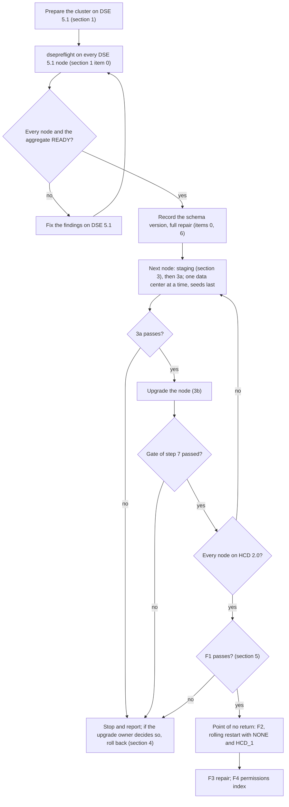

<!--
Copyright IBM Corp.

Licensed under the Apache License, Version 2.0 (the "License");
you may not use this file except in compliance with the License.
You may obtain a copy of the License at

http://www.apache.org/licenses/LICENSE-2.0

Unless required by applicable law or agreed to in writing, software
distributed under the License is distributed on an "AS IS" BASIS,
WITHOUT WARRANTIES OR CONDITIONS OF ANY KIND, either express or implied.
See the License for the specific language governing permissions and
limitations under the License.
-->

# <a id="header"></a>Runbook: in-place upgrade from DSE 5.1.51 to HCD 2.0 (version 1.0)

> **Version 1.0, not for production.** What was run is in the Validated list below; the rest is not validated. It is
> the operator's text for the upgrade from DSE 5.1.51; the upgrade from DSE 6.8 or 6.9 is [RUNBOOK.md](RUNBOOK.md),
> which this file follows in its structure and cites where a step is the same.

| | |
|---|---|
| From | DataStax Enterprise 5.1.51, DSE core only (the Cassandra workload), the same release on every node, every sstable at the newest format DSE 5.1 writes (`me`) |
| To | HCD 2.0 (the `main` code line) with the DSE 5.1 compatibility mode, `internode_compatibility_mode: DSE_5_1` with `storage_compatibility_mode: DSE_5_1` |
| Build required | The tarball of the HCD 2.0 release that contains the whole DSE compatibility work, its DSE 5.1 part included, run on JDK 17 (section 1, "Build requirement"). No validation run has used that release yet: the validated runs below used development builds of this work. |
| Scope | One or more data centers (one validated), single-node clusters and data centers of one node included. Clusters without encrypted (TDE) tables and without a KMIP key provider. |

<a id="validated"></a>**Validated** (development builds of this work):
- The whole procedure, run end to end twice, each time on a test cluster of three DSE 5.1.51 nodes in one data center,
  without internode TLS, on a small data set: the preflight `READY` on every node and in the aggregate; the first node
  upgraded, and the mixed phase checked through both products (writes and reads at `ONE`, `QUORUM` and `ALL` through
  every pair of coordinators, static columns, `GROUP BY`, paging across coordinators of the two products, LWTs, counters
  and batches; a schema change and an SAI index refused through the upgraded node and counted by `nodetool
  compatstatus`); that node rolled back to DSE 5.1 while no other node ran HCD 2.0 (section 4: the drain, the Paxos
  rollback with its serial reads, the rollback check, the restore; step 2 had no hints for HCD 2.0 nodes to wait for),
  DSE 5.1 starting on its files with no ERROR in its log and the table counts at `ALL` unchanged; then every node
  upgraded, the flag drop and its full repair. Clients writing and reading through every node during each run had no
  failed or wrong read or write, other than requests to a coordinator while it restarted, and the data was unchanged.
  Not a test of performance or of scale.
- The files and bytes that DSE 5.1.51 writes, captured on real DSE 5.1.51 nodes on Java 8 and used by the tests of
  HCD 2.0: sstables (a table with collections, a view, a SASI index, compact tables), `system.local` and `system.peers`
  as flushed and as compacted, the schema and the grants (row-level access control on a table and on a view), commit log
  segments, a hints file, transaction logs, batches and Paxos rows, gossip, the internode handshake and some messages
  (repair, reads with row-level access control), and DSE's configuration as installed and as running. The tests check
  that HCD 2.0 reads them, and that the sstables, hints files and transaction logs it writes in the mode have DSE 5.1's
  layout.
- On a three-node DSE 5.1.51 cluster, on DSE alone: the remedy of a materialized view restricted to rows (section 1
  item 1), the repair of the row that a failed `UNRESTRICT ROWS` on a view leaves, for a node still running and for a
  node already down (section 6), and how a view's `RESTRICT ROWS` spreads at a restart.
- HCD 2.0 alone, in `DSE_5_1` mode: unit tests and in-JVM tests of the mode, of its refusals at startup, of the writers
  of `me` sstables and of hints version 1, of the preflight tool's checks on DSE 5.1 files, and of the rollback checks.

<a id="not-validated"></a>**Not validated**: several data centers; more than three nodes, and data sets larger than the
test cluster's; internode TLS and internode compression between the two products; the hints HCD 2.0 writes for DSE 5.1
nodes, delivered while the cluster is mixed or after a rollback; the rollback of a node while other nodes run HCD 2.0
(with the hints of section 4 step 2 for them, and the rollback check's `HINTS_FOR_HCD`), of a single-node cluster, of a
node refused at its start, and the way back after a failed step of section 3b (the cases of section 4 are marked there);
the check of `system.batches` of section 4 step 0, and the serial reads of step 6 after DSE 5.1's start; the access
controls and DSE features refused at the start of an upgraded node; drivers other than the DSE Python driver of the test
clients, and `cqlsh`, during the mixed phase. Each step below is the procedure as the code requires it.

## <a id="brief"></a>The procedure in brief

A rolling, in-place upgrade: one node at a time stops DSE 5.1 and starts HCD 2.0 on the same data, commit log and hints
directories while the other nodes serve clients. Until the flag drop the upgraded nodes run with
`internode_compatibility_mode: DSE_5_1` and `storage_compatibility_mode: DSE_5_1`: they speak the pre-4.0 internode
dialect (messaging version 11) with the DSE 5.1 nodes, and write their sstables at the big format version `me` and
their hints files at version 1, which DSE 5.1 reads, so any upgraded node can be rolled back on its own (section 4),
a single-node cluster included. When every node runs HCD 2.0, a last rolling restart sets both settings back (`NONE` and
`HCD_1`), the *flag drop* (section 5): the point of no return.

1. **Prepare the cluster, on DSE 5.1** (section 1, "Security first", appendices B and C): DSE 5.1.51 on every node, on a
   Java 8 build that reads file times to the millisecond; `nodetool upgradesstables` so that every sstable is at `me`;
   remove what HCD 2.0 does not support (DSE features outside DSE core, row-level access control, SASI indexes, `COMPACT
   STORAGE`, `DateTieredCompactionStrategy`, compressors DSE 5.1 has and HCD 2.0 does not); Thrift off and its clients
   moved; one native port; drivers on native protocol V4; `system_auth` with replicas in every data center.
2. **Run the preflight on every DSE 5.1 node** until every node and the aggregate are `READY`; record the schema
   version; run the full repair right before the first node (section 1, items 0 and 6).
3. **Upgrade the nodes one at a time** (section 3), one data center at a time, the seeds last in each: stage JDK 17 and
   HCD 2.0, pass the checks of 3a, then upgrade the node (3b) and pass the gate of step 7. Anything unexpected: stop and
   report; a node can be rolled back (section 4).
4. **Drop the flag** (section 5): one more rolling restart with `NONE` and `HCD_1`, the full repair, the permissions
   index; then regular repairs.

From the preflight until the flag drop: no schema change, no grant, no role change, no topology change (but the removal
of a node lost for good, as [RUNBOOK.md section 6](RUNBOOK.md#s6-lost-node) says) and no repair other than the full
repair before the first node. Upgraded nodes refuse schema and topology changes and repair; DSE 5.1 nodes refuse none of
these. The mixed phase, the flag drop and its repair must finish within the smallest `gc_grace_seconds` of the tables
that take deletes, counted from the start of that repair. Every planned node stop follows "Stopping a node".



| State | Allowed | Not allowed |
|---|---|---|
| All nodes on DSE 5.1 | the changes of section 1 in its order of work; the full repair right before the first node | after item 0, any schema, access-control, role or topology change |
| Mixed, or all on HCD 2.0 in `DSE_5_1` | rolling back any upgraded node (section 4) | schema, topology, access-control and role changes, repair; DDL and repair through a DSE 5.1 node are not prevented: make sure nobody runs them |
| Flag drop started, and after it | schema changes (`DROP` only after F4), topology operations and grants once every node runs `NONE`; F3 within the deadline | going back to DSE 5.1 |

## <a id="use"></a>How to use this runbook

* Every step is done by hand on each node. Each step says what to do, how to check it and what to do otherwise. On any
  deviation that a step does not cover: stop, keep the cluster as it is and report to the upgrade owner.
* Read before planning: "The procedure in brief", "Security first", "Stopping a node", section 0, appendix B (what to
  remove on DSE 5.1) and appendix C (drivers). Appendix A lists the texts of the refusals specific to the upgrade from
  DSE 5.1 with their remedies; the texts it shares with the upgrade from DSE 6 read "DSE 5.1" where
  [RUNBOOK.md appendix A](RUNBOOK.md#a) reads "DSE 6", and take the same remedies there.
* Order: section 1 once; for each node, section 3 (staging), 3a and 3b; after the last node, section 5. Section 4 rolls
  one node back at any time before the flag drop. Section 6 is troubleshooting.
* Neither `dsepreflight` nor HCD 2.0's messages cite a section of this file: [PREFLIGHT.md](PREFLIGHT.md) section 7
  lists the checks of the tool on a DSE 5.1 node. Where a text of the tool or of HCD 2.0 names "the procedures the
  upgrade documentation gives for a node already down", they are in section 6, ["A node already down"](#s6-node-down).
* Commands are for a package install of DSE 5.1 (`/etc/dse`, `/var/lib/cassandra`, `systemctl … dse`) and an HCD 2.0
  tarball install; adapt the paths for a tarball install of DSE. HCD 2.0 logs in UTC. Keep every output a step asks to
  save.

Words used: *DSE 5.1 node* = a node running DSE 5.1.51; *upgraded node* = a node running HCD 2.0 with
`internode_compatibility_mode: DSE_5_1`; *mixed phase* = from the first node upgraded until the last node restarts with
`internode_compatibility_mode: NONE`; *the upgrade owner* = the person who decides for the upgrade and to whom
deviations are reported.

## <a id="security"></a>Security first

The rules of [SECURITY.md](SECURITY.md), section 5 for DSE 5.1. Anything that restricts access in DSE 5.1 and is ignored
here would grant access after the upgrade, so the upgrade fails fast on them:

1. **Refused (remove them on DSE 5.1 before the first node):** row-level access control, on tables and on materialized
   views (section 1 item 1). DSE 5.1 has no `RESTRICT` and no `AUTHORIZE FOR`.
2. **Dropped, removing access** (the node starts and warns, the preflight warns): proxy login and proxy execution
   (applications must log in as the role they need before the upgrade); other DSE-only permissions and resources. In
   `DSE_5_1` mode `GRANT ALL` does not write `UNMASK` and `SELECT_MASKED`, and an explicit grant of them is refused,
   until the flag drop.
3. **Authentication:** only DSE's internal scheme. LDAP, Kerberos and LDAP role management block the upgrade
   (preflight); the classes become `PasswordAuthenticator`, `CassandraRoleManager` and `CassandraAuthorizer` (the
   preflight report's settings to carry).
4. **During the upgrade, run no `GRANT`, `REVOKE`, `RESTRICT ROWS` or `UNRESTRICT ROWS` and no role change on any
   node.** Upgraded nodes do not receive DSE 5.1's schema changes; their periodic check (every 10 minutes) logs at ERROR
   what it finds. **Never run `UNRESTRICT ROWS` on a view**, before or during the upgrade: on DSE 5.1.51 it fails and
   leaves a row in `system_schema.tables` with which neither DSE 5.1.51 nor HCD 2.0 starts the node (section 6).
5. While both products run, each node enforces its own rules: a request may be allowed by one coordinator and refused
   by another.
6. Internode TLS: an upgraded node never retries in plain text a connection it encrypts to a DSE 5.1 node
   ([SECURITY.md](SECURITY.md) section 4).

## <a id="stop"></a>Stopping a node

As [RUNBOOK.md, "Stopping a node"](RUNBOOK.md#stop): `nodetool disablebinary`, wait 15 s, `nodetool drain` (exit 0 and
`DRAINED` in `system.log`), then stop the node. On DSE 5.1, `dse cassandra-stop` also drains. With Thrift off
(section 1 item 3) there is no Thrift port to close.

## <a id="s0"></a>0. Known limitations

* **Not for production; one data center validated.** For review only; never on a production cluster. What was
  validated is the header's "Validated" list (one data center of three nodes, without internode TLS); what was not, its
  "Not validated" list.
* **Only DSE 5.1.51.** Another DSE 5.1 release is upgraded to 5.1.51 with DSE's own procedure first; the preflight
  blocks on any other release, and an upgraded node logs a WARN for a DSE 5.1 peer of another release, without refusing
  it. DSE 5.0 and earlier, and clusters that hold DSE 5.1 and DSE 6 nodes at once, are out of scope.
* **Only DSE core.** No DSE Search, Graph, Analytics, DSEFS/CFS, Advanced Replication, tiered storage or in-memory
  tables (appendix B).
* **No SAI during the upgrade.** DSE 5.1 has no SAI; an upgraded node refuses to create an SAI index in `DSE_5_1` mode,
  even with `allow_ddl` (`CREATE INDEX … USING 'sai'`, and a `CREATE INDEX` without `USING` when
  `default_secondary_index` is `sai`). SAI indexes are created after the flag drop.
* **No encrypted (TDE) tables, no KMIP key provider: out of scope of this version.** The preflight blocks on
  `transparent_data_encryption_options` and on `system_info_encryption`; an upgraded node refuses to start on an
  encrypted table or sstable.
* **No incremental repair, no transient replication** while the storage mode is `DSE_5_1`, and after the flag drop until
  the `me` sstables are rewritten (section 5): use full repairs.
* **A schema change or a repair run through a DSE 5.1 node during the mixed phase is not prevented.** A DDL run on a DSE
  5.1 node reaches the other DSE 5.1 nodes only (the upgraded nodes ignore it, and count it in `nodetool compatstatus`
  as `schema push (ignored)`); a repair started on a DSE 5.1 node fails at once but leaves its session on the DSE 5.1
  replicas until the node that started it restarts. If it happens: upgrade no further node and report to the upgrade
  owner.
* **Serial reads under contention** coordinated by an upgraded node can fail with a `WriteTimeout` (write type `CAS`),
  as [RUNBOOK.md section 0](RUNBOOK.md#s0) says for DSE 6: applications handle it as a `ReadTimeout` of a serial read;
  it stays after the flag drop while `paxos_variant` is `v1`.
* **Some reads are refused** while DSE 5.1 replicas remain (the features of [RUNBOOK.md appendix A.8](RUNBOOK.md#a8),
  whose text starts `DSE 5.1 compatibility mode:` and names DSE 5.1 where A.8 names DSE 6): change the query or wait for
  the flag drop. **A read at `ONE` answered by an upgraded replica can be stale**: DSE 5.1 does not deliver hints to
  upgraded nodes during the upgrade (section 3b, "Hints during the mixed phase").
* **Not validated at scale**, nor with several data centers: clusters of tens to hundreds of nodes are out of scope of
  this version.
* **Docker images**: no upgrade test with docker images of DSE 5.1 or HCD 2.0 is part of this version.

## <a id="s1"></a>1. Before the first node

<a id="s1-release"></a>**Required DSE release.** Every node runs DSE 5.1.51 (`dse -v` prints `5.1.51`;
`nodetool version` prints `ReleaseVersion: 3.11.3.5151`). The preflight blocks on any other release, on the node and in
`system.peers` (`DSE_RELEASE`, `MIXED_RELEASES`, `PEER_RELEASE`). **Java of the DSE 5.1 nodes:** DSE 5.1 runs on Java 8
only; every DSE 5.1 node must run a Java 8 build that reads the modification times of files to the millisecond (the fix
of JDK-8177809): after a rollback, DSE 5.1 compares the times of the transaction logs HCD 2.0 wrote, in milliseconds,
with what its JVM reads from the files. No tool checks it (the preflight runs on JDK 17 and does not see DSE's Java):
check the build of each node by hand against its vendor's release notes. This version does not name the first update
of each vendor that carries the fix.

<a id="s1-build"></a>**Build requirement.** Use the HCD 2.0 release of the header. A quick check of a tarball: the
output of `tools/bin/dsepreflight --help` lists `--rollback-check` and `--jvm-options`, the options of the DSE 5.1 path
(this shows that the tarball has the DSE 5.1 checks; it does not identify the release).

<a id="s1-order"></a>**Order of work.** The items keep their numbers, which are not the order in which they are done:

**Step 0.** The required DSE release and Java, above, on every node.

**Step 1.** Item 2, first part: `nodetool upgradesstables` on every node, until every sstable is at `me`.

**Step 2.** The rest of item 2, items 1, 1b, 3 and 4 and appendix B: remove or change on DSE 5.1 what this software
does not support (schema and access-control changes, so before item 0; `DROP COMPACT STORAGE` only after step 1).

**Step 3.** Appendix C: drivers and `cqlsh`.

**Step 4.** The `dse.yaml` and `cassandra.yaml` changes of step 2 (`start_rpc: false`, one native port,
`allow_row_level_security: false`, `transparent_data_encryption_options`, `system_info_encryption` and
`hints_compression` as appendix B says) take effect at DSE's next start: restart every DSE 5.1 node, one at a time
("Stopping a node"), with every other node up, and check `nodetool status` (every node `UN`) between nodes. If none of
these changes was needed, no restart is needed: write that down.

**Step 5.** Item 7: the replication of `system_auth` (schema changes and their repair, before item 0).

**Step 6.** With several data centers: write down the order of the data centers and, in each, the nodes that are not
seeds, then the seeds, as [RUNBOOK.md section 3](RUNBOOK.md#s3-order-dc) says.

**Step 7.** Item 0: the preflight on every DSE 5.1 node, the aggregate, the schema version written down.

**Step 8.** Item 5 applies from now on until the flag drop.

**Step 9.** Item 6: the full repair, right before the first node. Then section 3 for the first node.

<a id="s1-item0"></a>**0. Run the preflight inspection on every DSE 5.1 node** (after every schema change of section 1).
Unpack the HCD 2.0 tarball anywhere on the node (for example `/tmp/hcd`) without installing it, with a JDK 17 for the
tool only, never in place of DSE's Java 8. The tool reads `system.local`, `system.peers`, `system_schema` and
`system_auth` from their sstables, so on the running node first flush them, one keyspace per command:
   ```
   nodetool flush system && nodetool flush system_schema && nodetool flush system_auth
   JAVA_HOME=<jdk17> /tmp/hcd/tools/bin/dsepreflight --nodetool <dse home>/bin/nodetool \
       --nodetool-java-home <DSE's Java 8> --json /tmp/preflight-$(hostname).json
   ```
Run it as root or as DSE's OS user. Add `--nodetool-arg=-u --nodetool-arg=<user> --nodetool-arg=-pwf
--nodetool-arg=<password file>` if JMX needs credentials (never `-pw`); pass `--conf-dir`, `--dse-yaml`, `--dse-home`,
`--jvm-options` (when `jvm.options` is not next to `cassandra.yaml`) or the directory options if the tool does not find
DSE's files. DSE 5.1's `nodetool` runs on Java 8 only: `--nodetool-java-home` names the Java 8 DSE runs with (its
installation directory, with `bin/java`). Exit 1 is a blocking finding, 0 ready (warnings included), 2 not inspected, 3
incomplete (a `nodetool` command failed, `LIVE_UNAVAILABLE`: fix it and run the tool again; it is never ready); run the
tool with JDK 17 (a JDK the launcher refuses, Java 8 included, also ends it with exit 1, before any report). The tool
reads `cassandra.yaml` and `jvm.options` only: check by hand on the command line of the running DSE process (as root,
`tr '\0' ' ' < /proc/<pid>/cmdline`, the pid listening on DSE's client port) the JVM options set elsewhere
(`cassandra-env.sh`, `JVM_OPTS`, `JVM_EXTRA_OPTS`, `/etc/default/dse`): no `-Dcassandra.start_rpc=true`, no
`-Dcassandra.force_3_0_protocol_version=true`, no `-Denable-old-dse-state=true`, and each `-Dcassandra.storage_port=` or
`-Dcassandra.ssl_storage_port=` equal to the file's value. Collect every node's report into one directory and run
`dsepreflight --aggregate <directory>` with the same release of the tool, within 24 hours of the reports: it exits 1
unless every report is ready, with one release (5.1.51), one schema version, one release of the tool, and a report for
every node of `system.peers`; it also names, per node, the views restricted to rows and the leftover view rows, which
only the reports of every node together find (a view's `RESTRICT ROWS` is in the schema of the node that ran it only,
until that node restarts). Write down that schema version. Do not start the upgrade while any node or the aggregate
reports a blocking finding: resolve each with the "What to do" line it prints. Keep each report: its settings to carry
feed section 3b step 3. [PREFLIGHT.md](PREFLIGHT.md) section 7 lists the checks.

<a id="s1-item1"></a>**1. Row-level access control, on DSE 5.1.** An upgraded node refuses to start while a table or a
materialized view is restricted to rows (`DSE_RLACA` in its `extensions`) or a `rows/…` grant exists, whether row-level
access control is enforced in `dse.yaml` or not; the preflight blocks on them (`ROW_LEVEL_ACCESS` for the tables and the
grants, `RESTRICTED_VIEW` for the views), and warns `ROW_LEVEL_ACCESS` while DSE 5.1 enforces row-level access control
on the node. First give the users who read restricted tables or views through `rows/` grants the access they need
without row-level access control (or none). Then:
   * A **table** restricted to rows: `UNRESTRICT ROWS ON <ks>.<table>`, then `REVOKE` its `rows/` grants, which
     `UNRESTRICT ROWS` leaves: `REVOKE SELECT ON '<value>' ROWS IN <ks>.<table> FROM <role>`, and the same for
     `MODIFY`, for each grant the preflight lists.
   * A **view** restricted to rows: never `UNRESTRICT ROWS` on it. `REVOKE` its `rows/` grants, then drop the view
     (`DROP MATERIALIZED VIEW`, which removes its `rows/` grants too) and create it again without the restriction; the
     view is built again from its base table under a new id: check its build in `system.built_views` and
     `system_distributed.view_build_status` before going on (the old view's directory keeps only its snapshots and
     backups). A view's `RESTRICT ROWS` is in the schema of the node that ran it until that node restarts; after it,
     every node takes it from that node: so aggregate the reports of every node (item 0) to find every restricted view.
     *(Validated on DSE 5.1.51.)* In the mixed phase no view is dropped or created, and its `rows/` grants stay (their
     roles would lose their rows on the DSE 5.1 nodes): upgrade no further node and report to the upgrade owner.
   * The row a failed `UNRESTRICT ROWS` on a view left (`VIEW_TABLE_ROW`, an upgraded node refuses to start too): repair
     it first, as section 6 says.
   * Then `authorization_options.allow_row_level_security: false` in `dse.yaml` (step 4's restart).
   * Proxy login and proxy execution: make the applications log in as the role they need ("Security first").

<a id="s1-item1b"></a>**1b. Only DSE core.** On DSE 5.1, before item 0: restart every Search, Analytics, Graph or CFS
node as a plain Cassandra node (`dse cassandra` without `-s`, `-k`, `-c` or `-g`; for a package install, every workload
of `/etc/default/dse` set to 0) while every other node is up, so that the peers' `system.peers` records the new
workloads (with `DseSimpleSnitch` a node's data center is named after its workloads: move such a node to a snitch that
keeps its data center name first, `GossipingPropertyFileSnitch` with its `dc` and `rack` in
`cassandra-rackdc.properties`, then `nodetool flush system` and the preflight again); drop the search indexes
(`DROP SEARCH INDEX ON <ks>.<table>`), delete the `solr.data` directories and drop `solr_admin` once no node runs
Search; migrate and drop the graph keyspaces, the Analytics, DSEFS and CFS keyspaces and `dse_advrep`, empty or not;
alter every table or view on tiered storage or in-memory compaction to a compaction strategy of Apache Cassandra; alter
every table or view compacted by `DateTieredCompactionStrategy` to `TimeWindowCompactionStrategy` (`ALTER TABLE … WITH
compaction = {'class': 'TimeWindowCompactionStrategy', …}`), which HCD 2.0 no longer has. An upgraded node refuses to
start while a trace remains (`internode_compatibility_mode DSE_5_1 refused: found traces of DSE features that this
software does not support…`, appendix A), also, once gossip has settled, while a DSE 5.1 peer gossips another workload.
When the check passes, `system.log` shows `DSE 5.1 compatibility mode: no trace of DSE Search, Graph, Analytics, DSEFS,
CFS, Advanced Replication, tiered storage or in-memory tables found, nor a compaction strategy this software no longer
has`.

<a id="s1-item2"></a>**2. Every sstable at `me`, and the schema HCD 2.0 needs.** On every DSE 5.1 node:
`nodetool upgradesstables` (every keyspace), until
`find <data_dir> -name '*-Data.db' -not -path '*/snapshots/*' -not -path '*/backups/*' | grep -v '/me-'` prints
nothing; the preflight blocks on any other version (`SSTABLE_FORMAT`). Then, on DSE 5.1:
   * every `COMPACT STORAGE` table: `ALTER TABLE <ks>.<table> DROP COMPACT STORAGE` (it needs every sstable at `me`, so
     after `upgradesstables`; adapt the applications to the table's new columns first) (`COMPACT_STORAGE`);
   * every SASI index: `DROP INDEX`; create an SAI index after the flag drop if needed (`SASI_INDEX`): HCD 2.0 has no
     SASI, and an index HCD 2.0 does not write would be incomplete after a rollback;
   * every table or view compressed with a compressor other than `LZ4Compressor`, `SnappyCompressor` or
     `DeflateCompressor`, encrypted, or with a `min_compress_ratio`: `ALTER TABLE … WITH compression = {'class':
     'LZ4Compressor'}` (no `min_compress_ratio`), then `nodetool upgradesstables -a <ks> <table>` on every node: an
     upgraded node refuses to start on such a table or such an sstable (appendix A). The preflight blocks on encrypted
     tables (`TDE_TABLE`) and on a compressor HCD 2.0 cannot load (`UNLOADABLE_CLASS`, `UNLOADABLE_TABLE` for a view),
     but not on a `min_compress_ratio`, nor on a compressor HCD 2.0 loads other than the three; list the compression on
     a DSE 5.1 node with `SELECT keyspace_name, table_name, compression FROM system_schema.tables;` and `SELECT
     keyspace_name, view_name, compression FROM system_schema.views;`, and check that every `class` is one of the three
     (by its short name or under `org.apache.cassandra.io.compress`), or that compression is off, and that no map has a
     `min_compress_ratio` above 0;
   * column types, keyspaces, tables, user types and functions the preflight cannot load in HCD 2.0 (`UNLOADABLE_*`,
     `JAVASCRIPT_UDF`, `UDF_LANGUAGE`): change them as the finding says;
   * every column of a type HCD 2.0 loads but does not write for DSE 5.1, a type outside those of Cassandra 3.11 and
     DSE's geometric and date range types, such as a custom type (`COLUMN_TYPE`): drop it as the finding says (its
     secondary indexes and the views that select it first), or its table for a column of the primary key; an upgraded
     node refuses to start on it (appendix A.3).

<a id="s1-item3"></a>**3. Thrift off.** HCD 2.0 has no Thrift. DSE 5.1.51's installed `cassandra.yaml` has
`start_rpc: true`, so nearly every node needs `start_rpc: false` (and no `-Dcassandra.start_rpc=true` among its JVM
options), with step 4's restart (or `nodetool disablethrift` at once, the setting for the next start); move every
Thrift client to CQL before it. The preflight blocks while Thrift is on at
start (`THRIFT`); it names, but does not read, the JMX gauge `connectedThriftClients`, which counts the Thrift clients
still connected: check it is 0 on every node before the restart.

<a id="s1-item4"></a>**4. One native port.** DSE 5.1.51 announces no native port per node, so drivers use one port
for every node, and every upgraded node must keep the `native_transport_port` of the DSE 5.1 nodes until the flag drop.
A cluster with a second port (`native_transport_port_ssl`) moves to a single port on DSE 5.1 before the first node (with
`optional` client encryption during the move); the preflight blocks while two ports are set (`NATIVE_PORTS`). Change
the port only after the flag drop.

<a id="s1-item5"></a>**5. No topology or schema changes** for the whole mixed phase: no node added, replaced,
decommissioned, removed or moved (a node lost for good: [RUNBOOK.md section 6](RUNBOOK.md#s6-lost-node)), no data
center added, no repair, no `import` or `refresh`, no DDL, no grant. Upgraded nodes refuse these (and `nodetool
upgradesstables` and `recompress_sstables` are allowed in `DSE_5_1` mode, for the remedy of appendix A); DDL and repair
run on a DSE 5.1 node are not prevented (section 0). Before every node's upgrade, `nodetool describecluster` on every
DSE 5.1 node shows one schema version among the DSE 5.1 nodes, the one written down at item 0 (3a).

<a id="s1-item6"></a>**6. A full repair first, and a time limit.** Read the deadline: on a DSE 5.1 node,
`SELECT keyspace_name, table_name, gc_grace_seconds FROM system_schema.tables;` and the same for
`system_schema.views`. Tables with `gc_grace_seconds` 0 or very short take no deletes, or the value is raised on DSE
5.1 before item 0. Right before the first node, on every node in turn (with several data centers, one data center
after the other): `nodetool repair -full -pr`, saving each output; DSE 5.1.51's default is a full repair, `-full`
makes it explicit. From the start of that repair, the whole mixed phase, the flag drop and F3 must finish within the
smallest `gc_grace_seconds` of the tables that take deletes. Every command must exit 0; a failed one is run again,
whole, on its node.

<a id="s1-item7"></a>**7. The replication of `system_auth`** (and, with several data centers, of the other replicated
system keyspaces). An upgraded node reads `system_auth.role_permissions` when it starts, to check the access controls
of item 1. DSE 5.1's default for `system_auth` and the other replicated system keyspaces is `SimpleStrategy` with one
replica: with it, the logins of the roles a down node holds fail during the mixed phase, and an upgraded node waits at
every start while another node is down (section 3b, "Starting an upgraded node while other replicas are down"). The
preflight warns (`SYSTEM_AUTH_REPLICATION`, `KEYSPACE_REPLICATION`). The rule and the steps are those of
[RUNBOOK.md section 1 item 7](RUNBOOK.md#s1-item7): on DSE 5.1, before item 0, `ALTER KEYSPACE` to
`NetworkTopologyStrategy` with replicas in every data center (three, or as many as its nodes if fewer, recommended),
then `nodetool repair -full <keyspace>` on every node, one at a time. Single-node and small clusters can be upgraded as
they are.

## <a id="s2"></a>2. No SAI pin

The upgrade from DSE 6 pins the SAI on-disk version ([RUNBOOK.md section 2](RUNBOOK.md#s2)). DSE 5.1 has no SAI, so
there is nothing to pin: do not add `-Dcassandra.sai.latest.version`, and create no SAI index until the flag drop (an
upgraded node refuses it in `DSE_5_1` mode). `nodetool compatstatus` shows
`SAI version pinned           : not checked (internode_compatibility_mode DSE_5_1)`.

## <a id="s3"></a>3. Per node

<a id="s3-order-dc"></a>**Order across data centers.** As [RUNBOOK.md section 3](RUNBOOK.md#s3-order-dc): one data
center at a time, one node at a time, the seeds of each data center last; a data center with a rolled-back node finished
before any other node is upgraded; no step while a data center is down.

<a id="s3-staging"></a>**Staging, before 3a.** As [RUNBOOK.md, "Staging, before 3a"](RUNBOOK.md#s3-staging): JDK 17 as
an unpacked tarball (for example `/opt/jdk17`) or as a package, as long as DSE 5.1, its tools and its `nodetool` keep
running on DSE's Java 8 (DSE 5.1 starts on Java 8 only, and its `nodetool` refuses JDK 17): a package must not take over
the `java` DSE 5.1 runs with, or, if it does, the default `java` is set back to Java 8 and HCD 2.0 gets JDK 17 through
its `JAVA_HOME`; write down the Java DSE runs with and check it again after the staging. Unpack HCD 2.0 (for example
into `/opt/hcd`), owned by the OS user DSE runs as (`cassandra` for a package install). Keep the tarball file on the
node until the node is upgraded.

### <a id="s3a"></a>3a. Checks before every node (stop on any deviation)

- <a id="s3a-p0"></a>P0. Run `dsepreflight` on the next node, as in section 1 item 0 (the three flushes first, and
  `--nodetool-java-home <DSE's Java 8>`: without it the report is `INCOMPLETE`, exit 3, unless a finding blocks).
  `READY` (exit 0) only: a blocking finding stops, and an `INCOMPLETE` report (exit 3) is fixed and the tool run again,
  never accepted. In the mixed phase the `UPGRADED_PEERS` note and a `PENDING_HINTS` warning for the hints the DSE 5.1
  nodes keep for upgraded nodes (3b step 0) are expected.
- <a id="s3a-p1"></a>P1. `nodetool status` on every node: every node `UN` in every node's view.
- <a id="s3a-p2"></a>P2. `nodetool describecluster` on every node: one schema version before the first upgrade; in the
  mixed phase exactly two, one listing only DSE 5.1 nodes, the one written down at section 1 item 0, and one listing
  only upgraded nodes.
- <a id="s3a-p3"></a>P3. `dse -v` gives 5.1.51 on every DSE 5.1 node.
- <a id="s3a-p4"></a>P4. On the next node,
  `find <data_dir> -name '*-Data.db' -not -path '*/snapshots/*' -not -path '*/backups/*' | grep -v '/me-'` prints
  nothing.
- <a id="s3a-p5"></a>P5. `nodetool compactionstats` shows no Validation or Anticompaction, and `nodetool netstats` says
  `Not sending any streams`.
- <a id="s3a-p6"></a>P6. `nodetool compatstatus` on every upgraded node: `Internode compatibility mode : DSE_5_1`,
  `Storage compatibility mode   : DSE_5_1`, `SSTable format written       : big-me`, and under
  `Peers with a known version` one line per DSE 5.1 node with the version 11 and `(pre-4.0 dialect)`; no
  `schema push (ignored)` line under `Requests refused (upgrade)`.
- <a id="s3a-p7"></a>P7. Every driver pins native protocol V4, and `cqlsh` too (appendix C).
- <a id="s3a-p8"></a>P8. Monitoring green (no failed request, no wrong read).

### <a id="s3b"></a>3b. The node itself

<a id="s3b-batches"></a>**Batches, before step 0.** With cqlsh connected to this node:
`SELECT id, toTimestamp(id), version FROM system.batches;` shows no row older than about two minutes (if older ones
stay, wait and check again).

<a id="s3b-step0"></a>**0.** `nodetool disablebinary`, then wait 15 s. List the hints files (`ls <hints_dir>`) and map
the host id at the start of each name with `nodetool status`: files for DSE 5.1 nodes, wait until they disappear; files
for a host id not in the ring, stop; files for upgraded nodes, leave them: DSE 5.1 does not deliver hints to an upgraded
node (it sends hints only to a node that gossips its own schema version), and HCD 2.0 delivers them after this node's
start. If you stop here, run `nodetool enablebinary`.

<a id="s3b-step1"></a>**1.** `nodetool flush`, then `nodetool snapshot -t pre-hcd-<UTC timestamp>` (the rollback
restores `system` and `system_schema` from it, and its check looks for it by that prefix); copy `cassandra.yaml`,
`dse.yaml`, `jvm.options` and `cassandra-rackdc.properties` aside. DSE 5.1 has no node metadata directory: nothing else
to copy.

<a id="s3b-step2"></a>**2.** DSE 5.1's hints for other DSE 5.1 nodes delivered (step 0), then `nodetool drain`; check
that it succeeded (exit 0 and `DRAINED`); write down its UTC time; stop DSE.

<a id="s3b-step3"></a>**3.** Make sure DSE cannot start on this node again, and create HCD 2.0's service unit, as
[RUNBOOK.md section 3b step 3](RUNBOOK.md#s3b-step3) says (`systemctl disable dse`, the drop-in `hcd-upgraded.conf`
with `RefuseManualStart=yes`, `/etc/systemd/system/hcd.service` with `JAVA_HOME=<jdk17>`). In HCD 2.0's
`conf/cassandra.yaml` carry the preflight report's settings to carry (`cluster_name`, `num_tokens` and the tokens, the
partitioner, the addresses and ports, with `storage_port`, `ssl_storage_port` and `native_transport_port` as DSE's, the
seeds, the snitch mapped as the report says and `cassandra-rackdc.properties` with the data center and rack of the
node's `system.local`, the authentication classes mapped, `internode_compression`, `client_encryption_options`,
`saved_caches_directory`, `cdc_raw_directory`; with internode TLS, `server_encryption_options` with the keys HCD 2.0
accepts) and set these keys where the shipped file has them (do not add a second copy; uncomment those it has commented
out):
   ```
   internode_compatibility_mode: DSE_5_1
   storage_compatibility_mode: DSE_5_1
   sstable:
     selected_format: big
   uuid_sstable_identifiers_enabled: false
   paxos_variant: v1
   data_file_directories: [<DSE's data directories>]
   commitlog_directory: <DSE's commit log directory>
   hints_directory: <DSE's hints directory>
   saved_caches_directory: <DSE's saved caches directory>
   metadata_directory: /var/lib/cassandra/metadata
   ```
`metadata_directory` is HCD 2.0's own (DSE 5.1 has none): it holds the files of the upgrade (the marker
`dse51-upgrade-in-progress`, the record `dse51-peers-seen` and the record `dse51-system-columns`). Take
`/var/lib/cassandra/metadata`, where the preflight tool and the rollback check look for it whatever DSE's directories
are; another directory works if every later run of the tool names it with `--metadata-dir`. Keep it the same at every
start until the flag drop. Leave `flush_compression` unset, or `fast` or `table`; leave `hints_compression` unset, or
set one DSE 5.1 can build (`LZ4Compressor`, `SnappyCompressor` or `DeflateCompressor`; appendix A); leave
`transient_replication_enabled` false, and `-Dcassandra.sstable.checksums.type` and
`-Dcassandra.sstable.compression.selector.class` unset; the shipped file names `paxos_variant` only in a comment: add
`paxos_variant: v1`, or leave it out, v1 being the default. With internode TLS, keep
`legacy_ssl_storage_port_enabled: false` (the node listens on `ssl_storage_port` for the DSE 5.1 nodes without it). Add
no SAI pin (section 2). Do not change the seed list.

<a id="s3b-step3b"></a>**3b.** Do not delete DSE 5.1's commit log or hints files: HCD 2.0 replays the commit log at
its first start and delivers the hints.

<a id="s3b-step4"></a>**4.** Start it and enable it at boot (`systemctl enable --now hcd`). Expected at this first start
(from the code; on the test cluster every node started in the mode and joined, its lines not checked one by one): the
WARN `Running in internode_compatibility_mode DSE_5_1: the node writes big me sstables, which DSE 5.1 reads, …`; the
INFO `Wrote the DSE 5.1 upgrade marker <metadata_directory>/dse51-upgrade-in-progress`; per DSE 5.1 commit log segment,
the WARN `Commit log segment <file> was written by DataStax Enterprise 5.1 and read at the start …`, the segment renamed
with the suffix `.replayed`; the INFO line of the values of DSE 5.1's columns of `system.local` and `system.peers` it
recorded (`DSE 5.1 compatibility mode: recorded the values of DSE 5.1's columns …`); `DSE 5.1 compatibility mode:
<peers> stored with a DSE 5.1 release (3.11.3.<build>) or dse_version (5.1.<patch>); connecting to them with the pre-4.0
handshake at version 11` and `Identified /<ip>:<port> as a DSE 5.1 node (…)` per DSE 5.1 peer; the INFO of the non-core
check of section 1 item 1b; `nodetool status` all `UN` here and on a DSE 5.1 node, `nodetool compatstatus` as P6. A
hints file DSE 5.1 left open when it was killed has no `-Statistics.hints` companion: HCD 2.0 logs a WARN at each load
of it, harmless. If the node refuses to start, look its text up in appendix A.

<a id="s3b-step5"></a>**5.** On a DSE 5.1 node: `nodetool gossipinfo` shows the upgraded node with a DSE state
(`X_11_PADDING`, the name DSE 5.1's nodetool gives it) holding `"dse_version":"5.1.51"`, and
`SELECT peer, dse_version FROM system.peers` shows `5.1.51` for it: expected. The upgraded node gossips the release
DSE 5.1 nodes run, so that their version gates stay as in a cluster of DSE 5.1 nodes; the system property
`cassandra.internode_compatibility_mode.dse_version` takes no other value in this mode.

<a id="s3b-step6"></a>**6.** After a DSE 5.1 node restarts, wait until every upgraded node shows it `UN` before the next
step.

<a id="s3b-step7"></a>**7.** Gate before the next node: P1, P2 and P6 on every node; table counts at `ALL` (and, with
several data centers, at `LOCAL_QUORUM` through a node of each data center), all equal; monitoring green, with only this
node briefly unavailable. Wait at least one minute before the next node.

<a id="s3b-auth-start"></a>**Starting an upgraded node while other replicas are down.** It reads DSE 5.1's access
controls from `system_auth` at `auth_read_consistency_level` (`LOCAL_QUORUM` by default) and waits up to
`dse_restrictions_check_wait_seconds` (120 s). When the read still fails on the request (replicas unavailable, a
timeout, a read failure), a node in `DSE_5_1` mode starts on the check of its own replica, with the WARN
`The startup check of the DSE access controls could not read system_auth.role_permissions at <level> (…); with
internode_compatibility_mode DSE_5_1 only this node's replica was checked, …`, when that replica holds DSE 5.1's table
and nothing it finds is refused; the periodic check reads the whole table again every 10 minutes. With DSE 5.1's
default of one replica of `system_auth`, that wait comes at every start while any other node is down. A read aborted
otherwise still refuses the start; `-Dcassandra.internode_compatibility_mode.dse_restrictions_local_check_only=true`,
for one start only, relies on this node's replica alone, as for DSE 6.

<a id="s3b-hints"></a>**Hints during the mixed phase.** A DSE 5.1 node keeps the hints it stores for an upgraded node
until its own upgrade, when HCD 2.0 delivers them (DSE 5.1 offers hints only to a node that gossips its own schema
version, which an upgraded node does not). So an upgraded node that missed writes while it was down (its upgrade, a
restart) can miss them for the rest of the upgrade, which a read at `ONE` shows: where stale reads matter, read at
`LOCAL_QUORUM` or above during the upgrade. A hint older than the smallest `gc_grace_seconds` of
its tables is dropped at its delivery: the deadline of section 1 item 6 keeps the hints of the tables that take deletes
live (if it is missed, stop and report to the upgrade owner); the hints of tables with a shorter `gc_grace_seconds`
expire earlier, and the upgraded replicas get those writes only from F3. The hints an upgraded
node writes are files of version 1, which DSE 5.1 reads; a hint they cannot hold (a deletion or expiration time after
2038, or a hint larger than the hints buffer takes) is not stored, counted in `nodetool compatstatus` and logged, at
most once a minute for each reason: `DSE 5.1 compatibility mode: a hint for <nodes> of <table> was not stored: <reason>;
the write reaches those nodes only by a repair: repair <table> once the cluster runs one release`: F3 covers it.

<a id="s3b-tools"></a>**Offline sstable tools** on an upgraded node (`sstableupgrade`, `sstabledump`, `sstablemetadata`,
…): run them with HCD 2.0's `conf/cassandra.yaml` of the `DSE_5_1` mode, so that what they write is `me` with DSE 5.1's
transaction logs. Do not run `sstablescrub`, `sstablesplit` or `sstableloader` on `oa` data (big sstables of a node run
outside the mode) in the mode: they would write a deletion or expiration time after 2038 wrong, without a failure. A
node in the mode refuses an entire-sstable stream of a version DSE 5.1 does not read (appendix A.5). Nodes in the mode
and nodes without it run together only during the flag drop, which streams nothing between them (no repair and no
topology change until every node runs `NONE`, F3), so the procedure needs no setting for it. Should data be streamed
into a node still in the mode by a sender not in it (`sstableloader` included), set `stream_entire_sstables: false` in
the `cassandra.yaml` that sender runs with (for `sstableloader`, the one it is given).

## <a id="s4"></a>4. Rolling a node back to DSE 5.1

<a id="s4-time"></a>**Time limit.** The node is down from its drain (step 3) until DSE 5.1 starts: keep that under the
hint window of the other nodes (3 hours by default). A single-node cluster rolls back the same way, keeping its data
*(single-node cluster: not validated)* (its open Paxos rounds cannot be protected: step 4). Prepare the steps (the tool,
the files, another node for the Paxos reads) before step 1. A node refused at its start (appendix A) does not run: see
"A node refused at its start" below.

<a id="s4-step0"></a>**0.** Before closing the client port, with cqlsh on this node:
`SELECT id, toTimestamp(id), version FROM system.batches;` shows no row older than about two minutes (else
`nodetool replaybatchlog`, and check again): the restore replaces `system.batches`.

<a id="s4-step1"></a>**1.** `nodetool disablebinary`, then wait 15 s.

<a id="s4-step2"></a>**2.** The hints for upgraded nodes: DSE 5.1 does not deliver them after the rollback. Repeat
every 10 s, for up to 10 minutes, until `nodetool listpendinghints` lists no upgraded node. With such a target down, go
on: the rollback check warns `HINTS_FOR_HCD`, and those hints wait for that node's own rollback or this node's next
upgrade, or are removed and their tables repaired; a hint that waits past the smallest `gc_grace_seconds` of its tables
is dropped at its delivery, so repair those tables then. The hints for DSE 5.1 nodes stay: DSE 5.1 delivers them.

<a id="s4-step3"></a>**3.** `nodetool drain`, check that it succeeded (exit 0 and `DRAINED`), then
`systemctl stop hcd && systemctl disable hcd`. The time limit runs from the stop. The drop-in that keeps HCD 2.0 from
starting comes at step 6, once the checks of step 4 pass: they may need HCD 2.0 started again.

<a id="s4-step4"></a>**4.** With HCD 2.0 stopped after a successful drain, `system` and `system_schema` not restored yet
and DSE 5.1 not started, run the two rollback modes of the tool, from `<hcd>`, as root or as DSE's OS user:
   ```
   JAVA_HOME=<jdk17> <hcd>/tools/bin/dsepreflight --paxos-rollback --cql /tmp/paxos-reads.cql --json /tmp/paxos-$(hostname).json
   JAVA_HOME=<jdk17> <hcd>/tools/bin/dsepreflight --rollback-check --json /tmp/rollback-check-$(hostname).json
   ```
   * `--paxos-rollback` lists the node's open Paxos rounds and writes the serial reads that complete them, as
     [RUNBOOK.md section 4 steps 5 and 6](RUNBOOK.md#s4-step5) say, its options and its exits the same; on this node it
     reads the data centers from `system.local` and `system.peers` of the `pre-hcd-<timestamp>` snapshot. On a node
     where HCD 2.0 wrote no `system.paxos` sstable (no lightweight transaction touched its replicas and no compaction of
     `system.paxos` ran), the first run is expected to exit 1 with `system looks already restored`: run it again with
     `--not-restored`. Run the reads it writes through another node (step 5). On a single-node cluster, or for a
     keyspace with one replica, the rounds cannot be protected (the report says so, and keeps exit 1): the Paxos state
     of the upgrade of those partitions is lost at the rollback, and an open proposal of the snapshot can replay over
     newer data; accept that, or do not roll back.
   * `--rollback-check` exits 0 when DSE 5.1.51 can start on the files left without losing what they hold (warnings
     allowed), 1 on a blocking finding, 2 on a usage or inspection error. It reads DSE's `cassandra.yaml`; pass
     `--commitlog-dir`, `--hints-dir`, `--metadata-dir` or `--saved-caches-dir` when HCD 2.0's `cassandra.yaml` sets
     other directories than DSE's, and `--snapshot <tag>` when the node has several complete `pre-hcd-*` snapshots or
     the snapshot of section 3b step 1 has another tag. Its report lists what the rollback removes and what it keeps.
     Resolve every blocking finding with its "What to do" line ([PREFLIGHT.md](PREFLIGHT.md) section 7); never start DSE
     5.1 while one remains (the one exception: `MARKER_NOT_FOUND`, below). The findings to expect: `TRANSACTION_LOG` or
     `COMMITLOG_UNFLUSHED` (the node was not drained cleanly: `systemctl start hcd`, then repeat from step 1);
     `HINTS_VERSION`, `HINTS_DAMAGED` and `HINTS_UNVERIFIED` block, `HINTS_TRUNCATED`, `HINTS_FOR_HCD` and
     `HINTS_FOR_UNKNOWN_TARGET` warn; `SNAPSHOT_MISSING` or `SNAPSHOT_AMBIGUOUS` (`--snapshot`); `SAI_FILES` warns;
     `MARKER_NOT_FOUND`: pass `--metadata-dir` with the `metadata_directory` of HCD 2.0's `cassandra.yaml` (the
     directory of the path a line `Wrote the DSE 5.1 upgrade marker <path>` of HCD 2.0's logs since the drain of section
     3b step 2 names). As its "What to do" line says, it may remain, alone among the blocking findings, only when the
     report's metadata directory is that one, its message does not say that HCD 2.0 went past its startup checks (a
     segment of DSE 5.1's commit log it replayed, the record `dse51-system-columns`), and those logs show the start of
     HCD 2.0 refused (the ERROR that ended it, a node refused at its start, below) with no line
     `Wrote the DSE 5.1 upgrade marker`, `Unable to write the DSE 5.1 upgrade marker` or
     `Failed to run startup check post-action on` before it. After the second or third line, or when the message says
     HCD 2.0 went past its startup checks, create the marker by hand (an empty file, owned by HCD 2.0's user) and check
     again; when it says that the directory read is not HCD 2.0's (HCD 2.0 started on the node), find the right one;
     otherwise stop and report.

<a id="s4-step5"></a>**5.** Run the reads of step 4 through another node, as [RUNBOOK.md section 4 step
6](RUNBOOK.md#s4-step6) says, until every read has succeeded; do not start DSE 5.1 before.

<a id="s4-restore"></a>**6. Restore and start DSE 5.1.** Restore the `system` and `system_schema` tables of each data
directory from the newest `pre-hcd-<timestamp>` snapshot, table by table, with the block of
[RUNBOOK.md, "Then restore and start DSE"](RUNBOOK.md#s4-restore) and its checks, as written there (`<DSE's OS user>`
`cassandra` for a package install). Then, as the rollback check's report lists them:
   * remove the commit log segments HCD 2.0 left (`CommitLog-7-*.log`) and the replayed DSE 5.1 segments
     (`*.log.replayed`): the `me` sstables carry the node's commit log intervals, and DSE 5.1 does not read version 7;
   * remove HCD 2.0's saved caches (`saved_caches/*`);
   * delete `<metadata_directory>/dse51-system-columns` and its `.tmp` file, if there;
   * keep `<metadata_directory>/dse51-upgrade-in-progress` and `dse51-peers-seen` (while the marker exists HCD 2.0
     refuses to start on the node with `NONE` or `DSE_6`); keep the `.unreadable-*` copies of the record, if any;
   * keep the hints files of version 1 with their `.crc32` and `-Statistics.hints` companions: DSE 5.1 delivers those
     for DSE 5.1 nodes;
   * the `SAI+` component files the check lists (none is expected: no SAI index can be created in the mode): remove them
     or leave them for DSE 5.1 to ignore;
   * keep the `me` sstables.

Create the drop-in `rolled-back.conf` of [RUNBOOK.md section 4 step 4](RUNBOOK.md#s4-step4) (HCD 2.0 must not start
again on this node), `systemctl daemon-reload`; `systemctl show -p RefuseManualStart hcd` must print
`RefuseManualStart=yes` (never check by starting it). Restore DSE's configuration, remove
`/etc/systemd/system/dse.service.d/hcd-upgraded.conf`, `systemctl daemon-reload && systemctl enable dse`, check that DSE
runs with its Java 8, and start DSE 5.1. With several data centers, finish this node's data center before any other
(section 3). Then check P1 and P2, table counts at `ALL`, serial reads of a few LWT partitions through every node, and
no ERROR in its `system.log` (a DSE 6 node rolled back logs at most one handshake ERROR per upgraded node, [RUNBOOK.md
section 4](RUNBOOK.md#s4-logs); on the test cluster, where no other node ran HCD 2.0, DSE 5.1 logged no ERROR after
its start: report every ERROR). The node can be upgraded again later with section 3 (a new snapshot). *(Validated on
the test cluster of the header for the first node upgraded, while no other node ran HCD 2.0, but for the drop-in
`rolled-back.conf` and the serial reads after DSE 5.1's start; with several data centers, or with other nodes on HCD
2.0: not validated.)*

<a id="s4-refused"></a>**A node refused at its start.** HCD 2.0 exits at a refusal of appendix A, so steps 0 to 3 do
not apply: the last drain is DSE 5.1's of section 3b step 2. Fix the cause where appendix A says it can be fixed with
the node upgraded, and start it again. To roll it back instead: `systemctl disable hcd`, then step 4 (if the refusal
came before HCD 2.0 wrote its upgrade marker, the rollback check reports `MARKER_NOT_FOUND`, which may remain only as
step 4 says), steps 5 and 6. When the rollback check reports `COMMITLOG_UNFLUSHED` or `TRANSACTION_LOG` for such a node
(a refusal after its commit log replay, such as that of the workloads a DSE 5.1 peer gossips), it needs a start that
succeeds and a drain: remove the cause first (for the gossiped workloads, restart that DSE 5.1 peer as a plain Cassandra
node), then start it and go on from step 0. If no start can succeed (a refusal appendix A gives no remedy for in the
mode), stop and report: the way back is the upgrade owner's decision. *(Not validated.)*

<a id="s4-wayback"></a>**A failure after the drain, before HCD 2.0's first start.** If a step of section 3b fails after
the drain and HCD 2.0 has not started on the node since it, DSE 5.1 can start again on its own files. First, if DSE 5.1
still runs, `systemctl stop dse`, and write nothing onto the node yet. HCD 2.0 has not started when all of these hold,
as [RUNBOOK.md section 3b, way back 2](RUNBOOK.md#s3b-wayback) says: as root,
`TZ=UTC journalctl -u hcd --since "<drain time>"` shows no `Started` line for the unit; no `system.log` of HCD 2.0
(`CASSANDRA_LOG_DIR`, `<hcd>/logs`) has a line dated after the drain; `<metadata_directory>/dse51-upgrade-in-progress`
is absent, empty, or says `since <timestamp>` earlier than the drain (a node rolled back before keeps its marker).
Otherwise this is a rollback (above). Then: if `/etc/systemd/system/hcd.service` exists, put the drop-in
`rolled-back.conf` of [RUNBOOK.md section 4 step 4](RUNBOOK.md#s4-step4) in place and run `systemctl disable hcd`;
remove `/etc/systemd/system/dse.service.d/hcd-upgraded.conf`; `systemctl daemon-reload`;
`systemctl show -p RefuseManualStart dse` must print `RefuseManualStart=no` and, if HCD 2.0's unit exists,
`systemctl is-enabled hcd` must answer `disabled` and `systemctl show -p RefuseManualStart hcd` `RefuseManualStart=yes`
(never check by starting it); check DSE's Java 8; `systemctl enable dse` and `systemctl start dse`; wait until every
node shows this node `UN` and its client port is open (`nodetool statusbinary`; `nodetool enablebinary` if it is not
running); remove the snapshot of section 3b step 1 (`nodetool clearsnapshot -t pre-hcd-<UTC timestamp>`); report to the
upgrade owner, saying if the node was down longer than the time limit of this section. *(Not validated.)*

## <a id="s5"></a>5. After the last node: the flag drop

The two modes are read only when a node starts: neither can be changed on a running node, so the flag drop is a rolling
restart that sets `internode_compatibility_mode: NONE` and `storage_compatibility_mode: HCD_1` together. The files of
the upgrade (the marker, which keeps a node from starting with `NONE`, and the records) are deleted by hand while the
node is stopped (F2).

- <a id="s5-f1"></a>F1. Refuse unless all of these hold: `systemctl is-active dse` is inactive on every node; P1 on
  every node and one schema version; on every node `nodetool compatstatus` shows no `(pre-4.0 dialect)` line and
  `DSE 5.1 peers on record      : 0`; `grep -v '^#' <metadata_directory>/dse51-peers-seen` prints nothing (or the file
  is absent); `find <data_dir> -name '*_txn_*.log'` prints nothing on every node; monitoring green. An upgraded node
  with no DSE 5.1 node left logs the WARN `No DSE peers found, the mode can be dropped (internode_compatibility_mode
  DSE_5_1: …)`, the cue for this section (it names both settings of F2), as is the form of the 10-minute status WARN of
  appendix A.5 that says `… no peer speaks the pre-4.0 dialect any more and none is on record …`.
- <a id="s5-f2"></a>F2. One node at a time (with several data centers, one data center after the other): in
  `conf/cassandra.yaml` set `internode_compatibility_mode: NONE` and `storage_compatibility_mode: HCD_1` (both in this
  one restart: neither `DSE_5_1` value is accepted without the other); `nodetool disablebinary`, wait 15 s;
  `nodetool drain`, check it (exit 0 and `DRAINED`); `systemctl stop hcd`; delete in `<metadata_directory>`
  `dse51-upgrade-in-progress`, `dse51-peers-seen`, `dse51-peers-seen.tmp`, `dse51-system-columns`, its `.tmp` file and
  its `.unreadable-*` copies, and `<commitlog_directory>/*.log.replayed`; `systemctl start hcd`. Never start the node in
  `DSE_5_1` again after these deletions: it would write the marker again and record values from sstables HCD 2.0 has
  compacted. `nodetool compatstatus` must say `NONE` and `HCD_1`, every node `UN`, counts right at `ALL`, monitoring
  green. From now on the node writes big `nb` sstables and no rollback is possible. If the start fails: leave the node
  stopped with `NONE` and `HCD_1`, do not set the `DSE_5_1` values back (the deletions above are done), and report
  (appendix A).
- <a id="s5-f3"></a>F3. Every node on `NONE`: `nodetool repair -full -pr`, on each node in turn (with several data
  centers, one data center after the other). Mandatory, within the deadline of section 1 item 6. Until the `me`
  sstables of a node are rewritten (`nodetool upgradesstables`), they cannot be marked pending repair: run full repairs
  only, never an incremental one.
- <a id="s5-f4"></a>F4. Right after the last node restarted in `NONE` and before any `DROP` of a table, keyspace,
  function or role, rebuild the reverse index of the permissions, as [RUNBOOK.md F4](RUNBOOK.md#s5-f4) says: the first
  start in `NONE` adds the table `system_auth.resource_role_permissons_index` that DSE 5.1 lacks, empty.
- The hints files of version 1 left are delivered after the flag drop.
- Settings that stay (to change later, one rolling restart each, outside this procedure): `storage_compatibility_mode:
  HCD_1`, `paxos_variant: v1` (at least as long as [RUNBOOK.md section 5](RUNBOOK.md#s5) says),
  `uuid_sstable_identifiers_enabled: false`, `sstable: selected_format: big`.
- `GRANT UNMASK` and `GRANT SELECT_MASKED` are allowed again, and so are schema changes (`DROP` only after F4), SAI
  indexes and topology operations.

## <a id="s6"></a>6. Troubleshooting

| Symptom | Where |
|---|---|
| A node refuses to start, or an operation or query is refused | appendix A; the texts shared with the upgrade from DSE 6: [RUNBOOK.md appendix A](RUNBOOK.md#a) |
| `Unexpected files detected for sstable …` at DSE 5.1's start after a rollback | [RUNBOOK.md section 6](RUNBOOK.md#s6-txn); the rollback check refuses while a transaction log is left |
| `schema push (ignored)` in `compatstatus`, a DSE 5.1 schema version changed | section 0: upgrade no further node and report |
| `<release> is a DSE 5.1 node of release …, not of DSE 5.1.51` on an upgraded node | upgrade that node to DSE 5.1.51 before it is upgraded to HCD 2.0 |
| `VIEW_TABLE_ROW` in a report, or a DSE 5.1 node that does not start with `Attempting to load already loaded view`, `MissingColumns` or `No partition columns found` | below |
| A node, DSE 5.1 or HCD 2.0, gone for good during the upgrade | [RUNBOOK.md section 6](RUNBOOK.md#s6-lost-node), "DSE 5.1" for "DSE 6" in its texts |

### <a id="s6-view-row"></a>The row a failed `UNRESTRICT ROWS` on a view leaves

On DSE 5.1.51, `UNRESTRICT ROWS` on a view fails and leaves, on the node that ran it, a row of `system_schema.tables`
named after the view; neither DSE 5.1.51 nor HCD 2.0 starts that node again with it. The preflight reports it
(`VIEW_TABLE_ROW`, the aggregate naming the node), and an upgraded node refuses to start
(`internode_compatibility_mode DSE_5_1 refused: system_schema.tables holds rows of materialized views of
system_schema.views: …`). *(Validated on DSE 5.1.51, on DSE alone: the repairs of the row below, for a node still
running and for a node already down; not validated: the view created again where a `DROP MATERIALIZED VIEW` had already
run, the preflight run again after the repair of a node already down, and the path of an upgraded node.)*

**On a node still running DSE 5.1**, before the first node is upgraded: as a superuser connected to that node,
`DELETE FROM system_schema.tables WHERE keyspace_name = '<keyspace>' AND table_name = '<view>'` (not the view's rows of
`system_schema.columns`, which the view uses, unless a `DROP MATERIALIZED VIEW` already ran on that node: then delete
them too), drain and restart the node, check one schema version with `nodetool describecluster`, then remove the view's
restriction (section 1 item 1), which that restart spreads to every node; where a `DROP MATERIALIZED VIEW` already ran,
the view is gone: create it again without the restriction and revoke its `rows/` grants if any is left. Never
`nodetool resetlocalschema`, and no `DROP MATERIALIZED VIEW` of the view while the row is there (it fails on that node
and leaves the row without columns). In the mixed phase, no schema change is made: upgrade no further node and report to
the upgrade owner.

<a id="s6-node-down"></a>**A node already down** (the procedures the texts of the tool and of HCD 2.0 name "for a node
already down"):
   * refused at start with `MissingColumns` or `No partition columns found` (a `DROP MATERIALIZED VIEW` ran while the
     row was there): start DSE 5.1 once with `-Dcassandra.ignore_corrupted_schema_tables=true`, run both `DELETE`s above
     (the row of `system_schema.tables` and the view's rows of `system_schema.columns`), restart without the property,
     check `nodetool describecluster`, then create the view again without the restriction and revoke its `rows/` grants
     if any is left;
   * refused with `Attempting to load already loaded view`, where the property does not help: with the node stopped,
     move its `system_schema` sstables aside and keep them, start it so that it pulls the schema from its peers,
     `REVOKE` the view's `rows/` grants, which the pulled schema leaves, and, if the node was not drained, repair it,
     since its unflushed writes are skipped at the commit log replay; then the preflight again on every node, and the
     remedy of a restricted view (section 1 item 1) if `RESTRICTED_VIEW` still names the view;
   * an upgraded node refused for such a row: roll it back (section 4), repair it as above on DSE 5.1, then upgrade it
     again.

## <a id="a"></a>Appendix A. Refusal and warning texts of the DSE 5.1 mode

The texts specific to the upgrade from DSE 5.1, from the required build: look a text up by its first words. `<…>` marks
a value the node fills in, `…` a part left out here. "Refused at startup" texts end the start: the node logs them at
ERROR and exits. Override properties go into `conf/jvm-server.options` (or `JVM_EXTRA_OPTS`) as `-D<property>=true`, and
none is used without the upgrade owner's decision.

### <a id="a1"></a>A.1 Configuration of the mode, refused at startup

* `internode_compatibility_mode DSE_5_1 requires storage_compatibility_mode DSE_5_1, found <mode>…` and
  `storage_compatibility_mode DSE_5_1 requires internode_compatibility_mode DSE_5_1, found <mode>…`: set both (section
  3b step 3), or, at the flag drop, `NONE` with `HCD_1`.
* `internode_compatibility_mode DSE_5_1 requires sstable.selected_format big, found <format>…`: set
  `selected_format: big` in the `sstable` section.
* `internode_compatibility_mode DSE_5_1 requires paxos_variant v1, found <variant>: DSE 5.1 has no Paxos v2`: set
  `paxos_variant: v1`.
* `internode_compatibility_mode DSE_5_1 refuses transient_replication_enabled…`: set it to `false`.
* `internode_compatibility_mode DSE_5_1 refuses hints_compression <setting>: …`: when the text says DSE 5.1 could not
  build the compressor, set one of those it names, or remove the setting; when it names `crc_check_chance`, remove that
  option; when it names an option with no value, give it a value or remove it.
* `internode_compatibility_mode DSE_5_1 requires the sstable checksum type CRC32, but …`,
  `… requires the default compression selector, but …` and `… requires flush_compression fast or table, found <value>…`:
  remove the property, or set `flush_compression: fast`, as the text says.
* `internode_compatibility_mode DSE_5_1 refused: network_authorizer …` (or `cidr_authorizer`, or a mutual TLS
  authenticator) `… which DSE 5.1 does not have…`: use the class the text names until the flag drop.
* `internode_compatibility_mode: unknown value <value>, expected NONE, DSE_6 or DSE_5_1`: fix the system property
  `cassandra.internode_compatibility_mode`.

Expected at every start in `DSE_5_1` (WARN): `Running in internode_compatibility_mode DSE_5_1: …`. With
`uuid_sstable_identifiers_enabled: true`: `internode_compatibility_mode DSE_5_1 forces uuid_sstable_identifiers_enabled
off…`: set it to `false`.

### <a id="a2"></a>A.2 Files on disk, refused at startup

Logged: ERROR `Unable to write the DSE 5.1 upgrade marker <path>: unless the file exists, a later start with
internode_compatibility_mode NONE or DSE_6 will not be refused …`: create the empty file by hand, owned by HCD 2.0's
user.

* `cannot enter DSE_5_1 compatibility mode: the node already ran without it, these files could not be read correctly, or
  at all, by DSE 5.1 after a rollback: <files>…` (sstables of the `bti` format or of another format than `big`, big
  sstables newer than `me`, non-numeric generations, commit log segments above version 7): the node ran HCD 2.0, or an
  offline tool, without the mode. When the list holds big `na`, `nb` or `oa` sstables, the text gives the remedy that
  keeps the data: with the node stopped, `sstablerepairedset --really-set --is-unrepaired <Data.db>` on those still
  pending repair, then `sstableupgrade <keyspace> <table>` run with this node's `cassandra.yaml`, for each of their
  tables, then the start again. `sstableupgrade` does not rewrite an `oa` sstable with a deletion or expiration time
  after 2038-01-19T03:14:06Z, which `me` cannot hold (it prints `Error upgrading <sstable>: …`, keeps the sstable and
  still exits 0), nor the sstables of a secondary index (the `.<index>` directories of a table): for those, and the
  other files, the snapshot restore. Report it in every case.
* `internode_compatibility_mode is <mode> but the DSE 5.1 upgrade marker <path> is present…: DSE 5.1 peers may still be
  in the cluster…` (with `NONE`, or `DSE_6` by mistake): before the flag drop, start in `DSE_5_1` with its storage mode
  and format again; at the flag drop, check F1 and delete the files as F2 says.
* `cannot start in DSE_5_1 compatibility mode: <record>, the record of the values of DSE 5.1's columns of system.local
  and system.peers of an earlier upgrade, cannot be deleted …`: delete the file by hand (the ERROR logged before it says
  why it could not be), then start the node again.
* `internode_compatibility_mode is DSE_5_1 but the DSE 6 upgrade marker …` (the files of an upgrade from DSE 6 on the
  node): report it.

### <a id="a3"></a>A.3 Schema, compression and column types, refused at startup

* `internode_compatibility_mode DSE_5_1 refused: <tables> would be compressed with a compressor DSE 5.1 does not read…`
  (or `… would be encrypted…`, or `… would be ignored: …` for a `min_compress_ratio`): start once more in the mode with
  `-Dcassandra.internode_compatibility_mode.ignore_dse51_compression=true`, which logs this at WARN instead; change the
  compression of the tables named (`ALTER TABLE` or `ALTER MATERIALIZED VIEW`, with
  `-Dcassandra.internode_compatibility_mode.allow_ddl=true` too) to `LZ4Compressor`, `SnappyCompressor` or
  `DeflateCompressor` without `min_compress_ratio`, or to none; `nodetool upgradesstables -a <keyspace> <table>`, which
  rewrites the sstables of the table and of its secondary indexes at `me` (not needed for a table named for its ratio
  alone); then restart in the mode without those properties. That `ALTER` is a schema change in the mixed phase: it
  reaches the upgraded nodes only, never the DSE 5.1 nodes, whose schema keeps the old compression, so each later node
  meets the same refusal at its upgrade. Use it only with the upgrade owner's decision; otherwise roll the node back
  (section 4), change the compression on DSE 5.1 (section 1 item 2, with `upgradesstables -a` on every node), and
  upgrade it again. Section 1 item 2's check keeps the case from arising.
* `internode_compatibility_mode DSE_5_1 refused: <n> sstables on disk are compressed with a compressor DSE 5.1 does not
  read, or encrypted, although the schema of their tables is not…`: one more start with the property above, then
  `nodetool upgradesstables -a <keyspace> <table>` (allowed in the mode), then a restart without it; no schema change.
* `internode_compatibility_mode DSE_5_1 refused: <columns> are of a type this software does not write for DSE 5.1…`: the
  column came with DSE 5.1's schema (a custom type, which the preflight blocks on: `COLUMN_TYPE`, section 1 item 2), the
  last node of the upgrade included, or from a run of this node outside the mode. From DSE 5.1's schema: do not drop the
  flag on this node; roll it back ("A node refused at its start", section 4), then, before the first node is upgraded,
  drop the column on DSE 5.1 and upgrade the node again, or, in the mixed phase (a schema change made on a DSE 5.1 node,
  section 0), upgrade no further node and report; if the rollback check reports `COMMITLOG_UNFLUSHED` (the start wrote
  the local node's metadata before this refusal), stop and report, as "A node refused at its start" says. From a run of
  this node outside the mode (its flag drop undone): once no node runs DSE 5.1, drop the flag on this node again, as the
  text says (section 5, F2); otherwise stop and report.
* `internode_compatibility_mode DSE_5_1 refused: system_schema.tables holds rows of materialized views…`: section 6.
* At DDL time, with `allow_ddl`: `internode_compatibility_mode DSE_5_1 refuses the statement: …` (a compressor DSE 5.1
  does not read, or a column, or a field of a user type, of a type this software does not write for DSE 5.1).

### <a id="a4"></a>A.4 Access controls and DSE features, refused at startup

* `internode_compatibility_mode DSE_5_1 refused: DSE access controls that this software does not enforce would grant
  access if ignored…` (`rows/` grants, tables or views restricted to rows): roll the node back (section 4), remove them
  on DSE 5.1 (section 1 item 1), then section 3 again. As the text says, the removal on DSE 5.1 is made only while no
  other node runs HCD 2.0; in the mixed phase, upgrade no further node and report.
* `internode_compatibility_mode DSE_5_1 refused: unable to read system_auth.role_permissions at <level>…`: section 3b,
  "Starting an upgraded node while other replicas are down".
* `internode_compatibility_mode DSE_5_1 refused: found traces of DSE features that this software does not support…` or
  `… found tables or materialized views on DateTieredCompactionStrategy…`: roll the node back, remove or alter them on
  DSE 5.1 (section 1 item 1b) and upgrade it again; as the text says, the schema changes among them are made only while
  no other node runs HCD 2.0 (in the mixed phase, upgrade no further node and report). Restarting nodes as plain
  Cassandra nodes is no schema change: the mixed phase allows it ("A node refused at its start", section 4). The text
  also says the rollback must delete the record `dse51-system-columns` when the workloads came from `system.local` or
  `system.peers`, as section 4 does. If every entry listed from `system.peers` is stale (a node since restarted as a
  Cassandra-only node, or gone), start with `-Dcassandra.internode_compatibility_mode.ignore_dse_peer_workloads=true`
  instead and keep it until the flag drop.
* Logged at ERROR every 10 minutes: `The periodic check found DSE 5.1 peers gossiping DSE workloads other than
  Cassandra…` (this node refuses its next start while they run them) and the periodic check of the access controls:
  report it.
* WARN `Ignoring the unknown permission 'PROXY.LOGIN' granted to role '<role>' on resource '<resource>' …` (and
  `PROXY.EXECUTE`): "Security first", rule 2.

### <a id="a5"></a>A.5 Operations, streams and hints, refused or logged

* `<operation> is refused while the DSE 5.1 upgrade is in progress…` (`repair`, `decommission`, `move`, `removenode`,
  `rebuild`, `import`, `refresh`, `resetlocalschema`, `assassinate`, …; counted in `nodetool compatstatus`), `schema
  changes are frozen during the DSE 5.1 upgrade…`, `repair is refused during the DSE 5.1 upgrade…`: wait for the flag
  drop (section 1 item 5).
* `incremental repair is refused in storage_compatibility_mode DSE_5_1: …`: use a full repair, after the flag drop
  (section 5, F3).
* `internode_compatibility_mode DSE_5_1 refuses the entire sstable <version> streamed from <peer> for <table>: …`: set
  `stream_entire_sstables: false` on the sender (section 3b, "Offline sstable tools").
* `Index <name> was not created: with internode_compatibility_mode DSE_5_1 no Storage Attached Index (SAI) is created,
  even with …`: create it after the flag drop (section 2).
* WARN `DSE 5.1 upgrade in progress (internode_compatibility_mode: DSE_5_1): <n> peer(s) speaking the pre-4.0 dialect or
  on record as DSE 5.1 peers: …`, every 10 minutes; once no DSE 5.1 peer is left, `… no peer speaks the pre-4.0 dialect
  any more and none is on record; once every node runs this software, drop the mode …`: the cue for section 5 (the
  shorter `… no peer speaks the pre-4.0 dialect any more`, without `and none is on record`, is not). If it says the
  record of DSE 5.1 peers has entries that are not addresses, report it.
* WARN `DSE 5.1 compatibility mode: not sending the gossip state <state> (ordinal <n>, value '<value>') to a DSE 5.1
  node, which knows no ordinal above …`: not expected with this software's own states: report it.
* WARN `DSE 5.1 compatibility mode: a hint for <nodes> of <table> was not stored: …`: section 3b, "Hints during the
  mixed phase".
* WARN `<peer> is a DSE 5.1 node of release <release> (dse_version <version>), not of DSE 5.1.51, …`: upgrade that node
  to DSE 5.1.51 first.
* WARN `Ignoring the schema pushes of peers that do not speak this node's messaging version, DSE 5.1 nodes in the first
  place …`: a schema change was made on a DSE 5.1 node: section 0.
* INFO `Answering with no schema the schema pulls of peers …`: expected.
* INFO `DSE 5.1 compatibility mode: also listening for TLS-only internode connections on <address> (ssl_storage_port)
  …`: expected with internode TLS when `ssl_storage_port` differs from `storage_port`.
* `Received a row filter with the Thrift dynamic column expression (kind 2) at messaging version <n>: a DSE 5.1 node
  forwards a query of a Thrift client, …` and `Received a row filter with a user expression (kind 4) at messaging
  version <n> on <table>: the expression a DSE 5.1 node sends for a read of a table restricted to rows …`, each counted
  in `nodetool compatstatus`: Thrift clients are left on a DSE 5.1 node (section 1 item 3), or a restriction to rows is
  there (for example a `RESTRICT ROWS` run during the upgrade, or one an upgraded node dropped knowingly with
  `-Dcassandra.internode_compatibility_mode.ignore_dse_restrictions=true`, [SECURITY.md](SECURITY.md) section 5): report
  it. For the second, as its text says, upgrade no further node: `UNRESTRICT ROWS` is a schema change, which the mixed
  phase forbids; the restriction is removed on DSE 5.1 only once every upgraded node is rolled back (section 4), as
  section 1 item 1 says, never with `UNRESTRICT ROWS` on a view.
* WARN `DSE 5.1 compatibility mode: refusing the unencrypted fallback of the internode connections to <peer>: …`: TLS to
  that node fails; fix its `internode_encryption`, `ssl_storage_port`, certificates or truststores.

## <a id="b"></a>Appendix B. What to remove or change on DSE 5.1 before the upgrade

Everything below is done on DSE 5.1, before section 1 item 0. "Blocks" means the preflight exits 1 (its code in
brackets); "refuses" means an upgraded node also refuses to start.

| Feature or setting | What to do on DSE 5.1 | Check |
|---|---|---|
| A release other than 5.1.51 | DSE's own upgrade to 5.1.51 on every node | blocks [`DSE_RELEASE`, `MIXED_RELEASES`, `PEER_RELEASE`] |
| sstables below `me` | `nodetool upgradesstables` (section 1 item 2) | blocks [`SSTABLE_FORMAT`], refuses |
| `COMPACT STORAGE` tables | `ALTER TABLE … DROP COMPACT STORAGE`, after `upgradesstables` | blocks [`COMPACT_STORAGE`] |
| SASI indexes | `DROP INDEX` | blocks [`SASI_INDEX`] |
| Row-level access control (tables and views), `rows/` grants | section 1 item 1 | blocks [`ROW_LEVEL_ACCESS`, `RESTRICTED_VIEW`], refuses |
| The row a failed `UNRESTRICT ROWS` on a view left | section 6 | blocks [`VIEW_TABLE_ROW`], refuses |
| DSE Search, Graph, Analytics, DSEFS, CFS, Advanced Replication, workloads other than Cassandra | section 1 item 1b | blocks [`NON_CORE_WORKLOAD`, `SEARCH_INDEX`, `SOLR_DATA`, `GRAPH_KEYSPACE`, `NON_CORE_KEYSPACE`, `ADVANCED_REPLICATION`, `DSEFS`], refuses |
| Tiered storage, in-memory compaction | `ALTER TABLE … WITH compaction` to a strategy of Apache Cassandra | blocks [`TIERED_STORAGE`], refuses |
| `DateTieredCompactionStrategy` | `ALTER TABLE` or `ALTER MATERIALIZED VIEW … WITH compaction = {'class': 'TimeWindowCompactionStrategy', …}` | blocks [`REMOVED_COMPACTION`], refuses |
| Columns of a type HCD 2.0 loads but does not write for DSE 5.1 (a custom type) | drop them, or their tables (section 1 item 2) | blocks [`COLUMN_TYPE`], refuses |
| Compressors other than LZ4, Snappy, Deflate; `min_compress_ratio` | section 1 item 2 | refuses; the preflight blocks on encryption [`TDE_TABLE`] and on a class HCD 2.0 cannot (`UNLOADABLE_TABLE` for a view) load [`UNLOADABLE_CLASS`], not on the rest: the check by hand of section 1 item 2 |
| Thrift (`start_rpc`) | section 1 item 3 | blocks [`THRIFT`] |
| A second native port (`native_transport_port_ssl`) | section 1 item 4 | blocks [`NATIVE_PORTS`] |
| `-Dcassandra.force_3_0_protocol_version=true`, `-Denable-old-dse-state=true` | remove them from the JVM options | blocks [`JVM_OPTIONS`] |
| LDAP or Kerberos, LDAP role management, other DSE security classes | internal authentication | blocks [`AUTH_SCHEME`] |
| Encrypted tables | out of scope of this version: decrypt (`ALTER TABLE … WITH compression = {'class': 'LZ4Compressor'}`, then `nodetool upgradesstables -a` on every node) | blocks [`TDE_TABLE`], refuses |
| `system_info_encryption` in `dse.yaml` (DSE 5.1 then encrypts `system.batches`, `system.paxos`, its commit log, saved caches and hints files) | `enabled: false` under `system_info_encryption`; step 4's restart on every node, with the `system_key_directory` still in place; then `nodetool upgradesstables -a system batches paxos` on every node, and the wait until the hints files written before are delivered | blocks [`TDE_TABLE`, `HINTS_COMPRESSION` for the files left] |
| `transparent_data_encryption_options` in `cassandra.yaml` (DSE 5.1 then encrypts its commit log) | `enabled: false`; step 4's restart on every node, with the keystore it names still in place | blocks [`TDE_COMMITLOG`] |
| `hints_compression`, or hints files written compressed or encrypted | remove the setting with step 4's restart, then wait, every node up, until DSE has delivered the files written before | blocks [`HINTS_COMPRESSION`] |
| Proxy login or execution used by applications | make the applications log in as the role they need | warns [`PROXY_GRANT`] |
| DSE snitches (`DseSimpleSnitch`, `DseDelegateSnitch`) | the snitch the report names, with the node's data center and rack | warns [`SNITCH`, `EC2_NAMING`] |

## <a id="c"></a>Appendix C. Driver and `cqlsh` requirements

* **Pin native protocol V4** on every client for the whole mixed phase: DSE 5.1 negotiates `DSE_V1` by default, which
  HCD 2.0 does not accept (it accepts V3 to V5). Java driver 4.x `advanced.protocol.version = V4`; Python driver
  `Cluster(protocol_version=4)`. Keep the pin until the flag drop.
* **`cqlsh`**: pin protocol V4 in `cqlshrc` (`[connection]`, `protocol_version = 4`); otherwise it negotiates `DSE_V1`
  with a DSE 5.1 node and V4 with an upgraded node, connection by connection.
* **No continuous paging** and no other DSE-only client feature (DSE Graph): turn them off before the first node.
* **One native port** for every node (section 1 item 4).
* **No Thrift client** (section 1 item 3).
* **Retries, serial reads, load balancing, authentication:** as [RUNBOOK.md appendix C](RUNBOOK.md#c).
