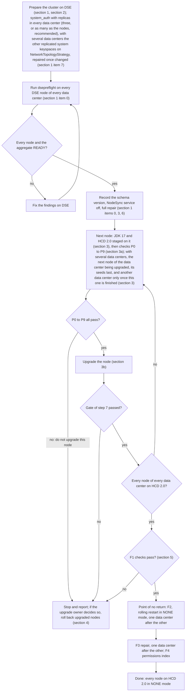
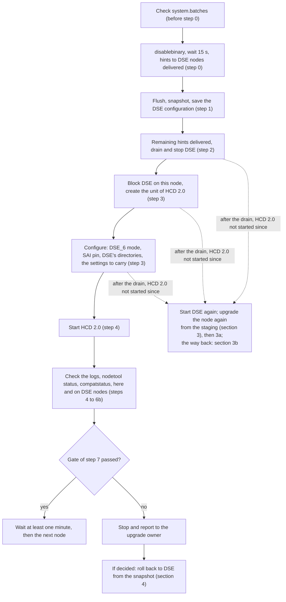
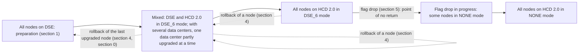

<!--
Copyright IBM Corp.

Licensed under the Apache License, Version 2.0 (the "License");
you may not use this file except in compliance with the License.
You may obtain a copy of the License at

http://www.apache.org/licenses/LICENSE-2.0

Unless required by applicable law or agreed to in writing, software
distributed under the License is distributed on an "AS IS" BASIS,
WITHOUT WARRANTIES OR CONDITIONS OF ANY KIND, either express or implied.
See the License for the specific language governing permissions and
limitations under the License.
-->

# <a id="header"></a>Runbook reference: in-place upgrade from DSE 6.8/6.9 to HCD 2.0 (for version 2.2)

> **This is the reference, not the operator runbook.** The operator runbook is [`RUNBOOK.md`](RUNBOOK.md), version 2.2,
> not for production, with only what the operator does; each of its sections links to the matching part of this file,
> and both files use the same anchor ids and the same section, item, step and check numbers. This file holds the full
> procedure with its rationale, the edge cases and the detail of what was validated and what was not. It began as the
> text of version 1.2 of the runbook and carries every correction since, up to version 2.2. [Appendix R](#r),
> "Where each step went", gives for every item, step, check and paragraph its place in `RUNBOOK.md`, or the reason it
> stays here only. A reference in the text below to a section, item, step or check, or to "this runbook", is to this
> file. New results are added here first, and to `RUNBOOK.md` only when a step changes.
>
> **Upgrading from DSE 5.1?** This file and `RUNBOOK.md` cover the upgrade from DSE 6.8 and 6.9 only. The upgrade
> from DSE 5.1.51 has its own procedure, [`RUNBOOK-DSE51.md`](RUNBOOK-DSE51.md), with other settings, checks and
> rollback steps; it cites the sections of `RUNBOOK.md` where a step is the same.

| | |
|---|---|
| From | DataStax Enterprise 6.8 or 6.9 at the latest patch release at the time of the upgrade (as of this version DSE 6.8.66 or DSE 6.9.26; section 1, "Required DSE release"), DSE core only (the Cassandra workload), one DSE release on every node |
| To | HCD 2.0 (the `main` code line) with the DSE 6 compatibility mode, `internode_compatibility_mode: DSE_6` |
| Build required | The tarball of the HCD 2.0 release that contains the whole DSE 6 compatibility work, including its sync with the `main` code line, run on JDK 17 (section 1, "Build requirement"). No validation run has used that release yet: the validated runs below used development builds of this work. |
| Scope | One or more data centers. Several data centers are validated on DSE 6.9.26 without internode TLS and with `internode_encryption: dc`, `rack` and `all`, the last two each through the upgrade of the data center upgraded second and the flag drop; on DSE 6.8 several data centers ran only in development runs on DSE 6.8.65 and are not validated (DSE 6.9 is the target release); the procedure is the same. Racks as tested: three racks of one node each (one data center); two data centers of three nodes, each with a rack of two nodes and a rack of one (with three replicas per data center, so the rack rule itself did not run); one data center of two or three nodes in one rack, and a single node, in test runs. Clusters without encrypted (TDE) tables, and without a KMIP key provider. |

<a id="validated"></a>**Validated** (on test clusters of three nodes in three racks, or of two data centers of three
nodes, each with a rack of two nodes and a rack of one and one seed per data center, and, where said below, one data
center of two or three nodes in one rack, or a single node; with development builds of this work):

| DSE release, topology | No internode TLS | `internode_encryption: dc` | `rack` | `all` |
|---|---|---|---|---|
| 6.9.26, one data center | full upgrade, flag drop, rollback with the Paxos steps, NodeSync procedure | mixed phase, one node upgraded | mixed phase, one or two nodes upgraded; rollbacks with and without DSE's legacy TLS port | mixed phase, one node upgraded |
| 6.9.26, two data centers | full upgrade, a rollback, flag drop; writes at `EACH_QUORUM` and `ALL` through every node | one data center upgraded; two rollbacks with the Paxos steps, with and without DSE's legacy TLS port | full upgrade and flag drop, no rollback | full upgrade and flag drop, no rollback |
| 6.8.65, one data center | full upgrade, flag drop, rollback with the Paxos steps | not validated | not validated | mixed phase, one node upgraded |
| 6.8.65, two data centers | development runs only | development runs only | not validated | development runs only |

In detail:
- **DSE 6.8.65, one data center:** the mixed phase with one node upgraded; reads and writes through every coordinator
  (writers and readers at `ONE`/`ALL`, `QUORUM`/`QUORUM` and `ALL`/`ONE`, with paging); LWTs, counters, hints, batches
  and views; the full rolling upgrade and the flag drop; a rollback with `dsepreflight --paxos-rollback`. Internode TLS
  with `all` and both settings of `legacy_ssl_storage_port_enabled`, one node upgraded: the upgraded node connected to
  the DSE nodes' `ssl_storage_port`, and they to its own. On a single node with the SAI pin `aa`: SAI-indexed tables
  written, deleted from, flushed and compacted on HCD 2.0, then the rollback, DSE answering from HCD 2.0's index files
  with no index build (section 2, "Validated").
- **DSE 6.9.26, one data center:** the mixed phase; reads and writes through every coordinator at the same levels,
  LWTs, counters, hints, batches and views; a rollback; the full rolling upgrade and the flag drop, F3 and F4; replica
  placement identical through DSE and HCD 2.0 for keyspaces with replication factor 1 and 2; the NodeSync procedure of
  section 1 item 6 (the flag off on every user table and every table of DSE's keyspaces, kept across a DSE restart,
  then the full repair, which covered them all; the statements typed out, not generated); the flag drop with the client
  traffic taken off before each drain (no refused and no failed request) and F3 with its `system_distributed` repair.
- **Internode TLS in one data center, DSE 6.9.26:** `all` with the configuration of section 3b step 3, and again with
  DSE's `enable_legacy_ssl_storage_port` and HCD 2.0's `legacy_ssl_storage_port_enabled` changed on the running nodes
  (DSE's `false` with HCD 2.0's `true`, then both `true`); `rack` (three racks of one node: every pair encrypted) and
  `dc` (one data center: nothing encrypted); each with one node upgraded, every node `UN` and no failed request. With
  `rack`: a rollback without DSE's legacy TLS port, in which the other DSE nodes saw the rolled-back node `DN` until
  each of them was restarted (it was the only upgraded node; section 4, "With internode TLS on DSE 6.9"); DSE's legacy
  TLS port set on every DSE node with a rolling restart before the upgrade, with HCD 2.0's
  `legacy_ssl_storage_port_enabled: false` (section 1, "Internode TLS on DSE 6.9"), through the mixed phase and a
  rollback, every node seeing the rolled-back node `UN` within half a minute, with no failed request; without that port,
  two upgraded nodes, then the rollback of one while the other stayed upgraded, with T1 and T3 by hand: no restart
  needed and no failed request; after the rollback of the only upgraded node with DSE's legacy TLS port, the repair on
  DSE, NodeSync turned on for one table and role changes through each DSE node: DSE refused NodeSync and repairs failed
  between one DSE node and the rolled-back node until every DSE node was restarted (the restart after the last rollback,
  section 4); without that port, a rollback with T1 and T3 in which the other DSE nodes saw the rolled-back node `DN`
  until one of them was restarted, the other recovering by itself about two minutes later.
- **The restart after the last rollback without internode TLS, DSE 6.9.27, one data center** (a patch release newer than
  the one this version names; three nodes, NodeSync off, a shortened ring delay): after the rollback of the only
  upgraded node, one DSE node kept refusing messages to the rolled-back node (`Cannot write message
  READS.MULTI_RANGE_READ … to legacy node` for minutes, `serializedSize() called with non-matching version OSS_30` in
  its dispatch of hints when the rolled-back node started, its writes to that node timing out and its hints for it
  written again every 10 s, reads at `ALL`, SAI counts included, timing out), while gossip looked normal and the other
  DSE node was not affected; restarting every DSE node behind the restart gate, the rolled-back node last, ended it: no
  such line afterwards, reads at `ALL` passed, and `nodetool repair -full -pr` and the repair of `system_distributed`
  passed. It did not happen on every run.
- **A DSE node lost for good, DSE 6.9.26, one data center** (three nodes, one upgraded, `max_hint_window` 10 minutes,
  so a silence threshold of 30 minutes): a DSE node stopped for good; right away, `nodetool assassinate` and
  `nodetool removenode` of it on the upgraded node refused with the generic text of appendix A.7; a second DSE node
  stopped for a few minutes and started again: its assassination refused while it was down and again after its start;
  at 15 minutes, both assassinations refused; after the threshold (the commands ran 144 minutes after the stop),
  `removenode` of the lost node refused while the other DSE node was alive, with the text of appendix A.7, and its
  assassination allowed, with the WARN `Allowing the assassination of the DSE 6 node <node>, silent for <n> seconds,
  …` (section 6), the node then gone from the ring of the upgraded node and of the DSE node left.
- **An HCD 2.0 node lost for good, DSE 6.9.26, one data center** (three nodes, two upgraded): on an upgraded node,
  `-Dcassandra.internode_compatibility_mode.lost_node_silence_seconds=30` (set in the service's override in the test
  cluster, read at the node's start as from `conf/jvm-server.options`) refused at startup with the text of appendix A.7
  and `=120` taken, with its INFO line; the other upgraded node stopped for good; right away, its assassination refused
  with the generic text of appendix A.7; past the threshold (the lost node silent for 266 seconds at its assassination),
  the assassination of the live DSE node refused, `removenode` of the lost node refused while that DSE node was alive,
  its text naming the DSE node and the assassination, and the lost node's assassination allowed, with the WARN `Allowing
  the assassination of the node <node> of this software, silent for <n> seconds, …` (section 6), the node then gone from
  the ring of the upgraded node and of the DSE node.
- **Test runs, DSE 6.9.26, a single node and one data center of three nodes, `system_auth` at DSE's default** (one
  replica; authentication on, with DSE's shipped authenticator, authorizer and role manager; on one machine, the
  processes started by hand, without systemd units): the single node, on DSE's shipped configuration (`DseSimpleSnitch`,
  one token), upgraded as it is: HCD 2.0 started at the first try and read `system_auth` at `LOCAL_QUORUM` (`DSE access
  controls ignored  : 0 (found by a LOCAL_QUORUM read)`), the role logged in, a wrong password and the grants it lacks
  refused as on DSE, and the flag drop of section 5 (F1 to F4) went through, with the same checks in `NONE`. The three
  nodes, `GossipingPropertyFileSnitch` in one rack: the preflight's `SYSTEM_AUTH_REPLICATION` warning on every node
  ("dc1 has 1 replica and 3 nodes: an upgraded node there cannot start while another node of dc1 is down …"), its
  mixed-phase remedy at P0 of the next nodes, the aggregate `READY`; the rolling upgrade, one node at a time with the
  others up, the seed last, every node started at the first try, the gate of step 7 passed after each. With the three on
  HCD 2.0 and one node down, a restarted node refused to start after 115 s (`internode_compatibility_mode DSE_6 refused:
  unable to read system_auth.role_permissions at LOCAL_QUORUM …`), although it held no row of `role_permissions`; with
  two nodes down, neither started alone, and started together both did (section 3b, "Starting an upgraded node while
  other replicas are down"). Not run: section 1 item 6 on the three nodes (a fresh cluster, the NodeSync flags left on,
  so its full repair printed `Skipping anti-entropy repair` lines), the flag drop of the three nodes, a rollback,
  `dse_restrictions_local_check_only`.
- **Test runs, DSE 6.8.65 and 6.9.26, one data center** (two or three nodes in one rack, on one machine): DSE's own
  hints files converted at HCD 2.0's first start and delivered to a DSE node; the view updates DSE stored in its
  batchlog (messaging version 1024 on DSE 6.8.65, 1536 on DSE 6.9.26), its hints files and its commit log, replayed by
  HCD 2.0 with the view's hidden column translated, the view rows on the DSE view replica in DSE's own encoding (section
  3b step 3b, section 6); with `system_info_encryption`, what DSE encrypts, the preflight's findings on it, and the
  order of the restart and of the rewrite, except the replay of encrypted commit log segments and the rewrite once
  every node runs with the setting off (section 1, "Required DSE release").
- **Two data centers, DSE 6.9.26** (`system_auth`, `system_distributed`, `system_traces`, `dse_security`, `dse_leases`
  and `dse_perf` on `NetworkTopologyStrategy` with three replicas in each data center, set when the cluster was created,
  before any data: section 1 item 7; `internode_compression: dc`):
  - without internode TLS, end to end: the preflight aggregate `READY`, listed by data center and rack; the full repair;
    one data center at a time, one node at a time, the seed last in each; writes at `EACH_QUORUM` and `ALL` and counter
    increments at `ALL` through every node, DSE ones included, with one data center fully upgraded and the other on DSE,
    then partly upgraded; a rollback of a node that is not a seed, with its data center's seed on HCD 2.0 and the other
    data center on DSE (section 4 without steps 5 and 6, and T0, T1 and T3 as a rehearsal), then its re-upgrade; the
    flag drop, F3 data center by data center, F4; a client at `LOCAL_QUORUM` with conditional updates at `LOCAL_SERIAL`
    in each data center, through a data-center-aware policy, with no failed request and no wrong read; DSE's
    `system.peers` and HCD 2.0's `system.peers_v2` agreeing on every node's data center, rack, host id and tokens
    through the mixed phase;
  - `internode_encryption: dc` with DSE's legacy TLS port: the upgrade of the data center upgraded first, with TLS
    between the data centers (plain inside each); DSE's own forwarder sending forwarded writes to upgraded nodes of its
    data center; a rollback with steps 5 and 6 of section 4, another node staying upgraded, the `SERIAL` and
    `LOCAL_SERIAL` reads through a DSE node of the rolled-back node's data center, on open rounds made for the test
    (the value a quorum accepted kept, the proposals of the node alone and of its snapshot not back); with the port
    then turned off, a second rollback with steps 5 and 6, on the open rounds of the live workload, and T0 to T3 (T2
    restarted one DSE node of four, of the other data center); the data center upgraded first finished with the port
    still off (not the required setting); three clients, at `LOCAL_QUORUM`/`LOCAL_SERIAL`, `QUORUM`/`SERIAL` and
    `EACH_QUORUM`/`SERIAL`, with no failed request and no wrong read;
  - `internode_encryption: dc`, one data center on each product: reads and writes through the six coordinators at
    `ONE`, `QUORUM`, `ALL`, `LOCAL_QUORUM` and `EACH_QUORUM`, paging at `QUORUM` and `EACH_QUORUM` included; views;
    LWTs, counters, logged, unlogged and conditional batches through every coordinator, with section 0's write timeout
    of contended serial reads as the only failure; clients with no failed request and no wrong read;
  - `rack` with DSE's legacy TLS port and HCD 2.0's `legacy_ssl_storage_port_enabled: false`, on a new cluster: the
    preflight aggregate `READY`, `INTERNODE_TLS` a warning on every node; the data center upgraded first, then the two
    nodes of the other that are not seeds, then its seed, the last node, with DSE's legacy TLS port still on; the DSE
    nodes' connections to the upgraded nodes from outside their rack encrypted, on `ssl_storage_port` and on
    `storage_port` (plain only within a rack), and the upgraded nodes' own connections encrypted except within their
    rack and to themselves; writes at `EACH_QUORUM` and `ALL` through every node after each upgrade phase; with a data
    center running both products, the reads and writes at the five levels above, the views and the LWTs, counters and
    batches as above; the flag drop and F3 under TLS, every node then listening on `storage_port` only, every outbound
    connection encrypted except to the node of the same rack and data center and to itself (section 0); three clients
    with no failed request and no wrong read;
  - `all` with the same settings, on a new cluster: the same upgrade steps and the flag drop with F3; every connection
    across data centers and within them encrypted, a node's connection to itself included after the flag drop; three
    clients with no failed request and no wrong read;
  - without internode TLS, before the `all` cluster: a DSE coordinator's write at `ALL` failing at once behind upgraded
    forwarders (every forwarder of the data center upgraded first on HCD 2.0 and one of its nodes refusing large
    mutations on purpose): `WriteFailure` at once through the DSE nodes, as with every node on DSE.
- **DSE 6.8.65, two data centers, development runs (not validated):** without internode TLS, the same steps as on DSE
  6.9.26, with no failed request; with `internode_encryption: dc`, then `all`, one data center partly upgraded and
  rollbacks with steps 5 and 6, no node showing the rolled-back node `DN` (DSE 6.8 listens on `ssl_storage_port`), and
  one `QUORUM` write timeout during a DSE restart, before the restart gate waited for the client port (section 4, the
  restart gate).

<a id="not-validated"></a>**Not validated** (each also marked where it applies; passages that apply only with several
data centers and were not validated are marked *(several data centers: not validated)*):
- More than three nodes in a data center or six in all, and scale: tens to hundreds of nodes (gossip and handshakes with
  hundreds of peers, the time per node against `gc_grace_seconds`, the hints held per DSE node), out of scope of this
  version.
- The rack rule (racks of two nodes ran with three replicas per data center, so every node held every key) and replica
  placement on keyspaces of replication factor 1 and 2 with several data centers (in-JVM tests only, with HCD 1.2
  standing in for DSE).
- `rack` on DSE 6.8, and `dc` and a rollback with internode TLS on DSE 6.8 beyond a two-data-center development run.
- A rollback with `all` on DSE 6.9, and with `rack` across data centers (the TLS rollbacks on DSE 6.9 ran with `rack` in
  one data center and with `dc` across two).
- T2 and the restart gate as written: T2's list from the rolled-back node's view after its `NORMAL` line and the wait
  for its echo reset ran end to end in a single test (two data centers with `dc`; the echo reset freed both DSE nodes of
  the list, nothing needed a restart); the gate of two views with the clients' errors never ran as written; an earlier
  T2, with every node's view as its list and with `dc` on two data centers, restarted one DSE node, which the
  rolled-back node's echo reset most likely freed anyway; T2 in one data center with that rule (it ran there with each
  node's own view as the gate).
- The restart of every DSE node after the last rollback as a routine step (it ran as the remedy after refusals in two
  tests, on DSE 6.9.26 with DSE's legacy TLS port and each node's own view as the gate, and on DSE 6.9.27, a newer patch
  release, without internode TLS; never after T2), with several data centers (no last rollback ran there), and on DSE
  6.8, where the state it ends was never looked for (a precaution there); NodeSync after the last rollback beyond the
  run with TLS, the repair on DSE after it beyond those two runs, and the cause of the state.
- Section 1 item 7's `ALTER KEYSPACE` and repair on a cluster that already holds roles and data (the test clusters were
  created with the replication in place, with nothing to copy).
- The `LOCAL_SERIAL` reads of section 4 step 6 through an HCD 2.0 coordinator (a rollback in a data center with no DSE
  node left, which section 3 allows for a re-upgrade there; the reads were validated through DSE nodes only).
- DSE's own deletions of old view entries in the other data centers (the views check passed across two data centers,
  also with a data center running both products).
- The echo request sent again to every peer in `DSE_6` mode (checked only on purpose, between two upgraded nodes).
- For a lost node, DSE or HCD 2.0 (section 6): `removenode` once no other DSE node is alive and `removenode force`
  (step 4), steps 5 to 7 (a replacement refused, the removal again on DSE after a rollback, F1), several data centers
  and DSE 6.8; the moment at which a silent node starts to count as lost (a DSE node was refused at 15 minutes and
  allowed at 144 minutes, the threshold being 30 minutes; an HCD 2.0 node, refused before 90 seconds and allowed at 266
  seconds, the threshold being 120 seconds); the procedure in `NONE` mode (every run was in `DSE_6` mode).
- A view update DSE stored that HCD 2.0 cannot translate, with the WARN of appendix A.10 (section 6, "Batch … cannot be
  decoded"; section 3b step 3b): no test run had one.
- The preflight's `TDE_TABLE` on the four tables `system_info_encryption` encrypts with the setting off, and the
  remedies' texts on the key directory and its keytab (section 1, "Required DSE release"): unit tests only, the test run
  having had the earlier texts.
- The refusal of a plain-text retry of internode TLS towards DSE nodes (section 1, "Internode TLS: no plain-text retry
  towards DSE nodes"): unit tests with real sockets only.
- The preflight's blocking `INTERNODE_TLS` (unit tests only; where it ran it did not block: no internode TLS, or DSE's
  legacy TLS port set), the preflight's blocking `HINTS_COMPRESSION` on `hints_compression` (unit tests only; DSE was
  not run with it; on encrypted hints files it ran, DSE 6.8.65 and 6.9.26), and the preflight aggregate's blocking
  `MIXED_STORAGE_PORTS` and `STALE_REPORT` (unit tests only); the `-Dcassandra.ssl_storage_port` part of appendix A.11's
  check by hand (1) (run with the `storage_port` pattern only).
- The preflight's `SYSTEM_AUTH_REPLICATION` (section 1 items 0 and 7): blocking, unit tests only, no test cluster having
  run the tool with `system_auth` short of the replication item 7 asks; its warning, run only on one data center of
  three nodes at one replica (validated, above); its silence on a single node on DSE's defaults, unit tests only (the
  test run of a single node had a version that took the missing `nodes/peers` for nodes not known and warned); the
  higher replication factor of item 7 bounded by the nodes of the data center, a rule of the runbook not exercised; not
  run: the flag drop of a data center of three nodes at one replica of `system_auth`, and a rollback of it or of a
  single node; not upgraded as they are: several data centers, or a data center of more than three nodes, below three
  replicas, a data center of two nodes, or of three nodes at two replicas, a single node that once had peers, or one
  with `system_auth` on `NetworkTopologyStrategy` or `EverywhereStrategy`; on DSE 6.8, none of it.
- The preflight's `KEYSPACE_REPLICATION` (section 1 items 0 and 7), with several data centers (with one known at most,
  only for a replication that gives no node a replica): unit tests only, no test cluster having run the tool with item
  7's other keyspaces short of its rule.
- The preflight's blocking `UNREADABLE_INPUT` on a `nodes/peers` changed while read, left half written by DSE (with a
  `peers.old` or a `peers.txn`), whose attributes cannot be read, or missing or empty while `nodetool status` lists
  other nodes, and its `PENDING_HINTS` info and `Hints` step then; the info `NO_PEERS_FILE` on a missing `nodes/peers`,
  and its caveat on the remedies of `SYSTEM_AUTH_REPLICATION` and `KEYSPACE_REPLICATION`; the aggregate's
  `NO_PEERS_RECORDED`; the rollback mode leaving a `nodes/peers` it cannot trust (changed while read, left half written,
  damaged, attributes unreadable) unused (section 1 item 0, section 4 step 5): unit tests only.
- EC2 snitches (no test cluster ran on EC2; section 1 item 0), `Ec2MultiRegionSnitch` across regions with its private
  and broadcast addresses, and `prefer_local` reconnection to a private address (each test node had one address).
- TDE and KMIP: out of scope of this version (section 0).
- A rollback while every seed a DSE node lists runs HCD 2.0, and a DSE node that is not itself a seed in that state (a
  DSE node that is not a seed rolled back while its data center's seed ran HCD 2.0 and the other data center's seed
  ran DSE rejoined); a data center down or unreachable during the mixed phase (section 3 forbids any upgrade step
  meanwhile).
- The schema-pull counts per DSE node and per reason (counted per upgraded node only).
- An abandoned upgrade (section 0); the return to DSE when a step fails after the drain, before HCD 2.0 starts (section
  3b).
- The generator of section 1 item 6; the NodeSync procedure, the flag drop with client traffic taken off before each
  drain and F3 with `system_distributed` on DSE 6.8.
- Several data centers on DSE 6.8 (development runs on DSE 6.8.65 only).
- How long DSE keeps endpoint grouping on after the first upgraded node appears (section 3b step 6b).
- The bytes of DSE's `internode_compression: dc` framing between data centers (it ran with no failed request; DSE asks
  for LZ4 across data centers and for none within one, and its first message carries the compression bit across data
  centers only).
- DSE 6.8.66, the required 6.8 release (DSE 6.8.65 and 6.9.26 ran; 6.8.65 is enough for this version).

The versions of this text and what each changed: [Header history](#history).

## <a id="brief"></a>The procedure in brief

This section is a short overview for a first reading. The numbered sections below hold every step, check and remedy;
follow them, not this summary, when doing the work.

**What it is.** A rolling, in-place upgrade: one node at a time stops DSE and starts HCD 2.0 on the same data, commit
log, hints and metadata directories, while the other nodes keep serving clients. Until the flag drop, the upgraded nodes
run with `internode_compatibility_mode: DSE_6`: they talk to the DSE nodes in DSE's own (pre-4.0) internode dialect and
keep their sstables and SAI index files in formats DSE can read. So any upgraded node can be rolled back to DSE on its
own (section 4). When every node runs HCD 2.0, a last rolling restart sets the mode to `NONE`: the *flag drop* (section
5). It is the point of no return: from the first node restarted in `NONE` on, no node goes back to DSE. Read the limits
of section 0 first: this version is not for production, covers one or more data centers (several validated on DSE 6.9
without internode TLS and with `internode_encryption: dc`, `rack` and `all`) and DSE core only, the latest DSE 6.8 or
6.9 patch release only, and only clusters without encrypted (TDE) tables.

**The phases.**
1. **Prepare the cluster, on DSE** (section 1, with "Security first", appendix B and appendix C). First bring every node
   to the latest DSE 6.8 or 6.9 patch release, with DSE's own procedure (section 1, "Required DSE release"; as of this
   version 6.8.66 or 6.9.26). Then remove what HCD 2.0 does not support (DSE features outside DSE core, `RESTRICT`,
   row-level access controls and scheme permissions, materialized views with unsupported hidden columns, the `VECTOR`
   columns of DSE 6.9), pin the drivers to native protocol V4, turn off the NodeSync flag of every replicated table
   (user tables and DSE's own: HCD 2.0 has no NodeSync and ignores the flag), and decide the SAI on-disk version to pin
   (section 2). If these changes touched `dse.yaml` or `cassandra.yaml`, restart every DSE node once, one at a time, so
   that they take effect (section 1, "Order of work", step 2b; with no such change, no restart is needed). With
   internode TLS on DSE 6.9, turn on DSE's legacy TLS port in that restart (required: without it, a node rolled back to
   DSE can stay unreachable for the other DSE nodes until one of them is restarted; the preflight blocks without it;
   section 1, "Internode TLS on DSE 6.9"). Give `system_auth` replicas in every data center (three, or as many as the
   data center has nodes, recommended; single-node and small development clusters can stay as they are), with several
   data centers on `NetworkTopologyStrategy` with `system_distributed`, `system_traces` and DSE's replicated keyspaces,
   with replicas in every data center, and repair what changed (section 1 item 7).
2. **Run the preflight tool on every DSE node** (section 1, item 0). `dsepreflight` only reads the node's files and
   reports `READY` (exit 0), blocking findings (exit 1), each with what to do, or `INCOMPLETE` (exit 3) when the live
   state of `--nodetool` could not be read completely; exit 2 means it could not inspect the node. Fix the findings and
   run it again until every node and the aggregate of all the reports, of every data center, are `READY`. Write down the
   schema version. Then turn the NodeSync service off on every node, and run a full repair right before the first node
   (section 1, items 3 and 6).
3. **Upgrade the nodes one at a time** (section 3). With several data centers, one data center at a time, the seeds last
   in each; a data center with a rolled-back node is finished before the next, and no step is made while a data center
   is down (section 3, "Order across data centers"). For each node: the checks P0 to P9 (section 3a, the preflight again
   among them), with JDK 17 and the unpacked HCD 2.0 put on the node beforehand (section 3, "Staging, before 3a"), then
   the node itself (section 3b): take the clients off, snapshot, drain and stop DSE, start HCD 2.0 on the same data with
   the settings carried from DSE (the preflight's "Settings to carry", internode TLS and EC2 names included), check it,
   and pass the gate of step 7 before the next node. If a step fails after the drain and HCD 2.0 has not started since,
   DSE is started again (section 3b, "A failure after the drain, before HCD 2.0 starts"). If something goes wrong, stop
   and report to the upgrade owner; a node can be rolled back to DSE (section 4; with internode TLS on DSE 6.9, if DSE's
   legacy TLS port was not turned on as section 1 requires, the rollback may also have to restart the DSE nodes that the
   rolled-back node itself shows `DN` and that its own echo reset does not free, one at a time, the next one only once
   the previous one shows every node `UN`, the rolled-back node shows it `UN` and its client port is open (stop and
   report if that takes more than 10 minutes); and after the last rollback, the one that leaves no node on HCD 2.0,
   every DSE node is restarted that way, with or without internode TLS, before any repair or other operation: section
   4).
4. **Drop the flag** (section 5) once every node runs HCD 2.0 and the checks of F1 pass: one more rolling restart with
   `internode_compatibility_mode: NONE` (F2), then a full repair (F3, one data center after the other) and the rebuild
   of the reverse index of the permissions (F4). Nothing replaces NodeSync on HCD 2.0: from then on, schedule regular
   repairs (section 5).

From the preflight (section 1 item 0) until the flag drop: no schema change, no grant and no role change; apart from the
full repair right before the first node, no topology change (but the removal of a node lost for good, section 6) and
no repair (section 1 item 5, "Security first" rule 4). Upgraded nodes refuse schema changes, topology changes and
repair, but not grants or role changes; DSE nodes refuse none of them: a schema change run through a DSE node is not
prevented (section 0). The whole mixed phase, the flag drop and its repair must finish within the smallest
`gc_grace_seconds` of the tables that take deletes, counted from the start of that repair (section 1 item 6). Every
planned node stop follows "Stopping a node".

The whole procedure:



One node (section 3b, simplified):



The cluster over time:



| State | Allowed | Not allowed |
|---|---|---|
| All nodes on DSE | the changes of section 1 in its order of work: schema and access-control changes before item 0, the full repair right before the first node | after item 0, any schema, access-control, role or topology change |
| Mixed, or all nodes on HCD 2.0 in `DSE_6` mode | rolling back any upgraded node (section 4; with every seed on HCD 2.0: not validated, section 3 "Seeds") | schema, topology, access-control and role changes, repair; DDL through a DSE node is not prevented, so make sure nobody runs it |
| Flag drop started, and after it | schema changes (`DROP` only after F4), topology operations and grants again once every node runs in `NONE`; F3 within the deadline of section 1 item 6 | going back to DSE |

## <a id="use"></a>How to use this runbook

* Every procedure is written for an operator working by hand on each node. Each step says what to do, how to check it
  worked, and what to do otherwise. On any deviation that a step does not cover: stop, keep the cluster as it is and
  report to the upgrade owner.
* Read, before planning: "The procedure in brief" (an overview), "Security first", "Stopping a node", section 0
  (known limitations), appendix B (the DSE features to remove) and appendix C (drivers). Appendix A lists every error
  and refusal text with its cause and remedy.
* Order of work: section 1 once, before the first node (its own order is at its top); then, for each node, section 3a
  (preflight) and section 3b (the node), with section 2 (the SAI pin) applied in section 3b step 3; after the last
  node, section 5 (the flag drop). Section 4 rolls one node back to DSE at any time before the flag drop. Section 6 is
  troubleshooting.
* Section numbers, items, steps and P/T/F checks are stable. Neither the preflight tool (`dsepreflight`) nor HCD 2.0's
  own messages cite a runbook section or `SECURITY.md` (a refusal says "Roll this node back to DSE": section 4); the
  tool's upgrade steps are labelled (`Preflight`, `Security`, `Snapshot`, …), and `PREFLIGHT.md` gives the sections
  that cover each finding.
* Commands are for a package install of DSE (`/etc/dse`, `systemctl … dse`) and an HCD 2.0 tarball install; adapt the
  paths for a tarball install of DSE. HCD 2.0 logs in UTC. Keep every command output that a step asks to save.
* This reference gives the rationale, the edge cases and what was validated; the operator runbook, `RUNBOOK.md`, holds
  the steps alone.

Words used below: *DSE node* = a node still running DSE 6.8/6.9; *upgraded node* = a node running HCD 2.0 with
`internode_compatibility_mode: DSE_6`; *mixed phase* = from the first node upgraded until the last node restarts with
`internode_compatibility_mode: NONE` (the *flag drop*); *the upgrade owner* = the person who decides for the upgrade
and to whom deviations are reported.

## <a id="security"></a>Security first: DSE access controls this software does not enforce, and internode TLS

This is the content of [SECURITY.md](SECURITY.md), which holds the same rules with their sources and open items.

DataStax Enterprise stores access controls that HCD 2.0 does not understand. Anything that *restricts* access in DSE
and is silently ignored here would **grant access after the upgrade**, so the upgrade fails fast on them:

1. **Refused (remove them on DSE before the first node):**
   * `RESTRICT` entries (`system_auth.role_permissions.restricted`): run `UNRESTRICT` for each.
   * Row-level access control: tables with the `DSE_RLACA` extension (`RESTRICT ROWS ON <ks>.<table> USING <column>`)
     and `rows/…` grants: run `UNRESTRICT ROWS ON <ks>.<table>` on each such table and `REVOKE` the row-level grants
     (an upgraded node refuses them whether or not `allow_row_level_security` is on), then set
     `authorization_options.allow_row_level_security: false` in `dse.yaml` (the preflight blocks while it is true).
   * `authentication_options.scheme_permissions: true` in `dse.yaml` (with authentication enabled): give the roles
     that must log in `EXECUTE` on their scheme, make the others unable to log in (`ALTER ROLE … WITH LOGIN = false`),
     then set `scheme_permissions: false`.

   The preflight tool blocks on all three (`RESTRICT`, `ROW_LEVEL_ACCESS`, `SCHEME_PERMISSIONS`). An upgraded node
   refuses to start on the first two (it does not read `dse.yaml`; a `dse.yaml` change needs a restart of each DSE
   node, section 1 "Order of work"): appendix A, "DSE access controls". The override
   `-Dcassandra.internode_compatibility_mode.ignore_dse_restrictions=true` drops them knowingly, logged at WARN at
   every start where it drops something; use it only on the upgrade owner's decision.
2. **Dropped, removing access (fail closed; the node starts and warns, the preflight warns):** `AUTHORIZE FOR`
   delegations; `UPDATE` or `TRUNCATE` granted alone (the pair `UPDATE` + `TRUNCATE`, which is how DSE 6.8 and 6.9 store
   the permissions of a table's creator and a `GRANT ALL` on a table, is read as `MODIFY`; DSE's `GRANT MODIFY` stores
   `MODIFY` itself, read as is); proxy login and proxy execution (`PROXY.LOGIN`, `PROXY.EXECUTE`: applications that use
   them must log in as the role they need before the upgrade; the node warns once per permission name,
   `Ignoring the unknown permission 'PROXY.LOGIN' granted to role '<role>' on resource '<resource>' …`, and the same for
   `PROXY.EXECUTE`); other DSE-only permissions and resources. In `DSE_6` mode `GRANT ALL` does not write `UNMASK` and
   `SELECT_MASKED`, and an explicit grant of them is refused, until the flag drop. A `GRANT MODIFY` run on an upgraded
   node despite item 4 is written as the pair, which DSE's `REVOKE MODIFY` leaves in place: once the upgrade is
   complete, `REVOKE MODIFY` removes it; after a rollback to DSE, `REVOKE UPDATE` and `REVOKE TRUNCATE` do (and
   `REVOKE MODIFY` if the role also held a `MODIFY` granted on DSE).
3. **DSE authentication:** only the internal scheme is supported. LDAP and Kerberos schemes and
   `role_management_options.mode: ldap` block the upgrade; with the internal scheme the classes change to
   `PasswordAuthenticator`, `CassandraRoleManager` and `CassandraAuthorizer` (the preflight's "Settings to carry").
4. **During the upgrade, run no `GRANT`, `REVOKE`, `RESTRICT`, `UNRESTRICT`, `RESTRICT ROWS` or `UNRESTRICT ROWS` and
   no role change on any node.** Upgraded nodes do not receive DSE's schema changes, so a `RESTRICT ROWS` run on DSE
   after a node was upgraded is not seen by that node; the access-control check repeated every 10 minutes on upgraded
   nodes logs at ERROR what it finds in `system_auth.role_permissions`.
5. While DSE and upgraded nodes coexist, each node enforces its own rules: a request may be allowed by one coordinator
   and refused by another (an application that logs in by proxy, for example).
6. Internode TLS: in `DSE_6` an upgraded node never retries in plain text a connection its configuration encrypts to a
   DSE node or a node of unknown version, so TLS must work towards every DSE node it encrypts to (section 1, "Internode
   TLS: no plain-text retry towards DSE nodes"; `SECURITY.md` section 4).

## <a id="stop"></a>Stopping a node

Whenever one node stops or restarts while the others keep serving clients, in this procedure (the upgrade, a rollback,
the flag drop, the restarts of section 1 item 1b, a rolling restart) and at any later restart:
1. `nodetool disablebinary`.
2. Once it has returned, wait 15 s. If you give up the stop here, run `nodetool enablebinary`.
3. `nodetool drain`; check that it succeeded (it exits 0 and `system.log` shows `DRAINED`); stop the node.

Sections 3b and 4 have more steps between the wait and the drain; there the 15 s are also longer than
`hints_flush_period` (10 s). When the whole cluster stops, the clients have no other node to move to and the wait is
useless: drain each node and stop it.

*Why, and what clients see.* On HCD 2.0, `disablebinary` closes the client port as a drain does: the requests in flight
get up to `native_transport_timeout` (12 s by default) to finish, which `disablebinary` waits for before it returns, and
a request that arrives while the port closes is answered `Server is shutting down` (Overloaded, code 1001) without being
run. A DSE 6.9.26 node restarted this way under client load had no refused and no failed request (DSE's handling of
`disablebinary` inferred from that, not read). Taking the traffic off
first does not avoid that error, it moves it from the drain to `disablebinary`. What the wait gives: for its length the
node no longer coordinates client requests but is still a live replica and gossip member (on HCD 2.0 a drain closes the
client port and stops gossip right after), so the clients' moves to other nodes do not coincide with the node going down
for its peers; at a validated flag drop (three HCD 2.0 drains, in a cluster upgraded from DSE 6.9.26, under client load)
no request was refused and none failed. At `disablebinary` the peers do not tell the drivers that the node is down (a
drain does): the drivers notice their closed connections. The refused statement was not run, so retrying it on another
node is safe even when it is not idempotent. The Python driver 3.29 (checked; earlier 3.x not checked) with its default
`RetryPolicy` retries it on the next host of the query plan; the Java driver 4.x (checked on 4.17) with its
`DefaultRetryPolicy` only for statements marked idempotent (`basic.request.default-idempotence` is false by default);
other drivers (Java driver 3.x, the DSE drivers) were not checked (appendix C). With no other host in the query plan
(one contact point, a whitelist, a statement sent to that host), the application gets the error. With the HCD 2.0 nodes
of a two-data-center cluster drained and restarted this way one at a time under client load, one read was refused at
`disablebinary` as described above, and at one drain one `EACH_QUORUM` read coordinated by another HCD 2.0 node, most
likely sent during the drain, timed out just after it (`ReadTimeout`, 3 of the 4 responses; its cause was not traced). A
replica that drains can still let a request already sent to it time out (most likely what happened there). A timed-out
request, unlike a refused one, may have run, so retrying it is safe only for an idempotent statement.

## <a id="s0"></a>0. Known limitations

* **Not for production; one or more data centers.** This version is for review by the upgrade owner's team and must not
  be used on a production cluster. Validated: one data center with three racks of one node each, on DSE 6.8.65 and DSE
  6.9.26; two data centers of three nodes, each with a rack of two nodes and a rack of one, on DSE 6.9.26, without
  internode TLS, with `internode_encryption: dc` (the rollback's Paxos steps on two data centers included, section 4
  steps 5 and 6), and with `rack` and `all` through the upgrade of the data center upgraded second, the last node with
  DSE's legacy TLS port on, and the flag drop; reads and writes at `ONE`, `QUORUM`, `ALL`, `LOCAL_QUORUM` and
  `EACH_QUORUM`, views, LWTs, counters and batches across the two data centers, with one product in each and with a data
  center running both. On DSE 6.8.65 the same ran as development runs only (header). Several data centers on DSE 6.8
  stay unvalidated (DSE 6.9 is the target release); the procedure is the same. `system_auth` must have replicas in every
  data center (three, or as many as the nodes, recommended; single-node and small development clusters as they are),
  and, with several data centers, `system_auth`, `system_distributed`, `system_traces` and DSE's replicated keyspaces
  must be on `NetworkTopologyStrategy` with replicas in every data center, and what changed repaired, before the
  preflight (section 1 item 7). With several data centers the upgrade goes one data center at a time, the seeds last in
  each, a data center with a rolled-back node is finished before any other node is upgraded, and no upgrade step is made
  while a data center is down (section 3, "Order across data centers"). Not validated with several data centers (the
  header lists every item): a rollback with `rack` or `all` between data centers, section 1 item 7 on a cluster that
  already holds roles and data, replica placement on keyspaces of replication factor 1 and 2, a DSE node started or
  rolled back while every seed it lists runs HCD 2.0, `prefer_local`, `Ec2MultiRegionSnitch`, and scale. Validation at
  scale (the validated clusters have three and six nodes; production clusters have tens to hundreds) is out of scope of
  this version. Racks of more than one node have not exercised the rack rule in a validated run (with three racks of one
  node a rack-aware placement takes the same replicas as `SimpleStrategy`; with three replicas in a data center of three
  nodes every node holds every key); in-JVM tests exercise it, with HCD 1.2 standing in for DSE, on two replicas per
  data center in racks of two nodes and of one, and also cover replication factor 2 on `SimpleStrategy` and replication
  factor 1 in a data center. The preflight tool lists the nodes by data center and warns `TOPOLOGY_MISMATCH` when the
  reports record a node with more than one data center or rack (section 1 item 0, appendix A.11). Passages that apply
  only with several data centers and were not validated are marked *(several data centers: not validated)*.

* **Only DSE core.** DSE Search, Graph, Analytics, DSEFS/CFS and Advanced Replication are not supported by HCD 2.0 and
  never will be: appendix B lists what must be removed or disabled on DSE before the upgrade.

* **No vector search.** ANN workloads and tables with `VECTOR` columns, which only DSE 6.9 has among the supported
  releases, are not supported by the in-place upgrade from DSE 6.9 to HCD 2.0: no step of this procedure upgrades them.
  Before section 1 item 0, remove those columns or tables, or move that data by other means (appendix B). The preflight
  tool blocks on every table with a vector column, at any depth of its type (a collection, a tuple, a field of a user
  type), and names the indexes on those columns and the materialized views that select them (`VECTOR_COLUMN` in
  [PREFLIGHT.md](PREFLIGHT.md)). Until the flag drop an upgraded node refuses every ANN query, whichever replicas it
  would read (`the ANN operator`, appendix A.8), and no schema change is made (section 1 item 5).

* **Only the latest DSE 6.8 or 6.9 patch release.** The cluster must run the latest DSE 6.8 or 6.9 patch release at
  the time of the upgrade: as of this version DSE 6.8.66 or DSE 6.9.26 (section 1, "Required DSE release"). The
  procedure was validated on DSE 6.8.65 and 6.9.26 (header). Older releases are out of scope. In particular DSE 6.8
  before 6.8.65 and 6.9 before 6.9.23 have no persistent hint window: a DSE node never stops writing hints for an
  upgraded node that is up and keeps them all until it is itself upgraded, so its hints directory can grow for the
  whole mixed phase. The preflight tool does not check the patch release; the operator does (`dse -v`).

* **Encrypted (TDE) tables are out of scope of this version.** The upgrade of a cluster with TDE was not tested. This
  procedure applies only to clusters without encrypted tables, with `transparent_data_encryption_options` disabled and
  with `system_info_encryption` disabled in `dse.yaml` (with it DSE also encrypts the tables `system.batches`,
  `system.paxos`, `system_backups.backup_stores` and `system_backups.backup_configurations`, its commit log, saved
  caches and hints files: section 1, "Required DSE release"); the preflight tool blocks on all three (`TDE_TABLE`,
  `TDE_COMMITLOG`). Check on a DSE node that no table and no materialized view uses the `Encryptor` compression class,
  or any class whose name contains `Encrypt` (`SELECT keyspace_name, table_name, compression FROM system_schema.tables;`
  and `SELECT keyspace_name, view_name, compression FROM system_schema.views;`). **In particular, a DSE cluster that
  uses a KMIP key provider for TDE is out of scope of this version**: the `main` code this work was synced with has no
  KMIP key provider. The checks above find every encrypted table, whatever its key provider.

* **Internode TLS and compression.** The validated runs used `internode_compression: dc` (the default of both
  products; HCD 2.0 compresses nothing inside one data center with it; DSE asks for LZ4 across data centers and for
  none within one) or `all` on every node. Internode TLS (`server_encryption_options`, any `internode_encryption` but
  `none`) is **validated in one data center** with one or two nodes upgraded (header): on DSE 6.9.26 with `all`,
  `rack` and `dc`; with `rack` and DSE's `enable_legacy_ssl_storage_port: true` together with HCD 2.0's
  `legacy_ssl_storage_port_enabled: false` (the combination required below), one node upgraded; with `rack` and two
  upgraded nodes, without DSE's legacy TLS port; on DSE 6.8.65 with `all`, one node upgraded. It is **validated
  between two data centers with `dc`** (DSE 6.9.26, one data center on DSE throughout: the other data center's
  first two nodes upgraded and a rollback with the combination required below; then, with DSE's legacy TLS port turned
  off, a rollback without it, with T0 to T3, and that data center's last node upgraded with the port still off,
  not the required setting), and **with `rack`** (DSE 6.9.26, two racks in each data center, with the combination
  required below: one data center upgraded, then two of the other data center's three nodes, then its last
  node with DSE's legacy TLS port still on, then the flag drop; the upgraded nodes' own connections across racks and
  data centers encrypted; the DSE nodes' connections to the upgraded nodes from another rack encrypted too, on
  `storage_port` as well as on `ssl_storage_port`), and **with `all`** (DSE 6.9.26, the same topology and upgrade
  steps, with the combination required below: every connection across data centers and within them encrypted; the DSE
  nodes' connections to the upgraded nodes on `storage_port` as well as on `ssl_storage_port`). Not validated: a
  rollback with `rack` or `all` between data centers; `rack` on DSE 6.8, and `dc` and a rollback with TLS on DSE 6.8
  beyond a development run on two data centers (`dc` and `all`). Turning internode TLS on, or changing
  `internode_encryption`, is DSE's own procedure, finished before section 1 item 0 (on DSE 6.8 a node switched to
  `all` alone does not join the others, so it cannot be done one node at a time). The configuration:
  * Every DSE node of the required releases (section 1, "Required DSE release") encrypting a connection to an upgraded
    node dials its `ssl_storage_port`: DSE 6.8 always uses that port for TLS (6.8.66 inferred, not validated), and DSE
    6.9.26, like every 6.9 release from 6.9.7, uses it for every peer whose stored messaging version is below that of
    DSE 6.9.7 (once it has stored one, from a handshake or from gossip), which an upgraded node always is, whatever
    DSE's `enable_legacy_ssl_storage_port`. In `DSE_6` mode an upgraded node with internode encryption on therefore
    listens with TLS on `ssl_storage_port` as well as on `storage_port`, even with
    `legacy_ssl_storage_port_enabled: false` (unless the two ports are equal: then `storage_port` is the port DSE
    dials). The DSE nodes connect to the upgraded node's `ssl_storage_port`.
  * An upgraded node dials each DSE node with TLS on the port its release listens on, as DSE 6.9.7+ does with its own
    peers: `ssl_storage_port` for DSE 6.8, `storage_port` for DSE 6.9.26 (the build decides by release: below 6.9.7 the
    first, from 6.9.7 the second). It reads the DSE version from the node's gossip, or from the release stored for it
    before the first gossip exchange. DSE 6.9.26 accepts TLS on `storage_port` with `all` and `rack`; `dc` encrypts
    nothing in one data center (plain text on `storage_port` both ways). With several data centers, `dc` encrypts the
    connections between data centers only: the DSE nodes of one data center connect to the upgraded nodes of the other
    with TLS on their `ssl_storage_port`, and the DSE nodes of the upgraded nodes' own data center connect to them in
    plain on `storage_port`.
  * So, for both required releases: on HCD 2.0, carry the keys of DSE's `server_encryption_options` and its
    `ssl_storage_port` and keep `legacy_ssl_storage_port_enabled: false` (section 3b step 3). On DSE 6.9, set
    `enable_legacy_ssl_storage_port: true` on every DSE node before the first upgrade: **required**, because of the
    rollback, although the upgrade itself works without it (section 1, "Internode TLS on DSE 6.9"); on DSE 6.8 nothing
    changes. The mixed phase was validated with it and HCD 2.0's `legacy_ssl_storage_port_enabled: true`, and with
    HCD 2.0's `false`, through a rollback. Every node, DSE and upgraded, must use the same `ssl_storage_port` (a node
    that dials a peer's `ssl_storage_port`, as the two items above say, dials the port number its own
    `ssl_storage_port` sets) and the same `storage_port`, with or without TLS (section 3b step 3), and every DSE node
    the same `internode_encryption`, in every data center. The preflight reports `INTERNODE_TLS` with these settings: a
    warning, or a blocking finding on DSE 6.9.7 and later when DSE's `enable_legacy_ssl_storage_port` is not set to a
    value DSE reads as true (section 1). After the flag drop the upgraded nodes talk on `storage_port` only (with
    `rack` across two data centers every node then listened on `storage_port` only, and every outbound connection was
    encrypted except those to the node of its rack and data center and to itself; a message addressed to the node
    itself goes over a connection to its own address, which `rack` leaves plain, as for its own rack, and which never
    leaves the host; with `all`, every outbound connection of every node was encrypted, the one to itself included).
  * **A rollback with TLS on DSE 6.9** without DSE's legacy TLS port (the setting section 1 requires was not applied,
    for example on a cluster where internode encryption was turned on later without it, or where the step was skipped):
    the restored DSE node listens on `storage_port` only, while the other DSE nodes dialed it on `ssl_storage_port`, the
    port it listened on while it ran HCD 2.0. They can go on dialing that port and see it `DN` until one of them is
    restarted (then the other recovered by itself about two minutes later); every request it coordinates fails
    meanwhile. This happened on DSE 6.9.26 with `rack` when it was the only upgraded node. With another node still
    upgraded, the other DSE node saw it `UN` about 30 s after the rollback, without a restart (one run; why the runs
    differ is inferred: section 6). With two data centers and `dc` (without that port, another node still upgraded),
    every other node showed the rolled-back node `DN` until it had joined (its own `NORMAL`), and all but one showed it
    `UN` seconds after that, by themselves; one DSE node of the other data center, the first the rolled-back node dialed
    at its start, stayed `DN` until it was restarted. Section 4 ("With internode TLS on DSE 6.9") takes its clients off
    and restarts, one at a time, the DSE nodes that the rolled-back node itself shows `DN` and that still show it `DN`
    at their turn, each behind a gate of two views and its client port; section 6 describes the symptom. With DSE's
    legacy TLS port, every node saw the rolled-back node `UN` within half a minute of the rollback; but in one run DSE
    then refused NodeSync and repairs failed between one DSE node and the rolled-back node until every DSE node was
    restarted; the same state was later seen without internode TLS. So after the last rollback (no node left on HCD 2.0)
    section 4 restarts every DSE node, with or without internode TLS, before any repair or other operation ("After the
    last rollback"). DSE 6.8 always listens with TLS on `ssl_storage_port`, so a rolled-back DSE 6.8 node is expected to
    be reachable (not validated).

  `internode_compression: dc` between data centers ran without internode TLS and with it (`internode_encryption: dc`,
  `rack` and `all` on DSE 6.9.26; `dc` and `all` in a development run on DSE 6.8.65), with no failed request; its bytes
  were not checked (DSE asks for LZ4 across data centers and for none within one; the first messages, DSE's and HCD
  2.0's, have the compression bit set across data centers only). Internode TLS between data centers is validated on
  DSE 6.9.26 with `dc`, `rack` and `all`.

* **Serial reads under contention fail with a write timeout, not a read timeout.** HCD is converging to Apache
  Cassandra 5 and then trunk, so HCD 2.0 keeps the upstream behaviour and does not mimic DSE. Under Paxos v1
  (`paxos_variant: v1`, required in `DSE_6`) contention, a `SERIAL` or `LOCAL_SERIAL` read coordinated by an upgraded
  node can fail with `WriteTimeout` (write type `CAS`) on native protocol V4, or `CAS_WRITE_UNKNOWN` on V5, where a DSE
  coordinator answered `ReadTimeout`: the read's Paxos round got its proposal accepted by some replicas but fewer than
  a quorum, and the coordinator reports an unknown result (a few in a hundred serial reads under contention in the
  validated runs, in one and in two data centers). In every case the client gets an error and no data. The drivers'
  default retry policies rethrow both; an application that handles a `ReadTimeout` of a serial read (by retrying the
  read, for example) must handle this `WriteTimeout` the same way. It stays after the flag drop while `paxos_variant`
  is `v1`; no change of this software converts it.

* **A schema change run through a DSE node during the mixed phase is not prevented, and nothing reports it
  automatically.** Upgraded nodes refuse DDL, but DSE cannot be changed: a schema statement (`CREATE`, `ALTER` or `DROP`
  of a keyspace, table, type, index, view or function) run through a DSE node is applied by the DSE nodes and changes
  DSE's schema version. The nodes already upgraded do not take it (their schema is frozen against DSE); a node upgraded,
  or rolled back and upgraded again, after it starts from DSE's new schema, and the upgraded nodes then exchange it
  among themselves (not tested). Observed for a `CREATE TABLE` with one upgraded node: reads and writes of the new table
  fail through an upgraded coordinator (`table <keyspace>.<table> does not exist`) and, through DSE, at `ALL`
  (`ReadFailure`/`WriteFailure`). Derived, not tested: at `QUORUM` they fail whenever DSE needs an upgraded replica;
  writes that succeed store nothing on upgraded replicas and, by the Apache Cassandra 3.0 rule (not checked on DSE),
  leave no hint for them, so only the repair after the flag drop brings them; a batch that writes the new table and
  other tables of the same keyspace with the same partition key fails on upgraded replicas for all of them (inferred,
  not tested). The effects of `ALTER` and `DROP` are only partly known and not tested. Signs to watch: a `schema push
  (ignored)` line in `nodetool compatstatus` on an upgraded node (it appears with the first ignored push; the count
  covers only the time since the node's last start), the WARN `… a schema change made on a DSE 6 node during the upgrade
  does not reach this node`, and P9 (section 3a), which compares DSE's schema version with the one recorded before the
  first node (section 1 item 0). The only protection is the rule of section 1 item 5. If it happens: upgrade no further
  node (the next upgrade would spread DSE's new schema to the upgraded nodes; expected, not tested) and report it to the
  upgrade owner. Rolling back every upgraded node (section 4; the restart of every DSE node after the last rollback
  comes before the repair), then a repair on DSE, is the known way back to one schema; it has not been tested after a
  schema change on DSE, and it must finish within the smallest `gc_grace_seconds` of the tables that take deletes,
  counted from the start of the repair before the first node (section 1 item 6; repair is refused during the mixed
  phase). Run that repair on DSE with the NodeSync flags still off (section 1 item 6 says when to put them back): DSE's
  repair skips every table whose flag is on. Then start again from section 1 item 0 (new preflight reports, a new
  recorded schema version).

## <a id="s1"></a>1. Before the first node

<a id="s1-release"></a>**Required DSE release.** Every node must run the latest DSE 6.8 or 6.9 patch release at the time
of the upgrade: as of this version of the runbook, **DSE 6.8.66 or DSE 6.9.26** (the newest 6.8 and 6.9 releases as of
this version; check DataStax's release notes for a newer patch release). The procedure is validated on DSE 6.8.65 and
6.9.26 (header); one test of section 4 also ran on DSE 6.9.27, a later patch release ("After the last rollback"). The
preflight does not check the patch release: it accepts every DSE 6.8 and 6.9 release with the note `DSE_RELEASE` (`DSE
6.8 (<release>) is accepted; the upgrade requires the latest DSE 6.8 or 6.9 patch release, which this tool does not
check …`), which is no check of this requirement. If the cluster runs an older release, first upgrade DSE to that
release with DSE's own procedure, and finish it (every node on the same release, `dse -v`) before anything below. These
releases have DSE's persistent hint window, which section 3b ("Expected load") and section 4 ("Time limit") rely on;
leave `hint_window_persistent_enabled` unset or `true` in DSE's `cassandra.yaml` (if it is set to `false`, remove the
line with the changes of step 2b of the order of work). Leave `hints_compression` unset in DSE's `cassandra.yaml` too.
When it names a compressor, DSE writes its hints files compressed, and HCD 2.0 does not convert a compressed DSE hints
file: it leaves the file in place with the WARN of appendix A.10 that says its content cannot be converted, the same way
at every start, and P7 fails while the file is there. Check on every node that `grep -nE '^\s*hints_compression:'
/etc/dse/cassandra/cassandra.yaml` prints nothing. If it prints a line, remove the key and the indented lines below it
(the compressor's `class_name` and `parameters`) with the changes of step 2b, and on that node, as root, run `touch
/root/hints-uncompressed-since` between DSE's stop and its start of step 2b. A hints file records its compression in its
own header and keeps it: DSE writes the files it opens after that restart uncompressed, and reads and delivers those
written before as usual. Those older files must all be delivered before the first upgrade: they are for DSE nodes then,
but a file still there when its target node is upgraded becomes a file for an upgraded node, which the DSE node holding
it keeps until that node is itself upgraded (section 3b, "Expected load"), and section 3b step 0 leaves it for HCD 2.0,
which cannot convert it. So before item 0, on each node where the key was removed, with every node up, wait until `find
<hints_dir> -name '*-v*.hints' ! -name '*-Statistics.hints' ! -newer /root/hints-uncompressed-since` prints nothing (no
DSE hints file older than the restart is left), then remove the marker (`rm /root/hints-uncompressed-since`); a file
that stays, with every node up, is reported to the upgrade owner. Every hints file DSE writes after the restart is
uncompressed. Do not set `hints_compression` again on DSE during the upgrade. DSE also encrypts its hints files while
`dse.yaml` sets `enabled: true` under `system_info_encryption`, and not through `transparent_data_encryption_options`:
it then writes them through an encrypting compressor, which the file's header records as its compression, and reads them
back with the key the header names, from DSE's key provider (read in the code of DSE 6.8.65 and 6.9.26 and seen in a
test run of both, later patch releases taken to do the same; an earlier, less certain reading of DSE's code had named
transparent data encryption for the hints). The same setting encrypts the tables `system.batches`, `system.paxos`,
`system_backups.backup_configurations` and `system_backups.backup_stores` (their compression becomes
`EncryptingLZ4Compressor`; no other table changes), the commit log (through the same compressor) and the saved caches
(DSE's start logs `Saved cache encryption configured`; no saved cache file was inspected);
`transparent_data_encryption_options` encrypts only the commit log, the hints header staying `{}`. DSE applies the
setting only at its start: turned off, it keeps writing the same encrypted hints file and encrypted commit log segments
until it restarts; after the restart the new hints files and segments are plain, and the schema of the four tables is
back to `LZ4Compressor`, set by DSE itself (so these tables are not altered by hand), but their sstables stay encrypted
until they are rewritten. Section 0 rules the setting out: set `enabled: false` under `system_info_encryption` with the
same restart of step 2b, on every node, with DSE's whole `system_key_directory` still in place, its
`system/system_table_keytab` included (the restart replays the older commit log segments); then, once DSE runs with it
off on every node, run `nodetool upgradesstables -a system batches paxos` and `nodetool upgradesstables -a
system_backups` on every node (section 0, appendix B), and wait for the older hints files in the same way, with that
directory still in place, since DSE needs it to read the older sstables and to deliver the older files. The table key
DSE encrypts with is `system/system_table_keytab`, which DSE writes next to `system_key` at its first start with the
setting: a start without it writes a new one with no WARN or ERROR, and the older encrypted hints files then fail
(`Failed to dispatch hints file <file>: file is corrupted`, caused by `javax.crypto.BadPaddingException`) and, with
`disk_failure_policy: stop` (DSE's default), the node stops its native transport and gossip; with only `system_key` put
back and the new keytab left, the next start exits (`Exiting forcefully due to file system exception on startup, disk
failure policy "stop"`); with the original keytab back, DSE delivered the file (seen on DSE 6.8.65; the key's absence
was not tried on DSE 6.9.26, and no encrypted sstable or segment was read without it). *(The order, confirmed by a test
run of DSE 6.8.65 and 6.9.26: the setting applied only at a start; the restart making the new hints files and segments
plain and leaving the sstables encrypted; the two commands rewriting them; the older encrypted files delivered with the
directory in place, and not without it. Not run: the replay of encrypted commit log segments at the restart, both
restarts following a drain; the rewrite once every node runs with the setting off, which ran with a node down; a rewrite
before the restart.)* The preflight blocks with `TDE_TABLE` while `dse.yaml` enables `system_info_encryption`, naming
the four tables in that finding only, and, with the setting off, while the schema still records those four tables
encrypted (DSE not restarted since, or `system_schema` not flushed since), with a remedy of its own, the restart then
the rewrite, never an `ALTER TABLE`; and with `HINTS_COMPRESSION` while DSE's `cassandra.yaml` sets `hints_compression`
and while a DSE hints file on the node records parameters in its header, compressed or encrypted (it names each such
file with the names of its parameters, never their values), so a run after the restart shows whether the older files are
gone. The remedy of the finding on the files names both settings, the restart, the whole key directory kept in place,
the wait and the rewrite of the tables; the remedy of the finding on `hints_compression` names that key only; that of
`TDE_TABLE` gives the steps in this order (`PREFLIGHT.md`). Once the setting is off, DSE restarted and `system_schema`
flushed, the tool no longer blocks on it although sstables of those tables may still be encrypted: it does not check the
rewrite. A DSE hints file whose header it cannot read is the warning `HINTS_UNREADABLE` (`… so whether they are
compressed or encrypted is not known`; run the tool again: DSE may have been writing it; a file that stays unreadable is
reported, as HCD 2.0 cannot convert a damaged file either). *(`hints_compression`: not validated, DSE was not run with
the setting, the preflight's check of it unit tests only. With `system_info_encryption` on, the preflight's `TDE_TABLE`
and `HINTS_COMPRESSION` fired on DSE 6.8.65 and 6.9.26 on the encrypted hints files and tables, and with
`transparent_data_encryption_options` `TDE_COMMITLOG`, the screen report and the JSON holding no key or password; that
run had the texts before the key directory and the four tables' finding of their own, which unit tests only cover.
`HINTS_COMPRESSION` blocks, with its check of the files' headers.)* No tool checks the patch release: check `dse -v` on
every node.

<a id="s1-build"></a>**Build requirement.** Use the HCD 2.0 release that contains the whole DSE 6 compatibility work,
including its sync with the `main` code line, run on JDK 17 (header, "Build required"; the required build below): every
text, check, override and `nodetool compatstatus` line that this runbook quotes comes from it.

A quick check of a tarball: in the output of `tools/bin/dsepreflight --help`, `--paxos-rollback` is listed and the
description of `--paxos-dir` says that only the directory given is read, not its subdirectories. This shows only that
the tarball has the rollback mode and the `--paxos-dir` check; it does not identify the release. Every node report of
the required build has the note `DSE_RELEASE` `DSE 6.9 (<release>) is accepted; the upgrade requires the latest DSE 6.9
patch release, which this tool does not check` (on DSE 6.8: `… the latest DSE 6.8 or 6.9 patch release …`). On a
started upgraded node with internode encryption (with `legacy_ssl_storage_port_enabled: false` and `ssl_storage_port`
other than `storage_port`), its log shows the extra TLS socket:
`DSE 6 compatibility mode: also listening for TLS-only internode connections on …` (section 3b step 4). On a DSE node
with internode encryption, the tool of the required build lists among its `upgrade_steps` on DSE 6.9.7 and later a step
that starts `Internode TLS on DSE 6.9:`, and its `INTERNODE_TLS` text says that internode TLS between DSE and HCD 2.0
"is validated on DSE 6.9.26 with all, rack and dc, in one data center and between two, and on DSE 6.8.65 with all in
one data center only" (the runbook's header, its Validated matrix and its Not validated list, and section 0 give the
details and what is not validated). The node's and the aggregate's `INTERNODE_TLS` remedies ask to check DSE's JVM
options for a `-Dcassandra.ssl_storage_port`, which must be absent or give the `ssl_storage_port` of the node's
`cassandra.yaml` (`required: DSE honours it over cassandra.yaml, and this tool reads cassandra.yaml only; check it by
hand: the command line of the running DSE process lists the -D options it was started with`), and, with internode
encryption only, the aggregate's `MIXED_STORAGE_PORTS` remedy asks the same of both ports (`required: DSE honours both
over cassandra.yaml, and this tool reads cassandra.yaml only; check them by hand: the command line of the running DSE
process lists the -D options it was started with`), each validated in unit tests only; appendix A.11's check by hand
(1) covers it. The aggregate lists the nodes by data center, after a line such as `Reports read: 6, in 2 data centers`.

<a id="s1-tls69"></a>**Internode TLS on DSE 6.9: DSE's legacy TLS port** (required). With internode TLS (DSE's
`server_encryption_options.internode_encryption` other than `none`) on DSE 6.9 (6.9.26, the required release, like
every 6.9 release from 6.9.7), set on every DSE node, in DSE's `cassandra.yaml` under `server_encryption_options`:
```
server_encryption_options:
    # the other keys of the block unchanged
    enable_legacy_ssl_storage_port: true
```
DSE 6.9.26 ships the key set to `false` in that block: change that line, do not add a second one. It takes effect at the
DSE restarts of step 2b of the order of work below, before the first upgrade. After each node's restart, check on it
that DSE listens on `ssl_storage_port` as well as on `storage_port` (`ss -tln` lists both ports, 7001 and 7000 by
default) and that `nodetool status` shows every node `UN` (P1). The preflight tool checks the setting in DSE's
`cassandra.yaml`: with internode encryption on DSE 6.9.7 or later (the release `nodes/local` records), it reports
`INTERNODE_TLS` as a blocking finding when the key is not set to a value DSE reads as true (`false`, empty, absent, or
anything else), so neither the node nor the aggregate of section 1 item 0 is `READY` until it is set (a warning when it
is set to a value DSE reads as true, on DSE 6.8 and 6.9.0 to 6.9.6, which do not have the key, or for a release whose
ports the tool does not know; the blocking finding is validated in unit tests only). The tool reads the file, not what
the running DSE uses: keep the check by hand as a cross-check. Before the first upgrade and before each node (section
3a, P3), check on every DSE node that `grep -nE '^\s*enable_legacy_ssl_storage_port:' /etc/dse/cassandra/cassandra.yaml`
(the path of a package install) prints exactly one line, ending in `true` (the tool also takes `yes` or `on`, as DSE
does: write `true` instead), and that `ss -tln '( sport = :7000 or sport = :7001 )'` lists both ports (with the default
`storage_port` and `ssl_storage_port`). If internode encryption is turned on after step 2b, before the first upgrade,
set this key in that same rolling restart (turning internode TLS on is DSE's own procedure, finished before item 0:
section 0). *Why:* each DSE node dials an upgraded node on its `ssl_storage_port` (section 0) and, after that node is
rolled back to DSE, can go on dialing that port. Without this setting a rolled-back node listens on `storage_port` only:
the other DSE nodes can see it `DN` until one of them is restarted, and every client request it coordinates fails
meanwhile (section 4, "With internode TLS on DSE 6.9"; observed on DSE 6.9.26 with `rack`). With it, the rolled-back
node also listens on `ssl_storage_port`, and the other DSE nodes reconnect to it there: every node saw it `UN` within
half a minute of its return, with no failed request (validated on DSE 6.9.26 with `rack`); the checks after the last
rollback can still find refusals until every DSE node is restarted, which section 4 therefore does after the last
rollback in every case. *Nothing else changes:* HCD 2.0's configuration stays as section 3b step 3 says
(`legacy_ssl_storage_port_enabled: false`); the DSE nodes still dial the upgraded nodes on their `ssl_storage_port`, and
the upgraded nodes still dial DSE 6.9.26 on its `storage_port`. Validated: the mixed phase with DSE's setting `true` on
every DSE node and one upgraded node, with HCD 2.0's `legacy_ssl_storage_port_enabled` `true` and `false`, with no
failed request, and, with `rack` and `all` across two data centers and HCD 2.0's `false`, the whole upgrade to the flag
drop. Without the setting, the upgrade itself works (validated with one and two upgraded nodes), but a rollback then
needs the steps of section 4, which can cost DSE restarts and failed requests: that is why the setting is required. DSE
6.8 has no such setting and needs none: it always listens with TLS on `ssl_storage_port`.

<a id="s1-tls-fallback"></a>**Internode TLS: no plain-text retry towards DSE nodes** (required, DSE 6.8 and 6.9).
Upstream, with optional internode encryption, a node retries a failed TLS connection with each SSL fallback strategy
in turn, the last one in plain text, for its message connections and its streams alike. `internode_encryption: dc` and
`rack` make the encryption optional whatever `optional` in `server_encryption_options` says (so that the unencrypted
connections within the data center or rack can be made), so under `dc` or `rack` a failed TLS connection to a node of
another data center or rack could be retried in plain text, towards the optional `storage_port` of a DSE 6.9.7 or later
node or a node of unknown version. In `DSE_6` an upgraded node never does that towards a peer it does not know at
messaging version 4.0 or later, that is a DSE node (DSE 6 nodes are at 11) or a node whose version it has not learned
yet, when its configuration encrypts the connection (`all`, or `dc` and `rack` towards another data center or rack):
message connections are retried with the configured TLS connection instead, and a stream stops after its encrypted
attempts. Nodes known at 4.0 or later (the other upgraded nodes), the connections the configuration does not encrypt,
and a node in `NONE` keep the upstream behaviour. What it asks of the cluster:
* TLS works between the upgraded nodes and every DSE node they encrypt to: with `all` every DSE node, with `dc` those
  of the other data centers, with `rack` those of the other racks; the same truststores and certificates as between
  the DSE nodes (section 3b step 3), DSE listening with TLS on the port it is dialled on (section 0).
* `optional: false` in HCD 2.0's `server_encryption_options` changes nothing with `dc` or `rack` (HCD 2.0 still takes
  the encryption as optional); it only keeps `all` from retrying without TLS at all. With `all`, an `optional` left
  unset counts as `true` when a keystore is set (`EncryptionOptions`), so the retries happen there too.
* A DSE node that accepts only plain text where the upgraded node encrypts stays unreachable from the upgraded nodes
  until it accepts TLS: messages to it are retried with TLS, with the usual delays and failure lines, and streams to it
  fail. The case to look for is a cluster set to `all` without `optional: false` (unset, or `true`) in which a DSE node
  has no internode TLS yet: upstream, an upgraded node would reach it in plain text; in `DSE_6` it does not. Turning
  internode TLS on is DSE's own procedure, finished before section 1 item 0 (section 0).
* The upgraded node logs, once per peer for as long as it runs: `DSE 6 compatibility mode: refusing the unencrypted
  fallback of the internode connections to <peer>: internode_encryption (<setting>) encrypts the connections to this
  peer and <reason>, so a failed TLS connection is not retried in plain text: the connections to it keep failing while
  the peer does not accept TLS on port <port>; check the peer's internode_encryption and ssl_storage_port, and the
  certificates and truststores of both nodes`, where `<reason>` is `its messaging version is not known yet (it may be
  a DSE 6 node)` or `it is at messaging version <n>, below 4.0 (DSE 6 nodes are at 11)` (appendix A.9).
*(Not validated: unit tests with real sockets against a node that accepts only plain text, in both modes; no
test-cluster run.)*

<a id="s1-order"></a>**Order of work.** The items below keep their numbers, which are not the order in which they are
done. Do them in this order:
0. The required DSE release, above, on every node.
1. Appendix B and items 1, 1b and 2: remove or disable on DSE what this software does not support. Every removal is a
   schema or access-control change, so it comes before item 0.
2. Appendix C: driver settings (P8).
2b. <a id="s1-order-2b"></a>The `dse.yaml` and `cassandra.yaml` changes of steps 0 and 1 (`allow_row_level_security`,
    `scheme_permissions`, `transitional_mode`, `transparent_data_encryption_options`, `dsefs_options`,
    `advanced_replication_options`, and `hint_window_persistent_enabled: false` and `hints_compression` if they had to
    be removed: "Required DSE release" above; with internode TLS on DSE 6.9, `enable_legacy_ssl_storage_port: true`,
    required: "Internode TLS on DSE 6.9" above) take effect at DSE's next start (not the NodeSync key: it is added at
    item 3, step 6 below, together with `nodesyncservice disable`, which turns the service off without a restart):
    restart every DSE node, one at a time ("Stopping a node"), with every other node up, and check P1 between nodes. On
    a node where `hints_compression` was removed, as root, `touch /root/hints-uncompressed-since` between DSE's stop and
    its start, then, before step 5 (item 0), the wait of "Required DSE release" above. If none of the changes listed
    here was needed on any node, no restart is needed: write that down.
3. Item 6, first part: read the deadlines, decide on the short `gc_grace_seconds`, save the `nodesync` maps and turn
   the NodeSync flag off on every table of the replicated keyspaces, user tables and DSE's own (schema changes, before
   item 0).
3b. Item 7, the replication of the replicated system keyspaces (with one data center, `system_auth` only), the
   `ALTER KEYSPACE`s and the repair right after them (schema changes, before item 0).
4. Item 4: decide the SAI pin (section 2).
4b. With several data centers: write down the order of the data centers (the operator's choice) and, in each, the
   nodes that are not seeds, then the seeds (section 3, "Order across data centers"); check every node's seed list,
   and report one that names only seeds of data centers that come earlier in that order to the upgrade owner before
   the first upgrade (section 3, "Seeds").
5. Item 0: the preflight on every DSE node, the aggregate, and the DSE schema version written down.
6. Item 3: NodeSync off on every DSE node; write down the date and time.
7. Item 5 applies from now on until the flag drop.
8. Item 6, second part: the full repair, right before the first node, and the check of what it covered.
Then section 3 for the first node.

0. <a id="s1-item0"></a>**Run the preflight inspection on every DSE node** (after any schema change of items 6 and 7).
   Unpack the HCD 2.0 tarball anywhere on the node (for example `/tmp/hcd`) without installing it; give it a JDK 17 if
   the node has none (unpack one and set `JAVA_HOME` for the tool only). On a running node, first run
   `nodetool flush system_schema && nodetool flush system_auth` (one keyspace per command: nodetool reads a second
   argument as a table). Then, as root or as the DSE user:
   ```
   JAVA_HOME=<jdk17> /tmp/hcd/tools/bin/dsepreflight --nodetool <dse home>/bin/nodetool --json /tmp/preflight-$(hostname).json
   ```
   Add `--nodetool-arg=-u --nodetool-arg=<user> --nodetool-arg=-pwf --nodetool-arg=<password file>` if JMX needs
   credentials: the password in a file, never with `-pw`, which the process list shows. Package installations are found
   under `/etc/dse`, tarball installations under `DSE_HOME`, `/opt/dse` or `/usr/share/dse`; otherwise pass
   `--conf-dir`, `--dse-yaml`, `--dse-home` or the directory options. The tool only reads the node's files. It exits 1
   on a blocking finding, 0 when the node can be upgraded (warnings included), 2 when it could not inspect the node, and
   3 (`INCOMPLETE`) when, without a blocking finding, the live state of `--nodetool` could not be read completely
   (`LIVE_UNAVAILABLE`): make `nodetool` reach DSE (`--nodetool-java-home <dir>` if it does not run on the tool's JDK)
   and run the tool again. Collect every node's JSON report into one directory and run
   `dsepreflight --aggregate <directory>` with the same release of the tool, within 24 hours of the reports: it exits 1
   unless every report is ready and the cluster runs one DSE release, one schema version and one release of the tool,
   with no report written more than 24 hours before the aggregate (write that schema version down: each JSON report's
   `node.schema_version`, as the aggregate's text output does not print it, or the single version
   `nodetool describecluster` shows; P9 compares against it), with a report for every DSE node listed in any
   `nodes/peers`. Do not start the upgrade while any node or the aggregate reports a blocking finding; resolve each with
   the "What to do" line it prints (items 1 to 5 below and appendix B are what the tool checks). Read every warning, in
   particular lone UPDATE/TRUNCATE grants, proxy grants (applications must stop using proxy login), pending hints, and
   the snitch and security classes to carry. A table whose sstables lack a `TOC.txt` file is reported as a **warning
   only** (`SSTABLE_WITHOUT_TOC`, at most 20 sstables named per table): find out why before upgrading that node. After a
   repair or another streaming operation the usual cause is DSE's zero-copy streaming, which writes sstables without
   `TOC.txt` (and, when it sends only part of an sstable, without `Filter.db` and `Digest.crc32`), in DSE 6.8 and 6.9
   alike (DSE 6.9 from DSE's code, not run); DSE does not add the missing `TOC.txt` at its start (its `nodetool verify`,
   its offline sstable tools and its backup service do, when they open such an sstable); HCD 2.0 reads such sstables:
   accept the warning when DSE's `system.log` or its archives have
   `ZeroCopySSTableWriter … Writing partial component DATA to <that sstable's Data.db file>` (or, for an sstable
   streamed whole,
   `… Writing entire component DATA to <that sstable's Data.db file>`; DSE logs both lines at INFO, which its shipped
   logging configuration writes to `system.log`) for every sstable of that table without `TOC.txt` (the finding names
   the first 20; `for f in <table directory>/*-Data.db; do [ -e "${f%Data.db}TOC.txt" ] || echo "$f"; done` lists them
   all). The full repair of item 6 comes after this item, so expect the warning again at P0 of the first node. Otherwise
   look for an incomplete copy or restore, or a damaged disk, as its remedy says. Keep each node's report: its "Settings
   to carry" and "SAI on-disk version to pin" are the input to section 2 and section 3b step 3. Two checks the tool does
   not make: the per-table NodeSync flag and the short `gc_grace_seconds` of item 6 (do them by hand, item 6). Of the
   replication of item 7 it checks `system_auth`'s (`SYSTEM_AUTH_REPLICATION`): it blocks where item 7's requirement is
   not met, an upgraded node then unable to start even with every node up (in the mixed phase, when the replication can
   no longer be changed, its remedy is to upgrade no further node and report to the upgrade owner); it warns below the
   replicas item 7 recommends in a data center of three nodes or more, or so many above its nodes that `LOCAL_QUORUM`
   needs every node (four or five on three nodes), an upgraded node there then unable to start while another node of it
   is down, its remedy optional (in the mixed phase it only states the risk); and it warns, asking for the check by
   hand, when the data centers of the nodes are not all known, or `nodes/local` is missing, or a nodes file cannot be
   read, or `nodes/peers` is being rewritten by DSE (a missing `nodes/peers` is read as no peer: DSE 6.9.26 did not
   write it on a node that never had a peer; DSE can also write an empty one), and `SYSTEM_AUTH_REPLICATION` then blocks
   only on what blocks whatever the other nodes are (a `nodes/peers` that cannot be read, changed while read, or left
   half written by DSE, with a `peers.old` or a `peers.txn`, is itself a blocking `UNREADABLE_INPUT`: follow its remedy;
   when `nodes/peers` cannot be read or trusted, its blocking remedy and its check by hand apply only if no peer runs
   HCD 2.0 yet, and if one does, upgrade no further node and report to the upgrade owner; when `nodes/peers` is missing,
   as on a node that never had a peer, the info `NO_PEERS_FILE` says that this node was counted alone: if
   `nodetool status` lists other nodes, apply no remedy of `SYSTEM_AUTH_REPLICATION` or `KEYSPACE_REPLICATION` and
   report to the upgrade owner; run with `--nodetool`, the tool checks it itself, a blocking `UNREADABLE_INPUT` when
   `nodetool status` lists other nodes, as for an empty `nodes/peers`, and the aggregate blocks on a ready report that
   records no peer beside the reports of other nodes, `NO_PEERS_RECORDED`) *(blocking: not validated, unit tests only;
   the warning on too few replicas validated on DSE 6.9.26 on one data center of three nodes at one replica; the warning
   on nodes not all known, and the caveat when `nodes/peers` cannot be trusted: unit tests only)*. With several data
   centers it checks the other keyspaces of item 7 too (`KEYSPACE_REPLICATION`; with one data center known at most, only
   for a replication that gives no node a replica; one warning per keyspace, never blocking: an upgraded node needs none
   of them to start or to work; its remedy item 7's `ALTER` and repair for that keyspace, optional for a low count only
   (a data center without replicas, or a value that is no number, is to be changed), and in the mixed phase no change)
   *(not validated, unit tests only)*. With several data centers, run the tool on every node of every data center and
   aggregate all the reports together: the aggregate lists the nodes by data center, with the rack of each
   (`Reports read: <n>, in <m> data centers`); every data center and rack must be the one `nodetool status` shows, and
   no `TOPOLOGY_MISMATCH` may be left unexplained (appendix A.11).

   **EC2 snitches** (not validated: never run on EC2). If DSE runs `Ec2Snitch` or `Ec2MultiRegionSnitch` (as
   `endpoint_snitch` in `cassandra.yaml`, or as the `delegated_snitch` of `dse.yaml` behind `DseDelegateSnitch`),
   whatever names `nodetool status` shows: DSE has no `ec2_naming_scheme` and always uses the legacy EC2 names (data
   center `us-east` and rack `1a` for the zone `us-east-1a`), while HCD 2.0 defaults to
   `ec2_naming_scheme=standard` (`us-east-1` and `us-east-1a`). In HCD 2.0's `cassandra-rackdc.properties` on every
   node set `ec2_naming_scheme=legacy`, and carry `dc_suffix` with the value of DSE's `cassandra-rackdc.properties`
   when it sets one (copy the line as it is: trailing spaces are part of the data center name); otherwise the node
   comes back in another data center and rack, and refuses to start. The preflight warns `EC2_NAMING` with the value
   it read and lists the line in "Settings to carry"; an upgraded node still on the standard names logs a WARN before
   the refusal (appendix A.2). A snitch class of the same name in another package than `org.apache.cassandra.locator`
   is not taken for these snitches: check how it names data centers.
1. <a id="s1-item1"></a>**Security checks** ("Security first" above, `SECURITY.md` section 1): no `RESTRICT`, no
   row-level access control. Run `UNRESTRICT` for every restriction, `UNRESTRICT ROWS ON <ks>.<table>` on every table
   restricted to rows and `REVOKE` the row-level grants before upgrading the first node; an upgraded node refuses to
   start otherwise. Then set `authorization_options.allow_row_level_security: false` in `dse.yaml` (the preflight blocks
   on it). Do not run `GRANT`, `REVOKE`, `RESTRICT`, `UNRESTRICT`, `RESTRICT ROWS` or `UNRESTRICT ROWS` on DSE nodes
   during the upgrade: upgraded nodes do not receive DSE DDL.
1b. <a id="s1-item1b"></a>**Only DSE core is supported: no Search (Solr), Graph, Analytics (Spark, Hive), DSEFS/CFS or
    Advanced Replication, now or later.** Before the upgrade, on DSE: drop every search index
    (`DROP SEARCH INDEX ON <ks>.<table>`) and delete the `solr.data` directories; migrate elsewhere and drop the graph
    keyspaces (non-null `graph_engine`) and `dse_analytics`, `HiveMetaStore`, `dsefs` (or your
    `dsefs_options.keyspace_name`), `cfs`, `cfs_archive`, `dse_advrep`, empty or not; restart every Search, Analytics
    and Graph node as a plain Cassandra node (no `-s`/`-k`/`-g`; `SOLR_ENABLED`, `SPARK_ENABLED`, `GRAPH_ENABLED` set to
    0) while every other node is up, so that each node's `nodes/peers` records the new workload. Leave `solr_admin` and
    DSE core's own keyspaces (`dse_system`, `dse_security`, `dse_perf`, `dse_leases`, `dse_insights`, `dse_audit`,
    `dse_system_local` and `dse_insights_local`): DSE core creates them on every node. An upgraded node refuses to start
    while any trace remains (message prefix `internode_compatibility_mode DSE_6 refused: found traces of DSE
    features…`); the preflight tool reports them first. If the only traces listed are `nodes/peers` entries of nodes
    since restarted as Cassandra-only or removed, start with
    `-Dcassandra.internode_compatibility_mode.ignore_dse_peer_workloads=true` in `conf/jvm-server.options` and keep it
    until the flag drop (this software never rewrites `nodes/peers`); it warns at every start and covers nothing else.
    When the check passes, `system.log` shows `no trace of DSE Search, Graph, Analytics, DSEFS, CFS or Advanced
    Replication found` and `nodetool compatstatus` shows `Non-core DSE traces          : none`. Appendix B lists the
    rest of what must go.
2. <a id="s1-item2"></a>**Materialized views**: run `SELECT * FROM system_schema.hidden_columns;` on a DSE node. Views
   whose hidden columns are only the `.v` kind (regular, required for liveness) are handled. Drop any view with another
   hidden kind before the upgrade and recreate it after the flag drop (the preflight blocks on them:
   `VIEW_HIDDEN_COLUMNS`).
3. <a id="s1-item3"></a>**NodeSync off on every DSE node, for good**: add `enabled: false` under the `nodesync:` block
   of the DSE `cassandra.yaml` (it keeps the service off across restarts), and run `nodetool nodesyncservice disable` so
   no restart is needed now; `nodetool nodesyncservice status` must say it is not running. Without the yaml key DSE
   turns NodeSync back on at every start. While it runs, DSE closes its own connections to upgraded nodes
   (`Cannot write message READS.NODESYNC ... to legacy node`). DSE sends its acknowledgements of the hints an upgraded
   node delivers on one of those connections, so they are lost while it keeps closing it: the hints reach the DSE node,
   but the upgraded node logs for the same file, every 10 seconds in a test run, `Finished hinted handoff of file <file>
   to endpoint /<peer>: <host id>, partially`, and the WARN `DSE 6 compatibility mode: hints not acknowledged by DSE 6
   node <node>: <n> in file <file>; the file stays and is sent again from that page. …` at most every 10 minutes per
   node (section 3b, "Hints to DSE nodes"), and the DSE node logs over and over `Encountered error on connection
   SMALL_MESSAGE with id <n> from /<dse> to /<upgraded> …, the state might be unrecoverable, closing the
   connection` with `java.lang.IllegalStateException: Cannot write message READS.NODESYNC (<n>): /<dse> -> /<upgraded>
   to legacy node`. Remedy: this item on every DSE node, the yaml key included (or DSE turns NodeSync back on at its
   next start); the file then finishes, with no `partially` (seen on DSE 6.9.26: 11 seconds after
   `nodetool nodesyncservice disable` on the DSE nodes). The same flood without the symptom on the hints happened in
   other test runs: the deliveries went through. Write down the date and time (item 6).
4. <a id="s1-item4"></a>**Pin the SAI on-disk version**: decide the value now (section 2). It goes into the
   configuration of every node before its first start on HCD 2.0.
5. <a id="s1-item5"></a>**No topology or schema changes** for the whole mixed phase: no node added, replaced,
   decommissioned, removed or moved (except a node lost for good, section 6), no repair, no `upgradesstables`, no
   `import`, no DDL. Upgraded nodes refuse these (appendix A, "Operations refused during the upgrade"); DDL run on a DSE
   node does not reach the upgraded nodes and is not prevented (section 0): make sure no application, tool or person
   runs DDL through any node until the flag drop. Adding a data center is forbidden too: a new HCD 2.0 data center
   cannot be filled from DSE nodes, and a new DSE data center would stream from upgraded nodes as well, which is
   refused; the token allocation of new nodes does not matter since the topology is frozen.
6. <a id="s1-item6"></a>**A full repair first, and a time limit.** Read the deadline first: `SELECT keyspace_name,
   table_name, gc_grace_seconds, nodesync FROM system_schema.tables;` and `SELECT keyspace_name, view_name,
   gc_grace_seconds, nodesync FROM system_schema.views;` on a DSE node, with
   `SELECT keyspace_name, replication FROM system_schema.keyspaces;` (tables of `LocalStrategy` keyspaces are never
   repaired and need no decision). Tables with `gc_grace_seconds` 0 or very short need a decision (they take no deletes,
   or raise the value); a default DSE 6.9 cluster has some among DSE's own tables (on a fresh 6.9.26 cluster:
   `dse_insights.insights_config` and `dse_insights.tokens` at 0, `system_traces.events` and `system_traces.sessions` at
   0, `dse_perf.node_slow_log` at 60), all of them tables of DSE's keyspaces. This version leaves `gc_grace_seconds` of
   DSE's tables unchanged (DSE accepts a `gc_grace_seconds` change on its own tables except on those of `system_traces`,
   where it refuses it; the `nodesync` change below it accepts on all of them, `system_traces` included): with 0 or 60
   seconds a repair cannot protect a delete, so for those tables the only decision available is that they take no
   deletes; otherwise report it to the upgrade owner. If the plan below does not fit, raise `gc_grace_seconds` of user
   tables on DSE before item 0 (a change after item 0 breaks the schema version P9 compares with). In this item, **DSE's
   keyspaces** are the replicated `system_*` keyspaces (`system_auth`, `system_distributed`, `system_traces`,
   `system_backups`), the `dse_*` keyspaces and `solr_admin`; **user tables** are the tables of the other replicated
   keyspaces. **DSE's repair skips the tables with NodeSync enabled (DSE 6.9.26).** By DSE's source, a table created on
   DSE 6.8 or later has NodeSync enabled in its schema by default (`nodesync = {'enabled': 'true', …}`). Observed on
   6.9.26 only: on a fresh 6.9.26 cluster every table has it (the one view aside), user tables and the tables of DSE's
   keyspaces alike. DSE 6.8 sets it the same way on new tables, by its source (6.8.65, 6.8.66; not on views): check the
   `nodesync` column of the first query above. A repair of a keyspace or of every keyspace skips every table with the
   flag: it prints `Skipping anti-entropy repair on tables with NodeSync enabled: [<keyspace>.<table>, …]` (in the
   `nodetool repair` output and in `system.log`), finishes "successfully" and repairs only the other tables; a repair
   that names a flagged table is refused (`Cannot run anti-entropy repair on tables with NodeSync enabled`). By DSE's
   source the stored flag alone decides: the skip holds whether the NodeSync service runs or not, and no repair option
   includes flagged tables. A full repair of every node covered only the tables whose flag is off, and the views, in the
   validated runs. For the same reason, on a default DSE 6.9 cluster the usual repair after raising a keyspace's
   replication (`ALTER KEYSPACE system_auth …`, then `nodetool repair system_auth`) repairs no table: it does not fill
   the new replicas while the flag is on (the repair below, with the flags off, does). **NodeSync and HCD 2.0.** HCD 2.0
   has no NodeSync service. It tolerates the flag and ignores it: it accepts the `nodesync` table option (a
   `CREATE TABLE` with it succeeds with the warning `The unsupported 'nodesync' table option was ignored.`), keeps DSE's
   `nodesync` maps in its schema without acting on them, reads the NodeSync information DSE leaves in its sstables, and
   repairs every table whatever its flag (F3). During the upgrade the NodeSync service stays off on the DSE nodes (item
   3: DSE cannot send its NodeSync requests to an upgraded node), so from item 3 until F3 the only repair is the full
   repair below, which on DSE covers a table only when its flag is off. So turn the flag off on **every table of the
   replicated keyspaces, user tables and the tables of DSE's keyspaces alike**. After the upgrade nothing replaces
   NodeSync: schedule regular repairs on HCD 2.0 (section 5, "NodeSync after the upgrade"). Therefore, before item 0
   (the change must be in the schema version the preflight records), on any machine with `cqlsh`, `<node>` being one DSE
   node (add `-u <superuser> -p <password>` to each `cqlsh` line when authentication is on; every statement goes through
   that node):
   - save every table's `nodesync` map and every keyspace's replication, kept with the preflight reports (the `ALTER`
     below replaces the whole map, so this file is the only record of the old maps). The `grep` must print 2 or more
     (`system` and `system_schema` are always `LocalStrategy`); otherwise the file is not right and the next step
     would generate nothing:
     ```
     cqlsh <node> -e "SELECT keyspace_name, table_name, nodesync FROM system_schema.tables;" > nodesync-before.txt
     cqlsh <node> -e "SELECT keyspace_name, replication FROM system_schema.keyspaces;" > keyspaces.txt
     grep -c LocalStrategy keyspaces.txt
     ```
   - generate one `ALTER TABLE` for each table whose map has `'enabled': 'true'`, except in the `LocalStrategy`
     keyspaces (never repaired). The first line defines the generator as a shell function (`nsoff`, for the shell
     session in which you run these lines), the second writes the statements and prints how many:
     ```
     nsoff() { awk -F'|' -v q="'" 'FNR == NR { if (index($2, "LocalStrategy")) { k = $1; gsub(/ /, "", k); local[k] = 1 }; next } NF == 3 && index($3, q "enabled" q ": " q "true" q) { k = $1; t = $2; gsub(/ /, "", k); gsub(/ /, "", t); if (!(k in local)) printf "ALTER TABLE \"%s\".\"%s\" WITH nodesync = {%senabled%s: %sfalse%s};\n", k, t, q, q, q, q }' "$@"; }
     nsoff keyspaces.txt nodesync-before.txt > nodesync-off.cql; wc -l < nodesync-off.cql; cat nodesync-off.cql
     ```
     Each line reads `ALTER TABLE "<keyspace>"."<table>" WITH nodesync = {'enabled': 'false'};`. Read the list: it
     holds the user tables and the tables of DSE's keyspaces (on a fresh DSE 6.9.26 cluster, 25 of DSE's: 3 in
     `system_auth`, 8 in `system_distributed`, 2 in `system_traces`, 2 in `system_backups`, 1 in `dse_system`, 2 in
     `dse_leases`, 2 in `dse_insights`, 1 in `dse_perf`, 3 in `dse_security`, 1 in `solr_admin`);
   - run it, then check that no flag is left on. `cqlsh -f` goes on after a failed statement and prints its error as a
     line `nodesync-off.cql:<n>:<error>`: the first `grep -c` counts those lines and must print `0`, and
     `nodesync-off-output.txt` must hold nothing but `Warnings :` blocks and, with `-p`, cqlsh's warning that a password
     on the command line can be insecure (a `Connection error` means nothing ran). `Warnings :` blocks are not errors:
     DSE prints one for each base table of a materialized view (`Base table <keyspace>.<table> has materialized views
     but NodeSync is not enabled …`; the full repair below covers the view). In the check, the next number must be `0`
     and the last at least the line count of `nodesync-off.cql`. Keep the files of this item with the preflight reports:
     they record what was altered and checked:
     ```
     cqlsh <node> -f nodesync-off.cql > nodesync-off-output.txt 2>&1; grep -c '^nodesync-off\.cql:[0-9]*:' nodesync-off-output.txt
     cqlsh <node> -e "SELECT keyspace_name, table_name, nodesync FROM system_schema.tables;" > nodesync-after.txt
     nsoff keyspaces.txt nodesync-after.txt | wc -l; grep -c "'enabled': 'false'" nodesync-after.txt
     ```
     Validated on DSE 6.9.26 with the statements typed out (the generator: not validated), on every user
     table, the base table of a view, a counter table and an SAI-indexed table among them, and on the 25 tables of DSE's
     keyspaces of a fresh cluster: DSE accepted every one, kept them across a rolling restart, and the full repair below
     then covered every one of those tables and the view. If DSE refuses a statement (the first `grep -c` is not `0`),
     or a flag is left on (the `nsoff … | wc -l` of the check is not `0`; neither observed): for a user table, do not
     start the upgrade and report it to the upgrade owner; for a table of DSE's keyspaces, report it to the upgrade
     owner before going on: the repair below skips that table, its first repair is then F3, and its time limit runs
     from item 3 (or from NodeSync's last full pass over it, if NodeSync was not keeping up), not from the repair below;
   - **views:** DSE sets no `nodesync` map on a view (`null` on 6.9.26), and the full repair covered views in the
     validated runs. The check after the repair (below) covers views too; report to the upgrade owner any view it did
     not cover;
   - **The gap before the repair.** NodeSync validates only the tables whose flag is on: from these `ALTER`s on, nothing
     repairs those tables until the full repair below (and item 3 then stops the service). The time limit runs from that
     repair, which covers the gap; keep the gap short (the `ALTER`s, item 0 and the repair within a few days at most,
     well under the smallest `gc_grace_seconds` of the tables that take deletes). If NodeSync was not keeping up before
     the `ALTER`s, report it to the upgrade owner before going on (NodeSync records, per table and range, its last
     successful validation in `system_distributed.nodesync_status`, column `last_successful_validation`; DSE has no
     command that shows it per table): the repair below catches up, but deletes older than a table's
     `gc_grace_seconds` that a replica missed may already have come back. A NodeSync user validation repairs what it
     finds whatever the table's flag, but runs only while the NodeSync service runs: it is not part of this procedure;
   - every `ALTER` is a schema change. If the upgrade is abandoned, in this order, once every node runs DSE again (after
     the restart of every DSE node that section 4 requires after the last rollback): run the repair on DSE (section 0)
     with the flags still off, and check it as below; to start again from item 0, leave the flags off; only when the
     upgrade is abandoned for good, set on each altered table exactly the map saved in `nodesync-before.txt`, through
     one DSE node (the maps differ: on a fresh 6.9.26 cluster most tables had `{'enabled': 'true', 'incremental':
     'true'}`, the `dse_insights` tables `{'deadline_target_sec': '1200', 'enabled': 'true'}`), turn NodeSync back on on
     every node (the reverse of item 3), and delete `<metadata_directory>/dse-upgrade-in-progress` on every node that
     ran HCD 2.0 (DSE does not read it; while it exists HCD 2.0 refuses to start on the node with `NONE`). Not tested.
     Then, right before the first node, run on every node in turn (with several data centers, every node of every data
     center, one data center after the other) `nodetool repair -full -pr`, then `nodetool repair -full -pr
     system_distributed` (a repair without a keyspace skips it; on DSE it repairs only the `system_distributed` tables
     whose flag is off, every one after the step above, and F3 runs it again), and save the output of each run (`|
     tee`). From the start of that repair (the first node's run), the whole mixed phase, the flag drop and its repair
     (section 5, F3, slow on a large cluster) included, must finish within the smallest `gc_grace_seconds` of the tables
     that take deletes: repair is refused during the mixed phase, and DSE keeps the hints it holds for upgraded nodes
     until it is upgraded itself (section 3, "Expected load"). Past that limit those hints expire and a delete an
     upgraded node missed can come back once the other replicas purge their tombstones. Plan the order and the pace of
     the nodes (with several data centers, of every data center, one after the other) to fit. Reads at `QUORUM` after
     writes at `QUORUM` see the last acknowledged write (except the filtered reads of section 3, "Reads during the mixed
     phase"); whether read repair between a DSE coordinator and an upgraded replica fixes the replica has not been
     tested. Reads at `ONE` or `LOCAL_ONE` served by an upgraded node can miss writes it took no hint for until the DSE
     node holding them is upgraded. Right after this repair, check which tables it covered: the `Skipping anti-entropy
     repair on tables with NodeSync enabled` lines of the saved `nodetool repair` outputs (also in each node's
     `system.log`), and, in `cqlsh` on a DSE node, `CONSISTENCY ALL;` (DSE writes the table below at `ONE`, and the
     repair being checked is the first to cover it) then `SELECT keyspace_name, columnfamily_names, started_at,
     finished_at FROM system_distributed.parent_repair_history;`, keeping only the rows whose `started_at` is after the
     start of this repair. DSE writes one row per keyspace for each node's run, even when every table of the keyspace
     was skipped: `columnfamily_names` `{''}` then means that no table was repaired. A keyspace with one replica gets no
     row (`Replication factor is 1. No repair is needed`). In the `nodetool` output only the keyspaces with a repaired
     table print `Repair session … finished`. In each keyspace with more than one replica, every table of
     `nodesync-off.cql` (user tables and tables of DSE's keyspaces) and every view must be in the `columnfamily_names`
     of its keyspace's row for every node's run (`system_distributed`'s rows come from the `system_distributed` runs;
     every keyspace of DSE whose tables have the flag off had its rows in the validated runs). If a user table was
     skipped, do not start the upgrade: turn its flag off as above, then run item 0 (new preflight reports, a new
     recorded schema version) and this repair again. If a view or a table of DSE's keyspaces was skipped, do not start
     the upgrade: report it to the upgrade owner.
7. <a id="s1-item7"></a>**The replication of the replicated system keyspaces** (with one data center, `system_auth`
   only, unless `KEYSPACE_REPLICATION` says that no node holds a replica of one). Done at step 3b of the order of work,
   after item 6's first part and before item 0. Every data center must hold replicas of `system_auth`: with several data
   centers, on `NetworkTopologyStrategy` listing each; with one, `SimpleStrategy` will do, and so will DSE's
   `EverywhereStrategy`, a replica on every node (over several data centers it never will: `LOCAL_QUORUM` counts the
   replicas of the whole ring, which only a data center holding more than half of the nodes meets, and at most one can).
   No data center may have more replicas than its nodes can make a `LOCAL_QUORUM` of (the quorum is half the replication
   factor, rounded down, plus one, whatever the nodes: two replicas or more on one node, four or more on two, six or
   more on three never meet it). Three replicas in each data center, or as many as it has nodes if fewer, are
   recommended: in a data center of three nodes or more they let the upgrade go on while a node is down. Keep a higher
   replication factor as it is, up to the nodes of the data center (more replicas than nodes can raise `LOCAL_QUORUM`:
   five replicas on three nodes need all three up). Single-node and small development clusters can be upgraded as they
   are. To change it with one data center: `ALTER KEYSPACE system_auth WITH replication = {'class':
   'NetworkTopologyStrategy', '<dc1>': 3};` (three, or as many as its nodes if fewer), then the repair of sub-step 3;
   the other keyspaces below stay as they are, and the sub-steps apply to `system_auth` alone, unless the preflight's
   `KEYSPACE_REPLICATION` says that no node holds a replica of one: then fix that keyspace with the sub-steps too. Why:
   the startup check of an upgraded node reads the whole of `system_auth.role_permissions` at `LOCAL_QUORUM` (section
   3b, "Starting an upgraded node while other replicas are down"), so each part of it needs a quorum of its replicas in
   the node's data center up. With one or two replicas the quorum is every replica, so an upgraded node cannot start
   while a node holding a replica is down; with DSE's default, `SimpleStrategy` with one replica, in a cluster of
   several nodes every node holds a part, so every other node of the data center must be up, even one that holds no row
   of `role_permissions`. Seen on DSE 6.9.26 in a test run of two nodes with that default and the other node down: the
   node converted its hints, then refused to start with `internode_compatibility_mode DSE_6 refused: unable to read
   system_auth.role_permissions at LOCAL_QUORUM (Cannot achieve consistency level LOCAL_QUORUM) after 24 attempts in 115
   s …`; the three-node runs that had `system_auth` at three replicas started with a peer down. In a data center of one
   or two nodes no replication lets an upgraded node start while another node of it is down (on two nodes one replica
   puts a part on each, and the quorum of two or three replicas is two), so the recommendation changes nothing there; on
   a single node the one replica is enough. Where a data center has no replica, or more than its nodes can make a quorum
   of, or with `SimpleStrategy` across several data centers (it does not place replicas in each data center), an
   upgraded node there cannot start, even with every node up. The preflight (item 0, run after this item) checks the
   replication of `system_auth` in the data centers that the node's `nodes/local` and `nodes/peers` record, with
   `SYSTEM_AUTH_REPLICATION`: it blocks where the requirement above is not met (a data center with nodes not listed, or
   at 0 replicas; `NetworkTopologyStrategy` listing no data center with a replica; `SimpleStrategy` or
   `EverywhereStrategy` with several data centers; a class other than these three, or none, or a replication factor that
   is no number, or a `SimpleStrategy` factor missing or 0; no `system_auth` keyspace in the schema read; more replicas
   than the nodes can make a quorum of); it warns where an upgraded node could not start while another node of its data
   center is down and the recommended replicas would let it (one or two replicas in a data center of three nodes or
   more, or so many above its nodes that the quorum needs every node, four or five on three nodes), never in a data
   center of one or two nodes. Its remedy gives, with the NodeSync flag off on `system_auth`'s tables (sub-step 1), the
   `ALTER KEYSPACE` with those data centers and the recommended replicas (a higher replication factor kept up to the
   nodes of the data center), then `nodetool repair -full system_auth` on every node; for the warning, that remedy is
   optional. When `nodes/peers` cannot be read or trusted, so that the tool cannot tell whether a peer already runs HCD
   2.0, the blocking remedy and the check by hand add that they apply only if none does, and, if one does, to upgrade no
   further node and report to the upgrade owner. Once a node runs HCD 2.0 the replication can no longer be changed (no
   schema change in the mixed phase, and the upgraded nodes do not receive DSE's schema changes), so the blocking
   finding's remedy is then to upgrade no further node and report to the upgrade owner, and the warning only states the
   risk: keep every node of that data center up while an upgraded node there starts. When the data center of some or all
   nodes is not known from `nodes/local` and `nodes/peers`, or `nodes/local` is missing, or a nodes file cannot be read,
   or `nodes/peers` is being rewritten by DSE (a missing `nodes/peers` alone is read as no peer: DSE 6.9.26 did not
   write it on a node that never had a peer; DSE can also write an empty one), it checks against the nodes it knows, as
   a lower bound (the class only when no data center is known, and for `EverywhereStrategy` over at most one known data
   center), blocks only on what blocks whatever the other nodes are, and otherwise warns, asking for the check by hand
   *(blocking: not validated, unit tests only; the warning on too few replicas validated on DSE 6.9.26 on one data
   center of three nodes at one replica; the warning on nodes not all known, and the caveat when `nodes/peers` cannot be
   trusted: unit tests only)*. With several data centers, in `keyspaces.txt` (item 6), each of `system_distributed`,
   `system_traces` and DSE's keyspaces replicated per data center (`dse_security`, `dse_leases`, `dse_perf`, and any
   other `system_*` or `dse_*` keyspace, or `solr_admin`, on `SimpleStrategy` or `NetworkTopologyStrategy`; leave those
   on `EverywhereStrategy` or `LocalStrategy` as they are) follows the rule of `system_auth`: on
   `NetworkTopologyStrategy` with every data center listed and replicas in each, three recommended, or as many as the
   data center has nodes if fewer, a higher replication factor kept as it is, up to the nodes of the data center. The
   preflight checks them too, with `KEYSPACE_REPLICATION`, when the node's `nodes/local` and `nodes/peers` record
   several data centers (with one, the data center of every node known, only a replication that gives no node a
   replica): one warning per keyspace, never blocking, since an upgraded node needs none of them to start or to work
   (HCD 2.0 writes the build status of materialized views to `system_distributed` at `ONE` and reads it at `ONE`, writes
   the traces of queries to `system_traces` at `ANY`, does not use DSE's keyspaces, and refuses repairs during the
   upgrade; afterwards it writes the repair history at `ANY` and the repair traces, read back at `ONE`): where a data
   center with nodes is not listed, has 0 replicas or a value that is no number, where `NetworkTopologyStrategy` lists
   no data center with a replica, where `SimpleStrategy` spans the data centers (unless its replication factor is at
   least the nodes, all counted, a replica then on every node) or has no usable replication factor, where a data center
   of no node is listed with a value that is no number, or where a data center of three nodes or more has fewer than the
   three recommended (which costs HCD 2.0 nothing: the warning follows the recommendation); no such warning in a data
   center of one or two nodes, nothing for more replicas than nodes, nor for a keyspace the schema does not have; its
   remedy gives sub-steps 1 to 3 for that keyspace, optional for a low count only (a data center without replicas, or a
   value that is no number, is to be changed), and in the mixed phase asks for no change. When the data centers of some
   nodes are not known, it checks the data centers known against the nodes counted, as for `system_auth`, and, with one
   data center known at most, does not check these keyspaces, but for a replication that gives no node a replica; check
   them by hand when its step "Replication of the other system keyspaces" says `not checked (…)` or `incomplete, see
   INSPECTION_ERROR`, or when `SYSTEM_AUTH_REPLICATION` says that they were checked against the nodes whose data center
   is known only *(not validated, unit tests only)*. Where the preflight warns on `system_auth` (a data center of three
   nodes or more below the recommendation, or with so many replicas above its nodes that `LOCAL_QUORUM` needs every
   node), either change its replication with the sub-steps below, or write down that every node of that data center must
   be up while an upgraded node there starts (the risk the preflight's warning states); where it warns on another
   keyspace, change it with the sub-steps below where the remedy is not marked optional, and where it says `optional`
   (fewer replicas than the three recommended only), change it or write down that it stays as it is. For the other
   keyspaces, the preflight does not flag `SimpleStrategy` whose replication factor is at least the nodes (a replica on
   every node), nor more replicas than the nodes of a data center: the rule above still applies to them. If no keyspace
   is to change (with one data center: `system_auth` meets the requirement and no `KEYSPACE_REPLICATION` says that no
   node holds a replica of another, and the replicas of `system_auth` stay as they are), write it down and go on.
   Otherwise, as DSE's own guidance for several data centers says, in this order:
   1. the NodeSync flag is off on every table of these keyspaces: item 6's first part did it (its check printed `0`):
      DSE's repair skips a table whose flag is on;
   2. through one DSE node, once per keyspace to change: `ALTER KEYSPACE <keyspace> WITH replication = {'class':
      'NetworkTopologyStrategy', '<dc1>': 3, '<dc2>': 3};` (every data center, with its exact name as `nodetool status`
      shows it, three replicas, or as many as its nodes if fewer, a higher replication factor kept up to its nodes);
      then `DESCRIBE KEYSPACE <keyspace>` shows the new map, and `nodetool describecluster` one schema version;
   3. right after, on every node of every data center, one node at a time: `nodetool repair -full <keyspace>` for each
      altered keyspace, `system_auth` first, saving each output (`| tee`). Every command must exit 0 and print no
      `Skipping anti-entropy repair on tables with NodeSync enabled` line; a failed command is run again, whole, on its
      node, with P1 on every node. An `ALTER KEYSPACE` moves no data: until this repair, an authentication or permission
      read can land on a new replica that does not hold the role yet and fail, so do the `ALTER`s and this repair in a
      quiet period, without a pause between them;
   4. then the order of work goes on (step 4). These are schema changes, so they come before item 0: the recorded schema
      version includes them, and the full repair of item 6 runs on them again. Why: the startup check of an upgraded
      node reads DSE's access controls from `system_auth` at `LOCAL_QUORUM` (section 3, "Starting an upgraded node while
      other replicas are down"), which with `SimpleStrategy` can find too few replicas in the node's data center: the
      node then refuses to start after the wait; and logins and permission checks at the local consistency levels, and
      F3's repair of `system_distributed`, one data center after the other, need replicas in every data center. The
      validated runs with two data centers set this replication when the cluster was created, before any data, and ran
      `nodetool repair -full <keyspace>` on every node right after (with the NodeSync flags still on, so that repair
      copied nothing) *(with one data center or several: not validated on a cluster that already holds roles and data)*.

## <a id="s2"></a>2. Pin the SAI on-disk version (every upgraded node, whole mixed phase)

**Why.** An SAI index is stored in files next to each sstable, in a versioned on-disk format. HCD 2.0 writes a
newer format (`ec`) than DSE reads. If an upgraded node flushes or compacts an SAI-indexed table with its default
format and is then rolled back, DSE does not read those index files: at startup it rebuilds the index of every
sstable the upgraded node wrote, and the files in the newer format stay behind. On a real data set that rebuild can
take long, with IO and CPU load on the node that was just rolled back. With the version pinned, DSE reads the
files as they are and no rebuild happens. The pin is therefore mandatory while a rollback is possible.

**Which value.** The format the DSE release writes:

| DSE release (`dse -v`) | SAI version to pin | index file names DSE writes |
|---|---|---|
| 6.8.x | `aa` | `<sstable>-SAI_<index>_<component>.db`, `<sstable>-SAI_<component>.db` |
| 6.9.x | `ca` | `<sstable>-SAI+ca+<index>+<component>.db` |

Check it on one DSE node before the upgrade: `ls <data_dir>/<keyspace>/<table>-*/ | grep SAI` on an SAI-indexed
table shows one of the two name patterns. Every node of the cluster runs the same DSE release before the first
upgrade. The preflight report gives the value ("SAI on-disk version to pin").

**How.** On each node, while installing HCD 2.0 and before its first start:

1. Add this line to `conf/jvm-server.options` of the HCD 2.0 installation (the property name says "latest" but it
   sets the version written for new index files):
   ```
   -Dcassandra.sai.latest.version=aa
   ```
   (`ca` for DSE 6.9). If the installation passes JVM flags through `JVM_EXTRA_OPTS` instead, add it there.
2. After the start, check the JVM runs with it: `ps -ef | grep -o '[c]assandra.sai.latest.version=[a-z]*'` prints
   the pinned value.
3. After the first flush of an SAI-indexed table on that node (`nodetool flush <keyspace> <table>` is fine), the new
   sstable's index files have the DSE name pattern of the table above, not `SAI+ec+`.

**Enforced.** In `internode_compatibility_mode: DSE_6` the node refuses to start when the pin is missing, differs
from the version of the DSE release stored in its `nodes/local` and saved peers, or (no release stored) is anything
other than `aa` or `ca`. It also refuses when `cassandra.sai.version.selector.class` is set, or when the stored
releases belong to more than one DSE version. Every refusal starts with `internode_compatibility_mode DSE_6 refused:`
and names the line to add, for example:
```
internode_compatibility_mode DSE_6 refused: the SAI on-disk version is not pinned (cassandra.sai.latest.version is not set, so this node writes version ec) but the cluster ran DSE 6.8 (4.0.0.6865 of this node in nodes/local, ...), which writes SAI version aa. Add -Dcassandra.sai.latest.version=aa to conf/jvm-server.options (or JVM_EXTRA_OPTS) and restart; ...
```
When the check passes, `system.log` shows `DSE 6 compatibility mode: SAI on-disk version pinned to aa
(cassandra.sai.latest.version), derived from DSE 6.8 (...)` and `nodetool compatstatus` shows the line
`SAI version pinned           : aa, derived from DSE 6.8 (...)`. Appendix A has every text of the check.
`-Dcassandra.internode_compatibility_mode.ignore_sai_version_pin=true` lets a node start despite the check, with a
warning at every start; use it for one start only (for example a peer row that still holds the release of a node
since upgraded and down since, after checking the pin by hand) and remove it afterwards.

**How long.** Keep the pin on every upgraded node until the flag drop: after that no node goes back to DSE. Remove
the line during the flag-drop rolling restart (or later, with any rolling restart). Index files written with the pin
stay readable; new files are written in the default format from then on. No index rebuild is needed.

**If a node ran without the pin.** Do not delete index files by hand: DSE lists the leftover `SAI+ec+` files in the
sstable's `TOC.txt`. Before a rollback, expect DSE to rebuild those indexes at startup (the log shows `Submitting
N parallel initial index builds`); SAI queries on that node are incomplete until the build finishes. If the node
stays on HCD 2.0, add the pin and restart it; files already written in `ec` remain readable by HCD 2.0.

**Validated.** On DSE 6.8.65, with the pin: rows written through the upgraded node and flushed there, then the node
rolled back: DSE left the index files untouched, and index queries at CONSISTENCY ALL returned the rows. Without the pin
(`ec`): DSE ignored the `SAI+ec+` files, logged `Submitting 1 parallel initial index builds over 1 total sstables`,
wrote its own `aa` files next to them and kept both sets in `TOC.txt`. On DSE 6.9.26 a rollback with the pin `ca` needed
no SAI rebuild either. On DSE 6.8.65, a single node, with the pin `aa`: upgraded as this runbook says, more writes and
deletions of ranges, rows, cells and partitions through HCD 2.0, flushes of two indexed tables and a compaction of one
of them there, then the rollback of section 4. DSE started on the index files HCD 2.0 had written by the flushes and by
the compaction with no index build (no build line in its logs; the checksums of all 60 sstable and index files of the
keyspace the same before and after DSE's start), and answered 1759 of the 1760 index queries of each table exactly as a
full scan; the one other, `v IN (...)`, DSE 6.8 refuses as an operator its index does not support, before the upgrade as
after. HCD 2.0 and DSE gave the same answers to the 3502 queries compared (the 16 with a `LIMIT` and the 2 DSE refuses
left out). HCD 2.0's flush wrote one entry per partition into the text index, where DSE writes one per row; DSE's
answers from those files were right.

## <a id="s3"></a>3. Per node

<a id="s3-order-dc"></a>**Order across data centers** (with one data center, skip this paragraph). With several data
centers, upgrade one data center at a time, in the order written down in section 1 (step 4b of the order of work), one
node at a time, the seeds of that data center last. Never upgrade a node of another data center while one is partly
upgraded. After a rollback (section 4), the data center of the rolled-back node is finished first, the node upgraded
again or the data center's other upgraded nodes rolled back, before any node of another data center is upgraded; this
takes precedence over the previous rule: the re-upgrade of a node rolled back in a data center already finished is
allowed while another data center is partly upgraded, and nothing else is upgraded until it is done *(an
interpretation of the rule, not confirmed)*. Make no upgrade step while a data center is down or unreachable (its nodes
`DN` in `nodetool status`): wait until every node of every data center is `UN`, then check the hints (below) before
going on (a data center down was never tested *(several data centers: not validated)*). The checks of 3a and the gate
of step 7 cover every node of every data center. Nothing depends on which data center goes first.

<a id="s3-staging"></a>**Staging, before 3a.** For each node, put JDK 17 and HCD 2.0 on it while DSE still runs, so
that nothing is downloaded or installed between the drain (section 3b step 2) and HCD 2.0's start (step 4); P0 uses
them too. First write down the JDK DSE runs with: `java -version` as DSE's OS user, and DSE's `JAVA_HOME` if its
configuration sets one. Prefer JDK 17 as an unpacked tarball (for example in `/opt/jdk17`), which changes nothing for
DSE. A distribution's OpenJDK 17 package can instead take over the system's `java` alternative (in auto mode the
highest version wins), and DSE would then start on JDK 17 on the way back of section 3b or at a rollback (section 4);
if it did, set DSE's JDK back (`update-alternatives --set java <DSE's java>` on Debian and Ubuntu,
`alternatives --set java <DSE's java>` on RHEL and its derivatives) and DSE's `JAVA_HOME` to the value written down.
Then check `<jdk17>/bin/java -version`, and that `java -version` as DSE's OS user and DSE's `JAVA_HOME` still give the
JDK written down. The HCD 2.0 tarball unpacked, for example into `/opt/hcd`, owned by the OS user DSE runs as
(`cassandra` for a package install): HCD 2.0 runs as that user, which owns the data directories. Neither changes DSE's
files or settings. Keep the tarball file on the node until the node is upgraded: the way back of section 3b may need it.
Why: a package download that times out after the drain leaves the node down, with DSE disabled and nothing to start.

### <a id="s3a"></a>3a. Preflight, before every node (stop on any deviation)

- <a id="s3a-p0"></a>P0. Run `dsepreflight` on the next node, as in section 1 item 0. Only `READY` (exit 0) is allowed:
  a blocking finding stops, and an `INCOMPLETE` report (exit 3) is fixed and the tool run again, never accepted. An
  `SSTABLE_WITHOUT_TOC` warning is handled as section 1 item 0 says: after the full repair of item 6, expect it for the
  sstables DSE's zero-copy streaming wrote. In the mixed phase the `LIVE_SCHEMA` warning (two schema versions), a
  `PENDING_HINTS` warning for DSE's hints files held for upgraded nodes (section 3b step 0 leaves them for HCD 2.0 to
  convert at its first start) and the `UPGRADED_PEERS` note are expected (the aggregate of section 1 item 0 shows
  `UPGRADED_PEERS` too), and so are the `SYSTEM_AUTH_REPLICATION` and `KEYSPACE_REPLICATION` warnings written down at
  section 1 item 7, with their mixed-phase remedy (seen on DSE 6.9.26 for the first).
- <a id="s3a-p1"></a>P1. `nodetool status` on every node of every data center, DSE and upgraded alike: every node `UN`
  in every node's view.
- <a id="s3a-p2"></a>P2. `nodetool describecluster` on every node of every data center: one schema version before the
  first upgrade; in the mixed phase exactly two, one listing only DSE nodes (of any data center) and one listing only
  upgraded nodes.
- <a id="s3a-p3"></a>P3. `dse -v` gives the same release on every DSE node of every data center, the required one
  (section 1, "Required DSE release"). With internode TLS on DSE 6.9: on every DSE node, the check by hand of section 1,
  "Internode TLS on DSE 6.9" (DSE's legacy TLS port on, both ports listening). In the mixed phase, this is the only
  check of the key on the DSE nodes other than the next one: P0 checks only the next node, where `INTERNODE_TLS` blocks
  on DSE 6.9.7 or later when the key is not set to a value DSE reads as true, and the aggregate of section 1 item 0
  checked them all before the first upgrade.
- <a id="s3a-p4"></a>P4. `nodetool nodesyncservice status` says `The NodeSync service is not running`, and DSE's
  `cassandra.yaml` has `enabled: false` under `nodesync:`.
- <a id="s3a-p5"></a>P5.
  `find <data_dir> -name '*-Data.db' -not -path '*/snapshots/*' -not -path '*/backups/*' | grep -- '-big-'`
  prints nothing; otherwise run `nodetool upgradesstables` on DSE first.
- <a id="s3a-p6"></a>P6. `nodetool compactionstats` shows no Validation or Anticompaction, and `nodetool netstats` says
  `Not sending any streams`.
- <a id="s3a-p7"></a>P7. `nodetool compatstatus` on every upgraded node: `Internode compatibility mode : DSE_6`,
  `SAI version pinned           : aa, …` (6.8) or `ca, …` (6.9), and under `Peers with a known version` one line per
  DSE node of every data center with its address, the version 11 and `(pre-4.0 dialect)`; no `*-v*.hints` file in its
  hints directory.
- <a id="s3a-p8"></a>P8. Every driver pins native protocol V4 (appendix C).
- <a id="s3a-p9"></a>P9. The application's monitoring is green: no failed request, no wrong read; the DSE schema
  version (`nodetool describecluster` on a DSE node) is the one written down before the first node (section 1 item 0),
  and no upgraded node shows a `schema push (ignored)` line in `nodetool compatstatus` (section 0).
- A DSE node restarted during the mixed phase sees two schema versions; that is expected.

### <a id="s3b"></a>3b. The node itself

<a id="s3b-batches"></a>**Batches, before step 0.** With cqlsh connected to this node:
`SELECT id, toTimestamp(id), version FROM system.batches;` must show no row older than about two minutes (rows of
batches in flight come and go; if older ones stay, run `nodetool replaybatchlog` if DSE's nodetool has it (DSE 6.9.26
has it), otherwise wait, and check again). Rows from other coordinators can still arrive until the drain; HCD 2.0
replays any it finds, including those DSE stored in its own format (section 6 if one cannot be decoded). Do this before
step 1, so that the snapshot holds as few batches as possible (section 4 step 0 says why any left are harmless).

<a id="s3b-wayback"></a>**A failure after the drain, before HCD 2.0 starts** (*not validated*). If a step fails after
the drain (step 2) and HCD 2.0 has not started on this node since that drain, the node has not run HCD 2.0 on its
current files: its commit log, sstables and hints are still DSE's, and DSE can start again. Tie every check to the
drain's UTC time written down at step 2 (`YYYY-MM-DD HH:MM:SS`): on a node upgraded again after a rollback (section 4),
the unit's journal, HCD 2.0's logs and the upgrade marker still show the earlier upgrade's start, which proves nothing
about this one. HCD 2.0's `system.log` (its `logback.xml` writes UTC) and the marker give UTC times in ISO form, with a
`T` between the date and the time instead of a space (`2026-10-16T10:09:58…`, the marker's with a final `Z`): compare
them with the drain time on the same UTC clock. In this order:

**1.** If DSE still runs after its drain (step 2 failed before stopping it), stop it first (`systemctl stop dse`). Write
nothing onto the node yet. Is HCD 2.0 on the node at all: the directory the staging unpacked it into (`<hcd>`, for
example `/opt/hcd`), whole or in part, or `/etc/systemd/system/hcd.service`? A copy unpacked elsewhere for a preflight
run only (such as section 1 item 0's `/tmp/hcd`) does not count, and an unpacked directory alone is not a start. If
neither is there, HCD 2.0 cannot have started since the drain: go to sub-step 4.

**2.** The evidence, before anything is copied onto the node. HCD 2.0 has not started since the drain when all of these
hold:
- as root, `TZ=UTC journalctl -u hcd --since "<drain time>"` shows no start of the unit: no `Started` line for it
  (`Started HCD 2.0.` or, on recent systemd, `Started hcd.service - HCD 2.0.`, from the unit's `Description` of step 3);
  `-- No entries --` is the expected output, and any other line needs a look. `journalctl` reads `--since` in the local
  time zone unless `TZ` says otherwise, and a user outside the `adm` and `systemd-journal` groups sees no entry of a
  system unit. A journal kept only in memory (no `/var/log/journal`) loses its entries at a reboot: if the node rebooted
  since the drain, rely on the other checks;
- `find <directories> -name 'system.log*' -newermt '<drain time> UTC'` lists no file, the directories being those of
  `CASSANDRA_LOG_DIR` (as step 3 set it) and `<hcd>/logs` (where a start outside systemd logs) that exist: leave out a
  directory that does not exist, and count only the file names `find` prints on its standard output (GNU `find` reads
  that time as a UTC date). Only HCD 2.0 should write these files: a file listed shows a start, unless its last dated
  line (`grep -E '^(ERROR|WARN|INFO|DEBUG|TRACE) ' <file> | tail -n 1`; for a `.zip`,
  `unzip -p <file> | grep -E '^(ERROR|WARN|INFO|DEBUG|TRACE) ' | tail -n 1`, or `gzip -dc` in place of `unzip -p`) is
  older than the drain, as a log rotation or a copy changes a file's modification time but not its lines;
- `<metadata_directory>/dse-upgrade-in-progress` is absent, holds no text, or says `since <timestamp>` with a timestamp
  earlier than the drain. HCD 2.0 writes it at its first start, with the text
  `DSE 6 in-place upgrade in progress on this node since <timestamp> …`, but only when the file does not exist yet: an
  empty one created by hand in step 3 stays empty after HCD 2.0 started, and one left by an earlier upgrade (section 4
  keeps it while any node runs HCD 2.0, and after the last rollback while the node may be upgraded again) keeps its
  earlier timestamp; so only a marker dated at or after the drain shows that HCD 2.0 started, and the other cases prove
  nothing by themselves.

If one of these shows a start, copy nothing for sub-step 3: go to the paragraph after it.

**3.** The preflight check, on the stopped node: `dsepreflight`, run as in section 1 item 0 but without `--nodetool`
(DSE is down; the tool only reads the node's files), and with `--json /tmp/preflight-wayback-$(hostname).json` (section
1 item 0's report is kept as it is), reports no `NODE_RAN_HCD`, no `COMMITLOG` note
`commit log segments already replayed by HCD 2.0` and no `COMMITLOG_VERSION`. Ignore the other findings, but the check
could not be made, and does not count, when the tool exits 2 (nothing inspected: a usage error, or
`the inspection failed: …`) or reports a `COMMITLOG_VERSION` that says `cannot list the commit log directory`, a
`COMMITLOG` note `no commit log directory at …` (a wrong commit log path), a `NOT_A_DSE_NODE` (a wrong or missing
metadata directory), an `INSPECTION_ERROR` of the commit log or the metadata directory, or an `UNREADABLE_INPUT`: fix
the tool's options (for example `--conf-dir`) or the permissions (run it as root or as DSE's OS user) and run it again;
if it still cannot inspect the node, stop and report. A rollback removes the files behind the three findings (section 4:
HCD 2.0's commit log segments, `commitlog/*.log.replayed`, `dse-peers-seen` and the import marker
`metadata/nodes/.imported-by-hcd`), so they hold on a node upgraded again too. Run the tool from a scratch directory
with room for the unpacked tarball: the HCD 2.0 tarball file, which the staging keeps on the node, unpacked into, for
example, `/tmp/hcd-check`, with `JAVA_HOME=<jdk17> /tmp/hcd-check/tools/bin/dsepreflight`. If the node lacks the tarball
file or JDK 17, copy them into a scratch directory, JDK 17 as its tarball or its unpacked tree: from the staging host,
or from another node through the jump host, with `scp -rp <staging host>:<path> <scratch directory>` run on this node,
pushed from a jump host, or `tar -c … | ssh <this node> tar -x …` (do not assume `rsync`, or ssh between production
nodes). Never copy another node's `<hcd>`: an upgraded node's `logs/`, its `conf/` with its addresses, data center and
rack, and its `data/` would come along. Never write into `<hcd>` or `CASSANDRA_LOG_DIR`: they hold the evidence of
sub-step 2, kept for the report, and `<hcd>` is the staging.

**If sub-step 2 or 3 shows that HCD 2.0 started since the drain**, DSE must not start on this node (it refuses HCD 2.0's
commit log, step 3): a refusal at startup is handled as step 4 says (its text in appendix A; fix the setting and start
HCD 2.0 again); only if HCD 2.0 cannot be brought up, stop and report: section 4's steps 0 to 4 need a running HCD 2.0,
so the way back is then the upgrade owner's decision.

**4.** Then, as HCD 2.0 has not started since the drain: remove the marker if it holds no text and this node never ran
HCD 2.0 before this attempt (no `pre-hcd-<timestamp>` snapshot older than step 1's, and the upgrade owner's records of
earlier upgrades name no earlier upgrade of it). Keep it if it says `since <timestamp>` earlier than the drain (left by
an earlier upgrade), or if it is empty and the node ran HCD 2.0 at an earlier upgrade: such an empty marker was made by
hand after `Unable to write the DSE 6 upgrade marker` (appendix A.2), and HCD 2.0 does not fill it later. If
`/etc/systemd/system/hcd.service` exists, make sure HCD 2.0 cannot start on this node until it is upgraded again (with
`Conflicts=dse.service`, a `systemctl start hcd` would stop DSE without a drain and start HCD 2.0 on DSE's files): put
`/etc/systemd/system/hcd.service.d/rolled-back.conf` in place, containing `[Unit]` and `RefuseManualStart=yes` on two
lines, and run `systemctl disable hcd`, as section 4 step 4 does. Remove
`/etc/systemd/system/dse.service.d/hcd-upgraded.conf` and run `systemctl daemon-reload`;
`systemctl show -p RefuseManualStart dse` must now print `RefuseManualStart=no`, and, if HCD 2.0's unit exists,
`systemctl is-enabled hcd` must answer `disabled` and `systemctl show -p RefuseManualStart hcd` must print
`RefuseManualStart=yes` (check it that way: never by starting it). Remove `/tmp/hcd-check` and any JDK copied for
sub-step 3 (keep the tarball file: the staging needs it). Check that `java -version` as DSE's OS user, and DSE's
`JAVA_HOME`, give the JDK and the value written down at the staging; otherwise set the `java` alternative back as the
staging says and restore DSE's `JAVA_HOME` to the value written down. Then `systemctl enable dse` and
`systemctl start dse`; wait until every node shows this node `UN` (P1) and its client port is open
(`nodetool statusbinary`; `nodetool enablebinary` if it is not running). Then remove the snapshot of step 1
(`nodetool clearsnapshot -t pre-hcd-<UTC timestamp>`), so that this attempt adds no second snapshot of its own (section
4 restores from the newest), and, as root, the copy of DSE's node metadata directory step 1 made with it
(`rm -r -- <copies>/pre-hcd-<UTC timestamp>`). The node was down from its drain: if that went past section 4's "Time
limit" (the hint window), say so in the report. Report to the upgrade owner, fix the cause, and upgrade the node again
from the staging (section 3), then 3a.

0. <a id="s3b-step0"></a>`nodetool disablebinary`, then wait 15 s (longer than `hints_flush_period`). List
   `<hints_dir>/*-v*.hints` and map the host id at the start of each name with `nodetool status`: files for DSE nodes —
   wait until they disappear (`Finished hinted handoff of file`); files for a host id not in the ring — stop; files for
   upgraded nodes — leave them for step 3b (DSE keeps them open: `nodetool truncatehints` cannot remove them). If you
   stop here, run `nodetool enablebinary`.
1. <a id="s3b-step1"></a>`nodetool flush`, then `nodetool snapshot -t pre-hcd-<UTC timestamp>` (the rollback restores
   `system` and `system_schema` from it); copy `cassandra.yaml`, `dse.yaml`, `cassandra-rackdc.properties` aside. Then
   copy DSE's node metadata directory, `<metadata_directory>/nodes` (`nodes/local` and `nodes/peers`, and the
   `local.old`, `peers.old`, `local.txn` or `peers.txn` that an interrupted DSE write left), aside under the snapshot's
   name: the snapshot holds only the tables' sstables, and section 4 step 5 puts this copy back when `nodes/local` is
   missing, after a start without `DSE_6` moved the directory to `nodes.migrated` (step 3). As root, in bash, with `m`
   DSE's metadata directory (`metadata_directory` in step 3) and `<copies>` an absolute path on the node's own disk,
   outside DSE's data, commit log, hints, saved caches and metadata directories (neither DSE, nor HCD 2.0, nor the
   removals of section 4 touch it), apart from section 4's `<quarantine>` (neither inside the other: the restore of
   section 4 takes a `pre-hcd-<timestamp>` directory in `<quarantine>` for an interrupted restore), the same for every
   upgrade of the node, so that section 4 finds the copy of the snapshot it restores *(not validated)*:
   ```
   snap=pre-hcd-<UTC timestamp>; m=<metadata_directory>; c=<copies>/$snap
   l() { (cd "$1" && find . \( -type d -printf '%p %y %m %u:%g\n' \) -o -printf '%p %y %m %u:%g %s\n' | sort); }
   same() { [ "$(l "$m/nodes")" = "$(l "$c/nodes")" ] && diff -r "$m/nodes" "$c/nodes"; }
   if [ -e "$c" ]; then if same; then echo "copied: $c/nodes"; l "$c/nodes"; else echo "STOP: $c exists and differs"; fi
   elif [ ! -f "$m/nodes/local" ]; then echo "STOP: no $m/nodes/local"
   elif ! { (umask 077; mkdir -p "$c") && cp -a "$m/nodes" "$c/nodes"; }; then echo "STOP: the copy failed: $c"
   elif ! same; then echo "STOP: the copy differs: $c"
   else echo "copied: $c/nodes"; l "$c/nodes"; fi
   ```
   `cp -a` keeps each file's mode, owner and times (run as root, it keeps the owner DSE runs as); the check compares the
   two directories' listings (path, type, mode, owner and group, and the size of each file; a directory's size depends
   on the file system, so it is left out) and their contents (`diff -r`). The block creates `<copies>` and each copy
   readable by root only (`umask 077`); an existing `<copies>` keeps its mode: make it readable by root only. It must
   print `copied:` and list `./local` and `./peers` with the owner DSE runs as; run once more, it compares the copy
   again and prints `copied:` if it still matches. The copy is taken while DSE runs, at the same point as the snapshot,
   so it matches the `system` tables the rollback restores; DSE may still rewrite a file of `nodes/` until its drain,
   and one rewritten during the copy fails the check. On "the copy failed", "the copy differs" or "exists and differs",
   `rm -r -- "$c"` (the copy only) and run it again. If it stops again, or on "no … nodes/local" (a wrong `m`, or DSE's
   node metadata elsewhere), undo step 1 and step 0 before reporting: `nodetool enablebinary`,
   `nodetool clearsnapshot -t "$snap"` (a snapshot left behind would count as an earlier upgrade in way back 4 and in
   section 4 step 5) and `rm -r -- "$c"` if it exists; then stop and report. Keep the copy as long as the snapshot: way
   back 4 above removes both.
2. <a id="s3b-step2"></a>DSE's hints for other nodes delivered (no `*-v*.hints` file left in the hints directory but
   those of step 0 for upgraded nodes), then `nodetool drain`, check that it succeeded (it exits 0 and `system.log`
   shows `DRAINED`), write down its UTC time with `date -u '+%Y-%m-%d %H:%M:%S'` once it returns and keep it with this
   step's notes ("A failure after the drain, before HCD 2.0 starts" above needs it; do not take it from DSE's `DRAINED`
   line, as DSE's log may use local time), and stop DSE.
3. <a id="s3b-step3"></a>Make sure DSE cannot start on this node again: `systemctl disable dse`, then create
   `/etc/systemd/system/dse.service.d/hcd-upgraded.conf` containing
   ```
   [Unit]
   RefuseManualStart=yes
   ```
   and run `systemctl daemon-reload`; `systemctl show -p RefuseManualStart dse` must now print `RefuseManualStart=yes`
   (check it that way, not by starting DSE). DSE must never start on a node that runs HCD 2.0: it refuses HCD 2.0's
   commit log (`Unsupported commit log version 7`) and the two processes would share the data directories.
   (`systemctl mask dse` fails when the unit file lives in `/etc/systemd/system`, as with tarball installs; the drop-in
   works for any install.) HCD 2.0 is already unpacked, owned by the OS user DSE runs as, and JDK 17 is on the node
   (section 3, "Staging, before 3a"); check again `<jdk17>/bin/java -version`. If either is missing, put it there now
   from the sources the way back's sub-step 3 names (the HCD 2.0 tarball file from another node or the staging host,
   unpacked into `<hcd>` and owned by the OS user DSE runs as, as the staging says; JDK 17 as its tarball or unpacked
   tree, never as a package, which can change DSE's JDK: see the staging); only if that fails, see "A failure after the
   drain, before HCD 2.0 starts" above. Create a systemd unit `/etc/systemd/system/hcd.service` (change `User`, `Group`,
   `JAVA_HOME` and the paths to the node's; `MAX_HEAP_SIZE` and `HEAP_NEWSIZE` as DSE's heap settings, or leave them out
   and HCD 2.0 sizes the heap itself; `system.log` is written to `CASSANDRA_LOG_DIR`, `/opt/hcd/logs` when it is not
   set; create the directory, a directory of its own, not DSE's, owned by that user). If an earlier rollback or the way
   back above left `/etc/systemd/system/hcd.service.d/rolled-back.conf`, remove it first. The unit:
   ```
   [Unit]
   Description=HCD 2.0
   After=network-online.target
   Wants=network-online.target
   Conflicts=dse.service

   [Service]
   Type=simple
   User=cassandra
   Group=cassandra
   Environment=JAVA_HOME=<jdk17>
   Environment=CASSANDRA_LOG_DIR=/var/log/hcd
   Environment=MAX_HEAP_SIZE=<DSE's -Xmx, e.g. 8G>
   Environment=HEAP_NEWSIZE=<DSE's -Xmn, e.g. 2G>
   ExecStart=/opt/hcd/bin/cassandra -f
   SuccessExitStatus=143
   KillMode=mixed
   TimeoutStopSec=600
   LimitNOFILE=100000
   LimitMEMLOCK=infinity

   [Install]
   WantedBy=multi-user.target
   ```
   then `systemctl daemon-reload`. Do not enable the unit yet: a reboot would start HCD 2.0 before its configuration
   below is done. Step 4 enables and starts it (`systemctl enable --now hcd`); it is stopped, after a successful drain,
   with `systemctl stop hcd`. In HCD 2.0's `conf/cassandra.yaml`, carry the node's settings from DSE's (the preflight
   report's "Settings to carry": `cluster_name`, `num_tokens`, the addresses and ports (`storage_port` as DSE's, the
   same on every node, with or without internode TLS: an upgraded node gives every address of a pre-4.0 message, which
   carries no port, its own `storage_port`, the coordinator of a forwarded write included), the seeds, the snitch and
   `cassandra-rackdc.properties` (with an EC2 snitch: `ec2_naming_scheme=legacy` and DSE's `dc_suffix`, section 1 item
   0), the security classes, `internode_compression`, `client_encryption_options`, `cdc_raw_directory`, and with
   internode TLS `server_encryption_options` and `ssl_storage_port`, see "Internode TLS" below) and set these keys where
   the shipped file has them (do not add a second copy: some are already set, `uuid_sstable_identifiers_enabled: true`
   and `storage_compatibility_mode` among them, so change them in place; others are commented out, among them the
   directories below, `cdc_raw_directory`, `internode_compatibility_mode` and the `sstable:` block, so uncomment them;
   the shipped file names `paxos_variant` only in a comment: add `paxos_variant: v1`, or leave it out, v1 being the
   default):
   ```
   internode_compatibility_mode: DSE_6
   storage_compatibility_mode: HCD_1
   sstable:
     selected_format: bti
   uuid_sstable_identifiers_enabled: false
   paxos_variant: v1
   data_file_directories: [<DSE's data directories>]
   commitlog_directory: <DSE's commit log directory>
   hints_directory: <DSE's hints directory>
   saved_caches_directory: <DSE's saved caches directory>
   metadata_directory: <DSE's metadata directory, the one holding nodes/local and nodes/peers>
   ```
   (in `DSE_6` the node refuses any Paxos variant other than v1, section 6). Leave `flush_compression` unset (commented
   out in the shipped file, which means `fast`), or set it to `fast` or `table`: in `DSE_6` the node refuses `adaptive`
   and `none`, which flush some tables' sstables with compressors DSE 6 is not known to read (appendix A.1). In
   `conf/jvm-server.options` add the SAI pin (section 2) and `-Dcassandra.trie_index_format_version=bb`. The
   preflight's "Settings to carry" does not list that property: the `DSE_6` mode sets `bb` itself when the property is
   absent and refuses any other value, so the line changes nothing while the mode is on; it keeps `bb` after the flag
   drop until a later restart removes it (section 5). Harmless either way; the validated runs set it. The node writes
   `<metadata_directory>/dse-upgrade-in-progress` at its first `DSE_6` start (`Wrote the DSE 6 upgrade marker …`); it
   may also be created by hand before the start (an empty file). Set `internode_compatibility_mode: DSE_6` before the
   first start: a start without it imports DSE's `nodes/local` and `nodes/peers` like the files of an HCD 1.x node and
   then moves `<metadata_directory>/nodes` to `<metadata_directory>/nodes.migrated` (early in the start, during its
   startup checks, so also when the start fails later); DSE, after a rollback, does not find its node metadata there,
   and section 4 step 5 puts back the copy of step 1. Nothing refuses such a start; the next start with `DSE_6` is
   refused once that start wrote files DSE cannot read (appendix A.2). Do not change the seed list (section 3, "Seeds").
   With several data centers: the node keeps the data center and rack DSE recorded in its `nodes/local`
   (`cassandra-rackdc.properties` as DSE had it, `prefer_local` included, with `GossipingPropertyFileSnitch`: the snitch
   the preflight names); with `Ec2Snitch` or `Ec2MultiRegionSnitch`, `ec2_naming_scheme=legacy` and DSE's `dc_suffix`
   (section 1 item 0), and with `Ec2MultiRegionSnitch` the private and broadcast addresses as DSE had them *(several
   data centers: not validated; never run on EC2, nor with `prefer_local` and two addresses per node)*.

   **Internode TLS** (DSE's `server_encryption_options.internode_encryption` other than `none`; validated in one data
   center, and in two with `dc`, `rack` and `all`, section 0; the same settings on every node of every data center):
   carry the keys DSE sets in `server_encryption_options` under the names HCD 2.0 accepts (`internode_encryption`,
   `optional`, `require_client_auth`, `require_endpoint_verification`, `keystore`, `keystore_password`, `truststore`,
   `truststore_password`, `store_type`, `protocol`, `accepted_protocols`, `cipher_suites`, `algorithm`), not the block
   as it is: HCD 2.0 refuses to start on a key it does not have, such as DSE's `keystore_type` and `truststore_type`
   (HCD 2.0 has one `store_type` for both stores: set it to their value; when they differ, or DSE names only one of
   them, make both stores of one type first), and reads DSE's `enable_legacy_ssl_storage_port` as
   `legacy_ssl_storage_port_enabled`, so leave that one out, and leave out the keys DSE's file sets to no value (HCD 2.0
   refuses no value for a setting with a default, such as `keystore` or the booleans; the preflight names them). Give
   the keystore and truststore absolute paths (a relative path is resolved from the directory the process starts in,
   which need not be the same for DSE and HCD 2.0). Carry `ssl_storage_port` with DSE's value (7001 by default in both
   products). Keep `legacy_ssl_storage_port_enabled: false` (the default; `true` also works but is not needed: with it
   the socket on `ssl_storage_port` is opened the upstream way, without the INFO line of step 4, and a DSE node whose
   version is not known is dialled on `ssl_storage_port`). Nothing changes on DSE at the upgrade (on DSE 6.9, section 1
   has set `enable_legacy_ssl_storage_port: true` on every DSE node, a required setting for a rollback: leave it. If a
   DSE node lacks it, report to the upgrade owner before this upgrade; it can be set in the mixed phase too, with a
   restart of that DSE node as "Stopping a node" says; validated with one node upgraded). The preflight finding
   `INTERNODE_TLS` (a warning here: P0 allows only `READY`) names the keys HCD 2.0 does not have, the empty ones it
   refuses and the relative paths it found.
3b. <a id="s3b-step3b"></a>Do not delete DSE's hints files: HCD 2.0 converts them at its first start (step 4) and
   delivers them, to upgraded and DSE nodes alike. Hints for a host id no longer in the ring, for a table that no longer
   exists, naming a column HCD 2.0 does not know or past their expiry are dropped and counted. *(The column: not
   validated.)* A DSE hint that updates a materialized view names the view's hidden column: HCD 2.0 translates it, as
   it does the view data of DSE nodes, and delivers the hint, when DSE's `system_schema.hidden_columns` on the node
   lists exactly that column for the view; otherwise it logs the WARN of appendix A.10 once per view and drops the hint,
   counted for an unknown column (the translation and the delivery validated on hints DSE 6.8.65 and 6.9.26 wrote; the
   WARN's path not validated). HCD 2.0's replay of DSE's commit log at the same start applies the base table's
   mutations again and so writes the view batches again for the views of this node's base rows still in the commit log
   (after a crash or a `kill -9`, not after the drain of step 0): the same view updates can then be delivered more than
   once, from DSE's hints, from DSE's batches and from HCD 2.0's own batches, with the cells and write timestamps of the
   original writes, which is harmless (seen on both releases: 11 view updates delivered three times, 11 from DSE's hints
   file and 22 from the batchlog replay).
4. <a id="s3b-step4"></a>Start it and enable it at boot (`systemctl enable --now hcd`). Expected WARNs at this first
   start: `Running in internode_compatibility_mode DSE_6: …` (appendix A.1) and, for each DSE commit log segment,
   `Commit log segment <file> was written by DataStax Enterprise 6 and read at the start …` (appendix A.10). If it held
   DSE hints files, expect `DSE 6 compatibility mode: converting N hints file(s) written by DataStax Enterprise 6 ...`,
   one `converted the hints file ...` line per file and a summary ending `0 left in place after a failure; H hint(s)
   converted, D dropped (0 for a host not in the ring, 0 for an unknown table, 0 for an unknown column, E expired)`
   (earlier in it, `G gone before their conversion` counts the files that disappeared before HCD 2.0 read them), and no
   WARN or ERROR of `DseHintsConverter` other than the WARNs of dropped hints of appendix A.10 (read `system.log` and
   any `system.log.*.zip` rotated since the upgrade started; HCD 2.0 logs in UTC). No `<host id>-<ts>-v<N>.hints` file
   may be left (`-Statistics.hints` companions hold no hint). An `unable to convert the hints file` WARN keeps that file
   and retries at the next start (P7 then fails until it is resolved); when it says that the file's content cannot be
   converted, the conversion fails the same way at every start, the node starting all the same (appendix A.10). Hints
   dropped for a host not in the ring, an unknown table or an unknown column are lost writes: repair the affected tables
   after the flag drop (F3). *(The hints lines of this step: not validated.)* Within about a minute the node logs
   `Finished hinted handoff of file <host id>-<ts>-2.hints to endpoint /<peer>` for each target that is up. Then expect
   in its `system.log`: `DSE 6 compatibility mode: [...] stored with a DSE 6 release (4.0.0.<build>); connecting to them
   with the pre-4.0 handshake at version 11`, then `Identified /<ip>:<port> as a DSE 6 node (…)`. Check `nodetool
   status` (all `UN`) on this node and on a DSE node, and `nodetool compatstatus` (DSE peers at 11). No ERROR `Batch
   <id> of system.batches, … cannot be decoded` may appear (section 6). With internode TLS (with
   `legacy_ssl_storage_port_enabled: false` and `ssl_storage_port` other than `storage_port`), expect at start the INFO
   `DSE 6 compatibility mode: also listening for TLS-only internode connections on /<address>:<port> (ssl_storage_port)
   although legacy_ssl_storage_port_enabled is false, because DSE 6 nodes connect to this node on ssl_storage_port for
   the connections internode_encryption (<mode>) encrypts: DSE 6.8 and 6.9 before 6.9.7 always, DSE 6.9.7+ once it has
   stored a messaging version below DSE 6.9.7's for this node` (one per listening address). With `internode_encryption:
   rack` or `dc` and `require_client_auth: true` carried from DSE, expect the upstream WARN `Setting require_client_auth
   is incompatible with 'rack' and 'dc' internode_encryption values. It is possible for an internode connection to
   pretend to be in the same rack/dc by spoofing its broadcast address in the handshake and bypass authentication. …`
   (several lines at each start): the client certificate is not checked for a peer that claims this node's rack or data
   center. It is a warning, not a refusal: keep the settings carried from DSE (with `all` it does not appear; DSE's own
   behaviour here is not known). This node may log refused or failed connections to a DSE 6.8 node whose version it does
   not know yet (no gossip state of it and no DSE release stored for it, which is rare: the stored releases come from
   DSE's `nodes/peers`), for a few seconds, until that node's gossip arrives (each attempt chooses the port again). With
   an EC2 snitch, no WARN `DSE 6 compatibility mode: <Ec2Snitch or Ec2MultiRegionSnitch> names this node's data center
   …` may appear (appendix A.2). If the node refuses to start, look its text up in appendix A.

   Also expected, at this start or at every start, with nothing to do (all WARNs):
   `Timed out after <n> milliseconds, was waiting for remaining peers to connect: {<dc>=[<DSE nodes>]}`, while two or
   more other nodes of its data center run DSE: the start's wait for the peers of its data center (code of the HCD 2.0
   base, not of the compatibility mode) ends at its timeout, 10 s, so the client port opens about 10 s later than
   otherwise;
   `Guardrails value "" for write_consistency_levels_disallowed does not contain "ANY". …` (the guardrail setting of the
   shipped configuration, harmless); `Found unknown system directory system.range_xfers …` and
   `… system.nodesync_checkpoints …` (DSE's tables HCD 2.0 does not have);
   `Ignoring incremental node sync metadata … as it is not supported`; `Origin of <n> sstables is unknown or doesn't
   match the local node; commitLogIntervals for them were ignored`, for the sstables DSE's zero-copy streaming wrote;
   `Unable to determine block size for commit log directory: …`, an exception of the base that it catches (for example
   on an LVM volume; the start goes on); `JMX is not enabled to receive remote connections. …` (the shipped
   configuration enables local JMX only, which `nodetool` on the node uses); `No DSE peers found, the mode can be
   dropped …`, at the start of a node with no DSE node left, a single node or the last node of the cluster (seen on
   DSE 6.9.26 on both; the flag drop of section 5 follows once every node runs HCD 2.0); and, for proxy grants, the
   WARN of "Security first", rule 2,
   `Ignoring the unknown permission 'PROXY.LOGIN' granted to role '<role>' on resource '<resource>' …`.
5. <a id="s3b-step5"></a>Expected on the DSE nodes whose seed list names the upgraded node, once per reconnection:
   `WARN ... Seed gossip version is 11; will not connect with that version` (with no upgraded seed, DSE does not log
   it). Not expected here: `ERROR ... Unexpected error while negotiating internode protocol handshake` — report it (a
   node rolled back to DSE logs it at most once per upgraded node at its DSE start, which is expected there: section 4).
6. <a id="s3b-step6"></a>After a DSE node restarts, an upgraded node can show it `DN` after the DSE node itself reports
   NORMAL: for a few seconds in most restarts, and up to a few minutes for a DSE seed restarted while every other seed
   it lists ran HCD 2.0; when the node needed to retry, `system.log` shows
   `answered the echo request sent again ... marking it up`. Wait until every upgraded node shows it `UN` before the
   next step of this procedure. A DSE node that stays `DN` on an upgraded node while `nodetool gossipinfo` shows it
   NORMAL with a growing heartbeat is not expected: collect `debug.log` of both nodes and report it. Disable NodeSync on
   the restarted DSE node again if its `cassandra.yaml` lacks `enabled: false` under `nodesync:` (section 1 item 3).
6b. <a id="s3b-step6b"></a>On a DSE node: `nodetool gossipinfo` shows the upgraded node with
    `DSE_GOSSIP_STATE ... "dse_version":"6.8.1"`; `system.log` shows one
    `Detected DSE version downgrade of a node to DSE version 6.8.1` WARN when the first upgraded node appears (expected;
    none while another upgraded node already runs: the lowest DSE version that node sees does not change), and
    `Endpoint grouping range read will be disabled` (expected). Do not wait for the second line: on DSE 6.9.26 it can
    come minutes after the upgraded node came up, on every DSE node at about the same time, and DSE-coordinated SAI
    queries that ran then passed, with no `Cannot write message … to legacy node` line on the DSE nodes; after a
    rollback and a re-upgrade it can come within a second of the gossip event. With several data centers, the same on
    the DSE nodes of every data center. When DSE switches endpoint grouping off is not known *(not validated)*.
    `SELECT peer, dse_version FROM system.peers` shows 6.8.1 for the upgraded node. Drivers that read `system.peers`
    through a DSE node see that node as DSE 6.8.1; keep them pinned to protocol V4. If 6.8.1 cannot be used, start the
    upgraded nodes with `-Dcassandra.internode_compatibility_mode.dse_version=none` and every DSE node with
    `-Ddse.disable_endpoint_group_range_reads=true` (rolling restart), otherwise SAI queries coordinated by DSE fail.
    During the mixed phase, `nodetool gossipinfo` on an upgraded node shows DSE's own states under this software's names
    for their ordinals (`X_11_PADDING` for `DSE_GOSSIP_STATE`, `X2` to `X7` for DSE's ports and schema compatibility
    version), and DSE's `system.peers` keeps for an upgraded node the `server_id`, `jmx_port`, `storage_port_ssl` and
    `native_transport_port_ssl` it stored when the node ran DSE (no longer gossiped): both expected.
6c. <a id="s3b-step6c"></a>At any point of the mixed phase (a condition to watch for, not a check of each node), an
   upgraded node can show another upgraded node `DN` for minutes while `nodetool gossipinfo` there shows it NORMAL with
   a growing heartbeat. An upgraded node sends an unanswered or failed echo request again to any peer, and such a view
   is not expected: an echo answer delayed past its request's expiry, made on purpose, left the peer `DN` only until the
   node marked it up seconds after the delay ended, without a restart *(not validated beyond that test made on
   purpose)*. Then: collect `debug.log` of both nodes first. Only while every other node shows every node `UN` (a
   restart while another replica is down can cost a quorum), restart the upgraded node that shows the other `DN`, as in
   "Stopping a node", and wait until every node shows every node `UN`, the restarted node included and shown `UN` by the
   others; while it is down, requests that need it as a replica can fail as for any stopped node. If the view stays
   after the restart, stop and report. Report it with the logs in every case.
7. <a id="s3b-step7"></a>Gate before the next node: P1 and P2 on every node of every data center; table counts at ALL
   and, with several data centers, at `LOCAL_QUORUM` through a node of each data center (all equal); P7 on the new node
   with one line at 11 per remaining DSE node of every data center; no
   `Unexpected error while negotiating internode protocol handshake` on any DSE node since step 0 (other than the lines
   section 4 expects on a node rolled back to DSE, at its DSE start); monitoring green in every data center, with only
   this node briefly unavailable; the hints check of "Expected load" below on every DSE node of every data center. Wait
   at least one minute before the next node.

<a id="s3b-auth-start"></a>**Starting an upgraded node while other replicas are down.** It reads DSE's access controls
from `system_auth` at the authorizer's consistency level (`auth_read_consistency_level`, LOCAL_QUORUM by default) and
waits up to `dse_restrictions_check_wait_seconds` (120 s) before refusing to start. In a whole-cluster restart start the
nodes together. A node that must start alone may be started once with
`-Dcassandra.internode_compatibility_mode.dse_restrictions_local_check_only=true`; remove it at the next restart. When
the cluster-wide read fails, that flag relies on this node's replica of `system_auth` alone, which can miss a grant held
only on other nodes; with the flag there is no wait: the first failed read falls back to this node's replica. With
several data centers `system_auth` has replicas in every data center (section 1 item 7), so the check reads in the
node's own data center: `nodetool compatstatus` shows `DSE access controls ignored  : 0 (found by a LOCAL_QUORUM read)`
(validated with two data centers, on every upgraded node). With several data centers and `system_auth` on
`SimpleStrategy`, its replicas need not be in the node's data center, so the `LOCAL_QUORUM` read can be unavailable and
the node then refuses to start after the wait: section 1 item 7 rules that out. There,
`dse_restrictions_local_check_only` is no remedy: where the `LOCAL_QUORUM` read is unavailable with every node up, it is
so at every start, so the check would always rely on this node's replica alone, and can miss a grant (shown by an in-JVM
test). With one data center and `system_auth` at DSE's default, one replica, the node cannot start while any other node
of its data center is down: every node holds a part of `system_auth`, and the check reads the whole of
`role_permissions`, so even a node that holds no row of it is needed (seen on DSE 6.9.26, with three nodes: the
Validated list, "Test runs, DSE 6.9.26, a single node and one data center of three nodes"); with two nodes down, neither
starts alone, and started together both do. The three replicas item 7 recommends rule that out, for three nodes or more
(with fewer, no replication does).

<a id="s3b-seeds"></a>**Seeds** (precaution, partly validated). Do not change seed lists during the mixed phase and,
where possible, upgrade the seed nodes last, so that a DSE node that restarts still finds a DSE seed; with several data
centers, the seeds of each data center go last in it (section 1, step 4b of the order of work). Validated with every
node a seed (one data center) and with one seed per data center, the first node of each (two data centers). A DSE node
that is itself a seed, listing itself and two seeds that ran HCD 2.0, restarted and rejoined (DSE 6.9.26): its shadow
round got an answer from an upgraded seed. An upgraded node then showed it `DN` for up to a few minutes, longer than
the DSE node's own view (step 6): wait for `UN` in every upgraded node's view before the next node. Not tested: a DSE
node that is not itself a seed restarted while every seed it lists runs HCD 2.0, and a rollback (section 4) in that
state. From DSE's code (the Apache Cassandra 3.11 rule), such a node leaves its shadow round on the first answer of any
upgraded seed that is not itself in a shadow round, so only seeds that do not answer at all (down, unreachable) leave
it without gossip: it then aborts its start with `Unable to gossip with any peers` after about 60 s *(inferred, not
tested)*. A DSE node that does not finish starting because it cannot gossip with its seeds: report it and keep it
stopped. With several data centers, validated: a DSE node that is not a seed rolled back while its data center's seed
ran HCD 2.0 and the other data center's seed ran DSE rejoined. A DSE node started while every seed it lists runs HCD
2.0 is not validated, as above: with seeds of every data center in every node's seed list, the seeds last in each data
center and one data center at a time, it can happen only after the last seed's upgrade, for a node rolled back then; a
seed list that names only seeds of data centers that come earlier in the order brings it sooner, so check every node's
seed list when writing down the order (section 1, step 4b of the order of work) and report such a list to the upgrade
owner before the first upgrade.

<a id="s3b-load"></a>**Expected load during the mixed phase.** DSE nodes ask upgraded nodes for their schema; upgraded
nodes answer with no schema and count it in `nodetool compatstatus` (`schema pull (answered with no schema)`). Expect a
few per DSE node at each node start (an upgraded node counts about three per DSE node of either data center at its
start, and none afterwards); the requests come with node starts, restarts and upgrades. Each pull is cheap (the upgraded
node logs one INFO line at most every 10 minutes and otherwise only counts them), but the total grows with the number of
DSE nodes times the number of upgraded nodes. Upgrade large clusters without long pauses between nodes. DSE also keeps
the hints it holds for upgraded nodes (it sends hints only to peers with its own schema version) until that DSE node is
itself upgraded: its first HCD 2.0 start converts and delivers them. DSE writes hints for an upgraded node while it sees
the node down (its switch, any later restart or conviction) and, while the node is up, for each write DSE coordinates
that times out on it. With the required DSE releases (section 1, "Required DSE release": they have the persistent hint
window, `hint_window_persistent_enabled`, true by default) and DSE's defaults for `hinted_handoff_enabled`,
`hinted_handoff_disabled_datacenters` and `max_hint_window_in_ms`, a DSE node stops writing hints for an upgraded node
about three hours after the oldest hint it holds for it (`max_hint_window_in_ms`, 10800000 by default, counted from the
oldest stored hint), even while the node is up. It holds those hints, never delivers them while the node runs HCD 2.0,
and usually wrote the first while the node was down for its upgrade, so count about three hours from that node's stop.
After that, a write through a DSE coordinator that times out on that node reaches it only through read repair or the
repair after the flag drop (F3); reads at `QUORUM` are not affected; reads at `ONE` or `LOCAL_ONE` served by that node
can miss it. DSE has no limit on the hints it stores per node, so what it holds for an upgraded node is about three
hours of the hints it writes for it: small on a healthy cluster (tens of KB per DSE node for each switch, the writes
missed while the node was down), larger if an upgraded node is overloaded, pauses or is slow to reach (older DSE
releases are out of scope for this reason: section 0). On every DSE node, at each gate of step 7 and at the end of a
rollback (section 4), check the hints directory (`hints_directory` in DSE's `cassandra.yaml`) and the free space of its
file system. With several data centers upgraded one at a time, every DSE node of the data centers still on DSE holds
such hints for every node of the data centers already upgraded, until it is upgraded itself (the last DSE node holds one
file per upgraded node): check the DSE nodes of every data center. The commands:
```
du -sh <hints_dir>
ls -l <hints_dir> | grep -E ' <host id>-[0-9]+-v[0-9]+\.hints$'
df -h <hints_dir>
```
with the host id of each upgraded node from `nodetool status` (DSE 6.9.26's nodetool has no `listpendinghints`);
the `ls` line lists the hints files DSE holds for that node (not their `-Statistics.hints` companions), and prints
nothing when there are none. A size that keeps growing fast between checks means writes keep timing out on an
upgraded node, and a file system short of space puts the DSE node at risk: report either to the upgrade owner.

Do not change `max_hint_window_in_ms`, `hint_window_persistent_enabled` or `hints_compression` on DSE during the upgrade
(a DSE rolling restart; not validated).

<a id="s3b-hints"></a>**Hints to DSE nodes.** On each upgraded node, watch `system.log` for `DSE 6 compatibility mode:
hints not acknowledged by DSE 6 node <node>: <n> in file <file>`. Once, after a DSE node restart or overload, it is
harmless: the file is sent again. The WARN comes at most every 10 minutes per node; repeating across 10-minute periods
for the same file means that DSE node drops a hint in it and the hints behind it wait until they expire: run
`nodetool truncatehints <ip>` on the upgraded node; the repair after the flag drop brings the writes. One exception:
when that DSE node logs `Cannot write message READS.NODESYNC ... to legacy node`, NodeSync runs there and DSE closes the
connection that carries its acknowledgements; the hints are applied but not acknowledged, with `Finished hinted handoff
of file <file> to endpoint /<peer>: <host id>, partially` every few seconds: turn NodeSync off on every DSE node as
section 1 item 3 says, and the file finishes; do not truncate its hints (section 1 item 3), although the WARN's own text
advises `nodetool truncatehints` when it repeats.

<a id="s3b-tools"></a>**Offline sstable tools** on an upgraded node (`sstabledump`, `sstablemetadata` and the others of
`<hcd>/tools/bin`): run them with HCD 2.0's `conf/cassandra.yaml`, the one of the `DSE_6` mode. With it the transaction
logs they write are named for DSE (`bb_txn_<type>_<id>.log`), which DSE completes at its start after a rollback; with
another configuration they would be named `bti-…` and DSE would ignore them (section 4).

**Map-entry range predicates** (`map_col['key'] > ...`) are refused while DSE replicas remain, although DSE accepts
them; `=` on map entries works. So are the other read features the pre-4.0 dialect cannot carry (appendix A,
"Reads").

**Reads during the mixed phase.** A filtered read above CL ONE that involves a DSE replica can miss a row whose
matching values were written to different replicas by separate partial updates, as on DSE itself.

**Serial reads under contention.** An upgraded node can answer a contended `SERIAL` or `LOCAL_SERIAL` read with a
`WriteTimeout` (write type `CAS`) where DSE answered a `ReadTimeout`: a known limitation, see section 0.

## <a id="s4"></a>4. Rolling a node back to DSE

<a id="s4-time"></a>**Time limit.** A node rolled back stays down from its drain (step 4) until DSE starts on it. Keep
that time under the hint window of the other nodes (`max_hint_window: 3h` on HCD 2.0 and `max_hint_window_in_ms:
10800000` on DSE by default): past it they stop storing hints for the node, and it misses the writes of the rest of its
downtime until a repair. Reads at `QUORUM` are not affected; reads at `ONE` through that node can miss those writes. A
DSE node (with the required releases, which have the persistent window: section 3b, "Expected load") counts the window
from the oldest hint it holds for the node rolled back, and for a node that ran HCD 2.0 that hint usually dates from its
upgrade: if the node ran HCD 2.0 for more than about three hours, the DSE nodes stopped hinting it before this rollback,
and the writes they coordinate during its downtime wait for a repair as well. So the 3 h margin holds for the upgraded
nodes' hints only. During the mixed phase that repair is refused: it comes with F3 (section 5), or, if the upgrade is
abandoned and every node runs DSE again, with the repair on DSE of section 0 (which skips any table whose NodeSync flag
is on: section 1 item 6 turns them off). If no node runs HCD 2.0 any more after this rollback (the last rollback),
repair on DSE as soon as P1 holds on every node after DSE starts (only after the restart of every DSE node at the end of
this section): the full repair of section 1 item 6, `nodetool repair -full -pr` and `nodetool repair -full -pr
system_distributed` on every node in turn (with several data centers, every node of every data center, one data center
after the other), with the flags still off. Every command must exit 0: `nodetool repair` stops at the first keyspace
whose repair fails, so a failed command leaves the keyspaces after it unrepaired from that node; deal with the cause,
then, with P1 on every node, run the whole command again on that node (the end of this section says when to report it).
Prepare steps 0 to 6 (the tool, the files, a DSE coordinator for step 6) before step 1: they take minutes.

<a id="s4-hints"></a>**First drain this node's hints.** The rollback deletes HCD 2.0's hints files, which DSE cannot
read; they include the hints converted from DSE's own files at the upgrade, so any left would be lost.

0. <a id="s4-step0"></a>Before closing the client port, with cqlsh connected to this node: `SELECT id, toTimestamp(id),
   version FROM system.batches;` must show no row older than about two minutes (if older ones stay, `nodetool
   replaybatchlog` and check again): the restore below replaces `system.batches` with the snapshot's, so a batch left
   there is lost to DSE (it stays in the quarantine of the restore), and the snapshot's own batches come back and are
   replayed again by DSE (harmless: same writes, and batches older than `gc_grace_seconds` are skipped). A batch kept
   because it cannot be decoded (section 6): save it and delete it first; its writes return only with a repair (a
   DSE-written batch, version 256 or more, might be inserted back after DSE starts so that DSE replays it: not tested).
1. <a id="s4-step1"></a>`nodetool disablebinary`, then wait 15 s for the hint buffers to be flushed.
2. <a id="s4-step2"></a>Repeat every 10 s, for up to 10 minutes, until `nodetool listpendinghints` prints
   `This node does not have any pending hints` **and** no `<host id>-<ts>-<n>.hints` file (numeric version, `-2` with
   `HCD_1`) is left in the hints directory. `listpendinghints` does not count the file HCD 2.0 keeps open for a node
   that is down, so count the files.
3. <a id="s4-step3"></a>If files remain: for a target that is down, start it; for a DSE target that is up, look for the
   WARN `hints not acknowledged by DSE 6 node` (`nodetool truncatehints <address>` gives up its hints, a repair of the
   affected tables brings their writes); a dispatch paused with `nodetool pausehandoff` is not shown by nodetool: run
   `nodetool resumehandoff`. To give up every hint left (targets down for good, host ids not in the ring), accept that
   their writes return only with a repair, then continue.
4. <a id="s4-step4"></a>Then `nodetool drain`, check that it succeeded (it exits 0 and `system.log` shows `DRAINED`),
   and stop HCD 2.0 (`systemctl stop hcd && systemctl disable hcd`). If a hints file appears after the stop, start HCD
   2.0 again (`systemctl start hcd`) and repeat from step 1. Once none is left, make sure HCD 2.0 cannot start on this
   node until it is upgraded again (with `Conflicts=dse.service`, a `systemctl start hcd` would stop DSE and start HCD
   2.0 on DSE's files without a new snapshot): create `/etc/systemd/system/hcd.service.d/rolled-back.conf` containing
   `[Unit]` and `RefuseManualStart=yes` on two lines, then `systemctl daemon-reload`;
   `systemctl show -p RefuseManualStart hcd` must print `RefuseManualStart=yes` (check it that way, not by starting HCD
   2.0). The time limit above runs from the stop.

<a id="s4-paxos"></a>**Then complete the node's open Paxos rounds, before DSE starts.** The restore below replaces
`system.paxos` with the pre-upgrade snapshot. Two LWT anomalies follow if a round is left open: a value accepted by a
quorum that included this node, but not committed, can be lost; and a proposal accepted before the upgrade by this node
but never by a quorum can come back and overwrite a newer committed value, once a quorum forms from this node and a
replica that missed the later commits. A serial read through another node completes or supersedes such a round. A serial
read before the stop is not enough: it does not cover the snapshot, and new rounds can still reach the node until it is
drained.

5. <a id="s4-step5"></a>With HCD 2.0 stopped after a successful drain and DSE not yet started, as root: if
   `<metadata_directory>/nodes/local` is missing, HCD 2.0 started on this node without `DSE_6` (section 3b step 3) and
   moved DSE's node metadata directory to `nodes.migrated`. DSE needs that directory back, as does the tool below,
   which reads the data centers from it. Put back the copy that section 3b step 1 made with the newest
   `pre-hcd-<timestamp>` snapshot, the one the restore below uses (its copy matches the `system` tables restored), with
   the same `<copies>` as at the upgrade. What HCD 2.0 left is moved next to the copy, never deleted, as everything
   else section 4 takes out of DSE's directories: `nodes/`, if there (a directory without `local`), to
   `<copies>/<snapshot>/nodes.left-by-hcd`, and `nodes.migrated`, if there, to `<copies>/<snapshot>/nodes.migrated`,
   so that the metadata directory is as DSE left it at the snapshot *(not validated: no rollback of such a node was
   run)*:
   ```
   snap=pre-hcd-<timestamp>; m=<metadata_directory>; c=<copies>/$snap
   l() { (cd "$1" && find . \( -type d -printf '%p %y %m %u:%g\n' \) -o -printf '%p %y %m %u:%g %s\n' | sort); }
   x() { [ -e "$1" ] || [ -L "$1" ]; }
   if [ ! -f "$c/nodes/local" ]; then echo "STOP: no copy at $c/nodes"
   elif x "$m/nodes/local"; then echo "STOP: $m/nodes/local exists"
   elif x "$m/nodes" && x "$c/nodes.left-by-hcd"; then echo "STOP: $c/nodes.left-by-hcd exists"
   elif x "$m/nodes.migrated" && x "$c/nodes.migrated"; then echo "STOP: $c/nodes.migrated exists"
   elif x "$m/nodes" && ! mv "$m/nodes" "$c/nodes.left-by-hcd"; then echo "STOP: cannot move $m/nodes aside"
   elif x "$m/nodes.migrated" && ! mv "$m/nodes.migrated" "$c/nodes.migrated"; then echo "STOP: cannot move $m/nodes.migrated aside"
   elif ! cp -a "$c/nodes" "$m/nodes"; then echo "STOP: the copy back failed"
   elif [ "$(l "$c/nodes")" != "$(l "$m/nodes")" ] || ! diff -r "$c/nodes" "$m/nodes"; then echo "STOP: $m/nodes differs from the copy"
   else echo "put back: $m/nodes"; l "$m/nodes"; fi
   ```
   It must print `put back:`, with the listing of step 1's copy (`./local` and `./peers`, owned by the user DSE runs
   as). It changes nothing when it stops on the first four checks: no copy (a node upgraded before section 3b step 1
   took it, or another `<copies>`: stop and report; there is no other copy of DSE's node metadata), `nodes/local`
   present (nothing to put back: do not run it), or a name already taken next to the copy (stop and report). A failed
   move stops it before the copy back (stop and report). On "the copy back failed" or "differs from the copy",
   `rm -r -- <metadata_directory>/nodes` (a copy of the copy; the copy itself and what was moved aside stay) and run it
   again: the moves are then skipped.

   Then, at every rollback, whether `nodes/local` was missing or not, check that HCD 2.0 left no file DSE cannot read
   *(not validated)*. A start without `DSE_6` may have written them: a commit log segment of HCD 2.0's own version
   (`CommitLog-<version>-*.log` with a version other than 7 and 680, when `storage_compatibility_mode` was neither
   `HCD_1` nor `CASSANDRA_4`), which the list of files removed below leaves, or, in any keyspace, trie sstables newer
   than `bb`, big sstables newer than `me` or UUID-named sstables, which the restore of `system` and `system_schema`
   below does not replace (appendix A.2). Such a start does not always move `nodes/`: when the move fails it only logs a
   WARN (`Failed to archive CC4 nodes directory`) and leaves `nodes/local` in place, hence the check at every rollback.
   With every other setting of section 3b step 3, the SAI pin of section 2 included, such a start writes commit log
   version 7, `bb` sstables and numeric identifiers, which this section handles; a node in `DSE_6` passes the check. Run
   `dsepreflight` as way back 3 of section 3b runs it (without `--nodetool`, here from `<hcd>`, as the tool below), with
   `--json /tmp/preflight-files-$(hostname).json`, after the copy is back when it was put back (the tool reads the data
   centers from `nodes/`): it must report no `SSTABLE_FORMAT` and no `COMMITLOG_VERSION` but one that counts only
   version 7 (`(version: count) {7=<n>}`, HCD 2.0's segments of the drain, which the list below removes). Ignore its
   other findings (an exit 1 among them); the run counts only as way back 3 says (not on an exit 2, an
   `INSPECTION_ERROR` of the commit log or metadata directory, an `UNREADABLE_INPUT`, and the others it lists). The
   check reads the names of the sstables' data files and the versions of the commit log segments only: SAI index files
   written without the pin are not seen (section 2 says what to expect of them at a rollback). If it reports one, stop
   and report: such a rollback also needs those files dealt with, which this section does not do (the refusal of
   appendix A.2 names the choices for the sstables). Then run the preflight tool of the required build (section 1,
   "Build requirement") in its rollback mode:
   ```
   JAVA_HOME=<jdk17> <hcd>/tools/bin/dsepreflight --paxos-rollback --cql /tmp/paxos-reads.cql --json /tmp/paxos-$(hostname).json
   ```
   It finds DSE's files as in section 1 item 0 (package under `/etc/dse`, tarball under `DSE_HOME`, `/opt/dse` or
   `/usr/share/dse`); otherwise pass `--conf-dir`, `--cassandra-yaml`, `--dse-home`, `--dse-yaml`, `--rackdc`,
   `--data-dir` or `--metadata-dir` (`--commitlog-dir`, `--hints-dir` and the `--nodetool` options are refused in this
   mode). It reads, each sstable on its own, the `system.paxos` sstables of the data directories and of the
   `pre-hcd-<timestamp>` snapshot (if there are several, pass `--snapshot pre-hcd-<timestamp>` with the full name of the
   snapshot taken at this node's last upgrade, the newest, which is the one the restore below uses; there are always
   several after an earlier rollback and re-upgrade of the node, because the restore keeps the snapshot), and lists the
   partitions with an open round: `proposal_ballot` set, and `most_recent_commit_at` absent or older (compared by
   time-UUID timestamp), empty proposals included. HCD 2.0's serial reads and LWTs that did not apply leave empty
   proposals that are never committed, so most LWT partitions the node served in the last `gc_grace_seconds` are listed;
   they are read too: one of them may be all that keeps a future quorum from replaying a proposal a minority accepted
   earlier, which would make a never-acknowledged write appear after a serial read reported it absent. Validated: this
   step before the restore, in two data centers, on DSE 6.8.65 and DSE 6.9.26, every read of step 6 through a DSE node
   of the rolled-back node's data center, the value a quorum accepted kept and the proposals of the node alone and of
   its snapshot not back; the out-of-order path (after the restore, with `--paxos-dir`) on DSE 6.8.65 and DSE 6.9.26.
   Not validated: a `--paxos-dir` naming a parent directory, which the tool reports as a problem. `--snapshot` takes the
   tag of the snapshot, never a path. The tool opens sstables offline, without validation, and only in the trie format:
   it refuses a `big` sstable before opening it, since opening one offline can delete its `Summary.db` or rewrite its
   `TOC.txt`, and reports it as a problem (the last bullet below). A proposal no later than its commit is listed too
   when the commit expires before the proposal within 24 hours of the run, since DSE would then read the proposal alone.
   Exit 2 is a usage error, no snapshot or several snapshots without `--snapshot` (the error adds the problems found
   before it), no readable schema, or an inspection failure: fix and run again. Exit 0: go to step 6. Exit 1: read the
   report, then run the tool again with the options it names, until only entries that need a decision are left; each run
   rewrites both files, so step 6 uses the files of the last run:
   * a keyspace with replicas outside this node's data center gets no read until you pass
     `--serial-consistency <keyspace>=SERIAL` or `--serial-consistency <keyspace>=LOCAL_SERIAL` (`*=<level>` for every
     keyspace not named), the level the application uses; never read at the other level: a serial read at the wrong
     level can itself replay an old proposal over a newer committed value (validated with one keyspace written at
     `SERIAL` and one at `LOCAL_SERIAL`, each passed with its own level);
   * an unknown data center: pass `--dc <name>` (also when the nodes files name no data center and
     `cassandra-rackdc.properties` cannot be read, or pass `--rackdc <file>`); a keyspace with no replica in this node's
     data center (or none at all) although the node holds its Paxos state means the replication or the data center is
     wrong: check them;
   * a `nodes/local` that cannot be read, or a `nodes/peers` the tool cannot trust, as the node inspection judges it
     (changed while it was read, left half written by DSE with a `peers.old`, or a `peers.txn` without the file,
     damaged, or its attributes unreadable): the data centers of the cluster are unknown (for a `nodes/peers`, its peers
     are not used), and the reads of the keyspaces whose replicas may span data centers are left to choose; pass
     `--serial-consistency <keyspace>=<level>` for them, as in the first entry; if the file cannot be read for its
     permissions, run the tool as root or as the user DSE runs as. This entry keeps exit 1: the node metadata (put back
     above, or left in place) is not rewritten while both products are stopped, so running the tool again as it was run,
     without these options, finds the same file and the same problem, and with them it still exits 1, the problem
     staying in the report; once every read is named, go to step 6, and do not start DSE before every read has succeeded
     *(not validated; unit tests only)*;
   * `cassandra.yaml` cannot be read, so DSE's default directories were assumed, or a data directory holds no
     `system.paxos` (`system/paxos-<id>`), whose Paxos state was then not read: pass `--conf-dir` or `--cassandra-yaml`,
     or `--data-dir` and `--metadata-dir`, until the report lists every data directory of the node;
   * `system` looks restored: expected at the first run on a node where HCD 2.0 wrote no `system.paxos` sstable (no
     lightweight transaction touched its replicas and no compaction of `system.paxos` ran; then the restore has not run,
     and the next run passes `--not-restored`, below). If the restore below already ran (out of order), pass
     `--paxos-dir <quarantine>/<snapshot>/<n>/system/paxos-<id>` (`<snapshot>` being the snapshot's name,
     `pre-hcd-<timestamp>`; `<quarantine>/<snapshot>/<n>` is the quarantine the restore of this rollback used for data
     directory `<n>`; pass the table directory itself, holding HCD 2.0's `*-Data.db` files, never
     `<quarantine>/<snapshot>/<n>` or its `system`) for each data directory whose quarantined `system/paxos-<id>` holds
     `*-Data.db` files (check with `ls`; each flush or compaction of `system.paxos` writes to one data directory, so
     some may hold none); the tool reads only the directories given, reports one with no `system.paxos` sstable as a
     problem (exit 1) and, when it finds one, names the `paxos-<id>` directory to pass instead. Make sure the snapshot
     is still at `<data dir>/system/paxos-<id>/snapshots/pre-hcd-<timestamp>` (the tool looks for it only there; the
     restore keeps it there). If the restore did not run (HCD 2.0 wrote no `system.paxos` sstable on this node), pass
     `--not-restored`. `system` looks partly restored: a restore interrupted (undo it and run the block of the restore
     again, below, then pass `--paxos-dir`), or snapshot sstables HCD 2.0 dropped as fully expired without writing any
     (pass `--not-restored`). Check that every directory passed has its own line, with its sstable count, under
     `system.paxos directories read:` in the report. If no quarantined `system/paxos-<id>` holds a `*-Data.db` file
     (confirm with `ls`), pass each of them: the only problems left must be one per data directory, each saying that its
     `system/paxos-<id>` quarantine holds no system.paxos sstable and that this problem needs no other action, and no
     other problem. The tool's text says the problem "needs no other action when it is the only problem in the report"
     (one data directory), or when the only other problems are "the same problem (an empty quarantined
     system/paxos-<id>) for the other data directory" (or "for each of the other N data directories"); if fewer or more
     empty directories are passed than there are data directories, it adds that count. Then the node had no Paxos state
     at the drain, and the exit 1 is accepted. An empty one passed together with a `--paxos-dir` that holds sstables is
     reported with "drop this --paxos-dir": drop it;
   * a round that cannot be protected (replication factor 1, below) keeps exit 1: accept that its Paxos state is lost
     at the rollback, or do not roll back;
   * a read marked to check (`-- CHECK` in the file): the tool could not apply the replication rules (step 6); apply
     them by hand and keep or drop the read;
   * an sstable the tool cannot read (a `big` one included), or a partition to handle by hand (the report says why; a
     table in no schema was dropped and needs no read): use HCD 2.0's `tools/bin/sstabledump` on a copy of that
     sstable's files. A row is open when
     `proposal_ballot` is set (not deleted) and `most_recent_commit_at` is absent or older, comparing the 60-bit
     timestamps of the time UUIDs (for example Python's `uuid.UUID(<ballot>).time`), never their text; a row with
     neither holds only a promise. `cf_id` is the table (`system_schema.tables.id`) and `row_key` the serialized
     partition key: for a single-column key, the column type's own encoding, usable as is for native types (`WHERE id
     = blobAsInt(0x0000000a)`; frozen collections, tuples and UDTs need a literal); for a composite key, each
     component as a 2-byte length, its bytes, then a 0x00 byte. Put the reads found this way in a separate file per
     serial consistency, chosen as in the first bullet and filtered by the replication rules of step 6, and run them
     in step 6 with the tool's files (each run of the tool rewrites its own files).
6. <a id="s4-step6"></a>Run `/tmp/paxos-reads.cql` (the SERIAL reads) through another node, and
   `/tmp/paxos-reads-local-serial.cql` (the LOCAL_SERIAL reads) through another node of this node's data center, in both
   cases a DSE node while one exists (only a DSE coordinator is validated; when no DSE node is left in this node's data
   center, an upgraded node of it *(not validated)*): `cqlsh <node> -f <file>`, as a role with `SELECT` on the tables,
   with every other replica up. `cqlsh -f` goes on after a failed statement: check its output for errors (Unavailable,
   timeouts, `CasWriteUnknownResult`) and run the failed reads again until every read has succeeded; do not start DSE
   before. The tool reads the Paxos state as of its run, so its reads hold for 24 hours: both files
   (`-- Run the tool again if DSE does not start before <time> …`), its screen output and its JSON (`valid_until`) give
   that time; if DSE does not start before it, run step 5 again and the reads of its new files. A file starting with
   `-- INCOMPLETE:` (partitions left out, reads to check or problems; see the report) or `-- NOTE:` (nothing left out
   here; the other file or the report needs attention) belongs to a run that exited 1: handle the report as in step 5;
   after an exit 1 accepted in step 5, run the files of that run. A read that returns `(0 rows)` has succeeded:
   partitions without a row (empty proposals) are listed too. The replication rules the tool applies: no read is needed
   where every quorum used on the table includes all the other replicas (a total replication factor of 2 for tables
   written at `SERIAL`, a local one of 2 for tables written at `LOCAL_SERIAL`; with several data centers these rules are
   covered by unit tests only, the validated runs having three replicas in each data center); a total replication factor
   of 1, or a local one of 1 for tables written at `LOCAL_SERIAL`, cannot be protected: the node is the whole quorum, so
   the Paxos state of its upgrade is lost at the rollback and an open snapshot proposal can replay over newer data.

<a id="s4-restore"></a>**Then restore and start DSE.** Restore the `system` and `system_schema` tables of each data
directory from the `pre-hcd-<timestamp>` snapshot taken at this node's last upgrade (the newest; the one step 5 read),
table by table: in each table directory, move the files HCD 2.0 left into a quarantine of their own
(`<quarantine>/pre-hcd-<timestamp>/<n>/<keyspace>/<table directory>`, `<n>` being the data directory's position in
`data_file_directories`; the tool of step 5 reads `system.paxos` only from a `<...>/system/paxos-<id>` layout; keep the
quarantine until DSE runs) and copy the snapshot's files in, keeping the snapshot in the table directory, where step 5's
tool reads it (a re-upgrade adds its own snapshot beside it, so several can exist); a table directory without that
snapshot (HCD 2.0's own tables, which DSE does not have) is only emptied into the quarantine, and DSE ignores it.
Restore only once per rollback: a second run would move the restored files over the ones HCD 2.0 left (the block below
refuses it). As root, in bash, once for the node (`<DSE's OS user>` being `cassandra` for a package install;
`<quarantine>` an absolute path on the node's own disk, apart from section 3b step 1's `<copies>` (neither inside the
other), outside DSE's data directories; `dirs` every data directory of DSE, in the order of `data_file_directories`)
*(not validated as written)*:
   ```
   snap=pre-hcd-<timestamp>; Q=<quarantine>/$snap; dirs=(<each data directory, in data_file_directories order>)
   bad=$(for dd in "${dirs[@]}"; do [ -d "$dd/system_schema" ] || echo "$dd"; done
         [ ${#dirs[@]} -gt 0 ] || echo "(empty dirs)"
         [ ${#dirs[@]} -eq 0 ] || [ "$(realpath -m -- "${dirs[@]}" | sort -u | wc -l)" -eq ${#dirs[@]} ] ||
           echo "(a directory listed twice)")
   newest=$(for dd in "${dirs[@]}"; do printf '%s\n' "$dd"/system_schema/*/snapshots/pre-hcd-*; done |
            xargs -r -d '\n' ls -td 2>/dev/null | head -n 1 | sed 's|.*/||')
   if [ -n "$bad" ]; then echo "STOP: check dirs: $bad"
   elif [ "$snap" != "$newest" ]; then echo "STOP: the newest snapshot is '$newest'"
   elif [ -e "$Q/.restored" ]; then echo "STOP: this rollback's restore is done: $Q"
   elif [ -e "$Q" ]; then echo "STOP: this rollback's restore was interrupted: undo it, then run this again: $Q"
   elif ls -d <quarantine>/pre-hcd-* 2>/dev/null; then echo "STOP: an earlier rollback's quarantine (above)"
   elif ! mkdir -p "$Q"; then echo "STOP: cannot create $Q"
   else
     n=0; ok=1
     for dd in "${dirs[@]}"; do
       n=$((n+1))
       for d in "$dd"/system/*/ "$dd"/system_schema/*/; do
         [ -d "$d" ] || continue; d=${d%/}; t="$Q/$n/${d#"$dd"/}"
         mkdir -p "$t" || { ok=0; continue; }
         find "$d" -maxdepth 1 -type f -exec mv {} "$t/" \;
         if [ -n "$(find "$d" -maxdepth 1 -type f -print -quit)" ]; then ok=0; continue; fi
         if [ -d "$d/snapshots/$snap" ]; then
           cp -p "$d/snapshots/$snap"/* "$d/" || ok=0; rm -f "$d/manifest.json" "$d/schema.cql"
         fi
       done
       chown -R <DSE's OS user>: "$dd/system" "$dd/system_schema" || ok=0
     done
     if [ "$ok" = 1 ]; then
       touch "$Q/.restored"; for dd in "${dirs[@]}"; do ls "$dd"/system_schema/tables-*/; done
     else echo "STOP: a move, a copy or a chown failed: undo, fix, run again"; fi
   fi
   ```
Each table directory's files go to `<quarantine>/pre-hcd-<timestamp>/<n>/<keyspace>/<table directory>`, `<n>` being the
data directory's position in `dirs`, from 1. Before running it, compare `dirs` with `data_file_directories` in DSE's
`cassandra.yaml`: every data directory, once, in that order. The last `ls` must list the snapshot's sstables of
`system_schema.tables` in at least one data directory (in the others it may list only `snapshots`, nothing, or an `ls`
error); if it does not, or if a data directory was left out of `dirs`, do not start DSE: `rm -f "$Q/.restored"`, run the
undo below with the same `dirs`; then, if `dirs` was wrong, correct it and run the block again, and if it was right,
stop and report. The block marks the restore done only when every move, copy and chown succeeded; "a move, a copy or a
chown failed" (a full disk, for example): undo, fix the cause, run it again (a table directory whose files could not all
be moved gets no copy). The block changes nothing when it stops (at most an empty `<quarantine>`, with any parent
directories it created, is left): on a directory of `dirs` that holds no `system_schema`, an empty `dirs` or a directory
listed twice; on a snapshot that is not the newest by its time (it names the newest: if that is the snapshot of this
node's last upgrade, set `snap` to it and run again; if it is empty, meaning no snapshot was found, or names another
snapshot: stop and report); on this rollback's restore, done (do not run it again) or interrupted (undo it as below,
then run it again); on an earlier rollback's quarantine, which it lists: that rollback's DSE has run since, so delete
it, or move it outside `<quarantine>` and outside DSE's data directories, then run the block again; when it cannot
create the quarantine (fix the cause, then run it again). To undo an interrupted restore, with the same `snap`, `Q` and
`dirs` (it deletes the copies the block made, never a file that is also the snapshot's, moves the quarantined files back
and removes the quarantine once it is empty) *(not validated)*:
   ```
   if [ ! -d "$Q" ] || [ -e "$Q/.restored" ]; then echo "STOP: no interrupted restore at $Q"
   else
     n=0
     for dd in "${dirs[@]}"; do
       n=$((n+1))
       for t in "$Q/$n"/system/*/ "$Q/$n"/system_schema/*/; do
         [ -d "$t" ] || continue; t=${t%/}; d="$dd/${t#"$Q/$n"/}"
         if [ -d "$d/snapshots/$snap" ]; then
           for f in "$d/snapshots/$snap"/*; do
             c="$d/${f##*/}"; if [ -e "$c" ] && ! [ "$c" -ef "$f" ]; then rm -f "$c"; fi
           done
         fi
         find "$t" -maxdepth 1 -type f -exec mv -n {} "$d/" \;
       done
     done
     if [ -z "$(find "$Q" -type f -print -quit)" ]; then rm -r "$Q"; echo "undone"
     else echo "STOP: files left in $Q"; fi
   fi
   ```
On "files left": for a file of `$Q` whose namesake is already back in its table directory (a move between file systems
interrupted, for example), compare the two with `cmp`: identical, delete the one in `$Q`; the one in `$Q` shorter and
`cmp` reporting EOF on it (a partial copy), delete the one in `$Q`; the one in the table directory shorter and `cmp`
reporting EOF on it, delete that one; otherwise stop and report. Then run the undo again. (When `<quarantine>` is on
another file system than a data directory, each move is a copy, and a second run of the undo can delete, as a copy, a
file that is also in the snapshot; the block copies it back when it runs again.) The snapshot's `manifest.json` and
`schema.cql` are not table files: the block removes their copies. Then remove the files HCD 2.0 left (paths relative to
DSE's base data directory, `/var/lib/cassandra` for a package install; its commit log segments
`commitlog/CommitLog-7-*.log`, flushed by the successful drain of step 4: DSE refuses them, `Unsupported commit log
version 7`; `commitlog/*.log.replayed`; its hints `hints/*-2.hints`, `hints/*-2.crc32`, `hints/*-2-Statistics.hints`,
`saved_caches/*`, `<first data directory>/system/_paxos_repair_state/` (the block has moved its files into the
quarantine), `metadata/nodes/.imported-by-hcd`, `metadata/nodes/.hcd-import-marker.tmp`, `metadata/dse-peers-seen`,
`metadata/dse-peers-seen.tmp`); keep the `bb` sstables, DSE's own hints, `metadata/nodes/local` and
`metadata/nodes/peers` (no DSE segment `CommitLog-680-*` can be in the commit log directory: DSE cannot have run since
the upgrade), and the transaction logs `bb_txn_<type>_<id>.log` that a drain or a crash left in the table directories of
the other keyspaces: in `DSE_6` HCD 2.0, the node and the offline tools, names its transaction logs for DSE and writes
their remove records with the update time DSE checks, and DSE completes such a log at its start. Then `find <DSE's data
directories> -name 'bti-*_txn_*.log' -not -path '<quarantine>/*'` must print nothing: such a log is not expected (it
comes only from HCD 2.0 run with a configuration other than `DSE_6`, such as an offline tool run with another
`cassandra.yaml`: section 3b, "Offline sstable tools"), and DSE ignores it, loading the sstables its transaction made
obsolete next to the new ones. If it prints a log, stop and report before starting DSE; only with the upgrade owner's
go-ahead, complete it by hand as DSE would: when its last line starts with `COMMIT:`, delete the files of each sstable a
`REMOVE:` line names, then the log; otherwise the files of each sstable an `ADD:` line names, then the log. *Not
validated: a drain or a crash that leaves a transaction log (no validated drain met a compaction in flight).* Restore
DSE's configuration; remove `/etc/systemd/system/dse.service.d/hcd-upgraded.conf`, run `systemctl daemon-reload &&
systemctl enable dse` and start DSE. **With internode TLS on DSE 6.9 and without DSE's legacy TLS port** (the setting
section 1 requires was not applied): before starting DSE, step T0 at the end of this section; as soon as DSE has
started, T1 to T3; then the rest of the restore below. **With several data centers**, finish the data center of the
rolled-back node before any node of another data center is upgraded (section 3, "Order across data centers"). **After
the last rollback**, with or without internode TLS: every DSE node is restarted before any repair or other operation
(the end of this section).

<a id="s4-logs"></a>**What to expect in the logs at DSE's start.** The rolled-back node logs at most one ERROR
`Unexpected error while negotiating internode protocol handshake` (DSE's `InboundHandshakeHandler`) per upgraded node,
after DSE starts: an upgraded node that dials it before it dials that node uses the 4.0 handshake, as it did while the
node ran HCD 2.0, then reconnects at version 11, DSE's dialect; an upgraded node that the rolled-back node dials first
learns DSE's version from that handshake, and no such line is logged for it. This is expected and harmless: no request
failed because of these lines, and no validated rollback logged more than one such line per upgraded node. None is
expected when no other node runs HCD 2.0 (the rollback of the only upgraded node), nor on the other DSE nodes. Report
any other ERROR, more than one of these lines per upgraded node at each DSE start of this node, or these lines on
another DSE node.

Materialized views: rebuild them on that node, `nodetool rebuild_view <keyspace> <base table> <view>` for each view (DSE
6.8.65's command also takes several views of one base table; it does not clear existing view data). The rebuild stays as
a precaution: view rows written by `INSERT` on DSE and only rewritten by HCD 2.0's compaction were read by DSE as live;
view rows that a base `UPDATE` created, and view rows HCD 2.0 itself generated from base writes, were not tested. SAI:
nothing to do if the version was pinned (section 2). Batchlog entries left at the stop are lost to DSE (step 0 makes
sure there are none), and LWT rounds that never reached a quorum are lost. Restoring `system` also restores
`system.paxos`, completely: no row HCD 2.0 wrote survives, and DSE reads the rest without error; steps 5 and 6 above
prevent the two anomalies of "Then complete the node's open Paxos rounds", validated on one data center and on two (not
tested: lost promises, an HCD 2.0 coordinator for the reads; the open rounds of real client traffic were read in a
validated rollback, and no client read was wrong). Keep `metadata/dse-upgrade-in-progress`: DSE does not read it, and
while it exists HCD 2.0 refuses to start on the node with `NONE` (appendix A.2), the guard against starting HCD 2.0
without `DSE_6` on files DSE may still need. Keep it while any node runs HCD 2.0 and, after the last rollback, while the
node may be upgraded again; delete it only when the upgrade is abandoned for good (section 1 item 6). Expect DSE to
deliver the hints it held for the node as soon as it runs DSE again. Re-apply NodeSync off and internode compression on
the rolled-back node: its restored `cassandra.yaml` is the backup taken before those settings, if they were set later.
Then check, with the node on DSE: P1, P2 and P4 (section 3a), table counts at ALL (with several data centers, also at
`LOCAL_QUORUM` through a node of each data center), serial reads of a few LWT partitions through every node, and no
ERROR in its `system.log` since DSE started other than the handshake lines expected above. Each DSE node then delivers
to it the hints it held for the node, up to about three hours of them (section 3b, "Expected load"); DSE sends them only
once the node is `UN` with DSE's schema version (P2), at its `hinted_handoff_throttle_in_kb` (expected from DSE's rule
of sending hints to peers with its own schema version; not tested). Before any other node is upgraded or rolled back,
run the `ls` line of section 3b on each DSE node of every data center with the host id of this node until it prints
nothing; if a DSE node's files for it do not shrink between two checks 10 minutes apart, report to the upgrade owner.
The node can be upgraded again later with section 3 (a new snapshot).

<a id="s4-tls"></a>**With internode TLS on DSE 6.9** (the client port kept closed by T0 and T1). Section 1 requires
DSE's legacy TLS port on every DSE node, and with it T0 to T3 do not apply (the restart of every DSE node after the last
rollback, at the end, does); T0 to T3 are the recovery when it was not applied, for example on a cluster where internode
encryption was turned on later without it, or where an operator skipped the step. They apply when this node's restored
DSE `cassandra.yaml` has an `internode_encryption` other than `none`, the cluster runs DSE 6.9 (6.9.26, the required
release), and that file does not set `enable_legacy_ssl_storage_port: true` under `server_encryption_options` (section
1, "Internode TLS on DSE 6.9"; the file has it when section 1 set it before this node's upgrade). Then this node listens
on `storage_port` only, while the other DSE nodes dialed it on its `ssl_storage_port` while it ran HCD 2.0 and can go on
dialing that port: they then see this node `DN` until one of them is restarted, and every client request this node
coordinates fails. Observed on DSE 6.9.26 with `rack` when this node was the only upgraded one: in one rollback the
other DSE nodes kept it `DN` for about 90 minutes, until both were restarted; in another, until the first of them was
restarted, the other recovering by itself about two minutes later. With another node still upgraded, the other DSE node
saw this node `UN` within a minute, without a restart (one run). With two data centers and `internode_encryption: dc`,
another node still upgraded, every other node showed this node `DN` until it had joined, and then all but one DSE node,
stuck on its `ssl_storage_port`, showed it `UN` by themselves; one restart freed that one (T2 below). Section 6 has the
symptom; T2 restarts, one at a time behind the restart gate below, the DSE nodes that this node shows `DN` and that
still show this node `DN` at their turn.

<a id="s4-gate"></a>*The restart gate*, for every DSE restart of T2 and of the restart after the last rollback (below):
restart DSE on one node as "Stopping a node" says (`nodetool disablebinary`, wait 15 s, `nodetool drain`,
`systemctl restart dse`). Then, every 10 s, run `nodetool status` on two nodes: the restarted node, and the rolled-back
node (in the restart after the last rollback, the last rolled-back node; when that node is the one restarted, the
restarted node alone). The gate is met when the restarted node shows every node `UN` (the rolled-back nodes included),
the rolled-back node shows the restarted node `UN`, **and** the restarted node's client port is up:
`nodetool statusbinary` on it prints `running` (DSE's start is complete; `ss -tln` lists its `native_transport_port`,
9042 by default). For the rest of the cluster, watch the clients' errors with the cluster's usual monitoring from the
restart on: `Unavailable` (`Cannot achieve consistency level …`) and timeouts. They are how the other nodes show that
one of them does not see the restarted node yet (while that coordinator also sees another replica of the same ranges
down: in T2, the rolled-back node). Restart the next node once the gate is met and the clients' errors are back to the
cluster's usual rate. If they go on after the gate is met, restart no other node, run `nodetool status` on the
coordinators they name (when the drivers report them; otherwise go by the error counts), and report to the upgrade
owner. Start no repair until the gate of the last restart is met and those errors are back to the usual rate. *Why two
views and not every node's:* on a cluster of tens to hundreds of nodes an operator cannot read every node's view at
every restart. The restarted node's own view shows that it hears every node; the rolled-back node's view shows that the
pair this procedure is about can talk; the other nodes are expected to see the restarted node `UN` as after any DSE
restart (not checked node by node), and the clients' errors show it when one does not. What this gives up: a repair
started about 10 s after a restarted node showed every node `UN` has failed at once with
`Endpoint not alive: <that node>`, most likely because the node running it did not show the restarted node `UN` yet
(inferred); and until a DSE node shows the restarted node `UN`, if it still shows the rolled-back node `DN`, it sees two
replicas down, and the requests it coordinates for the ranges both nodes hold fail at `QUORUM` with replication factor 3
(every one `Unavailable` with one alive replica, for up to about a minute, ending when that node shows the restarted
node `UN`). The gate of two views does not wait that window out on the other nodes; the clients' errors are what show
it, so the next restart waits for them (above). Do T2's restarts in a quiet period if you can, never while any node
other than the rolled-back one is down. *Why the client port:* a `QUORUM` write through a DSE coordinator has timed out
20 s after a restarted DSE node showed `UN` in every view, while its start was still going on and its client port was
not yet open. For the last rolled-back node in the restart after the last rollback, T3 has restored
`start_native_transport` before, so its client port opens at that start too. If the gate is not met within 10 minutes of
`systemctl restart dse`, stop: restart no other node and report to the upgrade owner. The 10 minutes are a safety bound,
not a tuning value, chosen far above the usual time (about a minute from the restart command, which includes the drain,
until a restarted DSE node shows every node `UN`), so that a healthy cluster never reaches it. In the restart after the
last rollback, when every node runs DSE and the rolled-back nodes see every node, a restart costs what any restart under
"Stopping a node" costs.
- <a id="s4-t0"></a>T0. Before starting DSE: if the restored `cassandra.yaml` has a `start_native_transport:` line, set
  it to `false`, so that DSE starts with its client port closed (T3 restores it). If it has no such line, do not add one
  (its effect on DSE 6.9.26 was not checked; T1 checks the client port either way): T1 then closes the port right after
  the start.
- <a id="s4-t1"></a>T1. As soon as `nodetool` answers on this node: `nodetool disablebinary` (needed only without T0's
  change; harmless with it), then `nodetool statusbinary` must print `not running`. The clients stay on the other nodes;
  this node stays a replica. Without T0's change, DSE opens its client port when its start completes, so a few requests
  may reach this node before T1; they fail (`Unavailable`). Check that the case applies: `ss -tln` on this node lists
  `storage_port` but not `ssl_storage_port`. If it lists `ssl_storage_port` too, the case does not apply: skip T2, do
  T3, then section 6 if a DSE node still shows this node `DN` 10 minutes after DSE started.
- <a id="s4-t2"></a>T2. *Which DSE nodes to restart, read from this node.* After a DSE start every other node shows this
  node `DN` until it has joined: from its gossip start until its own `system.log` shows
  `Node /<its address> state jump to NORMAL` (from this start), the others hold it down, whatever the port; the nodes
  that reach it show it `UN` a few seconds after that line. So a view read before that line tells nothing. If the line
  does not appear within 10 minutes of DSE's start, stop and report to the upgrade owner (a safety bound, not a wait).
  Once the line is there, run `nodetool status` on this node, once (a check, not a wait): the nodes it shows `DN` are
  T2's list. The DSE nodes in it are those this node cannot exchange messages with, most likely the ones stuck on its
  `ssl_storage_port` (inferred). If a node in the list is actually down (stopped or failed: `nodetool` does not answer
  on it), stop and report to the upgrade owner: no step of this procedure is made while another node is down.
  * DSE nodes in the list: first see which of them this node is freeing by itself. For each, look in this node's
    `debug.log` and its rotated files since this start for `Failed to receive echo reply from /<that node>`:
    * no such line at the check: most likely no other node passes that node's state on to this node, and nothing will
      free it (inferred): it is a restart candidate at once;
    * such lines: this node is checking that node, and after 11 failed echo replies it resets its connections to it and
      connects again, which most likely moves that node to `storage_port` (inferred from DSE's code). Wait for this
      node's `system.log` to show `Resetting connection pool to /<that node>, too many failed echo attempts: <x>`, then
      run `nodetool status` on this node: if it shows that node `UN`, that node is freed and not restarted; if it still
      shows it `DN`, it is a restart candidate (a node freed just after the check is caught by the re-check at its turn
      below, where it then shows this node `UN`). If neither the line nor `UN` comes within 10 minutes of this node's
      `NORMAL` line (a safety bound, not a wait), it is a restart candidate. Each of this node's echo attempts takes its
      `request_timeout_in_ms` plus the gossip interval, 1 s by default, so the reset comes about two minutes after the
      first failure only with the defaults (10000 ms, and `echo_attempts_before_reset` 10); with a much larger
      `request_timeout_in_ms` it can come after that bound, and that node is then restarted though the reset would have
      freed it: one restart more. The resets run at the same time for every such node, so this wait does not add up per
      node. Without a `debug.log` (debug logging off), treat every DSE node of the list as in this second case.

    Then take the restart candidates one at a time (with several data centers, those outside this node's data center
    first). Just before each one's turn, run `nodetool status` on it: if it shows this node `UN`, do not restart it; if
    it shows this node `DN`, restart it behind the restart gate above, and take the next one only once its gate is met.
  * Upgraded nodes in the list: never restart an upgraded node in T2 (upgraded nodes dial DSE 6.9.26 on its
    `storage_port`, section 0). Run `nodetool status` on this node every 10 s until it shows each of them `UN`, within
    10 minutes of the gate of T2's last restart (or of the end of the wait for the echo resets, when T2 restarted no
    node); otherwise stop and report to the upgrade owner.
  * Then T3. If the list held nothing, go to T3 at once.

  T2 reads no other node's view (on a large cluster that is not practical, and this node's view names the nodes that
  matter). Two cases are left to T3's P1, which reads every view as everywhere else in this runbook: a DSE node that
  this node showed `DN` but that showed this node `UN` at its turn (not restarted), and a DSE node that shows this node
  `DN` while this node shows it `UN` (not in the list; it shows as client errors only while another replica of its
  ranges is down). If P1 at T3 finds the first, stop and report to the upgrade owner; if it finds the second, restart
  that node behind the restart gate, report it, and run P1 again; if P1 fails again, stop and report to the upgrade
  owner. There is no fixed wait before or between the restarts: this node's `NORMAL` line, its echo reset, the re-check
  and the gate are the only conditions. *What was observed.* With two data centers and `dc`, without DSE's legacy port
  and another node still upgraded, every other node showed this node `DN` until its `NORMAL` line; three DSE nodes and
  the upgraded node showed it `UN` a few seconds after that line, by themselves. One DSE node of the other data center,
  the first node this node dialed at its start (the first of its seeds), stayed `DN`: its connections stayed on this
  node's `ssl_storage_port`, after a race between this node's first connection to it and its marking this node down
  (inferred). That node was taken out of the clients and restarted, and every node then showed this node `UN`, with no
  request failed. In one data center, with the only upgraded node rolled back, this node marked neither DSE node `UP`
  before the first restart; the other DSE node recovered about two minutes after that restart without one, once both
  sides had reset their connections after 11 failed echo attempts (WARN `Resetting connection pool to <address>, too
  many failed echo attempts: 11`). DSE's code explains both: a DSE node dials a peer's `ssl_storage_port` while the
  version it stored for it is below DSE 6.9.7's, and once the peer has passed its dead state, that version changes only
  with a new handshake (in T2's case, where nothing listens on the peer's `ssl_storage_port`, at the peer's next
  connection to it), as DSE ignored the version the peer gossiped in its dead state and does not receive it again
  within that generation. The echo reset gives that connection, but this node sends echoes to a peer only when another
  node passes that peer's state on to it, and the reset dials the port of the version this node stored for the peer,
  `storage_port` when this node's own first handshake with it stored DSE 6.9.7's (inferred). With two data centers the
  reset would have come about a minute and a half after the `NORMAL` line (inferred); in one data center, before the
  first restart, no node could pass the stuck nodes' state on, this node sent no echo, and nothing freed them. Each
  restart can fail requests on another DSE node that does not show the restarted node `UN` yet (the restart gate).
  After the last rollback every DSE node is restarted anyway (below), T2's restarts counting.
- <a id="s4-t3"></a>T3. Run `nodetool status` on every node, DSE and upgraded, this node included: every node `UN` in
  every node's view (P1; if it fails, see the two cases at the end of T2). Then, on this node, `nodetool enablebinary`,
  and `nodetool statusbinary` must print `running`; if T0 changed `start_native_transport`, restore its previous value
  in the file (it takes effect at the next start). Go on with the checks of the restore above (P1, P2 and P4, table
  counts, serial reads, the hints); after the last rollback, then the restart of every DSE node (below).

Validated: T2's restarts with each restarted node's own view as the gate (one data center); T1 and T3 by hand, without
T0, where T2 found no DSE node to restart, and where only T2's first restart was made; T0, T1 and T3 on two data
centers, without internode TLS and with `dc` (T0 setting `start_native_transport` to `false`); T2 on two data centers
with its list taken from every node's view and a gate that reads every node's view and waits for the client port. T2's
wait for the echo reset ran end to end once (two data centers with `dc`: the list held two DSE nodes, the echo reset
freed both about two minutes after their first failed echo, nothing was restarted). Not validated: T2 as written (its
list from this node's view and the wait for the echo reset ran end to end in a single test); the gate of two views with
the clients' errors; T2 in one data center with the re-check at each turn. With DSE's legacy TLS port on every DSE node
none of T0 to T3 applies (every node saw this node `UN` within half a minute), nor on DSE 6.8 (expected, not tested): if
a DSE node still shows this node `DN` 10 minutes after DSE started, see section 6.

<a id="s4-last"></a>**After the last rollback: restart every DSE node** *(as a routine step: not validated; on DSE 6.8,
a precaution)* (in every case, not only on signs of refusal). *The last rollback* is the one after which no node runs
HCD 2.0 any more: every node runs DSE again (the upgrade abandoned, or stopped to start again from section 1 item 0). A
rollback while another node still runs HCD 2.0 is not the last: T0 to T3 where they apply, and no restart of every DSE
node; if the remaining upgraded nodes are rolled back later, this restart follows the rollback that leaves no node on
HCD 2.0. If nodes are upgraded again and then all rolled back again, that rollback is a last rollback too, and this
restart is done again. It applies on every cluster: with or without internode TLS (with DSE's legacy TLS port, as
section 1 requires, or without it), on DSE 6.9, and on DSE 6.8 as a precaution (the state below was never looked for
there). Once the checks of the restore above pass on the last rolled-back node (after T3 where T0 to T3 apply; the hints
check of the restore may go on meanwhile: a DSE node keeps its hints files across a restart and sends them after it,
expected from the lineage, not checked on DSE), and **before any repair, before NodeSync is turned back on, and before
any other operation** (a schema, role or topology change, a new start from section 1 item 0): restart every DSE node
(with several data centers, of every data center *(several data centers: not validated)*), the rolled-back nodes
included, one at a time, each behind the restart gate above, the last rolled-back node last (whether the order matters
is not known). Every DSE node must restart once after the last rolled-back node started DSE; a DSE node that T2
restarted in this rollback has done so and is not restarted again, so when T2 restarted every other DSE node, only the
last rolled-back node itself is left. Then run the repair on DSE ("Time limit" above): every command must exit 0, and a
failed one is run again, whole, on its node, once every node shows every node `UN` (P1). *Why:* after the last rollback
with DSE's legacy TLS port, the DSE nodes and the rolled-back nodes may hold each other at a messaging version below
that of DSE 6.9.7: they may connect to each other on `ssl_storage_port`, the port DSE uses for such a peer (section 0),
and at such a version DSE refuses some of its own messages (from DSE's code). Observed on DSE 6.9.26 with `rack`, after
the rollback of the only upgraded node (one run): one DSE node's connections to the rolled-back node were all on
`ssl_storage_port` (`ss -tn`), the pair mostly on it, while the other DSE node's were mostly on `storage_port`. Between
the first pair DSE refused NodeSync once it was turned on (lines `Cannot write message READS.NODESYNC … to legacy node`,
below WARN, on that DSE node; segments with the rolled-back node in `missing_nodes` in
`system_distributed.nodesync_status`), and the repairs that either node of the pair coordinated failed on one keyspace
each with `Did not get replies from all endpoints.` (exit code 2, 10 s after that keyspace's repair started), while the
third node's repairs passed. Role changes were not refused. The texts DSE's code suggested, `Some nodes involved in
repair are on an incompatible major version` and `Group <x> does not support messaging version <x>`, did not appear, so
no reliable sign shows the state before something fails. Restarting every DSE node ended it: afterwards every connection
used `storage_port`, NodeSync validated every segment, and the repairs passed, except one started too early (the restart
gate above). Without DSE's legacy TLS port the state was not looked for (no repair or NodeSync was run after such a
rollback); the same restart covers it. The refusals depend on the version a DSE node stores for a peer, the port being
only their visible sign with TLS, and the state was also observed without internode TLS: on DSE 6.9.27 (a patch release
newer than the one this version names), one data center of three nodes, NodeSync off, a shortened ring delay, after the
rollback of the only upgraded node, one DSE node kept that version for the rolled-back node (inferred from the refusals)
while gossip looked normal (the other DSE node was not affected), and logged `Cannot write message
READS.MULTI_RANGE_READ … to legacy node` for minutes and `serializedSize() called with non-matching version OSS_30` in
its dispatch of hints when the rolled-back node started; its writes to the rolled-back node timed out, its hints for it
were written again every 10 s without being delivered, and reads at `ALL` (SAI counts included, which use multi-range
reads) timed out. The restart of every DSE node, the rolled-back node last, ended it there too: no such line afterwards,
reads at `ALL` passed, and the repair on DSE passed. It does not happen on every rollback, so the restart follows every
last rollback. The version is the one a DSE node stores for its peer, a DSE node too once rolled back, so nothing an
upgraded node does can reset it. The state was never looked for on DSE 6.8, where the restart is a precaution; NodeSync
after the last rollback without internode TLS is not validated. *If it comes back:* if a repair on DSE still fails (any
exit code other than 0, with `Did not get replies from all endpoints.` or another reason) after it was run again whole
with P1 on every node, or a DSE node logs `Cannot write message <verb> … to legacy node` or `Group <x> does not support
messaging version <x>` after these restarts, stop and report it to the upgrade owner (not seen after these restarts).
These lines are logged below WARN, and the same lines from before the restarts, or from the mixed phase (section 3b step
6b), do not count: on every DSE node, after the repair, and again once NodeSync has validated since it was turned back
on (rows of `system_distributed.nodesync_status` with a `last_successful_validation` later than that time), count them
since the later of the node's last DSE start (its last `Starting up server gossip` line) and the time DSE started on the
last rolled-back node (write that time down, as that node's `system.log` shows it, and use the same value on every DSE
node, whose logs are assumed to use the same time zone: a DSE node whose last start came before that time would
otherwise count lines of the mixed phase), the line `serializedSize() called with non-matching version` counted too,
with the command below, which must print `0`; any other output (a count, `t not set`, `no line at or after t: check t`)
is a stop: fix `t` or report (`t` is that time as `YYYY-MM-DD HH:MM:SS`, in the time zone of the logs; the path of a
package install; if the log rotated since, put the rotated files before `system.log`, oldest first, uncompressed):
```
awk -v t='<YYYY-MM-DD HH:MM:SS>' 'BEGIN {if (t !~ /^[0-9][0-9][0-9][0-9]-[0-9][0-9]-[0-9][0-9] [0-9][0-9]:[0-9][0-9]:[0-9][0-9]$/) {print "t not set"; bad = 1; exit 2}} !s && match($0, /[0-9][0-9][0-9][0-9]-[0-9][0-9]-[0-9][0-9] [0-9][0-9]:[0-9][0-9]:[0-9][0-9]/) && substr($0, RSTART, RLENGTH) >= t {s = 1; n = 0} /Starting up server gossip/ {n = 0} /Cannot write message .* to legacy node|does not support messaging version|called with non-matching version/ {n++} END {if (bad) exit 2; if (!s) {print "no line at or after t: check t"; exit 1} print n + 0; exit (n > 0)}' /var/log/cassandra/system.log
```

## <a id="s5"></a>5. After the last node: the flag drop

The compatibility mode is read only when a node starts: it cannot be changed on a running node, so the flag drop is a
rolling restart. The files of the upgrade that keep a node from starting with `NONE`, the marker and the record of DSE
peers, are deleted by hand while the node is stopped (F2).

- <a id="s5-f1"></a>F1. Refuse unless all of these hold: `systemctl is-active dse` is inactive on every node; P1 passes
  on every node of every data center and there is one schema version; on every node `compatstatus` answers with no
  `(pre-4.0 dialect)` line, no `known from gossip only` line and `DSE 6 peers on record        : 0`;
  `grep -v '^#' <metadata_dir>/dse-peers-seen` prints nothing (or the file is absent); no `*-v*.hints` file anywhere;
  monitoring green.
- <a id="s5-f2"></a>F2. One node at a time: set `internode_compatibility_mode: NONE` in `cassandra.yaml` and remove
  `-Dcassandra.sai.latest.version=...`; `nodetool disablebinary`, then wait 15 s ("Stopping a node" at the top);
  `nodetool drain`, check that it succeeded (it exits 0 and `system.log` shows `DRAINED`), and `systemctl stop hcd`;
  delete `<metadata_directory>/dse-upgrade-in-progress`, `dse-peers-seen`, `dse-peers-seen.tmp` and
  `commitlog/*.log.replayed`; `systemctl start hcd`. `compatstatus` must say `NONE`, every node `UN`, counts right at
  ALL, monitoring green. With several data centers, the nodes of one data center, then those of the next. At the first
  start in `NONE` the schema version changes: HCD 2.0 then makes the additions to the replicated system keyspaces that
  `DSE_6` defers, and for a few seconds the nodes can show several schema versions, then one: expected. Also expected
  after the flag drop: the WARN `Found a legacy log record … with updateTime based on the stats file, ignoring to allow
  startup to continue`, once per remove record left from the `DSE_6` period whose sstable's stats file is newer than its
  other files; and, on a node whose DSE node metadata records no peer (a single node: DSE does not write `nodes/peers`
  on a node that never had a peer, as seen on DSE 6.9.26, or writes an empty one; seen with no `nodes/peers` only), the
  WARN `No CC4 peer metadata found to migrate, falling back to system tables`, harmless: the start archives DSE's node
  metadata and reads the peers from its system tables. If the start fails (also for the transaction-log refusal of
  section 6): restore `cassandra.yaml` and the JVM options, recreate the marker and start with `DSE_6`; the refusal
  texts of a start in `NONE` are in appendix A. Taking the client traffic off before each drain ("Stopping a node")
  avoids requests refused with `Server is shutting down` at the drain; with it, the validated flag drops had no refused
  and no failed request.
- <a id="s5-f3"></a>F3. Every node on `NONE`: run `nodetool repair -full -pr` on each node in turn (with several data
  centers, every node of every data center, one data center after the other); it skips `system_distributed`
  (CASSANDRA-9621) and keyspaces with one replica, so also run `nodetool repair -full -pr system_distributed` on each
  node, in the same order. Mandatory: DSE held back its hints for upgraded nodes, and hints that DSE nodes dropped, or
  that expired or were truncated before DSE acknowledged them, never reached them. HCD 2.0 repairs every table whatever
  its NodeSync flag (no `Skipping` line). It must finish within the deadline of section 1 item 6.
- <a id="s5-f4"></a>F4. Rebuild the reverse index of the permissions, right after the last node restarted in `NONE` and
  **before any `DROP`** of a table, keyspace, function or role: until then a `DROP` leaves the grants of the dropped
  resource in `role_permissions`, and a resource created again with the same name gets them back
  (`CassandraAuthorizer`). The index created at the first `NONE` start holds none of the grants made before. In `cqlsh`
  connected to one node, as a superuser:
  ```
  CONSISTENCY QUORUM;
  COPY system_auth.role_permissions (resource, role) TO '/tmp/role_permissions.csv';
  COPY system_auth.resource_role_permissons_index (resource, role) FROM '/tmp/role_permissions.csv';
  SELECT count(*) FROM system_auth.role_permissions;
  SELECT count(*) FROM system_auth.resource_role_permissons_index;
  ```
  (`COPY` uses the session's consistency level.) The two counts must be equal (one index row per role and resource),
  and both `COPY` commands must report no error.
- **NodeSync after the upgrade.** HCD 2.0 has no NodeSync, and nothing in it replaces NodeSync. The `nodesync` maps
  stay in the schema (with the flags off since section 1 item 6); HCD 2.0 keeps and ignores them, accepts the
  `nodesync` option of `CREATE TABLE` with the warning `The unsupported 'nodesync' table option was ignored.`, and its
  repair covers every table whatever the flag. After F3, schedule regular repairs, as on any Apache Cassandra cluster:
  every table that takes deletes, in a keyspace with more than one replica, repaired in full at least once within its
  `gc_grace_seconds` (for example `nodetool repair -full -pr`, then `nodetool repair -full -pr system_distributed`, on
  every node in turn, as F3 does), with a margin for a repair that fails and must run again. Choosing a repair tool or
  schedule is outside this runbook.
- Nodes already restarted in NONE show peers still in `DSE_6` with an `X_11_PADDING` JSON in `nodetool gossipinfo`
  until those peers restart; this is harmless.
- Settings that stay after the flag drop (to change later, one rolling restart each, not part of this procedure):
  `-Dcassandra.trie_index_format_version=bb`, `storage_compatibility_mode: HCD_1` (the CIDR and identity tables appear
  only with the 5.0 storage mode), `paxos_variant: v1`, `uuid_sstable_identifiers_enabled: false`; the
  `metadata/nodes.migrated` directory stays.
- `paxos_variant: v1` is pinned: DSE has no Paxos v2, so exactly `v1` is required for the whole mixed phase (in `DSE_6`
  the node refuses to start, and refuses a runtime change, with any other variant, including
  `v1_without_linearizable_reads_or_rejected_writes`, which would make LWTs non-linearizable against DSE), and it stays
  at least until the largest `gc_grace_seconds` (at the time of the upgrade) of the tables that used LWTs has passed
  since the last DSE node was upgraded: DSE's Paxos state in `system.paxos` expires then. Before that, under v2 a Paxos
  repair loses a proposal a DSE coordinator got accepted but not committed. After the flag drop nothing enforces the
  pin: it is this procedure's rule (see also section 3b step 3).
- `GRANT UNMASK` and `GRANT SELECT_MASKED` are allowed again, and so are schema changes (`DROP` only after F4) and
  topology operations.

## <a id="s6"></a>6. Troubleshooting

| Symptom | Where |
|---|---|
| A node refuses to start, or an operation or query is refused | appendix A: look the text up by its first words |
| `Cannot decode system.paxos.<column> …` | below |
| `internode_compatibility_mode DSE_6 requires paxos_variant v1, found <variant>` | below |
| `Batch <id> of system.batches, … cannot be decoded` | below |
| At DSE's start after a rollback, or HCD 2.0's first start in `NONE`: `Unexpected files detected for sstable [<name>]: …` | below |
| `Server is shutting down` at a client | "Stopping a node"; appendix C |
| A DSE node `DN` on an upgraded node after its restart | section 3b step 6, section 3b "Seeds" |
| An upgraded node `DN` on another upgraded node for minutes, its gossip current | section 3b step 6c |
| After a rollback with internode TLS, other nodes show the rolled-back node `DN` and requests through it fail | below; section 4, "With internode TLS on DSE 6.9" |
| ERROR `Unexpected error while negotiating internode protocol handshake` on a DSE node | expected on a node rolled back to DSE, at most once per upgraded node at its DSE start (section 4, "What to expect in the logs at DSE's start"); anywhere else, report it (section 3b step 5) |
| `hints not acknowledged by DSE 6 node` | section 3b, "Hints to DSE nodes" |
| `Finished hinted handoff of file <file> to endpoint /<peer>: <host id>, partially` every few seconds for the same file, and `hints not acknowledged by DSE 6 node`, with `Cannot write message READS.NODESYNC ... to legacy node` on that DSE node | NodeSync left on: section 1 item 3 |
| `unable to convert the hints file` | section 3b step 4; appendix A.10 |
| `dropped <n> hint(s) of the hints file` (or `dropped the <n> hint(s)`) | section 3b step 4; appendix A.10 |
| A DSE coordinator fails SAI queries (`Cannot write message … to legacy node`) | section 3b step 6b |
| After the last rollback (no node on HCD 2.0), a repair on DSE fails, writes to the rolled-back node or reads at `ALL` time out, or a DSE node logs `Cannot write message <verb> … to legacy node` (for example `READS.MULTI_RANGE_READ`), `serializedSize() called with non-matching version` or `Group <x> does not support messaging version <x>` | section 4, "After the last rollback": every DSE node is restarted before any repair, with or without internode TLS; if it happens after those restarts, report it |
| `WriteTimeout` (write type `CAS`) to a serial read | section 0 |
| `schema push (ignored)` in `compatstatus`, DSE schema version changed | section 0 |
| A node, DSE or HCD 2.0, is gone for good (host lost or retired) during the upgrade | below |
| WARN `refusing the unencrypted fallback of the internode connections to <peer>` | section 1, "Internode TLS: no plain-text retry towards DSE nodes"; appendix A.9 |

### <a id="s6-paxos"></a>`Cannot decode system.paxos.<column> of table <id>, row_key 0x<key>`

HCD 2.0 reads the Paxos state DSE wrote (messaging versions 256, 512, 768, 1024, 1280 and 1536). A row stored with any
other version of 256 or more fails the LWTs of its partition with this error, and its Paxos repair too when the
round's ballot carries a serial consistency, until the row expires (DSE wrote it with the TTL of the table's
`gc_grace_seconds`). To remove it sooner, as a superuser connected to each replica in turn (`system.paxos` is local to
each node):

1. Read the write times of the row: `SELECT writetime(in_progress_ballot), writetime(in_progress_read_ballot),
   writetime(proposal_ballot), writetime(proposal_version), writetime(most_recent_commit_at) FROM system.paxos WHERE
   row_key = <key> AND cf_id = <table id>;`
2. Delete that one row above the largest of them: `DELETE FROM system.paxos USING TIMESTAMP <largest + 1> WHERE
   row_key = <key> AND cf_id = <table id>;`. One row per statement; never delete a range of `cf_id` (not supported,
   not tested).
3. During the mixed phase repair is refused: the next serial read or LWT of the partition completes the round. After
   the flag drop, run `nodetool repair --paxos-only <keyspace> <table>`.

Each failed load of Paxos state also logs a suppressed `AssertionError` from `PaxosState.close`; it is a known side
effect of the failure (a double close), not a separate problem.

### <a id="s6-variant"></a>`internode_compatibility_mode DSE_6 requires paxos_variant v1, found <variant>`

In `DSE_6` the node starts only with exactly `paxos_variant: v1`. The texts are `internode_compatibility_mode DSE_6
requires paxos_variant v1, found <variant>: DSE 6 has no Paxos v2` for a v2 variant, and `internode_compatibility_mode
DSE_6 requires paxos_variant v1, found v1_without_linearizable_reads_or_rejected_writes: with it SERIAL and
LOCAL_SERIAL reads propose nothing, which breaks the linearizability of LWTs against the DSE nodes`. Set
`paxos_variant: v1` (or remove the line: `v1` is the default) and start again. A change at runtime (JMX) is refused
with `changing paxos_variant to <variant> is refused while the DSE 6 upgrade is in progress
(internode_compatibility_mode: DSE_6 …)` and counted by `nodetool compatstatus`; in `NONE` the same refusal applies to
a v2 variant while DSE nodes are still in gossip.

### <a id="s6-batch"></a>`Batch <id> of system.batches, stored with messaging version <n>, cannot be decoded`

HCD 2.0 replays the batches DSE left in `system.batches` (versions 768, 1024, 1280 and 1536 with DSE's 6.8 layout, 256
and 512 with the 3.0 layout). A batch it cannot decode (an unknown version, or bytes that do not decode) is kept in the
batchlog, never replayed and never deleted, and does not block the other batches: the node logs this ERROR for it once
per start (`… stored without a messaging version, cannot be decoded …` for a row with no version), and every 10 minutes
a WARN `<k> batches of system.batches cannot be decoded and are kept in the batchlog, not replayed: …`. The batch's
mutations may be missing on some replicas. To drop it, as a superuser and as the ERROR says: save it (`SELECT mutations,
version FROM system.batches WHERE id = <id>` with cqlsh connected to that node), delete it on that node (`DELETE FROM
system.batches WHERE id = <id>`), and repair the tables it names once the upgrade is finished (repair is refused during
the mixed phase). For a mutation whose table is a materialized view the ERROR says instead `repair the view <ks.view>
on every node (the view replicas that miss its updates are usually other nodes), which restores the lost view rows that
another replica of the view holds, or repair its base table <ks.table>, which restores the lost view rows only where the
replicas of the base table differ, or rebuild the view (drop it and create it again, with materialized_views_enabled:
true), which restores all the view rows` (in `DSE_6` followed by ` (once the DSE 6 upgrade is finished: repair is
refused while it is in progress)`): do that after F3 and F4 (a rebuild drops the view). The batchlog holds the view
updates a base replica sends to its paired view replica, which is usually another node, and the base write usually
reached every base replica: another view replica then usually holds the lost update, which a repair of the view, run on
every node, restores, where a repair of the base table finds no difference. A view update DSE stored in its batchlog
before the upgrade names the view's hidden column, which HCD 2.0 translates, as it does the view data of DSE nodes, so
the batch is replayed, when DSE's `system_schema.hidden_columns` on the node lists exactly that column for the view;
otherwise HCD 2.0 logs, once per view, the WARN of appendix A.10 (`… names the column <column> of materialized view
<view>, which is not translated: <reason>. …`), and the batch cannot be decoded and gets this ERROR, as before (the
replay validated on DSE 6.8.65's and 6.9.26's own view batches, with no ERROR and the view rows on the DSE view replica
in DSE's encoding; the WARN's path not validated). A batch older than the `gc_grace_seconds` of its tables would not be
replayed even if it could be decoded. DSE 6.9.26 stores its batches at version 1536 and DSE 6.8.65 at 1024, both
decoded and replayed in test runs. When HCD 2.0 also replays DSE's commit log at the same start, after a crash rather
than a drain, it writes the view batches of the base rows of this node again, so a view update can be delivered more
than once, with the same cells and write timestamps: harmless (section 3b step 3b).

### <a id="s6-txn"></a>`Unexpected files detected for sstable [<name>]: last update time [...] should have been [...]`

Followed by `Cannot remove temporary or obsoleted files for <ks>.<table> due to a problem with transaction log files`.
The stats file of an sstable that a transaction log of HCD 2.0 made obsolete was written again after the log (for
example a level or `repairedAt` change racing with the drain: the reason upstream CASSANDRA-18119 left the stats file
out of the records outside `DSE_6`), and the start refuses the log. At DSE's start after a rollback: report it, and
complete the log by hand as section 4 says ("Then restore and start DSE") only with the upgrade owner's go-ahead. The
same lines can appear at HCD 2.0's own start after the flag drop, for a log written in `DSE_6`: then F2's "If the start
fails" applies (restore `cassandra.yaml` and the JVM options, recreate the marker and start with `DSE_6`), the start in
`DSE_6` accepts and completes the log, and the flag is then dropped on that node again (the flag drop is a rolling
restart, during which nodes with and without the flag coexist). *(Not validated: DSE refusing such a log was observed;
a drain leaving one was not.)*

### <a id="s6-tls-dn"></a>After a rollback with internode TLS, the other DSE nodes show the rolled-back node `DN`

*Symptom* (observed on DSE 6.9.26, `internode_encryption: rack`, DSE's `enable_legacy_ssl_storage_port: false`, the
rolled-back node the only upgraded node): after a node is rolled back to DSE (section 4), `nodetool status` on each
other DSE node shows it `DN`, and it stays so until one of those nodes is restarted (in one case for about 90 minutes,
until each was restarted); on the rolled-back node, `nodetool status` shows itself `UN` (and most likely the stuck DSE
nodes `DN`: inferred from its log). Every client request it coordinates fails at once with `Unavailable`
(`Cannot achieve consistency level QUORUM`, one alive replica: itself); requests coordinated by the other nodes succeed.
Before any DSE restart, no WARN or ERROR line of the other DSE nodes names it. To confirm: on the rolled-back node,
`ss -tln` lists `storage_port` (7000) but not `ssl_storage_port` (7001); on each other DSE node, `system.log` repeats
the INFO `Creating SSL handler for <rolled-back node>:<ssl_storage_port>` (once a second or more often), `ss -tn` shows
no connection to the rolled-back node (or only one from it, to its own `storage_port`, opened at the rolled-back node's
start), and `nodetool gossipinfo` shows it with `STATUS:<n>:hibernate,true` and `heartbeat:0`.

*When it was seen:* after rollbacks where every other node ran DSE, and on one DSE node in a rollback with two data
centers and another node still upgraded (below). In another rollback with the same DSE release, settings and build,
with another node still on HCD 2.0, the other DSE node saw the rolled-back node `UN` within a minute, without a
restart, and dialed it on `storage_port`. Expect the symptom at least after the rollback of the only upgraded node;
with another node still upgraded it may or may not appear; check for it after any rollback (section 4, T2).

*Cause:* while the node ran HCD 2.0 the other DSE nodes dialed it on its `ssl_storage_port` (section 0); after the
rollback they go on dialing that port, where DSE 6.9 listens only with `enable_legacy_ssl_storage_port: true`. At the
rolled-back node's start each other DSE node dials its `storage_port` once, receives its first gossip state
(`hibernate`; DSE announces a dead state from its gossip start until its own `NORMAL`), marks it down and from then on
dials `ssl_storage_port` only; they apply no later state of the rolled-back node, and it applies none of theirs. A node
that reaches the rolled-back node ends it for the others: an upgraded node, which dials DSE 6.9.26 on `storage_port`, or
a DSE node just restarted. It most likely passes the rolled-back node's state on to the other DSE nodes (inferred); the
other DSE nodes can then show it `UN` by themselves, about two minutes later, once both sides have reset their
connections after 11 failed echo attempts (WARN `Resetting connection pool to <address>, too many failed echo attempts:
11`) and the rolled-back node has connected to them again. It needs an encrypted pair: rollbacks without internode TLS
do not show it. How a DSE node gets there or out (inferred from the timing of the logs and from DSE 6.9.26's code): when
it marks the rolled-back node down on that dead state, it opens its connections to it again on `ssl_storage_port`: at
the node's generation change DSE stores the messaging version the node gossiped before, HCD 2.0's 12, over the one an
earlier connection from the node gave, and ignores the node's new version while its state is the dead one; a connection
that the rolled-back node opens to it after that moves it to `storage_port`. At its gossip settle the rolled-back node
opens its message connections only to the nodes it holds alive, so a DSE node it reached before that node marked it
down, and could not reach again, stays on `ssl_storage_port`. With DSE's legacy TLS port on, the same sequence does no
harm: DSE listens on `ssl_storage_port` too.

*With several data centers* (observed on DSE 6.9.26, `internode_encryption: dc`, the legacy port off, another node
still upgraded): every other node showed the rolled-back node `DN` until it had joined (its own `NORMAL` line), whatever
its data center and product; all but one showed it `UN` seconds after that line, by themselves. One DSE node of the
other data center, the first the rolled-back node dialed at its start, stayed `DN`; the rolled-back node's own log had
marked every peer `UP` except that node (its view most likely showed only that node `DN`: inferred). It was restarted
at its turn and every node then showed the rolled-back node `UN` (section 4, T2). It would most likely have been freed
about 94 s after that line, by the echo reset of the rolled-back node (inferred).

*Remedy:* section 4, "With internode TLS on DSE 6.9": `nodetool disablebinary` on the rolled-back node (T1); then, once
its `system.log` shows its own `NORMAL` line, `nodetool status` on it: of the DSE nodes it shows `DN`, the restart
candidates are those it sends no echo to, and those still `DN` in its view after its WARN `Resetting connection pool to
/<that node>, too many failed echo attempts: <x>` (or after 10 minutes); restart them one at a time, each only if it
still shows the rolled-back node `DN` at its turn (with several data centers, those outside its data center first), each
behind the restart gate (the restarted node shows every node `UN`, the rolled-back node shows it `UN`, polled every 10 s
on those two nodes, its client port is open, and the clients' errors are watched for the rest; stop and report if that
takes more than 10 minutes), never an upgraded node; then T3 (P1, then `nodetool enablebinary` on it). After the last
rollback, every DSE node that T2 did not restart is then restarted the same way before any repair, the rolled-back node
last (section 4, "After the last rollback"). *Prevention:* DSE's legacy TLS port on every DSE node before the first
upgrade, which section 1 requires ("Internode TLS on DSE 6.9"). If this happens with that setting, or on DSE 6.8, report
it to the upgrade owner.

### <a id="s6-lost-node"></a>A node lost for good during the upgrade

*(A DSE node, validated on DSE 6.9.26 in one data center of three nodes, one upgraded, up to its assassination: the
generic refusals before the silence threshold, a DSE node stopped for a few minutes and started again never counted as
lost, then, past the threshold, `removenode` refused while another DSE node was alive and the assassination allowed with
its WARN, the node gone from the ring of the upgraded node and of the DSE node. An HCD 2.0 node, validated on DSE 6.9.26
in one data center of three nodes, two upgraded, up to its assassination, with the system property of step 2: a value
below the floor refused at startup and one above it taken, with its INFO line; the generic refusal before the
threshold; then, past it, the assassination of the live DSE node refused, `removenode` of the lost node refused while
that DSE node was alive and its assassination allowed with its WARN, the node gone from the rings (header,
"Validated"). Not validated: step 4 onwards, several data centers, DSE 6.8, the moment a silent node starts to
count as lost, and the `NONE` mode.)*
The topology guards of appendix A.7 refuse every removal and replacement while the upgrade is in progress, and an
upgraded node keeps the DSE messaging version a DSE node gossiped even after the flag drop, so without an exception a
node that dies for good during the upgrade, a DSE node or an HCD 2.0 node, could never be removed, and the flag drop
could never pass F1 (P1 requires every node `UN`). HCD 2.0 makes one, for a node it counts as lost: a peer whose gossip
state the node holds, that is not alive, and of which nothing new has been heard (no newer heartbeat, directly or
relayed by another node, and no new generation) for the silence threshold, and that is either a DSE node (it gossips a
pre-4.0 messaging version or is recorded at one; a peer known only from the record of DSE 6 peers, or presumed from
DSE's node files, is not enough) or an HCD 2.0 node (it gossips a messaging version of 4.0 or later: an upgraded node in
`DSE_6` gossips 4.0, one in `NONE` its own version). Never the node itself, nor a peer whose gossip carries no messaging
version HCD 2.0 can read and that is not recorded at a pre-4.0 one. The threshold is the largest of 30 minutes,
`max_hint_window` and twice the ring delay (3 hours with the default `max_hint_window: 3h`), unless the system property
of step 2 sets it. A node that restarts, or that only this node cannot reach, gossips again (directly or through the
others) and is not lost; a node that stays silent longer than the threshold, a very slow restart for example, cannot be
told from a lost one, which is why step 1 comes first. The exception holds in `DSE_6` and in `NONE` alike, and follows
from what each removal streams: `nodetool assassinate` and `nodetool removenode force` stream nothing, and are allowed
whatever DSE nodes are alive; `nodetool removenode` streams the lost node's data between its other replicas and the
nodes that take over its ranges, which HCD 2.0 nodes do with each other in either mode but DSE nodes cannot do with
HCD 2.0, so it is allowed once every DSE node still in the cluster is lost (a DSE node upgraded meanwhile, which now
gossips 4.0, no longer counts as one). Only for a node that will never come back; never for a node that is restarting,
being upgraded or rolled back, or only cut off. Every step with the upgrade owner's go-ahead. While the node is in the
ring it is `DN`, so section 3a's P1 stops every further upgrade: with DSE nodes left, step 3 is the way to go on.
1. Confirm out of band that the node is gone for good: its process stopped, its host retired or unreachable for good.
2. The silence is measured on the node where the command runs, from the last news of the lost node that this node
   received; a restart of this node starts the count again (it learns the lost node's state anew from the others). Run
   the HCD 2.0 commands below on an upgraded node that has been up longer than the threshold. Before that, `nodetool
   assassinate`, `removenode` and `removenode force` of the node get the generic refusal of appendix A.7
   (`<operation> is refused while the DSE 6 upgrade is in progress …`): the node does not count as lost on that node
   yet; wait, or run the command on a node that has been up longer. The threshold can be set, only with the upgrade
   owner's decision, by `-Dcassandra.internode_compatibility_mode.lost_node_silence_seconds=<seconds>` in
   `conf/jvm-server.options` (or `JVM_EXTRA_OPTS`), read at the node's start, which starts the count again on that node:
   at least the larger of one minute and twice the ring delay (`cassandra.ring_delay_ms`, 30 s by default: 60 seconds),
   the time gossip takes to settle, so that the heartbeats of a node only this node cannot reach, relayed by the others,
   have arrived before it can count as lost. A lower value, or one that is not a whole number of seconds, refuses the
   start, in either mode, rather than being corrected (appendix A.7); a value taken is logged at INFO: `A node that is
   down counts as lost during the DSE 6 upgrade once nothing has been heard of it for <n> seconds
   (cassandra.internode_compatibility_mode.lost_node_silence_seconds=<n>)`. A shorter threshold shortens only the
   wait: the operator still confirms first that the node is gone (step 1).
3. While DSE nodes other than the lost node are alive: `nodetool assassinate <address>` on an upgraded node. It is
   allowed for a lost node whatever DSE nodes are alive, and streams nothing: the nodes that take over the lost node's
   ranges hold none of its data until a full repair, which runs only after the flag drop (section 5, F3). Until then, a
   read at `QUORUM` or `LOCAL_QUORUM` that pairs such a node with a replica that missed a write can miss that write
   when the write reached only the lost node and one other replica; plan for it (the applications, the deadline of
   section 1 item 6). Then run `nodetool status` on every DSE node: none may list the lost node any more; if one does,
   the DSE nodes and the HCD 2.0 nodes disagree on the replicas of its ranges: stop and report. `nodetool removenode` is
   refused while a DSE node not known to be lost is in the cluster (appendix A.7), since it streams the lost node's data
   between its other replicas, which a DSE node cannot do with HCD 2.0.
4. Once no DSE node other than the lost node is alive (the others upgraded, or lost too):
   `nodetool removenode <host id>` on an upgraded node. It streams the lost node's data from its other replicas, all of
   them HCD 2.0 nodes, to the nodes that take over its ranges. If it hangs: `nodetool removenode force`, accepted only
   when every node being removed is a lost node (it streams nothing more, so the data not yet streamed is held by fewer
   replicas until F3). A DSE node that comes back during the removal takes over ranges without their data until F3.
5. No replacement during the upgrade: an upgraded node, in `DSE_6`, refuses to start as a replacement, its text naming
   the removal (appendix A.7). Remove the node (steps 3 and 4) and add a new node after the flag drop. A node in `NONE`
   could replace a lost node once every node runs `NONE` and no DSE node is in gossip, but section 5 does not get there
   while the lost node is in the ring (F1), and a lost DSE node stays on the record of DSE 6 peers, which refuses a
   start in `NONE`, until it is removed: the removal is the way.
6. DSE keeps its own record of its peers: after a rollback to DSE, a node removed by HCD 2.0 (a DSE node, or an HCD 2.0
   node that ran DSE before the upgrade) is back in DSE's ring, down, and must be removed again there with DSE's
   `nodetool removenode`, as each WARN below says. Section 1 item 5 still holds: no other removal through a DSE node
   during the mixed phase.
7. Afterwards: once its removal is seen, a removed node has left the ring and the record of DSE 6 peers of the nodes
   that see it, so it no longer refuses their start in `NONE` nor blocks F1; F1 must find it neither in `nodetool
   compatstatus` nor in `dse-peers-seen` (otherwise report it); F3 after the flag drop, within the deadline of section 1
   item 6 (`gc_grace_seconds`).

Each allowed removal logs a WARN with its consequences, expected after these steps, where `<lost node>` is `the DSE 6
node <node>` or `the node <node> of this software` (an HCD 2.0 node):
`Allowing the assassination of <lost node>, silent for <n> seconds, during the DSE 6 upgrade: nothing is streamed, so
the data of its ranges is held by fewer replicas until a full repair, which runs once the upgrade is finished;
<caveat>`, `Allowing the removal of <lost node>, silent for <n> seconds, during the DSE 6 upgrade: its data is streamed
from its other replicas, all of this software (a DSE 6 node that comes back meanwhile takes over ranges without their
data until a full repair, which runs once the upgrade is finished); <caveat>` and `Allowing the forced removal of the
lost nodes [<nodes>], each silent for at least <n> seconds, during the DSE 6 upgrade: the data not yet streamed is held
by fewer replicas until a full repair, which runs once the upgrade is finished; <caveat>`, where `<caveat>` is `the
guard cannot tell a node lost for good from one silent for longer (restarting slowly, being upgraded or rolled back):
make sure first that it will not come back; after a rollback to DSE the node is back in DSE's ring, down (DSE keeps its
own record of its peers): remove it again there with DSE's nodetool removenode`.

## <a id="a"></a>Appendix A. Error and refusal texts

The refusals and the texts an operator acts on, quoted from the HCD 2.0 source of the required build (section 1, "Build
requirement"). `<…>` marks a value the node fills in; `…` marks a part left out here; square brackets around a `<…>`
placeholder alone are printed by the node (a list), other square brackets mark a part present only in some cases.
"Refused at startup" texts end the start: the node logs them at ERROR and exits. Most texts name their own remedy; the
remedies below say what to do in this procedure. Left out: DEBUG and INFO lines that need no action, the WARNs that
confirm an override set on purpose (each override names itself in its WARN), and the WARNs of rare file-system failures
(a file that cannot be moved, deleted or listed: they name the file and what to do). Override properties go into
`conf/jvm-server.options` (or `JVM_EXTRA_OPTS`) as `-D<property>=true` and none is used without the upgrade owner's
decision; each logs a WARN at every start, except `allow_ddl` (no log line) and `ignore_dse_peers` (a WARN only when the
marker or the record of DSE peers is present). `dse_restrictions_local_check_only` and `ignore_dse_restrictions` log
`<property>=true is set: …` at every start, and more WARNs when they act (appendix A.3).

### <a id="a1"></a>A.1 Configuration of the mode, refused at startup

* `internode_compatibility_mode DSE_6 requires storage_compatibility_mode HCD_1, found <mode>: DSE 6 cannot read data
  written in a newer storage format` — set `storage_compatibility_mode: HCD_1` (section 3b step 3).
* `internode_compatibility_mode DSE_6 requires paxos_variant v1, found <variant>: DSE 6 has no Paxos v2`, and, for
  `v1_without_linearizable_reads_or_rejected_writes`, `…: with it SERIAL and LOCAL_SERIAL reads propose nothing, which
  breaks the linearizability of LWTs against the DSE nodes` — set `paxos_variant: v1` (section 6).
* `internode_compatibility_mode DSE_6 requires sstable.selected_format bti, found <format>: DSE 6 only reads its own
  trie format` — set `sstable: selected_format: bti`.
* `internode_compatibility_mode DSE_6 requires the default compression selector, but
  cassandra.sstable.compression.selector.class=<class>: that class chooses the compressor of new tables, flushes and
  compactions, which DSE 6 is not known to read; remove -Dcassandra.sstable.compression.selector.class from the JVM
  options (conf/jvm-server.options or JVM_EXTRA_OPTS for the node, conf/jvm-clients.options or JVM_OPTS for a tool),
  then restart the node or run the tool again` — remove the property where the text says.
* `internode_compatibility_mode DSE_6 requires flush_compression fast or table, found <value>: flushes would write
  sstables compressed with <compressor>, which DSE 6 is not known to read; set flush_compression: fast in
  conf/cassandra.yaml, then restart the node or run the tool again` — set `flush_compression: fast`, or remove the line
  (section 3b step 3); `<compressor>` is `AdaptiveCompressor` for `adaptive` and `NoopCompressor` for `none`.
* `internode_compatibility_mode DSE_6 requires trie index format version bb, but
  cassandra.trie_index_format_version=<value>: DSE 6 cannot read newer trie indexes` — set
  `-Dcassandra.trie_index_format_version=bb`, or remove the property.
* `internode_compatibility_mode DSE_6 requires trie index format version bb, but the format was already initialised
  with <version>; start with -Dcassandra.trie_index_format_version=bb` — add that property and start again.
* `internode_compatibility_mode: unknown value <value>, expected NONE or DSE_6` — the system property
  `cassandra.internode_compatibility_mode` has a wrong value: fix or remove it.
* `cassandra.internode_compatibility_mode.dse_version is '<value>': it must be the DSE version 6.8.0 or 6.8.1, which
  this node gossips to DSE nodes so that they do not send it the range reads of a storage-attached index query with a
  verb only DSE nodes understand, or 'none'` — remove the property (default 6.8.1) or set `none` (section 3b step 6b).

Expected at every start in `DSE_6` (WARN): `Running in internode_compatibility_mode DSE_6: the node writes trie bb
sstables with numeric generations and requires paxos_variant v1; it speaks with DSE 6 peers the pre-4.0 internode
dialect DSE uses with non-DSE peers, until the flag is dropped`. With
`uuid_sstable_identifiers_enabled: true` (WARN): `internode_compatibility_mode DSE_6 forces
uuid_sstable_identifiers_enabled off: DSE 6 only parses numeric sstable generations` — set it to `false`. With
`dse_version=none` (WARN): `This node gossips no DSE version to DSE nodes
(cassandra.internode_compatibility_mode.dse_version=none): DSE nodes that stored one for it when it ran DSE send it
the range reads of storage-attached index queries with a verb it cannot receive, unless they run with
-Ddse.disable_endpoint_group_range_reads=true` — expected only with the fallback of section 3b step 6b.

### <a id="a2"></a>A.2 Startup checks, refused at startup

* `cannot enter DSE_6 compatibility mode: the node already ran without it, these files could not be read by DSE 6
  after a rollback: <files>. Restore the node from its pre-upgrade snapshot. Deleting these files instead loses this
  node's copy of their data: do it only if that data is replicated on other nodes, and repair the node once the
  compatibility mode is dropped` — the node ran HCD 2.0 without `DSE_6` (it wrote trie sstables newer than `bb`, big
  sstables newer than `me`, UUID-named sstables or a commit log segment of HCD 2.0's own version; sstables of an
  offline tool run with another `cassandra.yaml` are listed too). Section 4 removes none of these files: its restore
  replaces only `system` and `system_schema`, its list of removed files names only the commit log segments of version
  7, and section 4 step 5's check stops on them. Stop and report to the upgrade owner, who chooses as the message says
  (the node restored from its pre-upgrade snapshot and, for its node metadata, from the copy of section 3b step 1, or
  the files deleted when their data is replicated on other nodes, with a repair once the compatibility mode is
  dropped). If `<metadata_directory>/nodes/local` is missing, HCD 2.0 started on the node without `DSE_6` and moved
  DSE's node metadata to `<metadata_directory>/nodes.migrated`: section 4 step 5 puts back the copy that section 3b
  step 1 made. A start without `DSE_6` whose move of `nodes/` failed leaves `nodes/local` in place, with only a WARN
  `Failed to archive CC4 nodes directory`. No override.
* `internode_compatibility_mode is NONE but <evidence>: DSE 6 peers may still be in the cluster. Set
  internode_compatibility_mode: DSE_6, or <remedy>, or start with
  -Dcassandra.internode_compatibility_mode.ignore_dse_peers=true` — `<evidence>` is `the DSE 6 upgrade marker
  <metadata_directory>/dse-upgrade-in-progress is present` and/or `the record of DSE 6 peers
  <metadata_directory>/dse-peers-seen listing [<peers>] is present` (or `cannot be read (…)`). A node started with
  `NONE` before the flag drop, or a flag drop with a file left. Before the flag drop: set `DSE_6` back. At the flag
  drop: check F1, then delete the files as F2 says; the record empties itself once the node has seen every listed peer
  at messaging version 4.0 or later. The override is for a lost marker only.
* `Unable to read the record of DSE 6 peers <metadata_directory>/dse-peers-seen` — make the file readable by the
  user HCD 2.0 runs as.

Logged (not refusals): INFO `Wrote the DSE 6 upgrade marker <path>` at the first `DSE_6` start; ERROR `Unable to write
the DSE 6 upgrade marker <path>: unless the file exists, a later start with internode_compatibility_mode NONE will not
be refused while DSE 6 peers may remain; create it by hand` — create the empty file by hand. With the override, WARN
`<…> but ignored (cassandra.internode_compatibility_mode.ignore_dse_peers=true); DSE 6 peers, if any, will be
unreachable`. With an EC2 snitch on the standard names, WARN `DSE 6 compatibility mode: <Ec2Snitch or
Ec2MultiRegionSnitch> names this node's data center <dc> and rack <rack> with ec2_naming_scheme=standard, the default;
DSE 6 always used the legacy EC2 names (data center us-east and rack 1a for the zone us-east-1a), so the data center
and rack checks refuse the start of a node that ran DSE, unless cassandra.ignore_dc and cassandra.ignore_rack are set.
Set ec2_naming_scheme=legacy in cassandra-rackdc.properties, with the dc_suffix of DSE's cassandra-rackdc.properties
when it sets one`, followed by the upstream refusal of the changed data center or rack — set what it says (section 1
item 0) and start again; do not use `ignore_dc` or `ignore_rack`.

### <a id="a3"></a>A.3 DSE access controls ([SECURITY.md](SECURITY.md)), refused at startup

* `internode_compatibility_mode DSE_6 refused: DSE access controls that this software does not enforce would grant
  access if ignored (found by <source>): <what>. Roll this node back to DSE, remove them there (<remedies>) and upgrade
  it again; or start with
  -Dcassandra.internode_compatibility_mode.ignore_dse_restrictions=true to drop them knowingly` — `<source>` is
  `this node's replica` (first pass), `a LOCAL_QUORUM read` (second pass, after joining) or `this node's replica
  only: the cluster-wide read failed (…)` (with `dse_restrictions_local_check_only`); `<what>` lists `RESTRICT
  [<entries>]`, `row-level grants [<entries>]` and `row-level restricted tables in the schema [<ks>.<table> (tenant
  column <column>)]`; `<remedies>` are `UNRESTRICT the roles`, `REVOKE the row-level grants` and `UNRESTRICT ROWS ON
  <ks>.<table>` (the first 20 tables named). When the rows come from this node's replica it adds, before `Roll this
  node back`, `The rows listed from system_auth.role_permissions may be stale: the replica may hold partitions this node
  no longer owns (once it is rolled back to DSE, run nodetool cleanup system_auth on it), or miss a removal made on DSE
  while this node was down (once it is rolled back to DSE, hints or nodetool repair system_auth deliver it).` Remedy:
  section 4, then the statements on DSE, then section 3 again.
* `internode_compatibility_mode DSE_6 refused: system_auth.role_permissions is not in the schema, so the DSE access
  controls this software does not enforce cannot be checked; start with
  -Dcassandra.internode_compatibility_mode.ignore_dse_restrictions=true to start without that check` — at the second
  pass, after joining (the first pass, before a new node has the schema, records the check as not made); a node DSE ran
  always has that table: report it.
* `internode_compatibility_mode DSE_6 refused: unable to read system_auth.role_permissions on this node (<error>), so
  the DSE access controls this software does not enforce cannot be checked` — the node's own `system_auth` cannot be
  read: check its data directories (section 3b step 3).
* `internode_compatibility_mode DSE_6 refused: unable to read system_auth.role_permissions at <level> (<error>)[ after
  <n> attempts in <s> s], so the DSE access controls this software does not enforce cannot be checked across the
  cluster; make the replicas of system_auth reachable, or start with
  -Dcassandra.internode_compatibility_mode.dse_restrictions_local_check_only=true to rely on the check of this node's
  replica alone` — not enough `system_auth` replicas up within the wait (WARN `The startup check of the DSE access
  controls could not read system_auth.role_permissions at <level> (attempt <n>: …); retrying in 5 s, …` before it).
  Start the other nodes, or use the property once (section 3, "Starting an upgraded node while other replicas are
  down").
* `internode_compatibility_mode DSE_6 refused: invalid value '<value>' for
  cassandra.internode_compatibility_mode.dse_restrictions_check_wait_seconds: a number of seconds is expected` — fix
  the property.

Logged: ERROR every 10 minutes from the periodic check, `The periodic check (<source>) found DSE access controls this
node does not enforce: <what>; <…>do not run GRANT, REVOKE, RESTRICT, UNRESTRICT, RESTRICT ROWS or UNRESTRICT ROWS on
DSE nodes during the upgrade<…>` — someone changed access controls on DSE during the upgrade: report it; the node
refuses its next start. WARN `DSE access controls that this software does not enforce are ignored
(cassandra.internode_compatibility_mode.ignore_dse_restrictions=true) and access opens up accordingly (<source>):
<what>` with the override, and from the periodic check, once for each control added after the start, `The periodic check
(<source>) found DSE access controls this software does not enforce, dropped knowingly
(cassandra.internode_compatibility_mode.ignore_dse_restrictions=true) and access opens up accordingly: <what>`; at every
start, `cassandra.internode_compatibility_mode.ignore_dse_restrictions=true is set: the DSE access controls this
software does not enforce are dropped knowingly instead of refusing the start, and the cluster-wide check is not
retried; remove it once they are removed on DSE` and
`cassandra.internode_compatibility_mode.dse_restrictions_local_check_only=true is set: when the cluster-wide check of
the DSE access controls fails, only this node's replica is checked, and the cluster-wide check is not retried; remove it
at the next restart`, each with its property. WARN `Found <n> grant(s) of UPDATE or TRUNCATE alone in
system_auth.role_permissions (<source>), DataStax Enterprise permissions: this software has MODIFY only, …` *(not
validated)* and `DSE AUTHORIZE FOR delegation in system_auth.role_permissions is not enforced by this software and is
dropped …`, and, once per permission name, `Ignoring the unknown permission 'PROXY.LOGIN' granted to role '<role>' on
resource '<resource>' …` (and the same for `PROXY.EXECUTE` and the other DSE-only permissions; `SECURITY.md` section 2,
"Security first" rule 2).

### <a id="a4"></a>A.4 DSE features outside DSE core, refused at startup

* `internode_compatibility_mode DSE_6 refused: found traces of DSE features that this software does not support; only
  DSE core (the Cassandra workload) can be upgraded. <feature>: <traces>[; …]. Roll this node back to DSE, remove them
  there (<remedies>) and upgrade it again` — `<feature>` is `DSE workloads other than Cassandra`, `DSE Search`, `DSE
  Graph`, `DSE Analytics, DSEFS and CFS` or `DSE Advanced Replication`; the traces are workloads of `this node
  (nodes/local)` or of a `peer <ip> (nodes/peers)`, keyspaces, `index <ks>.<table>.<index> (<class>)` and `directory
  <path>` (a `solr.data` directory). With traces in `nodes/peers` it adds `An entry of nodes/peers is stale when that
  node has since been restarted as a Cassandra-only node or has left the cluster: if every entry listed from nodes/peers
  is stale, start with -Dcassandra.internode_compatibility_mode.ignore_dse_peer_workloads=true instead (…)`. Remedy:
  section 1 item 1b and appendix B, after a rollback (section 4).
* The same prefix with `cannot check for traces of DSE features that this software does not support; …` and `Make
  <nodes/local|nodes/peers|nodes/local and nodes/peers> readable: the files DSE wrote in the metadata directory, left
  in place in DSE_6 mode (restore them from the copy of the nodes directory made before the upgrade if they are
  damaged)[;
  -Dcassandra.internode_compatibility_mode.ignore_dse_peer_workloads=true leaves nodes/peers unchecked]` — DSE's node
  files cannot be read: fix their permissions or restore them.
* `internode_compatibility_mode DSE_6 refused: the schema contains the DSE Search index <ks>.<table>.<index>
  (<class>); DSE Search is not supported by this software. Roll this node back to DSE, drop the search index there
  (DROP SEARCH INDEX ON <ks>.<table>) and upgrade it again` — as above.

Logged when the check passes (INFO): `DSE 6 compatibility mode: no trace of DSE Search, Graph, Analytics, DSEFS, CFS
or Advanced Replication found`. In `NONE` mode (after the flag drop), refused at startup:
`internode_compatibility_mode NONE refused: the schema still contains the DSE-only index <ks>.<table>.<index>
(<class>). DSE Search and the other DSE features outside DSE core are not supported by this software, and a cluster
using them cannot be upgraded: the index must be dropped on DSE before the upgrade (a node in DSE_6 mode refuses a DSE
Search index and loads any other as a no-op index)` — an index that escaped the preflight and the checks: report it.

### <a id="a5"></a>A.5 SAI version pin, refused at startup

* `internode_compatibility_mode DSE_6 refused: the SAI on-disk version is not pinned (cassandra.sai.latest.version is
  not set, so this node writes version ec) but <the cluster|this node> ran DSE <6.8|6.9> (<releases>), which writes
  SAI version <aa|ca>. Add -Dcassandra.sai.latest.version=<aa|ca> to conf/jvm-server.options (or JVM_EXTRA_OPTS) and
  restart; …` — add the pin (section 2).
* `internode_compatibility_mode DSE_6 refused: cassandra.sai.latest.version is <value> but <the cluster|this node> ran
  DSE <…> (<releases>), which writes SAI version <aa|ca>. Set -Dcassandra.sai.latest.version=<aa|ca> in
  conf/jvm-server.options (or JVM_EXTRA_OPTS) and restart; …` — correct the pin.
* `internode_compatibility_mode DSE_6 refused: <the SAI on-disk version is not pinned (…)|cassandra.sai.latest.version
  is <value> but only aa (DSE 6.8) or ca (DSE 6.9) can be pinned> and the DSE release the cluster ran cannot be
  determined (<reason>). <Add|Set> -Dcassandra.sai.latest.version=aa for DSE 6.8 or -Dcassandra.sai.latest.version=ca
  for DSE 6.9 <to|in> conf/jvm-server.options (or JVM_EXTRA_OPTS), matching the DSE release of the cluster, and
  restart; …` — set the pin of the cluster's release (section 2 table).
* `internode_compatibility_mode DSE_6 refused: cassandra.sai.version.selector.class is <class>: that class, not
  cassandra.sai.latest.version, chooses the SAI on-disk version this node writes, so the version cannot be pinned.
  Remove -Dcassandra.sai.version.selector.class from conf/jvm-server.options (or JVM_EXTRA_OPTS) and restart; …`.
* `internode_compatibility_mode DSE_6 refused: the DSE releases stored for this node and its saved peers are not all
  of one DSE version (<groups>), so the SAI on-disk version to pin cannot be chosen. The upgrade requires one DSE
  release across the cluster: …` — bring every node to one DSE release first (P3). A stale peer row: the text names
  the one-start override `-Dcassandra.internode_compatibility_mode.ignore_sai_version_pin=true`.
* `internode_compatibility_mode DSE_6 refused: the DSE release stored for this node or its saved peers, from which
  the SAI on-disk version to pin is chosen, cannot be read (<error>)…` — DSE's node files cannot be read.

Every SAI text ends with `; -Dcassandra.internode_compatibility_mode.ignore_sai_version_pin=true starts the node
despite this check (with a warning), for a node that will not be rolled back to DSE` (except the mixed-release text,
which explains the override itself). Logged when the check passes (INFO): `DSE 6 compatibility mode: SAI on-disk
version pinned to <aa|ca> (cassandra.sai.latest.version), <derived from DSE <…> (<releases>)|set explicitly; …>`.

### <a id="a6"></a>A.6 Security settings that need tables DSE lacks, refused at startup

* `internode_compatibility_mode DSE_6 refused: <setting> reads <tables>, which DSE 6 does not have: …; use <class>
  until then[. …]` — `<setting>`
  is `network_authorizer <class>` (use `AllowAllNetworkAuthorizer`), `cidr_authorizer <class>` (use
  `AllowAllCIDRAuthorizer`) or `authenticator <mutual TLS class>` (use `PasswordAuthenticator`): their tables are
  created only after the flag drop (`network_permissions`) or with the 5.0 storage mode (`cidr_permissions`,
  `cidr_groups`, `identity_to_role`). Use the named class during the upgrade.

### <a id="a7"></a>A.7 Operations refused during the upgrade

`<operation> is refused while the DSE 6 upgrade is in progress (internode_compatibility_mode: DSE_6[, DSE 6 peers:
[<peers>]]); finish the upgrade of every node and drop the mode first` on an upgraded node, and `<operation> is refused
while the DSE 6 upgrade is in progress (internode_compatibility_mode: NONE, but DSE 6 peers are in the cluster:
[<peers>]); finish upgrading (or remove) the DSE 6 nodes first` on a node in `NONE` that still sees DSE nodes. The
operations: `repair`, `decommission`, `move`, `removenode`, `removenode force`, `rebuild`, `bootstrap resume`, `join`
(`nodetool join` of a node started without joining the ring that has not completed its bootstrap), `upgradesstables`,
`recompress_sstables`, `import`, `refresh`, `assassinate`, `resetlocalschema` and `changing paxos_variant to <variant>`;
each refusal is counted under that name in `nodetool compatstatus` (`Requests refused (upgrade)`). Remedy: wait for the
flag drop (section 1 item 5). `assassinate`, `removenode force` and `removenode` of a node lost for good, a DSE node or
an HCD 2.0 node, are allowed as section 6 says ("A node lost for good during the upgrade", with the WARNs of each
allowed removal); `removenode` of a lost node while a DSE node other than it is not known to be lost is refused with
`removenode of <lost node> lost for good is refused while DSE 6 nodes not known to be lost are in the cluster
([<nodes>][; known without a gossip state (on record or presumed): [<nodes>]]): it streams data with the other replicas,
which DSE 6 nodes cannot do with this software; upgrade those DSE 6 nodes first, or remove the lost node with nodetool
assassinate <address> (no streaming: the data of its ranges is then held by fewer replicas until a full repair, which
runs once the upgrade is finished)` (counted as `removenode`), where `<lost node>` is `the DSE 6 node <node>` or `the
node <node> of this software` — section 6, step 3. Before the lost node counts as lost on the node where the command
runs, `assassinate`, `removenode` and `removenode force` of it get the generic text above: section 6, step 2.

Refused at startup, in either mode, when the silence threshold of section 6 is set to a value HCD 2.0 does not take:
`-Dcassandra.internode_compatibility_mode.lost_node_silence_seconds=<value> is refused: the silence after which a node
that is down counts as lost during the DSE 6 upgrade must be at least <n> seconds, the larger of one minute and twice
the ring delay; unset it for the default (the largest of 30 minutes, max_hint_window and twice the ring delay)`, or
`-Dcassandra.internode_compatibility_mode.lost_node_silence_seconds=<value> is refused: not a whole number of seconds`
— set a whole number of seconds of at least `<n>`, or remove the option (section 6, step 2).

At startup, a new or replacing node is refused: `bootstrapping a new node (bootstrap state <state>) is refused while
the DSE 6 upgrade is in progress (…); finish the upgrade of every node and drop the mode first` or `replacing a node is
refused while the DSE 6 upgrade is in progress (internode_compatibility_mode: DSE_6[, DSE 6 peers: [<peers>]]); a
replacement cannot start in internode_compatibility_mode DSE_6; remove the node lost for good instead, a DSE 6 node or
a node of this software (nodetool removenode once every DSE 6 node still in the cluster is lost, nodetool assassinate
otherwise), and add a new node once the upgrade is finished` (in `DSE_6`), and `bootstrapping a new node is refused
while the DSE 6 upgrade is in progress (DSE 6 nodes in gossip: [<peers>]); finish upgrading (or remove) the DSE 6 nodes
first` (or `replacing a node …`, the node being replaced not counted) for a node without the mode. Remedy: no topology
change until after the flag drop; for a node lost for good, DSE or HCD 2.0, section 6.

Repair messages: `repair is refused during the DSE 6 upgrade: repair messages cannot be exchanged with a peer speaking
the pre-4.0 dialect (DSE 6); run repair after the flag is dropped`.

Schema changes, to the client: `schema changes are frozen during the DSE 6 upgrade; run them after the flag is
dropped (or start the node with -Dcassandra.internode_compatibility_mode.allow_ddl=true)` — run the DDL after the
flag drop; a statement that changes nothing (`CREATE … IF NOT EXISTS` of an existing object) runs. Do not use
`allow_ddl` (section 0).

Grants, to the client: `<permissions> cannot be granted with internode_compatibility_mode DSE_6: DataStax Enterprise,
which reads the same system_auth.role_permissions, does not have <it|them>. Grant <it|them> once the upgrade is
complete (internode_compatibility_mode NONE on every node)` (an explicit `GRANT UNMASK` or `SELECT_MASKED`), and the
client warning `<permissions> not granted to role '<role>' on <resource>: with internode_compatibility_mode DSE_6 only
the permissions DataStax Enterprise also has are written. Grant <it|them> once the upgrade is complete
(internode_compatibility_mode NONE on every node)` (a `GRANT ALL`). Grants are not part of this procedure ("Security
first", rule 4).

Partition denylist: `the partition denylist is unavailable: table system_distributed.partition_denylist is missing in
internode_compatibility_mode DSE_6 (DSE 6 does not have it): the replicated system keyspaces keep DSE 6's definitions
during the upgrade, and this software creates its own tables in them at the first start with
internode_compatibility_mode NONE` — available after the flag drop.

### <a id="a8"></a>A.8 Reads

To the client: `DSE 6 compatibility mode: <feature> is not available while the upgrade from DSE 6 is in progress; run
the query once internode_compatibility_mode is NONE on every node`, where `<feature>` is `an index hint`, `an SAI
optimizer option` (the `WITH optimizer_options = {…}` clause of a `SELECT` that filters rows, on an index or with `ALLOW
FILTERING`; this check lets a read by key alone through, since the options have no effect on it), `a disjunction (OR) in
the WHERE clause`, `a nested group of conditions in the WHERE clause`, `a row-filter expression of kind <n>`, `a
user-defined row-filter expression`, `a map entry compared with <operator>`, `the <operator> operator` or `GROUP BY with
a selector function`; counted as `read with <feature>` (for example `read with an SAI optimizer option`). These features
did not exist on DSE, but for the `ANN` operator of DSE 6.9, whose workloads this upgrade does not support (section 0):
change the query or wait for the flag drop.

An SAI optimizer option has a check of its own, which runs before this one: while the coordinator has a connection (open
or not) to a node of the keyspace's ring at an older messaging version (a DSE 6 node), the client gets `SAI optimizer
options are not supported in clusters below DS 20.`, which `nodetool compatstatus` does not count. So in a mixed cluster
that message usually comes first; the message above appears for a DSE 6 node the coordinator has not tried to connect
to yet, and once every node is upgraded but the mode is still `DSE_6`. The remedy is the same.

### <a id="a9"></a>A.9 Gossip, schema and messaging, logged

* WARN every 10 minutes: `DSE 6 upgrade in progress (internode_compatibility_mode: DSE_6): <n> peer(s) speaking the
  pre-4.0 dialect or on record as DSE 6 peers: [<peers>]; requests refused so far: <n>[ {<reason>=<count>, …}]`;
  once no DSE peer is left: `… no peer speaks the pre-4.0 dialect any more and none is on record; once every node runs
  this software, drop the mode and delete the upgrade marker` — the cue for section 5. When the record of DSE 6 peers
  has lines that are not addresses, the line says `… no peer speaks the pre-4.0 dialect any more` (without the cue) or
  lists the peers, then `; the record of DSE 6 peers <path> has entries that are not addresses, which keep a start with
  internode_compatibility_mode NONE refused until they are removed by hand: [<entries>]` before the refusals — report
  it to the upgrade owner (F1 requires a record without entries).
* INFO (at most every 10 minutes): `Answering with no schema the schema pulls of peers that do not speak this node's
  messaging version, DSE 6 nodes in the first place (for example <ip>): in internode_compatibility_mode DSE_6 the
  schema is frozen and this node's schema must not reach the DSE 6 nodes` — expected (section 3, "Expected load").
* WARN (at most every 10 minutes): `Ignoring the schema pushes of peers that do not speak this node's messaging
  version, DSE 6 nodes in the first place (for example <ip>): in internode_compatibility_mode DSE_6 the schema is
  frozen, and a schema change made on a DSE 6 node during the upgrade does not reach this node` — a schema change was
  made on DSE: section 0.
* INFO at start, with internode encryption on, `legacy_ssl_storage_port_enabled: false` and `ssl_storage_port` other
  than `storage_port` (one line per listening address): `DSE 6 compatibility mode: also listening for TLS-only
  internode connections on /<address>:<port> (ssl_storage_port) although legacy_ssl_storage_port_enabled is false,
  because DSE 6 nodes connect to this node on ssl_storage_port for the connections internode_encryption (<mode>)
  encrypts: DSE 6.8 and 6.9 before 6.9.7 always, DSE 6.9.7+ once it has stored a messaging version below DSE 6.9.7's
  for this node` — expected (section 0, section 3b step 4).
* WARN, once per peer for as long as the node runs: `DSE 6 compatibility mode: refusing the unencrypted fallback of the
  internode connections to <peer>: internode_encryption (<setting>) encrypts the connections to this peer and <reason>,
  so a failed TLS connection is not retried in plain text: the connections to it keep failing while the peer does not
  accept TLS on port <port>; check the peer's internode_encryption and ssl_storage_port, and the certificates and
  truststores of both nodes`, `<reason>` being `its messaging version is not known yet (it may be a DSE 6 node)` or `it
  is at messaging version <n>, below 4.0 (DSE 6 nodes are at 11)` — TLS to that node fails and HCD 2.0 does not retry
  it in plain text (section 1, "Internode TLS: no plain-text retry towards DSE nodes"): fix the peer's TLS settings,
  certificates or truststores; until then messages to it are retried with TLS and streams to it fail.
* WARN (at most every minute): `DSE 6 compatibility mode: not sending <verb> to <ip>: the verb does not exist in the
  pre-4.0 dialect that peer speaks`, counted as `verb <verb> to a DSE 6 peer` — a request type DSE cannot receive
  (for example Paxos v2 or repair): it fails at once instead of timing out; `<connection> not sending <verb>: the verb
  does not exist in the pre-4.0 dialect this peer speaks (DSE 6 compatibility mode)` for one queued before the peer's
  version was known. Report any that is not explained by an operator action.
* WARN `Cannot find index type <class> of index <index>; running in internode_compatibility_mode DSE_6, so it is
  loaded as a no-op index (a node in NONE mode refuses to load it: it must be dropped on DSE before the upgrade)` — an
  index class section 1 (appendix B, `UNLOADABLE_CLASS`) should have removed: report it.
* Materialized views: `materialized view data with a DSE hidden column this software does not reproduce` and `read of
  a materialized view filtering on a DSE hidden column` (counted refusals; the messages from DSE are refused rather
  than return wrong view rows) — a view section 1 item 2 should have dropped: report it.

### <a id="a10"></a>A.10 Commit log, hints, Paxos and batchlog

* WARN, once per DSE commit log segment at the first `DSE_6` start (expected): `Commit log segment <file> was written
  by DataStax Enterprise 6 and read at the start (replayed, or skipped as empty); its mutations of tables unknown to
  this software (DSE-only tables, listed by the "Skipped ... mutations from unknown" lines above), if any, were
  skipped. Renamed to <file>.replayed so that it is not replayed again. …` — nothing to do; the `.replayed` files are
  removed at the rollback (section 4) or the flag drop (F2).
* `Unable to verify commit log segments on disk: cannot list <directory>` (refused at startup) — make the
  commit log directory readable by the user HCD 2.0 runs as.

* WARN `DSE 6 compatibility mode: unable to convert the hints file <file> written by DataStax Enterprise 6<…>, left in
  place with its companion files: <reason>. The conversion is tried again at the next start of this node; until then
  its hints are delivered only if this node is rolled back to DSE, and otherwise a repair of the affected tables once
  internode_compatibility_mode is dropped restores them.` — fix the reason (disk space, permissions) and restart the
  node; P7 fails while the file is there.
* WARN `DSE 6 compatibility mode: unable to convert the hints file <file> written by DataStax Enterprise 6<…>, left in
  place with its companion files: <reason>. Its content cannot be converted: the conversion fails the same way at every
  start of this node, which starts all the same. A repair of the affected tables once internode_compatibility_mode is
  dropped restores its writes; once it has, move the file and its companion files out of the hints directory.` — the
  file is damaged (a checksum mismatch, a record cut short), is not a DSE hints file, is compressed (DSE's
  `hints_compression` was set when DSE wrote it, which section 1 rules out) or encrypted (DSE's `system_info_encryption`
  was enabled when DSE wrote it, which section 0 rules out and the preflight blocks on with `TDE_TABLE`), or holds a
  hint HCD 2.0 cannot decode; a restart does not help, and P7 fails while the file is there: stop the upgrade and report
  it to the upgrade owner. A file cut short is converted whole or not at all, never up to the cut. *(Not validated.)*
* WARN `DSE 6 compatibility mode: dropped the <n> hint(s) of the hints file <file> written by DataStax Enterprise 6 for
  host <host id>, which is not a peer of this node in the ring (neither in its token metadata nor in system.peers). …`
  and WARN `DSE 6 compatibility mode: dropped <n> hint(s) of the hints file <file> written by DataStax Enterprise 6 for
  host <host id> that name a column this node does not know (<columns>). …` — lost writes, counted in the summary (`for
  a host not in the ring`, `for an unknown column`): repair the affected tables after the flag drop (F3). Section 3b
  step 0 stops on a DSE hints file for a host id not in the ring before the upgrade: report the first WARN to the
  upgrade owner. *(Not validated.)*
* WARN `DSE 6 compatibility mode: the hints file <file> written by DataStax Enterprise 6 is empty, with no hint to
  convert, and could not be deleted: <reason>. It is tried again at the next start of this node.` — fix the reason
  (permissions) and restart the node; P7 fails while the file is there. *(Not validated.)*
* WARN `DSE 6 compatibility mode: unable to delete <file>, a companion file of …` (of a DSE hints file converted, or
  gone) — the file holds no hint: HCD 2.0 tries again at its next start, or delete it by hand. P7 fails while a `<host
  id>-<ts>-v<N>-Statistics.hints` companion is there (it matches `*-v*.hints`): delete it by hand. *(Not validated.)*
* WARN `DSE 6 compatibility mode: unable to look for hints files written by DataStax Enterprise 6 in <directory>: …`
  — no DSE hints file was converted at this start: make the hints directory readable by the user HCD 2.0 runs as and
  restart the node. *(Not validated.)*
* WARN `DSE 6 compatibility mode: unable to look in <directory> for companion files of DataStax Enterprise 6 hints files
  that are gone: …` — no hint is at stake: make the hints directory readable by the user HCD 2.0 runs as; the companions
  are looked for again at the next start. *(Not validated.)*
* WARN `DSE 6 compatibility mode: hints not acknowledged by DSE 6 node <node>: <n> in file <file>; the file stays and
  is sent again from that page. …` — section 3b, "Hints to DSE nodes".
* `Cannot decode system.paxos.<column> of table <id>, row_key 0x<key>: it was stored with messaging version <n>, which
  is not a DSE 6 version (256, 512, 768, 1024, 1280 or 1536). Lightweight transactions and Paxos repair of that
  partition fail until the row expires, with the TTL DSE gave it from the table's gc_grace_seconds, or a superuser
  deletes it from system.paxos on each replica` — section 6.
* ERROR `Batch <id> of system.batches, <stored with messaging version <n>|stored without a messaging version>, cannot
  be decoded: <reason>. It is kept in the batchlog and not replayed; the other batches are replayed as usual. …` and
  WARN every 10 minutes `<k> batches of system.batches cannot be decoded and are kept in the batchlog, not replayed:
  <ids>. See the error logged for each when it was first met` — section 6.
* WARN `Skipped batch replay of <id> (stored by DSE 6 with messaging version <n>; its mutations, none of which is
  replayed, write to <tables>, the first table of each mutation) due to <reason>` — a DSE batch for a table this
  software does not have (a DSE-only table): its writes are dropped, as for a dropped table.
* WARN, once per view: `DSE 6 compatibility mode: a view update DSE 6 stored on the disk of this node before the upgrade
  (in a batch of its batchlog, a hint of its hints files or a mutation of its commit log) names the column <column> of
  materialized view <view>, which is not translated: <reason>. The update is read as one naming a column unknown here
  (a batch is kept in the batchlog, a hint is dropped, a mutation of the commit log fails its replay), rather than
  written as view rows that may be wrong; this is logged once per view` — HCD 2.0 replays the view updates DSE stored
  (the batches of its batchlog, its hints, the mutations of its commit log segments) only when DSE's
  `system_schema.hidden_columns` on the node lists exactly the column named for the view; `<reason>` says why not (the
  table cannot be read, refuses the view, lists no hidden column for it or another one). Report it to the upgrade
  owner. The batch then gets the ERROR of section 6, whose advice restores the view; the hint is counted among the
  hints dropped for an unknown column (writes for F3); a mutation of a DSE commit log segment that fails its replay
  stops the start, as any commit log replay error does with the default `commit_failure_policy`
  (`Unexpected error deserializing mutation; saved to <file>…`) *(not validated)*.

### <a id="a11"></a>A.11 The preflight tool (`dsepreflight`)

Node mode (section 1 item 0, P0): exit 0 = ready (warnings included), 1 = at least one blocking finding, 2 = the node
could not be inspected, 3 = incomplete: no blocking finding, but the live state of `--nodetool` not read completely
(`LIVE_UNAVAILABLE`), never ready; DSE's `nodetool` runs without the variables of the tool's launch, and on the tool's
Java unless `--nodetool-java-home` names another. Every finding has a stable code, a message and a remedy; the blocking
codes and what they ask are in appendix B, the security ones in "Security first". In node mode two findings ask for
settings in HCD 2.0 (and `INTERNODE_TLS` on DSE 6.9.7 and later for one DSE setting, section 1): `EC2_NAMING` (a
warning: `ec2_naming_scheme=legacy` and DSE's `dc_suffix`, section 1 item 0) and `INTERNODE_TLS` (DSE encrypts internode
traffic: carry the keys of `server_encryption_options` HCD 2.0 accepts and `ssl_storage_port`, keep
`legacy_ssl_storage_port_enabled: false`, sections 0 and 3b step 3; after `carry ssl_storage_port: <port>` the remedy
adds `(check DSE's JVM options for a -Dcassandra.ssl_storage_port, which must be absent or give that same
ssl_storage_port (required: DSE honours it over cassandra.yaml, and this tool reads cassandra.yaml only; check it by
hand: the command line of the running DSE process lists the -D options it was started with))`, check (1) below).
`INTERNODE_TLS` blocks on DSE 6.9.7 and later (the release `nodes/local` records) when DSE's `cassandra.yaml` does not
set `server_encryption_options.enable_legacy_ssl_storage_port` to a value DSE reads as true (`false`, empty, absent, or
anything else) *(the blocking finding: not validated, unit tests only)*: its remedy starts
`set enable_legacy_ssl_storage_port: true on every DSE node (required):` (section 1, "Internode TLS on DSE 6.9"), then
says to change the key's line or add it, and how the DSE nodes that did not set it to `true` take it (a restart of each,
one at a time, each drained before it stops, with every other node up and every node `UN` before the next one, as
"Stopping a node" and P1 say, and `ss -tln` after each, before the first upgrade: in a rolling restart of DSE still to
come before the upgrade, such as the restarts of step 2b of the order of work, otherwise in a rolling restart of its
own; once `UPGRADED_PEERS` shows the mixed phase, after reporting to the upgrade owner, section 3b step 3), then the
settings to carry; the node's `upgrade_steps` add `Internode TLS on DSE 6.9: …`. The tool reads the key as DSE does
(`true`, `yes` or `on`, in any case, quoted or not; a quoted value with spaces is not true). With the key set to a value
DSE reads as true it is a warning (`keep enable_legacy_ssl_storage_port: true on every DSE node …`, and check with
`ss -tln` that DSE was restarted since). On DSE 6.8, which does not have the key, a warning that DSE needs no TLS
change; on DSE 6.9.0 to 6.9.6 (no key either), a warning that the release predates the key and the required 6.9 release
and that the key is required after DSE's own upgrade to it (on both, if DSE's file has the key, to remove it: DSE
refuses a `cassandra.yaml` key it does not have); for a release whose ports the tool does not know, a warning naming the
requirement on 6.9.7 and later; each with the settings to carry. The tool reads the file, not the running DSE, so the
check by hand of section 1 stays. The node report also lists the upgrade steps that apply to the node (`upgrade_steps`;
on screen "Upgrade steps for this node"), each labelled (`Preflight`, `EC2 names`, `Internode TLS on DSE 6.9`,
`Security`, `DSE core only`, `Materialized views`, `NodeSync`, `Replication of system_auth`, `SAI version pin`, `During
the mixed phase`, `Sstable formats`, `Drivers`, `Hints`, `Snapshot`, `Install`, `Internode TLS`), with what the tool
found for each; most steps whose inputs it could not all read say `not checked completely (not read: …)` and name them
(the `Sstable formats` step says `not checked (the data directories could not be inspected completely)`). Neither the
steps nor the findings cite a runbook section (`PREFLIGHT.md` maps each finding to its section). The hints files:
`HINTS_COMPRESSION` (blocking: DSE's `cassandra.yaml` sets `hints_compression`, or a DSE hints file is compressed or
encrypted, as its header records; section 1, "Required DSE release"; `system_info_encryption` is `TDE_TABLE`) and
`HINTS_UNREADABLE` (a warning: a header that cannot be read) *(`HINTS_COMPRESSION` on `hints_compression` and
`HINTS_UNREADABLE`: not validated, unit tests only; `HINTS_COMPRESSION` on encrypted files, run on DSE 6.8.65 and
6.9.26)*.

Aggregate mode (`--aggregate <directory>`) exits 1 unless every report is ready (`NODE_BLOCKED`, `nodes not ready: …`,
names each node with its blocking codes, `INTERNODE_TLS` included, or `NODE_INCOMPLETE`, `nodes whose live state was not
checked completely (LIVE_UNAVAILABLE in their reports): …`, for a report `INCOMPLETE` or `READY` with
`LIVE_UNAVAILABLE`), with one DSE release (`MIXED_RELEASES`), one schema version (`SCHEMA_DISAGREEMENT`), one release of
the tool (`MIXED_TOOL_BUILDS`), no report written more than 24 hours before the aggregate or more than 10 minutes after
it (`STALE_REPORT`: run the tool again on those nodes, then aggregate at once, after checking the clocks of the nodes
for a report written after the aggregate) *(not validated, unit tests only)* and a report for every DSE node of every
`nodes/peers` (`MISSING_REPORT`); `UPGRADED_PEERS` notes the nodes already on HCD 2.0. It reads only the regular files
named `*.json` of the directory given, not its subdirectories, and follows no link (`NOT_A_FILE_SKIPPED`, a note, lists
the entries skipped), skips the aggregate and rollback reports it finds there, and takes no other option than `--json`
(which refuses to replace an existing file that is not an aggregate report of the tool) and `--help`. It warns
`INTERNODE_TLS` when DSE nodes differ in `internode_encryption` or, with encryption, in `ssl_storage_port`: make them
equal on DSE before the upgrade (section 0). Its remedy starts `give every DSE node the same internode_encryption and
ssl_storage_port before the upgrade`, then gives the port each product dials with internode TLS, by DSE release (`read
in DSE's code for 6.8.65, 6.9.0 to 6.9.6, the port choice of 6.9.7, and 6.9.26; the other releases inferred from them`),
and ends `and check DSE's JVM options for a -Dcassandra.ssl_storage_port, which must be absent or give that same
ssl_storage_port (required: DSE honours it over cassandra.yaml, and this tool reads cassandra.yaml only; check it by
hand: the command line of the running DSE process lists the -D options it was started with)`: check (1) below. The
aggregate also lists the nodes by data center, with the rack of each, and warns `TOPOLOGY_MISMATCH` (it does not block)
when the reports record a node with more than one data center or rack, in its own `nodes/local` and in the `nodes/peers`
of the others: check that node's snitch settings and `nodetool status` on the nodes that record it otherwise, then run
the tool again on them; `DUPLICATE_REPORT` (blocking: more than one report of a node, by host id) also catches two
reports at one broadcast address. `UNREADABLE_REPORT` (blocking) fails closed: a file that is not JSON, writes a key
twice or is over 16 MiB; a report of another tool, kind or report format; a node report without a key the node
inspection always writes, with a value of the wrong type, a result other than `READY`, `BLOCKED` or `INCOMPLETE`, an
`INCOMPLETE` report without a `LIVE_UNAVAILABLE` finding, an empty entry in its peers, findings or settings, or a
finding without a code or severity; a `READY` or `INCOMPLETE` report that does not give its node's host id, addresses,
cluster name, release and schema version; its remedy also asks to remove from the directory any file that is not a node
report of the tool. The aggregate blocks `MIXED_STORAGE_PORTS` when the DSE nodes differ in `storage_port` *(not
validated, unit tests only)*: its message starts `the DSE nodes differ in their storage_port:` and lists each port with
its nodes (`storage_port <port> on <nodes>`). A report whose `cassandra.yaml` sets no `storage_port` counts as 7000, the
default of both products, and the message then says so. The tool reads a port as a typed YAML loader reads an integer
setting (as HCD 2.0, DSE 6.8.65 and DSE 6.9.26 do): `07000`, quoted or not, is octal, 3584, and `0x1B62` hexadecimal,
7010; a value that is no integer is shown as written, in double quotes, and differs from every port. The remedy: make
the `cassandra.yaml` of every DSE node set the `storage_port` DSE runs with, the same on every node, and check DSE's JVM
options for a `-Dcassandra.storage_port`, which must be absent or give that same port (required, not a precaution: DSE
listens on that option's port over `storage_port` of `cassandra.yaml`, and its `Node configuration:` line prints the
file's value; the tool reads `cassandra.yaml` only, so check the JVM options by hand as below), and, with internode
encryption, for a `-Dcassandra.ssl_storage_port`, which must be absent or give the `ssl_storage_port` of the node's
`cassandra.yaml`, the port HCD 2.0 carries (required: DSE honours it over `cassandra.yaml` too, read in DSE's code, not
validated; the remedy says `(required: DSE honours both over cassandra.yaml, and this tool reads cassandra.yaml only;
check them by hand: the command line of the running DSE process lists the -D options it was started with)`); run the
tool again on those nodes; then carry that `storage_port` into HCD 2.0 unchanged (section 3b step 3): DSE's pre-4.0
messages give their addresses without a port, the coordinator of a forwarded write included, and HCD 2.0 gives each of
them its own `storage_port`. A report whose `cassandra.yaml` the tool could not read (its blocking `UNREADABLE_INPUT`
already shows in `NODE_BLOCKED`) is compared neither on `storage_port` nor in the `INTERNODE_TLS` comparison; a report
without `upgrade_path` is an `UNREADABLE_REPORT`. The tool cannot see what DSE runs with, only its `cassandra.yaml`: so,
before the first upgrade, check by hand on every DSE node, while DSE runs on it, (1) that DSE's command line sets no
other `storage_port` or `ssl_storage_port`: as root, take the pid of the process that listens on DSE's client port
(`ss -Htlnp 'sport = :<native_transport_port>'`, 9042 if DSE's `cassandra.yaml` sets none), then
`tr '\0' ' ' < /proc/<pid>/cmdline | grep -oE 'cassandra\.(ssl_)?storage_port=[^ ]*'` prints nothing,
or only values equal to the file's: each `cassandra.storage_port=` value equal to the `storage_port` its
`cassandra.yaml` gives (7000 if it sets none), and, with internode encryption, each `cassandra.ssl_storage_port=` value
equal to its `ssl_storage_port` (7001 if it sets none), the same on every DSE node (DSE honours both options over
`cassandra.yaml`; for `-Dcassandra.ssl_storage_port` read in DSE's code, not validated); and (2) that DSE listens on the
`storage_port` the tool compared, the same on every DSE node, read from the INFO line
`Starting Messaging Service on <address>:<port>` that DSE writes at each start:
`grep 'Starting Messaging Service on' <DSE's log directory>/system.log` prints the lines of every start still in that
file, the last start's last; if it prints none, read the rotated archives in order, newest first,
`unzip -p <DSE's log directory>/system.log.1.zip | grep 'Starting Messaging Service on'`, then `system.log.2.zip` and so
on, and stop at the first that prints a line (if none does, (1) is the only check). Validated on DSE 6.9.26 and DSE
6.8.65 as written here, except: check (1) as root (it was run as the user who runs DSE) and its `ssl_storage_port` part;
the reading of the archives (`system.log.1.zip` the newest) on DSE 6.8. Without internode TLS, and on DSE 6.9.26 with
internode TLS and DSE's legacy TLS port off, DSE writes one such line per start, `storage_port`'s, with the port in use
whatever set it (DSE 6.8.65's `Node configuration:` line gives the file's value instead); with the legacy TLS port on,
DSE 6.9.26 writes two at one start, `ssl_storage_port`'s and then `storage_port`'s (with `all`, `dc` and `rack`), and so
does DSE 6.8 with `dc` or `rack`, which listens on both ports. Compare the line whose port is not the `ssl_storage_port`
of the node's `cassandra.yaml`, whatever the number and order of the lines; a line whose port is neither the file's
`storage_port` nor its `ssl_storage_port` means that an option overrides one: apply the remedy above. If internode TLS
is on and every line of the last start gives the file's `ssl_storage_port`, (1) is the only check, as on DSE 6.8 with
`internode_encryption: all`, which listens on `ssl_storage_port` only (even with a `-Dcassandra.storage_port` that (1)
finds, DSE 6.8.65 listens on `ssl_storage_port` only and writes its line only). If the port differs from that
`storage_port`, or (1) finds another value of either option, apply the remedy above before the upgrade.

Rollback mode (`--paxos-rollback`, section 4 steps 5 and 6): exit 0 with the result `READS_LISTED` (reads to run in
step 6), `NOTHING_TO_READ` or `NO_READ_NEEDED`; exit 1 with `NEEDS_ATTENTION` when a problem or an entry that needs a
decision is left (section 4 step 5 lists them); exit 2 for a usage error or an inspection failure. Its cqlsh files start
with `-- INCOMPLETE:` or `-- NOTE:` when the run exited 1, and mark reads to check with `-- CHECK`.

## <a id="b"></a>Appendix B. DSE features to remove or disable before the upgrade

Everything below is done on DSE, before section 1 item 0 (so that the recorded schema version includes it). "Blocks"
means the preflight tool exits 1 (its finding code in brackets); "refuses" means an upgraded node also refuses to
start.

| Feature or setting | What to do on DSE | Check |
|---|---|---|
| DSE Search (Solr) | `DROP SEARCH INDEX ON <ks>.<table>` for each search index; delete the `solr.data` directories (and `solr_data_dir` of `dse.yaml`); restart Search nodes as plain Cassandra nodes (item 1b). `solr_admin` stays. | blocks [`SEARCH_INDEX`, `SOLR_DATA`], refuses |
| DSE Graph | migrate the data elsewhere; drop the keyspaces with a non-null `graph_engine`; restart Graph nodes as plain Cassandra nodes | blocks [`GRAPH_KEYSPACE`], refuses |
| DSE Analytics (Spark, Hive), DSEFS, CFS | migrate what is needed; drop `dse_analytics`, `HiveMetaStore`, `dsefs` (or `dsefs_options.keyspace_name`), `cfs`, `cfs_archive`, empty or not; set `dsefs_options.enabled: false`; restart Analytics nodes as plain Cassandra nodes | blocks [`NON_CORE_KEYSPACE`, `DSEFS`], refuses |
| DSE Advanced Replication | stop it, set `advanced_replication_options.enabled: false`, migrate what `dse_advrep` holds if needed and drop it, empty or not; delete the Advanced Replication directory | blocks [`ADVANCED_REPLICATION`], refuses |
| Workloads other than Cassandra on any node | restart each such node as a plain Cassandra node (`dse cassandra` without `-s`, `-k`, `-g`; `SOLR_ENABLED`, `SPARK_ENABLED`, `GRAPH_ENABLED` set to 0 in `/etc/default/dse`) while every other node is up | blocks [`NON_CORE_WORKLOAD`], refuses |
| `RESTRICT`, row-level access control, scheme permissions | "Security first" | blocks [`RESTRICT`, `ROW_LEVEL_ACCESS`, `SCHEME_PERMISSIONS`], refuses (the first two) |
| LDAP or Kerberos authentication, LDAP role management, other DSE security classes | move every role to internal authentication (`authentication_options.default_scheme: internal` without `other_schemes`, `role_management_options.mode: internal`) | blocks [`AUTH_SCHEME`] |
| NodeSync | the service off for good (section 1 item 3); the per-table flag off on every table of the replicated keyspaces, user tables and DSE's own (section 1 item 6); after the upgrade, regular repairs in its place (section 5) | warns [`NODESYNC`, `LIVE_NODESYNC`] (the service; the per-table flag is not checked) |
| Encrypted tables, transparent data encryption | decrypt the tables (`ALTER TABLE … WITH compression = {'class': 'LZ4Compressor'}`, then `nodetool upgradesstables -a` on every node); `transparent_data_encryption_options.enabled: false` and a restart of every node with the keystore it names still in place (section 0); `system_info_encryption` off in `dse.yaml` (`enabled: false`), a restart of DSE on every node with its whole `system_key_directory` still in place, `system/system_table_keytab` included (without the directory's original keytab DSE makes a new one with no warning and stops serving on the older encrypted hints files: seen on DSE 6.8.65, not tried on DSE 6.9.26), then, once DSE runs with it off on every node, `nodetool upgradesstables -a system batches paxos` and `nodetool upgradesstables -a system_backups` on every node, and, with that directory still in place, the wait until the hints files written before are delivered (`HINTS_COMPRESSION`); the four system tables are not altered by hand: DSE sets their compression back at the restart (section 1, "Required DSE release"; the order confirmed by a test run of DSE 6.8.65 and 6.9.26, but for the replay of encrypted commit log segments and the rewrite once every node runs with the setting off, which did not run) | blocks [`TDE_TABLE`, `TDE_COMMITLOG`] |
| Tiered storage, DSE-only compaction or compression classes | `ALTER TABLE … WITH compaction = {'class': 'SizeTieredCompactionStrategy'}` (or `LeveledCompactionStrategy`; both products have both, and the preflight's remedies name them); remove `tiered_storage_options` | blocks [`TIERED_STORAGE`, `UNLOADABLE_CLASS`] |
| Indexes of classes HCD 2.0 does not have (other than Search) | `DROP INDEX`; recreate as SAI after the flag drop if needed | blocks [`UNLOADABLE_CLASS`] |
| `VECTOR` columns and ANN workloads (DSE 6.9) | not supported by this upgrade: remove the columns (after dropping the indexes, vector SAI indexes among them, and the materialized views on them; a column of the primary key goes only with its table) or their tables, or move that data by other means; after dropping a column, `nodetool upgradesstables -a <keyspace> <table>` on every node, so that no sstable keeps its data; the finding names each table with its vector columns and declared types | blocks [`VECTOR_COLUMN`]; warns on a table whose only vector columns are dropped ones (the same rewrite) *(unit tests only)* |
| Materialized views with hidden columns other than `.v` | drop them; recreate after the flag drop (section 1 item 2) | blocks [`VIEW_HIDDEN_COLUMNS`] |
| JavaScript or other non-Java user-defined functions | rewrite in Java or drop them (and the aggregates using them) | blocks [`JAVASCRIPT_UDF`, `UDF_LANGUAGE`] |
| `COMPACT STORAGE` tables | `ALTER TABLE … DROP COMPACT STORAGE` | blocks [`COMPACT_STORAGE`] |
| Legacy authentication tables | check their content is migrated to `roles`, `role_members`, `role_permissions`; drop them | blocks [`LEGACY_AUTH_TABLES`] |
| Keyspaces, types or tables HCD 2.0 cannot load | change them on DSE as the finding says | blocks [`UNLOADABLE_KEYSPACE`, `UNLOADABLE_TYPE`, `UNLOADABLE_TABLE`] |
| sstables in formats DSE 6 did not write or `big` sstables | `nodetool upgradesstables` on DSE (P5) | blocks [`SSTABLE_FORMAT`] |
| Internode TLS on DSE 6.9.7+ without DSE's legacy TLS port (`server_encryption_options.enable_legacy_ssl_storage_port` not set to a value DSE reads as true: `false`, empty, absent or anything else) | set `enable_legacy_ssl_storage_port: true` on every DSE node, with the DSE restarts of step 2b, or a rolling restart of its own after it (section 1, "Internode TLS on DSE 6.9"); in the mixed phase, report to the upgrade owner first (section 3b step 3). Before the first upgrade, also check DSE's JVM options for a `-Dcassandra.ssl_storage_port`, which must be absent or give the `ssl_storage_port` of the node's `cassandra.yaml`, the port HCD 2.0 carries (required: DSE honours it over `cassandra.yaml`; by hand, appendix A.11, check (1); the remedy asks it) | blocks [`INTERNODE_TLS`] *(not validated, unit tests only)* |
| `hints_compression` in DSE's `cassandra.yaml`, or DSE hints files whose header records a compression or an encryption | remove the key with the DSE restarts of step 2b of the order of work; DSE then writes uncompressed files, and those written before keep their compression: with every node up, wait until DSE has delivered them, before the first upgrade (section 1, "Required DSE release"); for encrypted files, written while `system_info_encryption` is enabled in `dse.yaml`, `enabled: false` under it with the same restart, then, once DSE runs with it off on every node, `nodetool upgradesstables -a system batches paxos` and `nodetool upgradesstables -a system_backups` on every node (`TDE_TABLE`, the row above), and the same wait, with the whole `system_key_directory` still in place; the preflight names the files left | blocks [`HINTS_COMPRESSION`] *(on `hints_compression`: not validated, unit tests only; on encrypted files, run on DSE 6.8.65 and 6.9.26)* |
| A DSE release other than 6.8/6.9, or several releases | bring every node to one DSE 6.8 or 6.9 release (6.9 preferred) | blocks [`DSE_RELEASE`, `MIXED_RELEASES`] |
| DSE nodes that differ in `storage_port` (a node whose `cassandra.yaml` sets none counts as 7000) | make the `cassandra.yaml` of every DSE node set the `storage_port` DSE runs with, the same on every node, and check DSE's JVM options for a `-Dcassandra.storage_port`, which must be absent or give that same port, and, with internode encryption, for a `-Dcassandra.ssl_storage_port`, which must be absent or give the `ssl_storage_port` of the node's `cassandra.yaml` (required: DSE honours both over `cassandra.yaml`; check them, and the port DSE listens on, by hand: appendix A.11; the remedy names both): DSE's pre-4.0 messages give their addresses without a port, and HCD 2.0 gives each of them its own `storage_port` (section 3b step 3, appendix A.11) | blocks [`MIXED_STORAGE_PORTS`] (unit tests only; the JVM options and the port in use by hand: appendix A.11) |
| Proxy login or proxy execution used by applications | make the applications log in as the role they need | warns [`PROXY_GRANT`] |
| `authentication_options.transitional_mode` | make every client log in with valid credentials; set `transitional_mode: disabled` | warns [`TRANSITIONAL_MODE`] |
| DSE audit logging | configure HCD 2.0's `audit_logging_options` | warns [`AUDIT_LOGGING`] |
| Encrypted configuration values (`config_encryption_active`) | carry the decrypted values into HCD 2.0's configuration | warns [`CONFIG_ENCRYPTION`] |
| Triggers | build each trigger class against HCD 2.0 and install its jar before the node starts | warns [`TRIGGER`] |
| DSE snitches (`DseSimpleSnitch`, `DseDelegateSnitch`) | set the snitch the finding names in HCD 2.0 (`GossipingPropertyFileSnitch` with the node's data center and rack); with `Ec2Snitch` or `Ec2MultiRegionSnitch` (as `endpoint_snitch`, or as `delegated_snitch` behind `DseDelegateSnitch`): `ec2_naming_scheme=legacy` and DSE's `dc_suffix` in HCD 2.0, section 1 item 0 | warns [`SNITCH`; `EC2_NAMING` for the EC2 snitches] |
| Continuous paging (DSE drivers) | turn it off in the applications: it needs a DSE protocol version, and the drivers pin V4 (appendix C); it leaves no trace on disk | not checked |

## <a id="c"></a>Appendix C. Driver requirements

* **Pin native protocol V4** on every client for the whole mixed phase (P8). DSE nodes negotiate `DSE_V2` by default
  and HCD 2.0 accepts V3 to V5 only; the drivers negotiate one version per session, so a session opened on a DSE node
  at `DSE_V2` cannot use the upgraded nodes. V4 is accepted by both. For example, Java
  driver 4.x: `advanced.protocol.version = V4`; Python driver: `Cluster(protocol_version=4)`. Keep the pin until the
  flag drop; raising it later is not part of this procedure.
* **DSE-only client features** (continuous paging, DSE Graph, insights reporting) are not available through an
  upgraded coordinator, and continuous paging needs a DSE protocol version: turn them off before the first node. An
  upgraded node appears in DSE's `system.peers` with `dse_version` 6.8.1 (section 3b step 6b), so a DSE driver may
  treat it as a DSE node: the V4 pin keeps it from using DSE protocol features.
* **Retries.** A request refused with `Server is shutting down` (Overloaded, 1001) was not run: the Python driver 3.29
  retries it on the next host by default; the Java driver 4.x only for statements marked idempotent
  (`basic.request.default-idempotence` is false by default); other drivers were not checked ("Stopping a node").
  Applications should list several contact points and not pin statements to one host.
* **Serial reads.** Under contention an upgraded coordinator answers a `SERIAL` or `LOCAL_SERIAL` read with a
  `WriteTimeout` of write type `CAS` on V4 (`CAS_WRITE_UNKNOWN` on V5), where DSE answers `ReadTimeout` (section 0):
  handle both the same way. The drivers' default retry policies rethrow both.
* **Load balancing.** In one data center any policy works; use the drivers' data-center-aware policy with the local data
  center set, as for DSE. With several data centers: the drivers' data-center-aware policy with the local data center
  set, `LOCAL_QUORUM` and `LOCAL_SERIAL` in a data center being upgraded (not `LOCAL_ONE`: a read served by an upgraded
  node can miss the writes it missed while it switched, which the DSE nodes hold as hints until their own upgrade,
  section 3b "Expected load"). The drivers read every node's data center and rack from `system.peers`, which agree
  through the mixed phase on DSE and upgraded nodes. `EACH_QUORUM` and `QUORUM` work: validated with writes at
  `EACH_QUORUM` and `ALL` through every node, single-row writes and reads at `QUORUM` and `EACH_QUORUM` with conditional
  updates at `SERIAL`, and reads beyond single rows at `QUORUM`, `EACH_QUORUM` and `LOCAL_QUORUM` with paging at
  `QUORUM` and `EACH_QUORUM`, through DSE and upgraded coordinators of two data centers, with one product in each and
  with a data center running both products.
* **Authentication.** HCD 2.0 announces `org.apache.cassandra.auth.PasswordAuthenticator`; the drivers' plain-text
  authenticator works with both products. Proxy login is not available ("Security first").

## <a id="history"></a>Header history

The versions of the runbook and what each changed. No version is for production.

**Version 1.0**: the first version, for one data center. Then: internode TLS (validated in one data center), EC2 names,
the hint window by DSE release, the required DSE release and KMIP; DSE's legacy TLS port required with internode TLS on
DSE 6.9, and the rollback with internode TLS (T0 to T3, the restart gate, the restart of every DSE node after the last
rollback); the NodeSync flag off on every replicated table, user tables and DSE's own, and regular repairs after the
upgrade; the flag drop and F3 validated on DSE 6.9.26; DSE's handshake ERROR lines at a rollback expected; the
preflight's block on internode TLS on DSE 6.9.7 and later without DSE's legacy TLS port.

**Version 1.1**: one or more data centers. The replicated system keyspaces on `NetworkTopologyStrategy` and repaired
before the preflight (section 1 item 7); one data center at a time, the seeds last in each, a data center with a
rolled-back node finished first, no step while a data center is down (section 3); the restarted DSE node's client port
in the restart gate; T2 limited to the DSE nodes that still show the rolled-back node `DN` at their turn, those of
another data center first; the items not run listed as not validated.

**Version 1.2**: large clusters. T2's list read from the rolled-back node's own view once it has joined, the restart
gate reading two views and the clients' errors, and T2's restarts only for the DSE nodes the rolled-back node's echo
reset does not free. Then: section 3b step 6c (an upgraded node shown `DN` by another upgraded node with current
gossip); the rolled-back node's handshake ERROR lines as at most one per upgraded node; in "Stopping a node", a refused
request and a timed-out one told apart; "Starting an upgraded node while other replicas are down" (no remedy for
`system_auth` on `SimpleStrategy` with several data centers); reads and writes at `ONE`, `QUORUM`, `ALL`, `LOCAL_QUORUM`
and `EACH_QUORUM` with paging, views, LWTs, counters, hints and batches validated across two data centers with one
product in each. Version 1.2 also kept the restart of every DSE node after the last rollback for internode TLS on DSE
6.9 only. Then: the build requirement raised (the echo request sent again to every peer, the pre-4.0 message params read
within their declared length), internode TLS `rack` validated across two data centers, `storage_port` the same on every
node; JDK 17 and HCD 2.0 staged on the node before 3a, the way back after a failure between the drain and HCD 2.0's
first start, internode TLS `all` validated across two data centers, the preflight aggregate's blocking
`MIXED_STORAGE_PORTS`; the build requirement raised again, the check by hand of appendix A.11 (DSE's JVM options and the
port DSE listens on); the build requirement moved to the work after its sync with the `main` code line, with the two
refusals of appendix A.1 on the compression selector and `flush_compression`; section 6's cause of the rolled-back node
seen `DN` with internode TLS, T2's explanation and the time of its echo reset; appendix A.11's check (1) for
`-Dcassandra.ssl_storage_port` too, and the preflight's remedy texts quoted in section 1 and appendices A.11 and B.

**Version 2.0**: the split. `RUNBOOK.md` became the short operator runbook, the same procedure as version 1.2, with the
same section, item, step and check numbers; this file kept version 1.2's full text as the reference.

**Version 2.1**: corrections in both files. The build requirement raised (section 1, "Build requirement"); the restart
of step 2b only when steps 0 and 1 changed a file; where the schema version is read (section 1 item 0);
`SSTABLE_WITHOUT_TOC` after a repair, at item 0 and P0, and `PENDING_HINTS` at P0; section 0's internode TLS turned on
with DSE's own procedure before item 0; the keys of the shipped `conf/cassandra.yaml` and
`-Dcassandra.trie_index_format_version` in section 3b step 3; the WARNs expected at an upgraded node's start (step 4)
and the proxy-grant WARN ("Security first", rule 2); step 5's seed condition; the offline sstable tools with the `DSE_6`
configuration (section 3b); the upgrade marker at the way back of section 3b and after the last rollback; the restore of
section 4 table by table, with its commands, `nodetool rebuild_view`, the transaction logs DSE completes and the check
for those it would ignore; section 6's transaction log refused at a start; F2's WARN on a legacy log record; the INFO
line of the extra TLS listener quoted with its full ending (section 3b step 4, appendix A.9). With version 2.1 the two
files carry no internal references. Then: the restore of section 4 as one block for the node, with its undo; `TOC.txt`
in section 1 item 0 (DSE 6.8 and 6.9 alike leave it out after zero-copy streaming and do not add it at their start),
with the `Writing entire component DATA` line accepted beside the partial one.

**Version 2.2**: the build requirement names the HCD 2.0 release that contains the whole DSE 6 compatibility work,
without a build date, and the notes on what earlier builds of this work did are removed, in both files; the item on DSE
6.8 with the required build removed from "Not validated" (no validation run has used the release); the validated runs
said to have used development builds of this work; section 4's check for a `bti-` transaction log is kept, such a log
not expected (section 3b, "Offline sstable tools"). Then: in section 1 item 0, DSE's `Writing entire component DATA`
line is looked for in `system.log` or its archives only, like the partial one (DSE logs both at INFO); appendix A.2
quotes the EC2 naming WARN with "section 1, item 0", as HCD 2.0 now logs it; section 0 and "Not validated" call TDE,
KMIP and clusters of tens to hundreds of nodes out of scope of this version, where they said "not supported", "not
supported yet", "planned for a later version", "expected" or "deferred"; the reference's section 0 no longer gives open
TDE bugs as the reason the upgrade with TDE was not tested. Then: appendix A.8 names an SAI optimizer option among the
read features refused in `DSE_6` mode, with its `nodetool compatstatus` count, and the generic, uncounted message that
HCD 2.0 may give first for it. Then: section 3b step 3 says what a first start without
`internode_compatibility_mode: DSE_6` does to DSE's node metadata (it moves `<metadata_directory>/nodes` to
`nodes.migrated`, and nothing refuses that start); section 4 step 5 stops and reports the rollback of such a node, whose
start also wrote files DSE cannot read, and says what that rollback also needs (the move back of the directory among
it); appendix A.2's refusal of a node that already ran without the mode points there when `nodes/local` is missing;
section 4's list of the files HCD 2.0 leaves names the import marker and its temporary file as HCD 2.0 then named them,
`metadata/nodes/.imported-by-hcd-*` and `metadata/nodes/.hcd-import-marker.tmp`. Then: section 3b step 1 copies DSE's
node metadata directory (`<metadata_directory>/nodes`, which the snapshot does not hold) to
`<copies>/pre-hcd-<timestamp>/nodes`, under the snapshot's name, with `cp -a`, and checks the copy (a failure that stays
undoes steps 0 and 1 before the report); way back 4 removes it with the snapshot; `<copies>` and section 4's
`<quarantine>` are kept apart. Section 4 step 5, when `nodes/local` is missing, now puts that copy back (what HCD 2.0
left, `nodes/` and `nodes.migrated`, moved next to the copy, never deleted), and no longer moves `nodes.migrated` back;
it stops and reports when there is no copy; appendix A.2's refusal of a node that already ran without the mode points to
the copy when `nodes/local` is missing; appendix A.4 restores unreadable node files from the copy, not from the
snapshot. Section 3b step 3 points to the copy *(not validated)*. Then: section 4 step 5 checks at every rollback, with
`dsepreflight` in its default mode, that HCD 2.0 left no file DSE cannot read, and stops and reports on such a file (the
rollback of a node whose start without the mode wrote only such files as section 4 handles then goes on once its node
metadata is back); appendix A.2's refusal of a node that already ran without the mode, whose files that check stops on,
is now always stopped and reported, where it rolled back a node whose `nodes/local` was present and whose list held no
commit log segment *(not validated)*. Then, after a test on DSE 6.8.65 and 6.9.26: "Security first", item 2, says how
DSE stores `MODIFY` (`GRANT MODIFY` as `MODIFY`; the permissions of a table's creator and a `GRANT ALL` on a table as
the pair `UPDATE` + `TRUNCATE`), where it said that DSE 6.8 stores `GRANT MODIFY` as the pair, and how to revoke a
`GRANT MODIFY` run on an upgraded node despite item 4, which DSE's `REVOKE MODIFY` leaves in place. Then: the conversion
of DSE's hints files as HCD 2.0 now logs it. Section 3b step 3b names the hints dropped for a column HCD 2.0 does not
know; step 4 quotes the summary with its count of such hints (`0 for an unknown column`) and of the files gone before
their conversion, and counts the hints dropped for an unknown column among the lost writes; appendix A.10 lists the
WARNs of the hints dropped for a host not in the ring and for an unknown column, of a file whose content cannot be
converted (it fails the same way at every start; a compressed or encrypted file among its causes), of an empty DSE file
that could not be deleted, of a companion file that could not be deleted (P7 fails while a `-Statistics.hints` companion
is there) and of a hints directory that could not be listed for DSE hints files or for their companions; the lookup
table of appendix A has a row for the dropped hints. A DSE hints file cut short is still converted whole or not at all
*(not validated)*. Appendix A.3 quotes the WARN of lone `UPDATE` or `TRUNCATE` grants as HCD 2.0 now logs it
(`…, DataStax Enterprise permissions: this software has MODIFY only, …`, where it said
`…, written by DataStax Enterprise: …`). Then: section 1, "Required DSE release", checks that DSE's `cassandra.yaml`
does not set `hints_compression`, whose compressed hints files HCD 2.0 cannot convert, and has it removed with the
changes of step 2b of the order of work if it does (that step's list names it), then waits until the hints files written
before that restart are delivered; section 3b, "Expected load", adds the key to the hints settings not to change during
the upgrade; appendix A.10 says that section 1 rules out a compressed DSE hints file *(not validated)*. Then, with a
change of HCD 2.0: section 6 has a procedure for a DSE node lost for good during the upgrade (HCD 2.0 allows the
assassination and, once every other DSE node is upgraded or lost, the removal of a DSE node it counts as lost, and
refuses a replacement in `DSE_6`), to which section 1 item 5 and "The procedure in brief" point; appendix A.7 quotes the
refusal of a `nodetool join` by a node that has not completed its bootstrap, the refusal of a replacement in `DSE_6`
with its ways out, the refusal of the removal of a lost DSE node while another DSE node is not known to be lost, and
points to section 6; appendix A.9 quotes the periodic status line with the entries of the record of DSE 6 peers that are
not addresses; appendix A.3 quotes the texts of the access-control check as HCD 2.0 now words them (the refusal when
`system_auth.role_permissions` is not in the schema, the possibly stale rows of the replica, the WARNs of its two
fallback properties at every start and of the periodic check with `ignore_dse_restrictions`), and the introduction of
appendix A says that those two properties now warn at every start; appendices A.4 and A.9 quote the texts of the check
of DSE features outside DSE core and of a DSE-only index as HCD 2.0 now words them (no reference to the runbook, the
copy of the nodes directory instead of the pre-upgrade snapshot, one remedy: dropped on DSE before the upgrade); section
6's entry on a batch that cannot be decoded quotes the advice for a materialized view; "How to use this runbook" (and
the header of `RUNBOOK.md`) no longer says that HCD 2.0's messages cite the runbook, and appendix A.2 quotes the EC2
WARN as HCD 2.0 now words it *(not validated)*. Then, with the preflight tool as HCD 2.0 now ships it: the tool's texts
cite no runbook section or other document, so "How to use this runbook", the order of work of section 1 and the header
of `RUNBOOK.md` no longer say that it cites them; its upgrade steps are labelled (`upgrade_steps`, where the report said
`runbook_steps`), and the step quoted for internode TLS on DSE 6.9 starts `Internode TLS on DSE 6.9:`; section 1, "Build
requirement", quotes the `DSE_RELEASE` note as `… the upgrade requires the latest DSE 6.9 patch release …` and the
remedies that ask for DSE's JVM options to be checked by hand as the tool now ends them; section 1, "Required DSE
release", says that the preflight blocks on `hints_compression` and on DSE hints files whose header records a
compression or an encryption (`HINTS_COMPRESSION`, with the warning `HINTS_UNREADABLE`), where it said that the
preflight did not check the setting; item 0 and appendix A.11 give `-pwf` for the password of `nodetool`, the
aggregate's release of the tool, its 24-hour limit on the age of the reports (`STALE_REPORT`), its strict reading of the
reports and the files it reads; section 4 step 5 says that the rollback mode opens no `big` sstable, takes a tag with
`--snapshot`, and reports an unreadable `cassandra.yaml` or a data directory without `system.paxos`, and step 6 that its
reads hold for 24 hours; appendix B has a row for `hints_compression`; the snapshot of section 3b step 1, and with it
the copy of the node metadata directory and the quarantine of section 4, are named `pre-hcd-<timestamp>`, where they had
another name *(not validated)*. Then, with changes of HCD 2.0: section 6's procedure is now for a node lost for good, a
DSE node or an HCD 2.0 node, which HCD 2.0 counts as lost and removes the same way (`removenode` once every DSE node
still in the cluster is lost), with a silence threshold that
`-Dcassandra.internode_compatibility_mode.lost_node_silence_seconds` can set (at least the larger of one minute and
twice the ring delay, a lower value refused at startup), its WARNs giving the silence in seconds and naming the kind of
node, and without the paragraph that left an HCD 2.0 node lost during the upgrade uncovered; appendix A.7 quotes the
replacement's refusal, which now names only the removal, the refusal of `removenode` naming the kind of node, and the
startup refusals of the property; section 6's entry on a batch that cannot be decoded quotes the advice for a
materialized view as HCD 2.0 now words it (the repair of the view, on every node, first) and says, with section 3b step
3b and appendix A.10, that HCD 2.0 now replays the view updates DSE stored in its batchlog, its hints files and its
commit log when it can translate the view's hidden column, with a WARN once per view when it cannot; section 1 has a new
paragraph, "Internode TLS: no plain-text retry towards DSE nodes", with its WARN in appendix A.9, a row of the table of
section 6 and a sixth item of "Security first"; section 1, "Required DSE release", appendix A.10 and appendix B name
`system_info_encryption` in `dse.yaml` as the setting with which DSE encrypts its hints files, and the key to keep in
place while the older files drain, where they named `transparent_data_encryption_options` *(not validated)*; section 0,
section 1, "Required DSE release", and appendix B quote the preflight's findings on encryption as HCD 2.0 now words
them: the four tables, the commit log, the saved caches and the hints files `system_info_encryption` encrypts, the
restart of DSE on every node with the system key in place, then the rewrite of those tables. Then, from a test cluster
on DSE 6.9.26 and test runs on DSE 6.8.65 and 6.9.26, with the preflight tool as HCD 2.0 now ships it: section 6's
procedure for a DSE node lost for good is validated on DSE 6.9.26 in one data center up to the assassination (the
refusals before the silence threshold, a DSE node stopped for a few minutes and started again not counted as lost,
`removenode` refused while another DSE node is alive, the assassination with its WARN), the HCD 2.0 node, step 4
onwards, the system property, several data centers, DSE 6.8 and the moment a silent node starts to count as lost still
not validated; section 1 item 3, section 3b ("Hints to DSE nodes") and section 6 name a consequence of NodeSync left on,
hints applied but not acknowledged (`…, partially` and `hints not acknowledged`), and its remedy; section 1, "Required
DSE release", appendix B and `PREFLIGHT.md` ask to keep DSE's whole `system_key_directory`, its
`system/system_table_keytab` included, with what happens without it, mark the order of the restart and of the rewrite
confirmed, but for the replay of encrypted commit log segments and the rewrite once every node runs with the setting
off, and say that the preflight names the four system tables only in the finding of `system_info_encryption`, or, with
the setting off before DSE's restart, in a finding of their own that points to the restart and the rewrite; section 1
item 7 now asks for `system_auth` on `NetworkTopologyStrategy` with three replicas, or as many as the nodes, with one
data center too, and its repair, before the first node, and section 3b says why; the replay of the view updates DSE
stored is validated on both releases, and section 3b step 3b and section 6 say that a view update can be delivered more
than once, harmlessly *(not validated: the one-data-center requirement on `system_auth`, on a cluster that holds roles
and data)*. Then, with a change of HCD 2.0, the preflight's check of the replication of `system_auth`: section 1 items 0
and 7 and `PREFLIGHT.md` say that the preflight now checks it with `SYSTEM_AUTH_REPLICATION`, in the data centers the
node records, and that with several data centers the other keyspaces of item 7 are still checked by hand; item 7 of both
files no longer requires three replicas of `system_auth`: every data center must hold replicas of it (with several data
centers, `NetworkTopologyStrategy` listing each) and no more than its nodes can make a `LOCAL_QUORUM` of, which the
preflight enforces (in the mixed phase, when the replication can no longer be changed, with the remedy to upgrade no
further node and report to the upgrade owner); three replicas, or as many as the nodes, are recommended, so that an
upgraded node can start while another node is down, which the preflight warns about (in the mixed phase, stating the
risk only); so single-node and small development clusters can be upgraded as they are; item 7 of both files bounds the
higher replication factor to keep by the nodes of the data center, since more replicas than nodes can raise
`LOCAL_QUORUM` *(not validated: the check, blocking and warning, unit tests only; the bound on the factor, not
exercised; a single node, or a data center with fewer than three replicas, upgraded as it is)*. Then, from a test run on
DSE 6.9.26: section 6's procedure for an HCD 2.0 node lost for good is validated on DSE 6.9.26 in one data center up to
the assassination, with the silence threshold as a system property (a value below the floor refused at startup, one
above it taken and logged; the refusal before the threshold; past it, the assassination of the live DSE node refused,
the lost node's `removenode` refused while that DSE node was alive, its assassination allowed with its WARN); step 4
onwards, several data centers, DSE 6.8, the moment a silent node starts to count as lost and the `NONE` mode still not
validated. Then, with a change of HCD 2.0: section 1 items 0 and 7, section 3a (P0) and `PREFLIGHT.md` say that, with
several data centers (and, with one, for a replication that gives no node a replica, which item 7 then has fixed with
its sub-steps), the preflight now checks the replication of item 7's other keyspaces with `KEYSPACE_REPLICATION`, one
warning per keyspace and never blocking, since an upgraded node needs none of them to start or to work, its remedy item
7's sub-steps for that keyspace, optional for a low count only (a data center without replicas, or a value that is no
number, is to be changed), and in the mixed phase no change, where they said that the tool did not check them, and
`INSPECTION_ERROR` a warning when that check fails; item 7 of both files gives these keyspaces the rule of
`system_auth`, replicas in every data center, three recommended, where it required at least three *(not validated: the
check, unit tests only)*. Then, from a test run on DSE 6.9.26: a single node and one data center of three nodes with
`system_auth` at DSE's default, one replica, upgraded as they are (the single node through the flag drop, the three
nodes through the rolling upgrade), now in the Validated list, what was not run left in the Not validated list; section
1 item 7 and section 3b say that with one replica every other node of the data center must be up for an upgraded node to
start, even one that holds no row of `role_permissions`, where they said a node holding a replica, and that with two
nodes down they start together; section 3b step 4 and section 5 (F2) list two WARNs the run saw,
`No DSE peers found, the mode can be dropped …` and
`No CC4 peer metadata found to migrate, falling back to system tables`; `PREFLIGHT.md`, item 0 of both files and the
reference's item 7 say that a node with no `nodes/peers`, which DSE 6.9.26 did not write on a node that never had a peer
(DSE can also write an empty one), is a single node for the preflight, which, as HCD 2.0 now ships it, no longer warns
there, and that a `nodes/peers` that changed while read or that DSE left half written (`peers.old`, `peers.txn`) is a
blocking `UNREADABLE_INPUT` of `PREFLIGHT.md`, with `PENDING_HINTS` then an info, that a missing `nodes/peers` gives the
info `NO_PEERS_FILE`, and that the remedies of `SYSTEM_AUTH_REPLICATION` and `KEYSPACE_REPLICATION` say when they apply
only if no peer runs HCD 2.0 yet, or only if `nodetool status` lists no other node; that, run with `--nodetool`, a
missing or empty `nodes/peers` while `nodetool status` lists other nodes is a blocking `UNREADABLE_INPUT`; that the
aggregate blocks on a ready report that records no peer beside the reports of other nodes (`NO_PEERS_RECORDED`); that
the rollback mode leaves a `nodes/peers` it cannot trust unused, an exit-1 entry of section 4 step 5, for such a
`nodes/peers` or a `nodes/local` that cannot be read, that asks for `--serial-consistency` for the reads left to choose
and DSE not started before every read has succeeded; that the screen report's header says
`none (no nodes/peers file, see NO_PEERS_FILE)` or `not used (see UNREADABLE_INPUT)` for the peers; item 0 and the
reference's item 7 say "or `nodes/peers` is being rewritten by DSE" *(not validated: these points, unit tests only)*.
Then: both files point readers upgrading from DSE 5.1.51 to its own procedure, `RUNBOOK-DSE51.md`; section 2 of
both files checks the pin with `ps -ef | grep -o '[c]assandra.sai.latest.version=[a-z]*'`, which no longer prints the
empty match of the `grep` itself; section 1, "Required DSE release", says that the preflight's `DSE_RELEASE` note
accepts every DSE 6.8 and 6.9 release and is no check of the patch release; section 4 step 5 says that on a node where
HCD 2.0 wrote no `system.paxos` sstable the first run of `--paxos-rollback` is expected to exit 1 with `system looks
already restored`, and the next to pass `--not-restored`; and, from a test run on DSE 6.8.65, a single node with the
SAI pin `aa` rolled back after writes, deletions, flushes and a compaction on HCD 2.0, DSE answering its index queries
from HCD 2.0's index files with no index build, is in the Validated list and section 2.
Then: the preflight's result `INCOMPLETE` (exit 3) when the live state of `--nodetool` was not read completely (a
`nodetool` command failed: `LIVE_UNAVAILABLE`), never ready, and the aggregate's `NODE_INCOMPLETE`;
`--nodetool-java-home` for the Java DSE's `nodetool` runs on; DSE's `nodetool` runs without the variables of the tool's
launch; section 3a P0 passes on `READY` only, an `INCOMPLETE` report fixed and the tool run again; section 5 says that
the mode is read only when a node starts, so the flag drop is a rolling restart *(the result `INCOMPLETE` and
`--nodetool-java-home`: unit tests and a local run on a DSE 6.8.65 node; the rest, text only)*.
Then: appendix A.8 of both files names the refused read with `a nested group of conditions in the WHERE clause`, which
their lists of features lacked *(text only; the refusal, unit tests)*.
Then: section 0, step 1 of the procedure in brief and appendix B of both files say that ANN workloads and tables with
`VECTOR` columns are not supported by the upgrade from DSE 6.9, and the preflight blocks on them (`VECTOR_COLUMN`)
*(unit tests only)*.
Then: the restart of every DSE node after the last rollback (section 4) is made with or without internode TLS, on DSE
6.9 and, as a precaution, on DSE 6.8, from a test run on DSE 6.9.27, a newer patch release, without internode TLS in
which one DSE node kept refusing messages to the rolled-back node until that restart; the signs listed in section 4 and
section 6 name `READS.MULTI_RANGE_READ`, `serializedSize() called with non-matching version` and the timeouts of writes
and of reads at `ALL`, and the count of the refusal lines counts that line too.
Then: section 4's list of the files HCD 2.0 leaves names the import marker as one file of a fixed name,
`metadata/nodes/.imported-by-hcd`, which no longer carries the node's host id *(unit tests only)*.

## <a id="r"></a>Appendix R. Where each step went

Made when the runbook was split into `RUNBOOK.md` and this file (version 2.0), and kept up to date since. One row per
numbered item, step or check of the text above, per bold-titled paragraph that tells the operator to do something, per
section heading, and per paragraph of rationale or of validation detail, so that every part of the text has a
destination; several rows share the anchor of the item, step or paragraph they belong to.

Columns:
- **Anchor**: the id of the explicit anchor (`<a id="…">`) of the row's text in this file; `RUNBOOK.md` uses the same
  id for the parts it keeps.
- **Step**: what the text says, in a few words.
- **In RUNBOOK.md**: the anchor of `RUNBOOK.md` that holds the step, or "reference only: <reason>", the reason being
  validation detail, rationale, or an edge case kept here (with the pointer `RUNBOOK.md` gives to it).

The table is kept complete: each anchor of this file has a row, each row names anchors of `RUNBOOK.md` or a reason.

### Header

| Anchor | Step | In RUNBOOK.md |
|---|---|---|
| `header` | The title | [header](RUNBOOK.md#header) |
| `history` | The versions and what each changed | reference only: header history (the short header has a status block instead) |
| `header` | From: DSE 6.8 or 6.9 at the latest patch release, DSE core, one release | [header](RUNBOOK.md#header) |
| `header` | To: HCD 2.0 with `internode_compatibility_mode: DSE_6` | [header](RUNBOOK.md#header) |
| `header` | Build required: the release | [header](RUNBOOK.md#header) |
| `header` | Scope: one or more data centers, the racks tested, no TDE or KMIP | [header](RUNBOOK.md#header); the rack layouts tested stay here |
| `validated` | Validated: the matrix, then what ran in each case | [validated](RUNBOOK.md#validated) as the matrix; the detail stays here |
| `not-validated` | Not validated | [not-validated](RUNBOOK.md#not-validated) as one-line bullets linking to their steps; the detail stays here |

### The procedure in brief

| Anchor | Step | In RUNBOOK.md |
|---|---|---|
| `brief` | Heading | [brief](RUNBOOK.md#brief) |
| `brief` | What it is: rolling, in place, the flag drop as the point of no return | [brief](RUNBOOK.md#brief) |
| `brief` | Phase 1: prepare the cluster on DSE | [brief](RUNBOOK.md#brief) |
| `brief` | Phase 2: the preflight on every DSE node, NodeSync off, the full repair | [brief](RUNBOOK.md#brief) |
| `brief` | Phase 3: one node at a time; the way back; a rollback | [brief](RUNBOOK.md#brief) |
| `brief` | Phase 4: the flag drop, F1 to F4, regular repairs after it | [brief](RUNBOOK.md#brief) |
| `brief` | The rules from the preflight until the flag drop | [brief](RUNBOOK.md#brief) |
| `brief` | Diagram: the whole procedure | [brief](RUNBOOK.md#brief) |
| `brief` | Diagram: one node | reference only: rationale (the steps of section 3b say the same; [brief](RUNBOOK.md#brief) keeps the diagram of the whole procedure) |
| `brief` | Diagram: the cluster over time | reference only: rationale (the state table of [brief](RUNBOOK.md#brief) says the same) |
| `brief` | Table: what each state of the cluster allows | [brief](RUNBOOK.md#brief) |

### How to use this runbook

| Anchor | Step | In RUNBOOK.md |
|---|---|---|
| `use` | Heading | [use](RUNBOOK.md#use) |
| `use` | Work by hand; stop and report on any deviation | [use](RUNBOOK.md#use) |
| `use` | What to read before planning | [use](RUNBOOK.md#use) |
| `use` | The order of the sections | [use](RUNBOOK.md#use) |
| `use` | Section, item, step and check numbers are stable; neither the preflight tool nor HCD 2.0's messages cite them | [use](RUNBOOK.md#use) |
| `use` | Package install of DSE, tarball of HCD 2.0; HCD 2.0 logs in UTC | [use](RUNBOOK.md#use) |
| `use` | What this reference holds beyond the steps | reference only: it describes this file (the "Details" links of `RUNBOOK.md` lead here) |
| `use` | Words used: DSE node, upgraded node, mixed phase, upgrade owner | [use](RUNBOOK.md#use) |

### Security first

| Anchor | Step | In RUNBOOK.md |
|---|---|---|
| `security` | Heading | [security](RUNBOOK.md#security) |
| `security` | Why the access controls go first | [security](RUNBOOK.md#security) |
| `security` | Rule 1: refused, remove on DSE (`RESTRICT`, row-level access control, scheme permissions) | [security](RUNBOOK.md#security) |
| `security` | Rule 2: dropped, removing access; the WARN of an ignored proxy permission | [security](RUNBOOK.md#security) |
| `security` | Rule 3: internal authentication only | [security](RUNBOOK.md#security) |
| `security` | Rule 4: no grant, restriction or role change during the upgrade | [security](RUNBOOK.md#security) |
| `security` | Rule 5: each node enforces its own rules | [security](RUNBOOK.md#security) |
| `security` | Rule 6: no plain-text retry of internode TLS towards DSE nodes | [security](RUNBOOK.md#security) for the pointer; the detail is at `s1-tls-fallback` |

### Stopping a node

| Anchor | Step | In RUNBOOK.md |
|---|---|---|
| `stop` | Heading | [stop](RUNBOOK.md#stop) |
| `stop` | When it applies; 1. `nodetool disablebinary` | [stop](RUNBOOK.md#stop) |
| `stop` | 2. Wait 15 s; `enablebinary` to give up | [stop](RUNBOOK.md#stop) |
| `stop` | 3. Drain, check `DRAINED`, stop the node | [stop](RUNBOOK.md#stop) |
| `stop` | More steps in 3b and 4; a whole-cluster stop | [stop](RUNBOOK.md#stop) |
| `stop` | Why, and what clients see | [stop](RUNBOOK.md#stop) for what a client sees (a refused request, a timed-out one), [c](RUNBOOK.md#c) for the retries; the rationale and the validation detail stay here |

### 0. Known limitations

| Anchor | Step | In RUNBOOK.md |
|---|---|---|
| `s0` | Heading | [s0](RUNBOOK.md#s0) |
| `s0` | Not for production; one or more data centers; the rules with several | [s0](RUNBOOK.md#s0); what ran stays here |
| `s0` | Only DSE core | [s0](RUNBOOK.md#s0) |
| `s0` | Only the latest patch release; check `dse -v` | [s0](RUNBOOK.md#s0) |
| `s0` | No TDE and no KMIP; the check for encrypted tables | [s0](RUNBOOK.md#s0) |
| `s0` | Internode TLS and compression: what ran where | reference only: validation detail (pointer: [validated](RUNBOOK.md#validated)) |
| `s0` | DSE dials an upgraded node's `ssl_storage_port` | reference only: rationale (pointer: [s3b-step3](RUNBOOK.md#s3b-step3)) |
| `s0` | An upgraded node dials each DSE node on its release's port | reference only: rationale (pointer: [s3b-step3](RUNBOOK.md#s3b-step3)) |
| `s0` | The TLS configuration for both releases; the same ports on every node; TLS turned on with DSE's own procedure before item 0 | [s0](RUNBOOK.md#s0) as one rule; the history of the preflight's `INTERNODE_TLS` texts stays here |
| `s0` | A rollback with TLS on DSE 6.9 without DSE's legacy TLS port | [s0](RUNBOOK.md#s0) in one sentence, the steps in [s4-tls](RUNBOOK.md#s4-tls); what was observed stays here |
| `s0` | Internode compression between data centers | reference only: validation detail (pointer: [not-validated](RUNBOOK.md#not-validated), the bytes of DSE's framing) |
| `s0` | Serial reads under contention fail with a write timeout | [s0](RUNBOOK.md#s0) |
| `s0` | A schema change through a DSE node: the signs and what to do | [s0](RUNBOOK.md#s0) |

### 1. Before the first node

| Anchor | Step | In RUNBOOK.md |
|---|---|---|
| `s1` | Heading | [s1](RUNBOOK.md#s1) |
| `s1-release` | Required DSE release; `dse -v` on every node | [s1-release](RUNBOOK.md#s1-release) |
| `s1-release` | `hints_compression` unset in DSE's `cassandra.yaml`: the check, and its removal with step 2b | [s1-release](RUNBOOK.md#s1-release) for the check, the removal and the wait for the older files; why (the parameters of a DSE hints file's header, a file left for an upgraded node, the inference about DSE) stays here |
| `s1-release` | `HINTS_COMPRESSION` and `HINTS_UNREADABLE`: the preflight's check of the key and of the hints files' headers | [s1-release](RUNBOOK.md#s1-release) for the blocking finding; what the tool prints and the warning stay here |
| `s1-build` | Build requirement | [s1-build](RUNBOOK.md#s1-build) |
| `s1-build` | A quick check of a tarball; the texts of the required build | [s1-build](RUNBOOK.md#s1-build) for the quick check, the `DSE_RELEASE` note, the `INTERNODE_TLS` text and aggregate line; the `upgrade_steps` entry and the `INTERNODE_TLS` and `MIXED_STORAGE_PORTS` remedies stay here (`RUNBOOK.md` quotes the extra TLS listener's log line at `s3b-step4`) |
| `s1-tls69` | Set `enable_legacy_ssl_storage_port: true` on DSE 6.9; the check by hand | [s1-tls69](RUNBOOK.md#s1-tls69) |
| `s1-tls69` | Why; nothing else changes | [s1-tls69](RUNBOOK.md#s1-tls69) for "nothing else changes" and what happens without the setting; the rationale and the validation detail stay here |
| `s1-tls-fallback` | No plain-text retry towards DSE nodes: what TLS must reach, `optional` without effect under `dc` and `rack`, a DSE node that accepts only plain text, the WARN | [s1-tls-fallback](RUNBOOK.md#s1-tls-fallback) for the requirement, the edge case and the WARN's first words; the upstream fallback, the peers known at 4.0 or later and the full WARN stay here |
| `s1-order` | Order of work: the items keep their numbers | [s1-order](RUNBOOK.md#s1-order) |
| `s1-order` | Order 0. The required release on every node | [s1-order](RUNBOOK.md#s1-order) |
| `s1-order` | Order 1. Appendix B, items 1, 1b and 2 | [s1-order](RUNBOOK.md#s1-order) |
| `s1-order` | Order 2. Appendix C (P8) | [s1-order](RUNBOOK.md#s1-order) |
| `s1-order-2b` | Order 2b. The `dse.yaml` and `cassandra.yaml` changes; restart every DSE node, unless no file changed; the marker of a node where `hints_compression` was removed, and the wait before step 5 | [s1-order-2b](RUNBOOK.md#s1-order-2b) |
| `s1-order` | Order 3. Item 6, first part: the NodeSync flags off | [s1-order](RUNBOOK.md#s1-order) |
| `s1-order` | Order 3b. Item 7 (with one data center, `system_auth` only) | [s1-order](RUNBOOK.md#s1-order) |
| `s1-order` | Order 4. Item 4: decide the SAI pin | [s1-order](RUNBOOK.md#s1-order) |
| `s1-order` | Order 4b. The order of the data centers; the seed lists | [s1-order](RUNBOOK.md#s1-order) |
| `s1-order` | Order 5. Item 0: the preflight, the aggregate, the schema version | [s1-order](RUNBOOK.md#s1-order) |
| `s1-order` | Order 6. Item 3: NodeSync off; the date and time | [s1-order](RUNBOOK.md#s1-order) |
| `s1-order` | Order 7. Item 5 applies from now on | [s1-order](RUNBOOK.md#s1-order) |
| `s1-order` | Order 8. Item 6, second part: the full repair and its check | [s1-order](RUNBOOK.md#s1-order) |
| `s1-item0` | Item 0. The preflight on every DSE node; the aggregate; the schema version (`node.schema_version`) | [s1-item0](RUNBOOK.md#s1-item0) |
| `s1-item0` | Item 0. `SSTABLE_WITHOUT_TOC`: DSE's zero-copy streaming, or another cause | [s1-item0](RUNBOOK.md#s1-item0) |
| `s1-item0` | Item 0. EC2 snitches: `ec2_naming_scheme=legacy` and DSE's `dc_suffix` | [s1-item0](RUNBOOK.md#s1-item0), marked not validated |
| `s1-item1` | Item 1. Security checks | [s1-item1](RUNBOOK.md#s1-item1) |
| `s1-item1b` | Item 1b. Only DSE core: remove Search, Graph, Analytics, DSEFS/CFS, Advanced Replication | [s1-item1b](RUNBOOK.md#s1-item1b) |
| `s1-item2` | Item 2. Materialized views with other hidden columns dropped | [s1-item2](RUNBOOK.md#s1-item2) |
| `s1-item3` | Item 3. NodeSync off on every DSE node, for good | [s1-item3](RUNBOOK.md#s1-item3) |
| `s1-item4` | Item 4. Decide the SAI pin | [s1-item4](RUNBOOK.md#s1-item4) |
| `s1-item5` | Item 5. No topology or schema change, no repair | [s1-item5](RUNBOOK.md#s1-item5) |
| `s1-item6` | Item 6. Read the deadline; the `gc_grace_seconds` decisions | [s1-item6](RUNBOOK.md#s1-item6) |
| `s1-item6` | Item 6. What "DSE's keyspaces" and "user tables" mean | [s1-item6](RUNBOOK.md#s1-item6) |
| `s1-item6` | Item 6. DSE's repair skips the tables with NodeSync enabled | reference only: rationale and validation detail (pointer: [s1-item6](RUNBOOK.md#s1-item6)) |
| `s1-item6` | Item 6. NodeSync and HCD 2.0 | reference only: rationale (pointer: [s1-item6](RUNBOOK.md#s1-item6), [s5](RUNBOOK.md#s5)) |
| `s1-item6` | Item 6. Save the `nodesync` maps and the replication | [s1-item6](RUNBOOK.md#s1-item6) |
| `s1-item6` | Item 6. Generate the `ALTER TABLE` statements | [s1-item6](RUNBOOK.md#s1-item6) |
| `s1-item6` | Item 6. Run them; check that no flag is left on | [s1-item6](RUNBOOK.md#s1-item6) |
| `s1-item6` | Item 6. If DSE refuses a statement or a flag stays on | [s1-item6](RUNBOOK.md#s1-item6); the validation detail stays here |
| `s1-item6` | Item 6. Views | [s1-item6](RUNBOOK.md#s1-item6) |
| `s1-item6` | Item 6. The gap before the repair; NodeSync not keeping up | [s1-item6](RUNBOOK.md#s1-item6) |
| `s1-item6` | Item 6. If the upgrade is abandoned: the maps back, NodeSync on, the upgrade marker deleted | [s1-item6](RUNBOOK.md#s1-item6), marked not validated |
| `s1-item6` | Item 6. The full repair right before the first node; the time limit | [s1-item6](RUNBOOK.md#s1-item6) |
| `s1-item6` | Item 6. Check which tables the repair covered | [s1-item6](RUNBOOK.md#s1-item6) |
| `s1-item7` | Item 7. The replication of the replicated system keyspaces (with one data center, `system_auth` only, unless `KEYSPACE_REPLICATION` says that no node holds a replica of one) | [s1-item7](RUNBOOK.md#s1-item7) |
| `s1-item7` | Item 7, sub-step 1: the NodeSync flags already off | [s1-item7](RUNBOOK.md#s1-item7) |
| `s1-item7` | Item 7, sub-step 2: `ALTER KEYSPACE` through one DSE node | [s1-item7](RUNBOOK.md#s1-item7) |
| `s1-item7` | Item 7, sub-step 3: the repair on every node right after | [s1-item7](RUNBOOK.md#s1-item7) |
| `s1-item7` | Item 7, sub-step 4: the order of work goes on | [s1-item7](RUNBOOK.md#s1-item7) |
| `s1-item7` | Item 7. Why; the validated clusters had it set when they were created; `system_auth` at one replica with one data center | reference only: rationale and validation detail (pointer: [s1-item7](RUNBOOK.md#s1-item7)) |

### 2. Pin the SAI on-disk version

| Anchor | Step | In RUNBOOK.md |
|---|---|---|
| `s2` | Heading | [s2](RUNBOOK.md#s2) |
| `s2` | Why | reference only: rationale (pointer: [s2](RUNBOOK.md#s2)) |
| `s2` | Which value: `aa` for 6.8, `ca` for 6.9; check it on a DSE node | [s2](RUNBOOK.md#s2) |
| `s2` | How: on each node, before its first start; 1. Add `-Dcassandra.sai.latest.version` | [s2](RUNBOOK.md#s2) |
| `s2` | How 2. Check that the JVM runs with it | [s2](RUNBOOK.md#s2) |
| `s2` | How 3. Check the index files of the first flush | [s2](RUNBOOK.md#s2) |
| `s2` | Enforced: the refusals; the one-start override | [s2](RUNBOOK.md#s2); the texts are in [a5](RUNBOOK.md#a5) |
| `s2` | How long: until the flag drop | [s2](RUNBOOK.md#s2) |
| `s2` | If a node ran without the pin | [s2](RUNBOOK.md#s2) |
| `s2` | Validated | reference only: validation detail |

### 3. Per node

| Anchor | Step | In RUNBOOK.md |
|---|---|---|
| `s3` | Heading | [s3](RUNBOOK.md#s3) |
| `s3-order-dc` | Order across data centers | [s3-order-dc](RUNBOOK.md#s3-order-dc); the order of the data centers in the validated runs stays here |
| `s3-staging` | Staging, before 3a: JDK 17 and HCD 2.0 on the node while DSE runs | [s3-staging](RUNBOOK.md#s3-staging); why stays here |
| `s3a` | Heading: stop on any deviation | [s3a](RUNBOOK.md#s3a) |
| `s3a-p0` | P0. `dsepreflight` on the next node; the warnings expected (`SSTABLE_WITHOUT_TOC`, `LIVE_SCHEMA`, `PENDING_HINTS`, `UPGRADED_PEERS`, those written down at item 7) | [s3a-p0](RUNBOOK.md#s3a-p0) |
| `s3a-p1` | P1. Every node `UN` in every view | [s3a-p1](RUNBOOK.md#s3a-p1) |
| `s3a-p2` | P2. One schema version, or exactly two in the mixed phase | [s3a-p2](RUNBOOK.md#s3a-p2) |
| `s3a-p3` | P3. One DSE release; DSE's legacy TLS port on DSE 6.9 | [s3a-p3](RUNBOOK.md#s3a-p3) |
| `s3a-p4` | P4. NodeSync not running, `enabled: false` in the yaml | [s3a-p4](RUNBOOK.md#s3a-p4) |
| `s3a-p5` | P5. No `big` sstable | [s3a-p5](RUNBOOK.md#s3a-p5) |
| `s3a-p6` | P6. No validation, anticompaction or stream | [s3a-p6](RUNBOOK.md#s3a-p6) |
| `s3a-p7` | P7. `nodetool compatstatus` on every upgraded node | [s3a-p7](RUNBOOK.md#s3a-p7) |
| `s3a-p8` | P8. Every driver pins native protocol V4 | [s3a-p8](RUNBOOK.md#s3a-p8) |
| `s3a-p9` | P9. Monitoring green; DSE's schema version unchanged | [s3a-p9](RUNBOOK.md#s3a-p9) |
| `s3a` | A restarted DSE node sees two schema versions: expected | [s3a](RUNBOOK.md#s3a) |
| `s3b` | Heading | [s3b](RUNBOOK.md#s3b) |
| `s3b-batches` | Batches, before step 0 | [s3b-batches](RUNBOOK.md#s3b-batches) |
| `s3b-wayback` | A failure after the drain, before HCD 2.0 starts: when DSE can start again | [s3b-wayback](RUNBOOK.md#s3b-wayback), marked not validated |
| `s3b-wayback` | Way back 1. Stop DSE if it runs; is HCD 2.0 on the node | [s3b-wayback](RUNBOOK.md#s3b-wayback) |
| `s3b-wayback` | Way back 2. The evidence: the unit's journal, the log files, the marker | [s3b-wayback](RUNBOOK.md#s3b-wayback) |
| `s3b-wayback` | Way back 3. The preflight check from a scratch copy | [s3b-wayback](RUNBOOK.md#s3b-wayback) |
| `s3b-wayback` | If HCD 2.0 started since the drain | [s3b-wayback](RUNBOOK.md#s3b-wayback) |
| `s3b-wayback` | Way back 4. The marker kept or removed; refuse HCD 2.0, start DSE, remove the snapshot and the copy of DSE's node metadata directory, report | [s3b-wayback](RUNBOOK.md#s3b-wayback) |
| `s3b-step0` | Step 0. `disablebinary`, wait; the hints for DSE nodes delivered | [s3b-step0](RUNBOOK.md#s3b-step0) |
| `s3b-step1` | Step 1. Flush, snapshot, the configuration and DSE's node metadata directory copied aside | [s3b-step1](RUNBOOK.md#s3b-step1) |
| `s3b-step2` | Step 2. Hints delivered, drain, the drain's UTC time, DSE stopped | [s3b-step2](RUNBOOK.md#s3b-step2) |
| `s3b-step3` | Step 3. DSE refused on the node; JDK 17 and HCD 2.0 there | [s3b-step3](RUNBOOK.md#s3b-step3) |
| `s3b-step3` | Step 3. The `hcd.service` unit | [s3b-step3](RUNBOOK.md#s3b-step3) |
| `s3b-step3` | Step 3. The settings carried; the keys of `DSE_6`, uncommented or added in the shipped file | [s3b-step3](RUNBOOK.md#s3b-step3) |
| `s3b-step3` | Step 3. `paxos_variant`, `flush_compression`, JVM options, the marker, seeds, data center and rack | [s3b-step3](RUNBOOK.md#s3b-step3) |
| `s3b-step3` | Step 3. Internode TLS: the keys to carry | [s3b-step3](RUNBOOK.md#s3b-step3) |
| `s3b-step3b` | Step 3b. DSE's hints files kept | [s3b-step3b](RUNBOOK.md#s3b-step3b); what is dropped, and the hints of a view translated, stay here |
| `s3b-step4` | Step 4. Start HCD 2.0; the expected lines; the checks | [s3b-step4](RUNBOOK.md#s3b-step4); the detail of the upstream WARN stays here |
| `s3b-step4` | Step 4. The WARNs expected at every start, with nothing to do | [s3b-step4](RUNBOOK.md#s3b-step4) |
| `s3b-step5` | Step 5. Expected lines on the DSE nodes whose seed list names the node; unexpected lines | [s3b-step5](RUNBOOK.md#s3b-step5) |
| `s3b-step6` | Step 6. A restarted DSE node shown `DN` for a while | [s3b-step6](RUNBOOK.md#s3b-step6); the detail stays here |
| `s3b-step6b` | Step 6b. DSE sees the node as DSE 6.8.1; endpoint grouping | [s3b-step6b](RUNBOOK.md#s3b-step6b); the detail stays here |
| `s3b-step6c` | Step 6c. An upgraded node `DN` on another: collect, then restart | [s3b-step6c](RUNBOOK.md#s3b-step6c); the validation detail stays here |
| `s3b-step7` | Step 7. The gate before the next node | [s3b-step7](RUNBOOK.md#s3b-step7) |
| `s3b-auth-start` | Starting an upgraded node while other replicas are down | [s3b-auth-start](RUNBOOK.md#s3b-auth-start); the validation detail stays here |
| `s3b-seeds` | Seeds: no change; seeds last; the seed lists checked | [s3b-seeds](RUNBOOK.md#s3b-seeds); the validation detail stays here |
| `s3b-load` | Expected load: schema pulls; DSE's hints for upgraded nodes | [s3b-load](RUNBOOK.md#s3b-load); the counts stay here |
| `s3b-load` | The hints check: the commands | [s3b-load](RUNBOOK.md#s3b-load) |
| `s3b-load` | No change of DSE's hint window during the upgrade | [s3b-load](RUNBOOK.md#s3b-load) |
| `s3b-hints` | Hints to DSE nodes: `truncatehints` when the WARN repeats | [s3b-hints](RUNBOOK.md#s3b-hints) |
| `s3b-tools` | Offline sstable tools with the `DSE_6` configuration | [s3b-tools](RUNBOOK.md#s3b-tools) |
| `s3b` | Map-entry range predicates refused | [s3b](RUNBOOK.md#s3b), one sentence; the texts are in [a8](RUNBOOK.md#a8) |
| `s3b` | Reads during the mixed phase | [s3b](RUNBOOK.md#s3b), one sentence |
| `s3b` | Serial reads under contention | [s3b](RUNBOOK.md#s3b), a pointer to [s0](RUNBOOK.md#s0) |

### 4. Rolling a node back to DSE

| Anchor | Step | In RUNBOOK.md |
|---|---|---|
| `s4` | Heading | [s4](RUNBOOK.md#s4) |
| `s4-time` | Time limit; the repair after the last rollback; prepare steps 0 to 6 | [s4-time](RUNBOOK.md#s4-time) |
| `s4-hints` | First drain this node's hints | [s4-hints](RUNBOOK.md#s4-hints) |
| `s4-step0` | Step 0. `system.batches` | [s4-step0](RUNBOOK.md#s4-step0) |
| `s4-step1` | Step 1. `disablebinary`, wait 15 s | [s4-step1](RUNBOOK.md#s4-step1) |
| `s4-step2` | Step 2. No pending hint and no hints file | [s4-step2](RUNBOOK.md#s4-step2) |
| `s4-step3` | Step 3. If files remain | [s4-step3](RUNBOOK.md#s4-step3) |
| `s4-step4` | Step 4. Drain, stop, HCD 2.0 refused on the node | [s4-step4](RUNBOOK.md#s4-step4) |
| `s4-paxos` | Then complete the node's open Paxos rounds before DSE starts: why | [s4-paxos](RUNBOOK.md#s4-paxos) as one line; the two anomalies and what was validated stay here |
| `s4-step5` | Step 5. `nodes/local` missing: the copy of section 3b step 1 put back; at every rollback, the check for files DSE cannot read | [s4-step5](RUNBOOK.md#s4-step5) |
| `s4-step5` | Step 5. `dsepreflight --paxos-rollback` | [s4-step5](RUNBOOK.md#s4-step5) |
| `s4-step5` | Step 5. What was validated | reference only: validation detail |
| `s4-step5` | Step 5. `--snapshot` takes a tag; no `big` sstable opened; a proposal listed when its commit expires within 24 hours | reference only: what the tool reads (a `big` sstable reaches the operator as an sstable the tool cannot read, the last exit-1 row) |
| `s4-step5` | Step 5. The exit codes | [s4-step5](RUNBOOK.md#s4-step5) |
| `s4-step5` | Step 5, exit 1: the serial consistency of each keyspace | [s4-step5](RUNBOOK.md#s4-step5) |
| `s4-step5` | Step 5, exit 1: an unknown data center | [s4-step5](RUNBOOK.md#s4-step5) |
| `s4-step5` | Step 5, exit 1: an unreadable `cassandra.yaml` or a data directory without `system.paxos` | [s4-step5](RUNBOOK.md#s4-step5) |
| `s4-step5` | Step 5, exit 1: `system` looks restored or partly restored (in order, or the restore already ran out of order) | [s4-step5](RUNBOOK.md#s4-step5) for the in-order case (`--not-restored`); the out-of-order and interrupted restores are an edge case kept here (pointer: [s4-step5](RUNBOOK.md#s4-step5)) |
| `s4-step5` | Step 5, exit 1: replication factor 1 | [s4-step5](RUNBOOK.md#s4-step5) |
| `s4-step5` | Step 5, exit 1: reads marked to check | [s4-step5](RUNBOOK.md#s4-step5) |
| `s4-step5` | Step 5, exit 1: an sstable read by hand with `sstabledump` | reference only: edge case kept here (pointer: [s4-step5](RUNBOOK.md#s4-step5), which sends the operator here) |
| `s4-step6` | Step 6. The serial reads through a DSE node | [s4-step6](RUNBOOK.md#s4-step6) |
| `s4-step6` | Step 6. The reads hold for 24 hours from step 5's run | [s4-step6](RUNBOOK.md#s4-step6) |
| `s4-restore` | Restore `system` and `system_schema` table by table (the commands); remove HCD 2.0's files; start DSE | [s4-restore](RUNBOOK.md#s4-restore) |
| `s4-restore` | The transaction logs kept, and the check for those DSE would ignore | [s4-restore](RUNBOOK.md#s4-restore) |
| `s4-logs` | The handshake ERROR expected at DSE's start | [s4-logs](RUNBOOK.md#s4-logs); the detail stays here |
| `s4-logs` | After DSE starts: views (`nodetool rebuild_view`), the upgrade marker, NodeSync, the checks, the hints | [s4-logs](RUNBOOK.md#s4-logs) |
| `s4-tls` | With internode TLS on DSE 6.9: when T0 to T3 apply | [s4-tls](RUNBOOK.md#s4-tls); the validation detail stays here |
| `s4-gate` | The restart gate | [s4-gate](RUNBOOK.md#s4-gate) |
| `s4-gate` | Why two views; why the client port; the 10 minutes | reference only: rationale and validation detail (pointer: [s4-gate](RUNBOOK.md#s4-gate)) |
| `s4-t0` | T0. `start_native_transport: false` before DSE starts | [s4-t0](RUNBOOK.md#s4-t0) |
| `s4-t1` | T1. `disablebinary`; does the case apply | [s4-t1](RUNBOOK.md#s4-t1) |
| `s4-t2` | T2. The list, from this node's view after its `NORMAL` line | [s4-t2](RUNBOOK.md#s4-t2) |
| `s4-t2` | T2. DSE nodes in the list: the echo reset | [s4-t2](RUNBOOK.md#s4-t2) |
| `s4-t2` | T2. The restart candidates, one at a time | [s4-t2](RUNBOOK.md#s4-t2) |
| `s4-t2` | T2. Upgraded nodes in the list; then T3 | [s4-t2](RUNBOOK.md#s4-t2) |
| `s4-t2` | T2. The two cases left to T3 | [s4-t3](RUNBOOK.md#s4-t3) |
| `s4-t2` | T2. What was observed | reference only: validation detail |
| `s4-t3` | T3. P1, then `enablebinary` | [s4-t3](RUNBOOK.md#s4-t3) |
| `s4-t3` | Where T0 to T3 ran | reference only: validation detail (pointer: [s6](RUNBOOK.md#s6)) |
| `s4-last` | After the last rollback: restart every DSE node | [s4-last](RUNBOOK.md#s4-last) |
| `s4-last` | Why | reference only: rationale and validation detail |
| `s4-last` | If it comes back: the count of the refusal lines | [s4-last](RUNBOOK.md#s4-last) |

### 5. After the last node: the flag drop

| Anchor | Step | In RUNBOOK.md |
|---|---|---|
| `s5` | Heading; the mode read only at a node's start, so the flag drop is a rolling restart | [s5](RUNBOOK.md#s5) |
| `s5-f1` | F1. The conditions of the flag drop | [s5-f1](RUNBOOK.md#s5-f1) |
| `s5-f2` | F2. One node at a time in `NONE`; the WARNs on a legacy log record and on no peer metadata | [s5-f2](RUNBOOK.md#s5-f2); the validation detail stays here |
| `s5-f3` | F3. The full repair, `system_distributed` included | [s5-f3](RUNBOOK.md#s5-f3); why it is mandatory stays here |
| `s5-f4` | F4. The reverse index of the permissions | [s5-f4](RUNBOOK.md#s5-f4); why `DROP` waits for it stays here |
| `s5` | NodeSync after the upgrade: regular repairs | [s5](RUNBOOK.md#s5) |
| `s5` | `X_11_PADDING` in `gossipinfo`: harmless | [s5](RUNBOOK.md#s5) |
| `s5` | Settings that stay after the flag drop | [s5](RUNBOOK.md#s5) |
| `s5` | `paxos_variant: v1` stays | [s5](RUNBOOK.md#s5) |
| `s5` | What is allowed again | [s5](RUNBOOK.md#s5) |

### 6. Troubleshooting

| Anchor | Step | In RUNBOOK.md |
|---|---|---|
| `s6` | Heading; the table of symptoms | [s6](RUNBOOK.md#s6) |
| `s6-paxos` | `Cannot decode system.paxos`: the cause | [s6-paxos](RUNBOOK.md#s6-paxos) |
| `s6-paxos` | 1. Read the write times of the row | [s6-paxos](RUNBOOK.md#s6-paxos) |
| `s6-paxos` | 2. Delete that one row | [s6-paxos](RUNBOOK.md#s6-paxos) |
| `s6-paxos` | 3. The round completes; the Paxos repair after the flag drop | [s6-paxos](RUNBOOK.md#s6-paxos) |
| `s6-variant` | `paxos_variant v1` required | [s6-variant](RUNBOOK.md#s6-variant) |
| `s6-batch` | A batch that cannot be decoded: save it, delete it, repair later; the advice for a view; the view updates DSE stored | [s6-batch](RUNBOOK.md#s6-batch) for the steps, the advice's first words and when a stored view update still gets the ERROR; the advice in full and why the view is repaired first stay here |
| `s6-txn` | A transaction log refused at DSE's start after a rollback, or at HCD 2.0's start after the flag drop | [s6-txn](RUNBOOK.md#s6-txn) |
| `s6-tls-dn` | After a rollback with TLS, the rolled-back node `DN`: the symptom, how to confirm | [s6-tls-dn](RUNBOOK.md#s6-tls-dn) |
| `s6-tls-dn` | When it was observed | reference only: validation detail |
| `s6-tls-dn` | Cause | reference only: rationale |
| `s6-tls-dn` | With several data centers | reference only: validation detail |
| `s6-tls-dn` | Remedy and prevention | [s6-tls-dn](RUNBOOK.md#s6-tls-dn) |
| `s6-lost-node` | A node lost for good, DSE or HCD 2.0: when HCD 2.0 counts it as lost, why the exception, what each removal streams, the scope (a DSE node and an HCD 2.0 node validated up to their assassination, the system property with it; the rest not validated) | [s6-lost-node](RUNBOOK.md#s6-lost-node) for the scope and the mark; the rule and why stay here |
| `s6-lost-node` | Steps 1 to 7: confirm, the silence threshold and the generic refusal before it, `assassinate` and the check on the DSE nodes, `removenode`, no replacement, the removal again on DSE after a rollback, F1 and F3 | [s6-lost-node](RUNBOOK.md#s6-lost-node); why each step (streaming, the read risk until F3, DSE's record of its peers, F1) stays here |
| `s6-lost-node` | Step 2: the silence threshold as a system property, its floor, the startup refusal and the INFO line | [s6-lost-node](RUNBOOK.md#s6-lost-node) for the property, the floor and the first words of the INFO line; why the floor, and the refusal's full text (appendix A.7), stay here |
| `s6-lost-node` | The WARNs of an allowed removal | [s6-lost-node](RUNBOOK.md#s6-lost-node) for their first words; the full texts stay here |

### Appendix A. Error and refusal texts

| Anchor | Step | In RUNBOOK.md |
|---|---|---|
| `a` | Heading | [a](RUNBOOK.md#a) |
| `a` | The conventions of the texts; the overrides | [a](RUNBOOK.md#a) |
| `a1` | A.1 The configuration of the mode | [a1](RUNBOOK.md#a1) |
| `a2` | A.2 The startup checks | [a2](RUNBOOK.md#a2) |
| `a3` | A.3 DSE access controls | [a3](RUNBOOK.md#a3) |
| `a4` | A.4 DSE features outside DSE core | [a4](RUNBOOK.md#a4) |
| `a5` | A.5 The SAI version pin | [a5](RUNBOOK.md#a5) |
| `a6` | A.6 Security settings that need tables DSE lacks | [a6](RUNBOOK.md#a6) |
| `a7` | A.7 Operations refused during the upgrade | [a7](RUNBOOK.md#a7) |
| `a8` | A.8 Reads | [a8](RUNBOOK.md#a8) |
| `a9` | A.9 Gossip, schema and messaging | [a9](RUNBOOK.md#a9) |
| `a10` | A.10 Commit log, hints, Paxos and batchlog | [a10](RUNBOOK.md#a10) |
| `a11` | A.11 Node mode: exit codes, `EC2_NAMING`, `INTERNODE_TLS` and its remedy (the check of `-Dcassandra.ssl_storage_port`) | [a11](RUNBOOK.md#a11) |
| `a11` | A.11 The blocking `INTERNODE_TLS` on DSE 6.9.7 and later | [a11](RUNBOOK.md#a11) |
| `a11` | A.11 Node mode: the upgrade steps, `HINTS_COMPRESSION` and `HINTS_UNREADABLE` | [a11](RUNBOOK.md#a11) |
| `a11` | A.11 Aggregate mode, the `INTERNODE_TLS` remedy | [a11](RUNBOOK.md#a11) |
| `a11` | A.11 Aggregate mode: `STALE_REPORT`, the strict reading of the reports (`UNREADABLE_REPORT`), the files read, the options | [a11](RUNBOOK.md#a11) |
| `a11` | A.11 `MIXED_STORAGE_PORTS` and its remedy (the JVM options of both ports) | [a11](RUNBOOK.md#a11) |
| `a11` | A.11 The check by hand: DSE's command line (`cassandra.storage_port` and `cassandra.ssl_storage_port`), the port DSE listens on | [a11](RUNBOOK.md#a11) |
| `a11` | A.11 Where the check by hand ran; the lines each release writes | reference only: validation detail (pointer: [a11](RUNBOOK.md#a11)) |
| `a11` | A.11 Which line to compare (an overridden port); the remedy when the port differs | [a11](RUNBOOK.md#a11) |
| `a11` | A.11 Rollback mode | [a11](RUNBOOK.md#a11) |

### Appendix B. DSE features to remove or disable

| Anchor | Step | In RUNBOOK.md |
|---|---|---|
| `b` | Heading | [b](RUNBOOK.md#b) |
| `b` | What "blocks" and "refuses" mean | [b](RUNBOOK.md#b) |
| `b` | The table of features and settings | [b](RUNBOOK.md#b) |

### Appendix C. Driver requirements

| Anchor | Step | In RUNBOOK.md |
|---|---|---|
| `c` | Heading | [c](RUNBOOK.md#c) |
| `c` | Pin native protocol V4 | [c](RUNBOOK.md#c) |
| `c` | DSE-only client features off | [c](RUNBOOK.md#c) |
| `c` | Retries | [c](RUNBOOK.md#c) |
| `c` | Serial reads | [c](RUNBOOK.md#c) |
| `c` | Load balancing | [c](RUNBOOK.md#c); the validation detail stays here |
| `c` | Authentication | [c](RUNBOOK.md#c) |

### Added by the split

| Anchor | Step | In RUNBOOK.md |
|---|---|---|
| `header` | The banner, and the line that points to Header history | reference only: they describe this file |
| `history` | Header history: the versions, what each changed, the split | reference only: the history of the text kept here (the header of `RUNBOOK.md` has a status block instead) |
| `r` | Appendix R, this table | reference only: the map between the two files |
