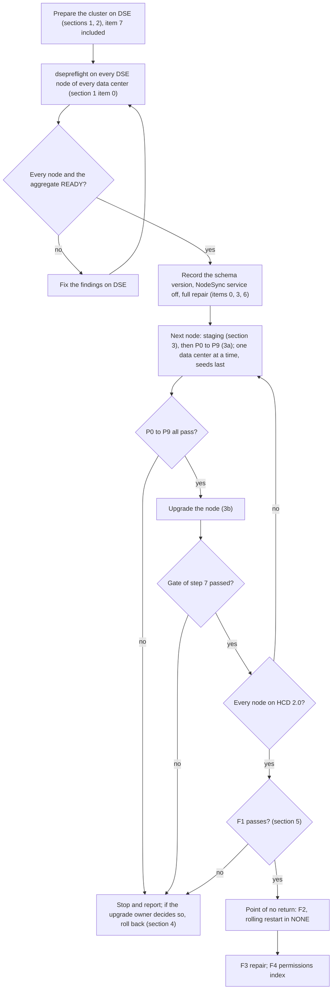

<!--
Copyright IBM Corp.

Licensed under the Apache License, Version 2.0 (the "License");
you may not use this file except in compliance with the License.
You may obtain a copy of the License at

http://www.apache.org/licenses/LICENSE-2.0

Unless required by applicable law or agreed to in writing, software
distributed under the License is distributed on an "AS IS" BASIS,
WITHOUT WARRANTIES OR CONDITIONS OF ANY KIND, either express or implied.
See the License for the specific language governing permissions and
limitations under the License.
-->

# <a id="header"></a>Runbook: in-place upgrade from DSE 6.8/6.9 to HCD 2.0 (version 2.2)

> **Version 2.2, not for production.** What was run is in the Validated list below; the rest is not validated.
> The versions and what each changed are in the reference's [Header history](RUNBOOK-REFERENCE.md#history).
> This is the operator's text: what to do, how to check it, and when to stop. Each section ends with a "Details" link
> to [`RUNBOOK-REFERENCE.md`](RUNBOOK-REFERENCE.md), the reference: the rationale, the edge cases and the detail of
> what was validated. Section, item, step and check numbers are the same in both files.
>
> **Upgrading from DSE 5.1?** This runbook covers the upgrade from DSE 6.8 and 6.9 only. The upgrade from DSE 5.1.51
> has its own procedure, [`RUNBOOK-DSE51.md`](RUNBOOK-DSE51.md), with other settings, checks and rollback steps.

| | |
|---|---|
| From | DataStax Enterprise 6.8 or 6.9 at the latest patch release at the time of the upgrade (DSE 6.8.66 or DSE 6.9.26 as of this version; section 1, "Required DSE release"), DSE core only (the Cassandra workload), one DSE release on every node |
| To | HCD 2.0 (the `main` code line) with the DSE 6 compatibility mode, `internode_compatibility_mode: DSE_6` |
| Build required | The tarball of the HCD 2.0 release that contains the whole DSE 6 compatibility work, including its sync with the `main` code line, run on JDK 17 (section 1, "Build requirement"). No validation run has used that release yet: the validated runs below used development builds of this work. |
| Scope | One or more data centers (several validated on DSE 6.9.26 only); racks as tested (below). Clusters without encrypted (TDE) tables and without a KMIP key provider. |

<a id="validated"></a>**Validated** (the header's validation status, as a matrix; test clusters of three nodes in three
racks, or two data centers of three nodes, each with a rack of two nodes and a rack of one, and, where said below, one
data center of two or three nodes in one rack, or a single node; development builds of this work; details:
[reference](RUNBOOK-REFERENCE.md#validated)):

| DSE release, topology | No internode TLS | `internode_encryption: dc` | `rack` | `all` |
|---|---|---|---|---|
| 6.9.26, one data center | full upgrade, flag drop, rollback with the Paxos steps, NodeSync procedure | mixed phase, one node upgraded | mixed phase, one or two nodes upgraded; rollbacks with and without DSE's legacy TLS port | mixed phase, one node upgraded |
| 6.9.26, two data centers | full upgrade, a rollback, flag drop; writes at `EACH_QUORUM` and `ALL` through every node | one data center upgraded; two rollbacks with the Paxos steps, with and without DSE's legacy TLS port | full upgrade and flag drop, no rollback | full upgrade and flag drop, no rollback |
| 6.8.65, one data center | full upgrade, flag drop, rollback with the Paxos steps | not validated | not validated | mixed phase, one node upgraded |
| 6.8.65, two data centers | development runs only | development runs only | not validated | development runs only |

Also validated on DSE 6.9.26: replica placement for replication factor 1 and 2 in one data center; reads and writes at
`ONE`, `QUORUM`, `ALL`, `LOCAL_QUORUM` and `EACH_QUORUM`, paging, views, LWTs (with the serial-read write timeout of
section 0), counters and batches through DSE and upgraded coordinators of two data centers, with one product in each and
with a data center running both; the preflight aggregate `READY` on six nodes in two data centers; clients at
`LOCAL_QUORUM`/`LOCAL_SERIAL`, `QUORUM`/`SERIAL` and `EACH_QUORUM`/`SERIAL` through the upgrades with no failed request
and no wrong read; in one data center, the assassination of a DSE node lost for good during the upgrade, after the
refusals before its silence threshold, with its `removenode` refused while another DSE node was alive, and of an HCD 2.0
node lost for good, with the silence threshold set by the system property (a value below the floor refused at startup,
one above it taken and logged), the assassination of the live DSE node refused and the lost node's `removenode` refused
while that DSE node was alive (section 6). On DSE 6.8.65 and 6.9.26, one data center of two or three nodes in one rack:
the replay of the view updates DSE stored in its batchlog, hints and commit log (section 6), and the order of the
restart and of the rewrite with `system_info_encryption`, except the replay of encrypted commit log segments and the
rewrite once every node runs with the setting off (section 1). On DSE 6.8.65, a single node with the SAI pin `aa`:
the rollback after writes, deletions, flushes and a compaction on HCD 2.0, DSE answering its index queries from HCD
2.0's index files with no index build (section 2). On DSE 6.9.26 with authentication, `system_auth` at DSE's
default (one replica): a single node on DSE's shipped configuration upgraded as it is, flag drop included; one data
center of three nodes in one rack upgraded as it is, one node at a time with the others up, the preflight's
`SYSTEM_AUTH_REPLICATION` warning and its mixed-phase remedy as written, and an upgraded node refused at its start while
another node of the data center was down; with two nodes down, neither started alone and both did when started together
(section 1 item 7, section 3b, section 5).

<a id="not-validated"></a>**Not validated** (the header's Not validated row; each also marked where it applies; details:
[reference](RUNBOOK-REFERENCE.md#not-validated)):
- More than three nodes in a data center or six in all; clusters of tens to hundreds of nodes, out of scope of this
  version ([section 0](#s0)).
- The rack rule (not exercised); replica placement with replication factor 1 or 2 with several data centers
  (in-JVM tests only).
- Internode TLS on DSE 6.8 beyond the mixed phase with `all` in one data center (one node upgraded, no rollback);
  several data centers on DSE 6.8; DSE 6.8.66 ([section 0](#s0), [section 1](#s1-release)).
- On DSE 6.8: the NodeSync procedure of item 6, the flag drop with the clients taken off before each drain, and F3 with
  `system_distributed` ([item 6](#s1-item6), [section 5](#s5)).
- A rollback with `all` on DSE 6.9, and with `rack` across data centers ([section 4](#s4-tls)).
- T2 and the restart gate as written ([section 4](#s4-gate)); the restart of every DSE node after the last rollback as a
  routine step, and with several data centers ([section 4](#s4-last)).
- The repair on DSE and NodeSync after the last rollback, with or without internode TLS ([section 4](#s4-last)).
- Section 1 item 7 on a cluster that already holds roles and data ([item 7](#s1-item7)).
- The `LOCAL_SERIAL` reads of section 4 step 6 through an HCD 2.0 coordinator ([step 6](#s4-step6)).
- DSE's deletions of old view entries in the other data centers ([section 1 item 2](#s1-item2)).
- The echo request sent again to every peer ([section 3b step 6c](#s3b-step6c)).
- For a lost node, DSE or HCD 2.0: `removenode` once no other DSE node is alive and `removenode force`, steps 5 to 7,
  several data centers and DSE 6.8; the moment a silent node starts to count as lost; the procedure in `NONE` mode
  ([section 6](#s6-lost-node)).
- A view update DSE stored that HCD 2.0 cannot translate, with its WARN ([section 6](#s6-batch)).
- The preflight's `TDE_TABLE` on the four tables `system_info_encryption` encrypts with the setting off, and the
  remedies' texts on the key directory (unit tests only; the test run had the earlier texts)
  ([Required DSE release](#s1-release)).
- The refusal of a plain-text retry towards DSE nodes (unit tests only) ([section 1](#s1-tls-fallback)).
- The preflight's blocking `INTERNODE_TLS`, `MIXED_STORAGE_PORTS`, `HINTS_COMPRESSION` on `hints_compression` (on
  encrypted hints files it ran) and `STALE_REPORT` (unit tests only) ([section 1](#s1-tls69), [Required DSE
  release](#s1-release), [appendix A.11](#a11)); the `-Dcassandra.ssl_storage_port` part of appendix A.11's check by
  hand (1) ([A.11](#a11)).
- The preflight's `SYSTEM_AUTH_REPLICATION` blocking, its warning on other cases than one data center of three nodes at
  one replica, its silence on a single node (the test run had a version that warned there), and the higher replication
  factor of item 7 bounded by the nodes of the data center (unit tests only); not run: the flag drop of a data center of
  three nodes at one replica of `system_auth`, and a rollback of it or of a single node; not upgraded as they are:
  several data centers, or a data center of more than three nodes, below three replicas, a data center of two nodes, or
  of three nodes at two replicas, a single node that once had peers, or one with `system_auth` on
  `NetworkTopologyStrategy` or `EverywhereStrategy`; on DSE 6.8, none of it ([item 0](#s1-item0), [item 7](#s1-item7)).
- The preflight's blocking `UNREADABLE_INPUT` on a `nodes/peers` changed while read, left half written by DSE (with a
  `peers.old` or a `peers.txn`), whose attributes cannot be read, or missing or empty while `nodetool status` lists
  other nodes, and its `PENDING_HINTS` info and `Hints` step then; the info `NO_PEERS_FILE` on a missing `nodes/peers`,
  and its caveat on the remedies of `SYSTEM_AUTH_REPLICATION` and `KEYSPACE_REPLICATION`; the aggregate's
  `NO_PEERS_RECORDED`; the rollback mode leaving a `nodes/peers` it cannot trust (changed while read, left half written,
  damaged, attributes unreadable) unused (unit tests only) ([item 0](#s1-item0), [section 4 step 5](#s4-step5)).
- The preflight's `KEYSPACE_REPLICATION` on item 7's other keyspaces, with several data centers, and with one known at
  most for a replication that gives no node a replica (unit tests only) ([item 0](#s1-item0), [item 7](#s1-item7)).
- EC2 snitches, `Ec2MultiRegionSnitch` across regions, `prefer_local` ([item 0](#s1-item0), [step 3](#s3b-step3)).
- A DSE node started, or a rollback, while every seed it lists runs HCD 2.0; a data center down during the mixed phase
  ([Seeds](#s3b-seeds), [section 3](#s3-order-dc)).
- An abandoned upgrade ([section 0](#s0)); the way back after a failed drain ([section 3b](#s3b-wayback)).
- The generator of section 1 item 6 ([item 6](#s1-item6)).
- How long DSE keeps endpoint grouping on ([step 6b](#s3b-step6b)); the bytes of DSE's `internode_compression: dc`
  framing between data centers; the schema-pull counts per DSE node ([Expected load](#s3b-load)).
- TDE and KMIP: out of scope of this version ([section 0](#s0)).

## <a id="brief"></a>The procedure in brief

An overview for a first reading; follow the numbered sections, not this summary, when doing the work.

A rolling, in-place upgrade: one node at a time stops DSE and starts HCD 2.0 on the same data, commit log, hints and
metadata directories while the other nodes serve clients. Until the flag drop the upgraded nodes run with
`internode_compatibility_mode: DSE_6`: they speak DSE's pre-4.0 internode dialect to DSE nodes and keep their files in
formats DSE reads, so any upgraded node can be rolled back on its own (section 4). When every node runs HCD 2.0, a last
rolling restart sets the mode to `NONE`, the *flag drop* (section 5): the point of no return.

1. **Prepare the cluster, on DSE** (section 1, "Security first", appendices B and C): the latest DSE 6.8 or 6.9 patch
   release on every node; remove what HCD 2.0 does not support (DSE features outside DSE core, `RESTRICT`, row-level
   access control, scheme permissions, views with unsupported hidden columns); pin the drivers to native protocol V4;
   turn off the NodeSync flag of every replicated table; decide the SAI pin (section 2); restart every DSE node once if
   these changes touched `dse.yaml` or `cassandra.yaml` (step 2b of the order of work), with DSE's legacy TLS port
   turned on if internode TLS runs on DSE 6.9; `system_auth` with replicas in every data center (three, or as many as
   the nodes, recommended), with several data centers on `NetworkTopologyStrategy` with the other replicated system
   keyspaces too, and repaired once changed (item 7).
2. **Run the preflight on every DSE node** until every node and the aggregate are `READY`; record the schema version;
   turn the NodeSync service off; run the full repair right before the first node (section 1, items 0, 3 and 6).
3. **Upgrade the nodes one at a time** (section 3), one data center at a time, the seeds last in each: stage JDK 17 and
   HCD 2.0, pass P0 to P9 (3a), then upgrade the node (3b) and pass the gate of step 7. A failure after the drain,
   before HCD 2.0 starts: start DSE again (3b). Anything else: stop and report; a node can be rolled back (section 4).
4. **Drop the flag** (section 5): F1, one more rolling restart in `NONE` (F2), the full repair (F3), the permissions
   index (F4); then regular repairs.

From the preflight until the flag drop: no schema change, no grant, no role change, no topology change (but the removal
of a node lost for good, section 6) and no repair other than the full repair before the first node. Upgraded nodes
refuse schema and topology changes and repair, but not grants (except `UNMASK` and `SELECT_MASKED`) or role changes; DSE
nodes refuse none of these. The mixed phase, the flag drop and its repair must finish within the smallest
`gc_grace_seconds` of the tables that take deletes, counted from the start of that repair (section 1 item 6). Every
planned node stop follows "Stopping a node".



| State | Allowed | Not allowed |
|---|---|---|
| All nodes on DSE | the changes of section 1 in its order of work; the full repair right before the first node | after item 0, any schema, access-control, role or topology change |
| Mixed, or all on HCD 2.0 in `DSE_6` | rolling back any upgraded node (section 4; with every seed on HCD 2.0: not validated, [section 3b "Seeds"](#s3b-seeds)) | schema, topology, access-control and role changes, repair; DDL through a DSE node is not prevented: make sure nobody runs it |
| Flag drop started, and after it | schema changes (`DROP` only after F4), topology operations and grants once every node runs `NONE`; F3 within the deadline | going back to DSE |

Details: [reference, "The procedure in brief"](RUNBOOK-REFERENCE.md#brief).

## <a id="use"></a>How to use this runbook

* Every step is done by hand on each node. Each step says what to do, how to check it and what to do otherwise. On any
  deviation that a step does not cover: stop, keep the cluster as it is and report to the upgrade owner.
* Read before planning: "The procedure in brief", "Security first", "Stopping a node", section 0, appendix B (the DSE
  features to remove) and appendix C (drivers). Appendix A lists the error and refusal texts with their remedies.
* Order: section 1 once; for each node, section 3 (staging), 3a and 3b, with section 2 applied in 3b step 3; after the
  last node, section 5. Section 4 rolls one node back at any time before the flag drop. Section 6 is troubleshooting.
* Section numbers, items, steps and P/T/F checks are stable. Neither `dsepreflight` nor HCD 2.0's own messages cite a
  runbook section: [PREFLIGHT.md](PREFLIGHT.md) gives the sections that cover each finding of the preflight.
* Commands are for a package install of DSE (`/etc/dse`, `systemctl … dse`) and an HCD 2.0 tarball install; adapt the
  paths for a tarball install of DSE. HCD 2.0 logs in UTC. Keep every output a step asks to save.

Words used: *DSE node* = a node running DSE 6.8/6.9; *upgraded node* = a node running HCD 2.0 with
`internode_compatibility_mode: DSE_6`; *mixed phase* = from the first node upgraded until the last node restarts with
`internode_compatibility_mode: NONE`; *the upgrade owner* = the person who decides for the upgrade and to whom
deviations are reported.

Details: [reference, "How to use this runbook"](RUNBOOK-REFERENCE.md#use).

## <a id="security"></a>Security first: DSE access controls this software does not enforce, and internode TLS

The same rules as [SECURITY.md](SECURITY.md). Anything that restricts access in DSE and is ignored here would grant
access after the upgrade, so the upgrade fails fast on them:

1. **Refused (remove them on DSE before the first node):**
   * `RESTRICT` entries: run `UNRESTRICT` for each.
   * Row-level access control (tables with the `DSE_RLACA` extension, `rows/…` grants):
     `UNRESTRICT ROWS ON <ks>.<table>` on each such table, `REVOKE` the row-level grants, then set
     `authorization_options.allow_row_level_security: false` in `dse.yaml`.
   * `authentication_options.scheme_permissions: true` in `dse.yaml` (with authentication enabled): give the roles that
     must log in `EXECUTE` on their scheme, make the others unable to log in (`ALTER ROLE … WITH LOGIN = false`), then
     set it to `false`.

   The preflight blocks on all three (`RESTRICT`, `ROW_LEVEL_ACCESS`, `SCHEME_PERMISSIONS`); an upgraded node refuses to
   start on the first two (appendix A.3). A `dse.yaml` change needs a restart of each DSE node (step 2b of the order of
   work). The override `-Dcassandra.internode_compatibility_mode.ignore_dse_restrictions=true` drops them knowingly (a
   WARN at every start where it drops something); only on the upgrade owner's decision.
2. **Dropped, removing access** (the node starts and warns, the preflight warns): `AUTHORIZE FOR` delegations; `UPDATE`
   or `TRUNCATE` granted alone (the pair is read as `MODIFY`); proxy login and proxy execution (applications must log in
   as the role they need before the upgrade; the node warns
   `Ignoring the unknown permission 'PROXY.LOGIN' granted to role '<role>' on resource '<resource>' …`, and the same for
   `PROXY.EXECUTE`); other DSE-only permissions. In `DSE_6` mode `GRANT ALL` does not write `UNMASK` and
   `SELECT_MASKED`, and an explicit grant of them is refused, until the flag drop.
3. **Authentication:** only DSE's internal scheme. LDAP, Kerberos and `role_management_options.mode: ldap` block the
   upgrade (preflight); the classes become `PasswordAuthenticator`, `CassandraRoleManager` and `CassandraAuthorizer`
   ("Settings to carry").
4. **During the upgrade, run no `GRANT`, `REVOKE`, `RESTRICT`, `UNRESTRICT`, `RESTRICT ROWS` or `UNRESTRICT ROWS` and no
   role change on any node.** Upgraded nodes do not receive DSE's schema changes; their periodic check (every 10
   minutes) logs at ERROR what it finds.
5. While both products run, each node enforces its own rules: a request may be allowed by one coordinator and refused by
   another.
6. Internode TLS: an upgraded node never retries in plain text a connection it encrypts to a DSE node (section 1,
   "Internode TLS: no plain-text retry towards DSE nodes"; `SECURITY.md` section 4).

Details: [reference, "Security first"](RUNBOOK-REFERENCE.md#security).

## <a id="stop"></a>Stopping a node

Whenever one node stops or restarts while the others serve clients (the upgrade, a rollback, the flag drop, the restarts
of section 1, any later restart):
1. `nodetool disablebinary`.
2. Once it has returned, wait 15 s. To give up the stop here, run `nodetool enablebinary`.
3. `nodetool drain`; check that it succeeded (exit 0 and `DRAINED` in `system.log`); stop the node.

Sections 3b and 4 add steps between the wait and the drain. When the whole cluster stops, drain each node and stop it. A
request refused at `disablebinary` (`Server is shutting down`) was not run and can be retried on another node; a
timed-out request may have run, so retry it only if it is idempotent (appendix C).

Details: [reference, "Stopping a node"](RUNBOOK-REFERENCE.md#stop).

## <a id="s0"></a>0. Known limitations

* **Not for production; one or more data centers.** For review only; never on a production cluster. What was validated
  is the header's "Validated" matrix; what was not, its "Not validated" list. `system_auth` with replicas in every data
  center (three, or as many as the nodes, recommended; single-node and small development clusters as they are), with
  several data centers `system_auth` and the other replicated system keyspaces on `NetworkTopologyStrategy` with
  replicas in every data center, and repaired once changed, before the preflight (section 1 item 7). With several data
  centers: one data center at a time, the seeds last in each; a data center with a rolled-back node finished before any
  other node is upgraded; no step while a data center is down (section 3, "Order across data centers"). Clusters of tens
  to hundreds of nodes are out of scope of this version: not validated. Passages that apply only with several data
  centers and were not validated are marked *(several data centers: not validated)*.
* **Only DSE core.** No DSE Search, Graph, Analytics, DSEFS/CFS or Advanced Replication: remove them on DSE (appendix
  B).
* **Only the latest DSE 6.8 or 6.9 patch release** (section 1, "Required DSE release"; `dse -v`). Older releases are out
  of scope: before DSE 6.8.65 and 6.9.23 DSE has no persistent hint window and its hints for upgraded nodes grow for the
  whole mixed phase. The preflight does not check the patch release.
* **No encrypted (TDE) tables, no KMIP key provider: out of scope of this version.** Only clusters without encrypted
  tables, with `transparent_data_encryption_options` disabled and with `system_info_encryption` disabled in `dse.yaml`
  (with it DSE also encrypts the tables `system.batches`, `system.paxos`, `system_backups.backup_configurations` and
  `system_backups.backup_stores`, its commit log, saved caches and hints files: section 1, "Required DSE
  release"); the preflight blocks on all three (`TDE_TABLE`, `TDE_COMMITLOG`). Check on a DSE node that no table or view
  uses the `Encryptor` compression class, or any class whose name contains `Encrypt`: `SELECT keyspace_name, table_name,
  compression FROM system_schema.tables;` and `SELECT keyspace_name, view_name, compression FROM system_schema.views;`;
  the four tables `system_info_encryption` encrypts are the exception: never `ALTER` them (section 1, "Required DSE
  release").
  A cluster that uses a KMIP key provider is out of scope of this version.
* **Internode TLS and compression.** `internode_compression` `dc` or `all` both ran. With internode TLS (any
  `internode_encryption` but `none`): on HCD 2.0 carry DSE's `server_encryption_options` keys and `ssl_storage_port`,
  and keep `legacy_ssl_storage_port_enabled: false` (section 3b step 3); on DSE 6.9 set
  `enable_legacy_ssl_storage_port: true` on every DSE node before the first upgrade, **required** (section 1, "Internode
  TLS on DSE 6.9"); on DSE 6.8 nothing changes. Turning internode TLS on, or changing `internode_encryption`, is DSE's
  own procedure, finished before section 1 item 0 (on DSE 6.8 a node switched to `all` alone does not join the others,
  so it cannot be done one node at a time). Every node, DSE and upgraded, must use the same `ssl_storage_port` and
  the same `storage_port`, with or without TLS, and every DSE node the same `internode_encryption`, in every data
  center. The preflight reports `INTERNODE_TLS` (a warning, or blocking on DSE 6.9.7 and later without DSE's legacy TLS
  port). After the flag drop the nodes talk on `storage_port` only. A rollback with TLS on DSE 6.9 without DSE's legacy
  TLS port can leave the rolled-back node `DN` on the other DSE nodes: section 4, "With internode TLS on DSE 6.9", and
  section 6; after the last rollback with internode TLS on DSE 6.9, every DSE node is restarted, with or without DSE's
  legacy TLS port, before any repair or other operation (section 4).
* **Serial reads under contention fail with a write timeout.** A contended `SERIAL` or `LOCAL_SERIAL` read coordinated
  by an upgraded node can fail with `WriteTimeout` (write type `CAS`) on native protocol V4, or `CAS_WRITE_UNKNOWN` on
  V5, where DSE answered `ReadTimeout`. The client gets an error and no data; an application that handles a
  `ReadTimeout` of a serial read must handle this one the same way. It stays after the flag drop while `paxos_variant`
  is `v1`.
* **A schema change run through a DSE node during the mixed phase is not prevented, and nothing reports it
  automatically.** DSE applies it; the upgraded nodes do not, so reads and writes of a new table fail through upgraded
  coordinators and at `ALL`, and the next upgraded node would take DSE's new schema. Watch for a `schema push (ignored)`
  line in `nodetool compatstatus` (counted since the node's last start), the WARN
  `… a schema change made on a DSE 6 node during the upgrade does not reach this node`, and P9. The only protection is
  section 1 item 5. If it happens: upgrade no further node and report to the upgrade owner. The known way back (not
  tested): roll back every upgraded node (section 4; with internode TLS on DSE 6.9, the restart of every DSE node after
  the last rollback comes first), then a repair on DSE with the NodeSync flags still off, within the smallest
  `gc_grace_seconds` of the tables that take deletes, counted from the start of the repair before the first node; then
  start again from section 1 item 0 (new reports, a new schema version). An abandoned upgrade is not validated.

Details: [reference, section 0](RUNBOOK-REFERENCE.md#s0).

## <a id="s1"></a>1. Before the first node

<a id="s1-release"></a>**Required DSE release.** Every node runs the latest DSE 6.8 or 6.9 patch release at the time of
the upgrade: as of this version **DSE 6.8.66 or DSE 6.9.26** (check DataStax's release notes for a newer one). If the
cluster runs an older release, first upgrade DSE with DSE's own procedure and finish it (`dse -v` gives the same release
on every node) before anything below. Leave `hint_window_persistent_enabled` unset or `true` in DSE's `cassandra.yaml`
(if it is `false`, remove the line with the changes of step 2b of the order of work). Leave `hints_compression` unset in
DSE's `cassandra.yaml`: HCD 2.0 cannot convert a compressed DSE hints file (appendix A.10). On every node,
`grep -nE '^\s*hints_compression:' /etc/dse/cassandra/cassandra.yaml` must print nothing. If it prints a line, remove
that key and the indented lines below it with the changes of step 2b, and, as root, run
`touch /root/hints-uncompressed-since` on that node between DSE's stop and its start of step 2b: DSE then writes its
hints uncompressed, but the files written before keep their compression. Before item 0, on each such node, with every
node up, wait until
`find <hints_dir> -name '*-v*.hints' ! -name '*-Statistics.hints' ! -newer /root/hints-uncompressed-since` prints
nothing (DSE delivers those files), then `rm /root/hints-uncompressed-since`; if one stays, report it to the upgrade
owner. Do not set the key again during the upgrade *(not validated)*. DSE 6.8.65 and 6.9.26 (later patch releases taken
to do the same) also encrypt their hints files, through their compression, while `dse.yaml` sets `enabled: true` under
`system_info_encryption`, a setting section 0 rules out: set `enabled: false` there with the same restart, on every
node, with DSE's whole `system_key_directory` still in place, its `system/system_table_keytab` included (the restart
replays the older commit log segments, encrypted too); then, once DSE runs with it off on every node, run
`nodetool upgradesstables -a system batches paxos` and `nodetool upgradesstables -a system_backups` on every node
(section 0, appendix B), and wait for the older hints files the same way, with that directory still in place. Without
the directory's original keytab, DSE makes a new one at its start, with no warning, then fails on the older encrypted
hints files (`Failed to dispatch hints file <file>: file is corrupted`) and stops serving (`disk_failure_policy: stop`)
(seen on DSE 6.8.65; not tried on DSE 6.9.26). *(The order, confirmed by a test run of DSE 6.8.65 and 6.9.26: the
setting applied only at DSE's start, the two commands rewriting the tables, the older encrypted files delivered with the
directory in place; not run: the replay of encrypted commit log segments at the restart, and the rewrite once every node
runs with the setting off.)* The preflight blocks with `TDE_TABLE` while `system_info_encryption` is enabled, or while
the schema still records those four tables encrypted (DSE not restarted since the setting was turned off, or
`system_schema` not flushed since) *(that finding: unit tests only)*, and with `HINTS_COMPRESSION` while
`hints_compression` is set or a DSE hints file on the node is compressed or encrypted, as its header records (naming the
files) *(`hints_compression`: not validated, unit tests only; the encrypted files: run, with the remedies' earlier
texts, without the key directory, whose present texts unit tests only cover)*. No tool checks the patch release: check
`dse -v` on every node. The preflight accepts every DSE 6.8 and 6.9 release with the note `DSE_RELEASE` (for example
`DSE 6.8 (6.8.65) is accepted; the upgrade requires the latest DSE 6.8 or 6.9 patch release, which this tool does not
check; DSE 6.9 is preferred`): that note is no check of this requirement, which stands.

<a id="s1-build"></a>**Build requirement.** Use the HCD 2.0 release of the header's "Build required" (the required build
below): every text, check, override and `nodetool compatstatus` line quoted here comes from it. A quick check of a
tarball: in the output of `tools/bin/dsepreflight --help`, `--paxos-rollback` is listed and `--paxos-dir` says that only
the directory given is read, not its subdirectories (this shows only that the tarball has the rollback mode and the
`--paxos-dir` check; it does not identify the release). Every node report of the required build has the note
`DSE_RELEASE` `DSE 6.9 (<release>) is accepted; the upgrade requires the latest DSE 6.9 patch release, which this tool
does not check` (on DSE 6.8: `… the latest DSE 6.8 or 6.9 patch release …`). On a DSE node with internode encryption,
the required build's `INTERNODE_TLS` text says that internode TLS between DSE and HCD 2.0 "is validated on DSE 6.9.26
with all, rack and dc, in one data center and between two, and on DSE 6.8.65 with all in one data center only", and its
aggregate starts its listing with a line such as `Reports read: 6, in 2 data centers`.

<a id="s1-tls69"></a>**Internode TLS on DSE 6.9: DSE's legacy TLS port** (required). With internode TLS (DSE's
`server_encryption_options.internode_encryption` other than `none`) on DSE 6.9, set on every DSE node, in DSE's
`cassandra.yaml`:
```
server_encryption_options:
    # the other keys of the block unchanged
    enable_legacy_ssl_storage_port: true
```
DSE 6.9.26 ships the key set to `false` in that block: change that line, do not add a second one. It takes effect at the
DSE restarts of step 2b of the order of work, before the first upgrade; if internode encryption is turned on after step
2b, before the first upgrade, set it in that same rolling restart. After each restart, and again before each node
(section 3a, P3), check on every DSE node that
`grep -nE '^\s*enable_legacy_ssl_storage_port:' /etc/dse/cassandra/cassandra.yaml` prints exactly one line ending in
`true` (write `true`, not `yes` or `on`), that `ss -tln '( sport = :7000 or sport = :7001 )'` lists both ports (with the
default `storage_port` and `ssl_storage_port`), and that `nodetool status` shows every node `UN`. The preflight blocks
on DSE 6.9.7 and later when the key is not set to a value DSE reads as true (`INTERNODE_TLS`, its remedy starting
`set enable_legacy_ssl_storage_port: true on every DSE node`: do what it says) *(the blocking finding: not validated,
unit tests only)*; it reads the file, not the running DSE, so keep the check by hand. Nothing else changes: HCD 2.0
keeps `legacy_ssl_storage_port_enabled: false`. Without the setting the upgrade works, but a rollback needs the extra
steps T0 to T3 of section 4. DSE 6.8 has no such setting and needs none.

<a id="s1-tls-fallback"></a>**Internode TLS: no plain-text retry towards DSE nodes** (required, DSE 6.8 and 6.9). An
upgraded node never retries in plain text a connection that its `server_encryption_options` encrypt to a DSE node, or to
a node whose messaging version it does not know yet: after a failed TLS connection it retries with TLS, for messages and
streams alike. So TLS must work between the upgraded nodes and every DSE node they encrypt to: with
`internode_encryption: all` every DSE node, with `dc` those of the other data centers, with `rack` those of the other
racks. With `dc` or `rack`, `optional` in `server_encryption_options` has no effect: HCD 2.0 takes the encryption as
optional whatever it says. A DSE node that accepts only plain text where the upgraded node encrypts (for example a DSE
node without internode TLS in a cluster set to `all` without `optional: false`, an unset `optional` counting as `true`
when a keystore is set) stays unreachable from the upgraded nodes until it accepts TLS: finish turning internode TLS on
before item 0 (section 0). An upgraded node that refuses the retry logs, once per peer, the WARN `DSE 6 compatibility
mode: refusing the unencrypted fallback of the internode connections to <peer>: …` (appendix A.9) *(not validated, unit
tests only)*.

<a id="s1-order"></a>**Order of work.** The items below keep their numbers, which are not the order in which they
are done. Do them in this order:

**Step 0.** The required DSE release, above, on every node.

**Step 1.** Appendix B and items 1, 1b and 2: remove or disable on DSE what this software does not support (schema and
access-control changes, so before item 0).

**Step 2.** Appendix C: driver settings (P8).

<a id="s1-order-2b"></a>**Step 2b.** The `dse.yaml` and `cassandra.yaml` changes of steps 0 and 1
(`allow_row_level_security`, `scheme_permissions`, `transitional_mode`, `transparent_data_encryption_options`,
`dsefs_options`, `advanced_replication_options`, `hint_window_persistent_enabled: false` and `hints_compression` removed
if set, and with internode TLS on DSE 6.9 `enable_legacy_ssl_storage_port: true`) take effect at DSE's next start (not
the NodeSync key: item 3 adds it with `nodesyncservice disable`): restart every DSE node, one at a time ("Stopping a
node"), with every other node up, and check P1 between nodes. On a node where `hints_compression` was removed, as root,
`touch /root/hints-uncompressed-since` between DSE's stop and its start, then, before step 5, the wait of "Required DSE
release". If none of the changes listed here was needed on any node, no restart is needed: write that down.

**Step 3.** Item 6, first part: read the deadlines, decide on the short `gc_grace_seconds`, save the `nodesync` maps and
turn the NodeSync flag off on every table of the replicated keyspaces (schema changes, before item 0).

**Step 3b.** Item 7 (schema changes and their repair, before item 0; with one data center, `system_auth` only).

**Step 4.** Item 4: decide the SAI pin (section 2).

**Step 4b.** With several data centers: write down the order of the data centers and, in each, the nodes that are not
seeds, then the seeds (section 3, "Order across data centers"); check every node's seed list, and report one that names
only seeds of data centers that come earlier in that order to the upgrade owner before the first upgrade ([section 3b,
"Seeds"](#s3b-seeds)).

**Step 5.** Item 0: the preflight on every DSE node, the aggregate, the schema version written down, and the check by
hand of appendix A.11 on every DSE node.

**Step 6.** Item 3: NodeSync off on every DSE node; write down the date and time.

**Step 7.** Item 5 applies from now on until the flag drop.

**Step 8.** Item 6, second part: the full repair, right before the first node, and the check of what it covered. Then
section 3 for the first node.

<a id="s1-item0"></a>**0. Run the preflight inspection on every DSE node** (after any schema change of items 6 and 7).
Unpack the HCD 2.0 tarball anywhere on the node (for example `/tmp/hcd`) without installing it, with a JDK 17 for the
tool only if the node has none. On a running node first run `nodetool flush system_schema && nodetool flush system_auth`
(one keyspace per command). Then, as root or as the DSE user:
   ```
   JAVA_HOME=<jdk17> /tmp/hcd/tools/bin/dsepreflight --nodetool <dse home>/bin/nodetool --json /tmp/preflight-$(hostname).json
   ```
Add `--nodetool-arg=-u --nodetool-arg=<user> --nodetool-arg=-pwf --nodetool-arg=<password file>` if JMX needs
credentials (never `-pw`, which the process list shows); pass `--conf-dir`, `--dse-yaml`, `--dse-home` or the directory
options if the tool does not find DSE's files; if DSE's `nodetool` does not run on the tool's JDK 17, add
`--nodetool-java-home <its Java>`. Exit 1 is a blocking finding, 0 ready (warnings included), 2 not inspected, 3
incomplete (a `nodetool` command failed, `LIVE_UNAVAILABLE`): fix it and run the tool again; it is never ready. Collect
every node's report into one directory and run `dsepreflight --aggregate <directory>` with the same release of the tool,
within 24 hours of the reports: it exits 1 unless every report is ready, with one DSE release, one schema version, one
release of the tool, no report older than 24 hours, and a report for every DSE node of every `nodes/peers`. Write down
that schema version (each JSON report's `node.schema_version`, or the single version `nodetool describecluster` shows;
P9 compares against it). Do not start the upgrade while any node or the aggregate reports a blocking finding: resolve
each with the "What to do" line it prints. Read every warning (lone UPDATE/TRUNCATE grants, proxy grants, pending hints,
the snitch and security classes to carry); a table whose sstables lack a `TOC.txt` file is a warning only
(`SSTABLE_WITHOUT_TOC`): find out why before upgrading that node. After a repair or another streaming operation the
usual cause is DSE's zero-copy streaming, which writes sstables without `TOC.txt` (DSE 6.8 and 6.9 alike, DSE 6.9 from
DSE's code, not run; DSE does not add the file at its start): accept the warning when DSE's `system.log` or its archives
have `ZeroCopySSTableWriter … Writing partial component DATA to <that sstable's Data.db file>` (or, for an sstable
streamed whole, `… Writing entire component DATA to <that sstable's Data.db file>`) for every sstable of that table
without `TOC.txt` (the finding names the first 20;
`for f in <table directory>/*-Data.db; do [ -e "${f%Data.db}TOC.txt" ] || echo "$f"; done` lists them all) (the full
repair of item 6 comes after this item, so expect it again at P0 of the first node); otherwise do what its remedy says.
Keep each report: its "Settings to carry" and "SAI on-disk version to pin" feed section 2 and section 3b step 3. The
tool checks the replication of `system_auth` against item 7 (`SYSTEM_AUTH_REPLICATION`): it blocks where an upgraded
node could not start even with every node up (for example a data center with nodes and no replica, `SimpleStrategy` with
several data centers, more replicas than the nodes of a data center can make a `LOCAL_QUORUM` of; in the mixed phase,
when the replication can no longer be changed, its remedy is to upgrade no further node and report to the upgrade
owner); it warns where an upgraded node could not start while another node of its data center is down (one or two
replicas in a data center of three nodes or more, or so many above its nodes that `LOCAL_QUORUM` needs every node, four
or five on three nodes), its remedy, item 7's `ALTER` and repair, optional (in the mixed phase it only states the risk);
and it warns, asking for the check by hand, when the data centers of the nodes are not all known, or `nodes/local` is
missing, or a nodes file cannot be read, or `nodes/peers` is being rewritten by DSE (a missing `nodes/peers` is read as
no peer: DSE 6.9.26 did not write it on a node that never had a peer; DSE can also write an empty one), and
`SYSTEM_AUTH_REPLICATION` then blocks only on what blocks whatever the other nodes are (a `nodes/peers` that cannot be
read, changed while read, or left half written by DSE, with a `peers.old` or a `peers.txn`, is itself a blocking
`UNREADABLE_INPUT`: follow its remedy; when `nodes/peers` cannot be read or trusted, its blocking remedy and its check
by hand apply only if no peer runs HCD 2.0 yet, and if one does, upgrade no further node and report to the upgrade
owner; when `nodes/peers` is missing, as on a node that never had a peer, the info `NO_PEERS_FILE` says that this node
was counted alone: if `nodetool status` lists other nodes, apply no remedy of `SYSTEM_AUTH_REPLICATION` or
`KEYSPACE_REPLICATION` and report to the upgrade owner; run with `--nodetool`, the tool checks it itself, a blocking
`UNREADABLE_INPUT` when `nodetool status` lists other nodes, as for an empty `nodes/peers`, and the aggregate blocks on
a ready report that records no peer beside the reports of other nodes, `NO_PEERS_RECORDED`) *(blocking: not validated,
unit tests only; the warning on too few replicas validated on DSE 6.9.26 on one data center of three nodes at one
replica; the warning on nodes not all known, and the caveat when `nodes/peers` cannot be trusted: unit tests only)*.
With several data centers it also checks the replication of item 7's other keyspaces (`KEYSPACE_REPLICATION`; with one
data center known at most, only for a replication that gives no node a replica; a warning, its remedy item 7's `ALTER`
and repair for that keyspace, optional for a low count only (a data center without replicas, or a value that is no
number, is to be changed); in the mixed phase, no change) *(not validated, unit tests only)*. It does not check the
per-table NodeSync flag or the short `gc_grace_seconds` (item 6): check them by hand. With several data centers,
aggregate the reports of every node of every data center together: every data center and rack it lists must be the one
`nodetool status` shows, and no `TOPOLOGY_MISMATCH` may be left unexplained (appendix A.11).

   **EC2 snitches** *(not validated)*. If DSE runs `Ec2Snitch` or `Ec2MultiRegionSnitch` (as `endpoint_snitch`, or as
   the `delegated_snitch` of `dse.yaml` behind `DseDelegateSnitch`), whatever names `nodetool status` shows: in HCD
   2.0's `cassandra-rackdc.properties` on every node set `ec2_naming_scheme=legacy`, and carry `dc_suffix` from DSE's
   `cassandra-rackdc.properties` when it sets one (copy the line as it is: trailing spaces are part of the name);
   otherwise the node comes back in another data center and rack and refuses to start. The preflight warns `EC2_NAMING`
   and lists the line in "Settings to carry"; an upgraded node still on the standard names logs a WARN before the
   refusal (appendix A.2). A snitch class of the same name in another package than `org.apache.cassandra.locator` is not
   taken for these snitches: check how it names data centers.

<a id="s1-item1"></a>**1. Security checks** ("Security first", `SECURITY.md` section 1): run `UNRESTRICT` for every
restriction, `UNRESTRICT ROWS ON <ks>.<table>` on every table restricted to rows and `REVOKE` the row-level grants
before the first node; then set `authorization_options.allow_row_level_security: false` in `dse.yaml`. No access-control
statement on any node during the upgrade.

<a id="s1-item1b"></a>**1b. Only DSE core: no Search (Solr), Graph, Analytics (Spark, Hive), DSEFS/CFS or Advanced
Replication.** On DSE: drop every search index (`DROP SEARCH INDEX ON <ks>.<table>`) and delete the `solr.data`
directories; migrate elsewhere and drop the graph keyspaces (non-null `graph_engine`) and `dse_analytics`,
`HiveMetaStore`, `dsefs` (or `dsefs_options.keyspace_name`), `cfs`, `cfs_archive`, `dse_advrep`, empty or not; restart
every Search, Analytics and Graph node as a plain Cassandra node (no `-s`/`-k`/`-g`; `SOLR_ENABLED`, `SPARK_ENABLED`,
`GRAPH_ENABLED` set to 0) while every other node is up. Leave `solr_admin` and DSE core's keyspaces (`dse_system`,
`dse_security`, `dse_perf`, `dse_leases`, `dse_insights`, `dse_audit`, `dse_system_local`, `dse_insights_local`). An
upgraded node refuses to start while a trace remains
(`internode_compatibility_mode DSE_6 refused: found traces of DSE features…`, appendix A.4). If the only traces listed
are `nodes/peers` entries of nodes since restarted as Cassandra-only or removed, start with
`-Dcassandra.internode_compatibility_mode.ignore_dse_peer_workloads=true` in `conf/jvm-server.options` and keep it until
the flag drop (it warns at every start and covers nothing else). When the check passes, `system.log` shows
`no trace of DSE Search, Graph, Analytics, DSEFS, CFS or Advanced Replication found` and `nodetool compatstatus` shows
`Non-core DSE traces          : none`.

<a id="s1-item2"></a>**2. Materialized views**: `SELECT * FROM system_schema.hidden_columns;` on a DSE node. Views whose
hidden columns are only of the `.v` kind are handled; drop any view with another kind before the upgrade and recreate it
after the flag drop (the preflight blocks: `VIEW_HIDDEN_COLUMNS`).

<a id="s1-item3"></a>**3. NodeSync off on every DSE node, for good**: add `enabled: false` under the `nodesync:` block
of DSE's `cassandra.yaml` and run `nodetool nodesyncservice disable`; `nodetool nodesyncservice status` must say it is
not running. Without the yaml key DSE turns NodeSync back on at every start; while it runs, DSE closes its connections
to upgraded nodes (`Cannot write message READS.NODESYNC ... to legacy node`), among them the one that carries its
acknowledgements of the hints an upgraded node delivers: the upgraded node then logs, every few seconds for the same
file, `Finished hinted handoff of file <file> to endpoint /<peer>: <host id>, partially`, and the WARN
`DSE 6 compatibility mode: hints not acknowledged by DSE 6 node <node>: <n> in file <file>; the file stays and is sent
again from that page. …` (at most every 10 minutes). Remedy: this item on every DSE node, the yaml key included; the
file then finishes (seen on DSE 6.9.26). Write down the date and time (item 6).

<a id="s1-item4"></a>**4. Pin the SAI on-disk version**: decide the value now (section 2); it goes into every node's
configuration before its first start on HCD 2.0.

<a id="s1-item5"></a>**5. No topology or schema changes** for the whole mixed phase: no node added, replaced,
decommissioned, removed or moved (a node lost for good: section 6), no data center added, no repair, no
`upgradesstables`, no `import`, no DDL. Upgraded nodes refuse these (appendix A.7); DDL run on a DSE node is not
prevented (section 0): make sure no application, tool or person runs DDL through any node until the flag drop.

<a id="s1-item6"></a>**6. A full repair first, and a time limit.** Read the deadline: on a DSE node,
`SELECT keyspace_name, table_name, gc_grace_seconds, nodesync FROM system_schema.tables;`,
`SELECT keyspace_name, view_name, gc_grace_seconds, nodesync FROM system_schema.views;` and
`SELECT keyspace_name, replication FROM system_schema.keyspaces;` (tables of `LocalStrategy` keyspaces are never
repaired). Tables with `gc_grace_seconds` 0 or very short need a decision: they take no deletes, or raise the value on
DSE before item 0 (user tables). DSE's own tables keep their value (a default DSE 6.9 cluster has some at 0 or 60): for
them the only decision is that they take no deletes; otherwise report to the upgrade owner. Here **DSE's keyspaces** are
the replicated `system_*` keyspaces, the `dse_*` keyspaces and `solr_admin`; **user tables** are the tables of the other
replicated keyspaces. DSE's repair skips every table whose NodeSync flag is on
(`Skipping anti-entropy repair on tables with NodeSync enabled`), and HCD 2.0 has no NodeSync: so turn the flag off on
**every table of the replicated keyspaces**, before item 0, on any machine with `cqlsh`, `<node>` being one DSE node
(add `-u <superuser> -p <password>` when authentication is on):
   - save the maps and the replication (the `grep` must print 2 or more; keep the files with the preflight reports):
     ```
     cqlsh <node> -e "SELECT keyspace_name, table_name, nodesync FROM system_schema.tables;" > nodesync-before.txt
     cqlsh <node> -e "SELECT keyspace_name, replication FROM system_schema.keyspaces;" > keyspaces.txt
     grep -c LocalStrategy keyspaces.txt
     ```
   - generate one `ALTER TABLE` per table whose map has `'enabled': 'true'`, outside the `LocalStrategy` keyspaces *(the
     generator: not validated)*:
     ```
     nsoff() { awk -F'|' -v q="'" 'FNR == NR { if (index($2, "LocalStrategy")) { k = $1; gsub(/ /, "", k); local[k] = 1 }; next } NF == 3 && index($3, q "enabled" q ": " q "true" q) { k = $1; t = $2; gsub(/ /, "", k); gsub(/ /, "", t); if (!(k in local)) printf "ALTER TABLE \"%s\".\"%s\" WITH nodesync = {%senabled%s: %sfalse%s};\n", k, t, q, q, q, q }' "$@"; }
     nsoff keyspaces.txt nodesync-before.txt > nodesync-off.cql; wc -l < nodesync-off.cql; cat nodesync-off.cql
     ```
     Each line reads `ALTER TABLE "<keyspace>"."<table>" WITH nodesync = {'enabled': 'false'};`; read the list (user
     tables and DSE's; 25 of DSE's on a fresh DSE 6.9.26 cluster);
   - run it and check: the first `grep -c` must print `0`, `nodesync-off-output.txt` must hold nothing but `Warnings :`
     blocks (and, with `-p`, cqlsh's password warning; a `Connection error` means nothing ran); in the check, the next
     number must be `0` and the last at least the line count of `nodesync-off.cql`:
     ```
     cqlsh <node> -f nodesync-off.cql > nodesync-off-output.txt 2>&1; grep -c '^nodesync-off\.cql:[0-9]*:' nodesync-off-output.txt
     cqlsh <node> -e "SELECT keyspace_name, table_name, nodesync FROM system_schema.tables;" > nodesync-after.txt
     nsoff keyspaces.txt nodesync-after.txt | wc -l; grep -c "'enabled': 'false'" nodesync-after.txt
     ```
     If DSE refuses a statement or a flag stays on: for a user table, do not start the upgrade and report it; for a
     table of DSE's keyspaces, report it before going on (its first repair is then F3, its time limit running from item
     3, or from NodeSync's last full pass over it if NodeSync was not keeping up);
   - views have no `nodesync` map; the check after the repair covers them;
   - keep the gap short: the `ALTER`s, item 0 and the repair within a few days, well under the smallest
     `gc_grace_seconds` of the tables that take deletes; if NodeSync was not keeping up before the `ALTER`s, report it
     to the upgrade owner before going on;
   - if the upgrade is abandoned, once every node runs DSE again (with internode TLS on DSE 6.9, after the restarts
     section 4 requires after the last rollback): the repair on DSE with the flags still off, checked as below; to start
     again from item 0, leave the flags off; only when the upgrade is abandoned for good, set on each altered table
     exactly the map saved in `nodesync-before.txt`, turn NodeSync back on on every node, and delete
     `<metadata_directory>/dse-upgrade-in-progress` on every node that ran HCD 2.0 *(not validated)*.

Then, right before the first node, on every node in turn (with several data centers, every node of every data center,
one data center after the other): `nodetool repair -full -pr`, then `nodetool repair -full -pr system_distributed`,
saving each output (`| tee`). From the start of that repair, the whole mixed phase, the flag drop and F3 must finish
within the smallest `gc_grace_seconds` of the tables that take deletes: plan the order and pace of the nodes to fit.
Then check what it covered: the `Skipping anti-entropy repair on tables with NodeSync enabled` lines of the outputs,
and, in `cqlsh` on a DSE node, `CONSISTENCY ALL;` then `SELECT keyspace_name, columnfamily_names, started_at,
finished_at FROM system_distributed.parent_repair_history;`, keeping the rows started after this repair: in each
keyspace with more than one replica, every table of `nodesync-off.cql` and every view must be in its keyspace's
`columnfamily_names` for every node's run (`{''}` means nothing was repaired). If a user table was skipped, do not start
the upgrade: turn its flag off, then run item 0 and this repair again. If a view or a table of DSE's keyspaces was
skipped, do not start the upgrade: report it to the upgrade owner.

<a id="s1-item7"></a>**7. The replication of the replicated system keyspaces** (with one data center, `system_auth`
only, unless `KEYSPACE_REPLICATION` says that no node holds a replica of one). At step 3b of the order of work. An
upgraded node reads DSE's access controls from `system_auth` at `LOCAL_QUORUM` when it starts and refuses to start when
it cannot (section 3b, "Starting an upgraded node while other replicas are down"): with DSE's default for `system_auth`,
`SimpleStrategy` with one replica, and one data center, an upgraded node of a cluster of several nodes cannot start
while any other node of the data center is down, since the check reads the whole of `role_permissions` and every node
holds a part of `system_auth`, even one with no row of that table (seen on DSE 6.9.26: `internode_compatibility_mode
DSE_6 refused: unable to read system_auth.role_permissions at LOCAL_QUORUM (Cannot achieve consistency level
LOCAL_QUORUM) after <n> attempts in <s> s …`). Every data center must hold replicas of `system_auth` (with several data
centers, on `NetworkTopologyStrategy` listing each; with one, `SimpleStrategy`, or DSE's `EverywhereStrategy`, will do),
and no data center more than its nodes can make a `LOCAL_QUORUM` of (two replicas or more on one node, four or more on
two, six or more on three never meet it). Three replicas in each data center, or as many as it has nodes if fewer, are
recommended: in a data center of three nodes or more they let the upgrade go on while a node is down; keep a higher
replication factor, up to the nodes of the data center (more replicas than nodes can raise `LOCAL_QUORUM`: five replicas
on three nodes need all three up). In a data center of one or two nodes, an upgraded node cannot start while another
node of it is down, whatever the replicas. Single-node and small development clusters can be upgraded as they are. With
one data center, the other keyspaces below stay as they are, and the steps below apply to `system_auth` alone, unless
the preflight's `KEYSPACE_REPLICATION` says that no node holds a replica of one: then fix that keyspace with the steps
too. With several data centers, in `keyspaces.txt`, each of `system_distributed`, `system_traces` and DSE's keyspaces
replicated per data center (`dse_security`, `dse_leases`, `dse_perf`, any other `system_*` or `dse_*` keyspace, or
`solr_admin`, on `SimpleStrategy` or `NetworkTopologyStrategy`; leave `EverywhereStrategy` and `LocalStrategy` as they
are) follows the rule of `system_auth`: on `NetworkTopologyStrategy` with every data center listed and replicas in each,
three recommended (or as many as it has nodes if fewer), keeping a higher replication factor up to the nodes of the data
center. The preflight (item 0, run after this item) checks `system_auth` in the data centers that the node's
`nodes/local` and `nodes/peers` record, with `SYSTEM_AUTH_REPLICATION`: blocking where a data center has no replica or
`LOCAL_QUORUM` cannot be met with every node up, a warning below the recommended replicas in a data center of three
nodes or more, or so many above its nodes that `LOCAL_QUORUM` needs every node (four or five on three nodes); its remedy
gives the `ALTER KEYSPACE` of sub-step 2 for them *(blocking: not validated, unit tests only; the warning on too few
replicas validated on DSE 6.9.26 on one data center of three nodes at one replica; the warning on nodes not all known,
and the caveat when `nodes/peers` cannot be trusted: unit tests only)*. With several data centers it checks the other
keyspaces too (with one, only for a replication that gives no node a replica), with `KEYSPACE_REPLICATION`, one warning
per keyspace and never blocking, since an upgraded node needs none of them to start or to work: where a data center has
no replica or a value that is no number, `SimpleStrategy` spans the data centers (unless its replication factor is at
least the nodes, all counted), or a data center of three nodes or more has fewer than the three recommended (no such
warning in a data center of one or two nodes); its remedy gives sub-steps 1 to 3 for that keyspace, optional for a low
count only (a data center without replicas, or a value that is no number, is to be changed); in the mixed phase, no
change *(not validated, unit tests only)*. Where the preflight warns on `system_auth` (a data center of three nodes or
more below the recommendation, or with so many replicas above its nodes that `LOCAL_QUORUM` needs every node), either
change its replication with the sub-steps below, or write down that every node of that data center must be up while an
upgraded node there starts; where it warns on another keyspace, change it with the sub-steps below where the remedy is
not marked optional, and where it says `optional` (fewer replicas than the three recommended only), change it or write
down that it stays as it is. For the other keyspaces, the preflight does not flag `SimpleStrategy` whose replication
factor is at least the nodes (a replica on every node), nor more replicas than the nodes of a data center: the rule
above still applies to them. When the preflight's step "Replication of the other system keyspaces" says `not checked
(…)` or `incomplete, see INSPECTION_ERROR`, or its `SYSTEM_AUTH_REPLICATION` says that the other keyspaces were checked
against the nodes whose data center is known only, check these keyspaces by hand. If no keyspace is to change (with one
data center: `system_auth` meets the requirement and no `KEYSPACE_REPLICATION` says that no node holds a replica of
another, and the replicas of `system_auth` stay as they are), write it down and go on. Otherwise, in this order *(with
one data center or several: not validated on a cluster that already holds roles and data)*:
   1. the NodeSync flag is off on these keyspaces' tables (item 6's first part, its check printed `0`);
   2. through one DSE node, per keyspace:
      `ALTER KEYSPACE <keyspace> WITH replication = {'class': 'NetworkTopologyStrategy', '<dc1>': 3, '<dc2>': 3};`
      (every data center, its exact name as `nodetool status` shows it, three replicas, or as many as its nodes if
      fewer, a higher replication factor kept up to its nodes; with one data center,
      `ALTER KEYSPACE system_auth WITH replication = {'class': 'NetworkTopologyStrategy', '<dc1>': 3};`);
      `DESCRIBE KEYSPACE <keyspace>` shows the new map, `nodetool describecluster` one schema version;
   3. right after, on every node of every data center, one at a time: `nodetool repair -full <keyspace>` for each
      altered keyspace, `system_auth` first, saving each output. Every command must exit 0 and print no
      `Skipping anti-entropy repair` line; a failed one is run again, whole, on its node, with P1 on every node. Do the
      `ALTER`s and this repair in a quiet period, without a pause between them;
   4. then the order of work goes on (step 4).

Details: [reference, section 1](RUNBOOK-REFERENCE.md#s1).

## <a id="s2"></a>2. Pin the SAI on-disk version (every upgraded node, whole mixed phase)

Mandatory while a rollback is possible: without the pin a rolled-back node rebuilds the index of every sstable HCD 2.0
wrote, at startup. The value is the format the DSE release writes (the preflight report gives it, "SAI on-disk version
to pin"; check on a DSE node with `ls <data_dir>/<keyspace>/<table>-*/ | grep SAI` on an SAI-indexed table):

| DSE release (`dse -v`) | SAI version to pin | index file names DSE writes |
|---|---|---|
| 6.8.x | `aa` | `<sstable>-SAI_<index>_<component>.db`, `<sstable>-SAI_<component>.db` |
| 6.9.x | `ca` | `<sstable>-SAI+ca+<index>+<component>.db` |

On each node, before its first start on HCD 2.0:
1. Add `-Dcassandra.sai.latest.version=aa` (`ca` for DSE 6.9) to `conf/jvm-server.options` of HCD 2.0 (or to
   `JVM_EXTRA_OPTS` if the installation passes JVM flags that way).
2. After the start: `ps -ef | grep -o '[c]assandra.sai.latest.version=[a-z]*'` prints the pinned value, and
   `nodetool compatstatus` shows `SAI version pinned           : aa, derived from DSE 6.8 (...)` (or `ca`).
3. After the first flush of an SAI-indexed table on the node (`nodetool flush <keyspace> <table>`), the new sstable's
   index files have DSE's name pattern above, not `SAI+ec+`.

In `DSE_6` the node refuses to start without the right pin
(`internode_compatibility_mode DSE_6 refused: the SAI on-disk version is not pinned…`; every text in appendix A.5).
`-Dcassandra.internode_compatibility_mode.ignore_sai_version_pin=true` lets a node start despite the check, with a
warning at every start: for one start only (for example a stale peer row, after checking the pin by hand), then remove
it. Keep the pin until the flag drop, and remove the line during the flag-drop restart (or later, with any rolling
restart). If a node ran without the pin, do not delete index files by hand: before a rollback, expect DSE to rebuild
those indexes at startup (`Submitting N parallel initial index builds`; SAI queries on that node are incomplete until it
finishes); if the node stays on HCD 2.0, add the pin and restart it.

Details: [reference, section 2](RUNBOOK-REFERENCE.md#s2).

## <a id="s3"></a>3. Per node

<a id="s3-order-dc"></a>**Order across data centers** (with one data center, skip this paragraph). Upgrade one data
center at a time, in the order written down at step 4b of the order of work, one node at a time, the seeds of that data
center last. Never upgrade a node of another data center while one is partly upgraded. After a rollback (section 4),
finish the data center of the rolled-back node first (the node upgraded again, or the data center's other upgraded nodes
rolled back) before any node of another data center; this rule takes precedence over the previous one: the re-upgrade of
a node rolled back in a data center already finished is allowed while another data center is partly upgraded, and
nothing else is upgraded until it is done *(an interpretation of the rule, not confirmed)*. Make no upgrade step while a
data center is down or unreachable (its nodes `DN` in `nodetool status`): wait until every node of every data center is
`UN`, then check the hints (3b, "Expected load") before going on *(several data centers: not validated)*. The checks of
3a and the gate of step 7 cover every node of every data center.

<a id="s3-staging"></a>**Staging, before 3a.** For each node, put JDK 17 and HCD 2.0 on it while DSE still runs, so that
nothing is downloaded or installed between the drain and HCD 2.0's start; P0 uses them too. First write down the JDK DSE
runs with (`java -version` as DSE's OS user, and DSE's `JAVA_HOME` if its configuration sets one). Prefer JDK 17 as an
unpacked tarball (for example `/opt/jdk17`). A distribution's OpenJDK 17 package can take over the system's `java`
alternative, and DSE would then start on JDK 17 on the way back or at a rollback: if it did, set DSE's JDK back
(`update-alternatives --set java <DSE's java>` on Debian and Ubuntu, `alternatives --set java <DSE's java>` on RHEL and
its derivatives) and DSE's `JAVA_HOME` to the value written down. Check `<jdk17>/bin/java -version`, and that
`java -version` as DSE's OS user and DSE's `JAVA_HOME` still give the JDK written down. Unpack the HCD 2.0 tarball (for
example into `/opt/hcd`), owned by the OS user DSE runs as (`cassandra` for a package install). Keep the tarball file on
the node until the node is upgraded: the way back of 3b may need it.

Details: [reference, section 3](RUNBOOK-REFERENCE.md#s3).

### <a id="s3a"></a>3a. Preflight, before every node (stop on any deviation)

- <a id="s3a-p0"></a>P0. Run `dsepreflight` on the next node, as in section 1 item 0. `READY` (exit 0) only: a blocking
  finding stops, and an `INCOMPLETE` report (exit 3) is fixed and the tool run again, never accepted; an
  `SSTABLE_WITHOUT_TOC` warning is handled as section 1 item 0 says (after the full repair of item 6, expect it for the
  sstables DSE's zero-copy streaming wrote); in the mixed phase the `LIVE_SCHEMA` warning (two schema versions), a
  `PENDING_HINTS` warning for DSE's hints files held for upgraded nodes (3b step 0 leaves them for HCD 2.0 to convert)
  and the `UPGRADED_PEERS` note are expected, and so are the `SYSTEM_AUTH_REPLICATION` and `KEYSPACE_REPLICATION`
  warnings written down at section 1 item 7, with their mixed-phase remedy.
- <a id="s3a-p1"></a>P1. `nodetool status` on every node of every data center: every node `UN` in every node's view.
- <a id="s3a-p2"></a>P2. `nodetool describecluster` on every node of every data center: one schema version before the
  first upgrade; in the mixed phase exactly two, one listing only DSE nodes and one listing only upgraded nodes.
- <a id="s3a-p3"></a>P3. `dse -v` gives the same release on every DSE node of every data center, the required one
  ([section 1](#s1-release)). With internode TLS on DSE 6.9: on every DSE node, the check by hand of section 1,
  "Internode TLS on DSE 6.9" (in the mixed phase the only check of the key on the DSE nodes other than the next one).
- <a id="s3a-p4"></a>P4. `nodetool nodesyncservice status` says `The NodeSync service is not running`, and DSE's
  `cassandra.yaml` has `enabled: false` under `nodesync:`.
- <a id="s3a-p5"></a>P5.
  `find <data_dir> -name '*-Data.db' -not -path '*/snapshots/*' -not -path '*/backups/*' | grep -- '-big-'` prints
  nothing; otherwise run `nodetool upgradesstables` on DSE first.
- <a id="s3a-p6"></a>P6. `nodetool compactionstats` shows no Validation or Anticompaction, and `nodetool netstats` says
  `Not sending any streams`.
- <a id="s3a-p7"></a>P7. `nodetool compatstatus` on every upgraded node: `Internode compatibility mode : DSE_6`,
  `SAI version pinned           : aa, …` (6.8) or `ca, …` (6.9), and under `Peers with a known version` one line per DSE
  node of every data center with the version 11 and `(pre-4.0 dialect)`; no `*-v*.hints` file in its hints directory.
- <a id="s3a-p8"></a>P8. Every driver pins native protocol V4 (appendix C).
- <a id="s3a-p9"></a>P9. Monitoring green (no failed request, no wrong read); DSE's schema version
  (`nodetool describecluster` on a DSE node) is the one written down at section 1 item 0; no upgraded node shows a
  `schema push (ignored)` line in `nodetool compatstatus` (section 0).
- A DSE node restarted during the mixed phase sees two schema versions: expected.

Details: [reference, section 3a](RUNBOOK-REFERENCE.md#s3a).

### <a id="s3b"></a>3b. The node itself

<a id="s3b-batches"></a>**Batches, before step 0.** With cqlsh connected to this node:
`SELECT id, toTimestamp(id), version FROM system.batches;` shows no row older than about two minutes (if older ones
stay, `nodetool replaybatchlog` if DSE's nodetool has it, otherwise wait, and check again).

<a id="s3b-wayback"></a>**A failure after the drain, before HCD 2.0 starts** *(not validated)*. If a step fails after
the drain (step 2) and HCD 2.0 has not started on this node since, DSE can start again on its own files. Tie every check
to the drain's UTC time written down at step 2 (HCD 2.0's logs and its marker write UTC, with a `T` between the date and
the time).

**Way back 1.** If DSE still runs, stop it (`systemctl stop dse`). Write nothing onto the node yet. If neither the
staged directory (`<hcd>`, whole or in part) nor `/etc/systemd/system/hcd.service` is there, go to way back 4 (a copy
unpacked elsewhere only for a preflight run, such as `/tmp/hcd`, does not count).

**Way back 2.** HCD 2.0 has not started since the drain when all of these hold:
- as root, `TZ=UTC journalctl -u hcd --since "<drain time>"` shows no `Started` line for the unit (`-- No entries --` is
  expected, and any other line needs a look; if the node rebooted and the journal is kept in memory only, rely on the
  other checks);
- `find <directories> -name 'system.log*' -newermt '<drain time> UTC'`, over those of `CASSANDRA_LOG_DIR` and
  `<hcd>/logs` that exist, lists no file, or only files whose last dated line is older than the drain (for a file:
  `grep -E '^(ERROR|WARN|INFO|DEBUG|TRACE) ' <file> | tail -n 1`; `unzip -p` or `gzip -dc` for an archive);
- `<metadata_directory>/dse-upgrade-in-progress` is absent, empty, or says `since <timestamp>` earlier than the drain.

If one of these shows a start, copy nothing for way back 3: go to the paragraph after it.

**Way back 3.** On the stopped node, `dsepreflight` as in section 1 item 0 but without `--nodetool` and with
`--json /tmp/preflight-wayback-$(hostname).json`, run from a scratch copy (the staged tarball file unpacked into
`/tmp/hcd-check`, with `JAVA_HOME=<jdk17> /tmp/hcd-check/tools/bin/dsepreflight`), reports no `NODE_RAN_HCD`, no
`COMMITLOG` note `commit log segments already replayed by HCD 2.0` and no `COMMITLOG_VERSION`; ignore the other
findings. The check does not count if the tool exits 2 or reports a `COMMITLOG_VERSION`
`cannot list the commit log directory …`, a `COMMITLOG` `no commit log directory at …`, a `NOT_A_DSE_NODE`, an
`INSPECTION_ERROR` of the commit log or metadata directory, or an `UNREADABLE_INPUT`: fix the options (for example
`--conf-dir`) or the permissions (run it as root or as DSE's OS user) and run it again; if it still cannot inspect the
node, stop and report. If the tarball or JDK 17 is missing, copy it into a scratch directory (JDK 17 as its tarball or
unpacked tree, never a package) from the staging host or another node, with `scp` or `tar | ssh` through the jump host
(do not assume `rsync`, or ssh between production nodes); never copy another node's `<hcd>`, and never write into
`<hcd>` or `CASSANDRA_LOG_DIR` (they hold the evidence).

If way back 2 or 3 shows that HCD 2.0 started since the drain, DSE must not start: handle a refusal as step 4 says and
start HCD 2.0 again; if HCD 2.0 cannot be brought up, stop and report (the way back is then the upgrade owner's
decision).

**Way back 4.** Remove the marker if it is empty and this node never ran HCD 2.0 before this attempt (no
`pre-hcd-<timestamp>` snapshot older than step 1's, and the upgrade owner's records of earlier upgrades name no earlier
upgrade of it). Keep it if it says `since <timestamp>` earlier than the drain, or if it is empty and the node ran HCD
2.0 at an earlier upgrade (then it was made by hand after `Unable to write the DSE 6 upgrade marker`, appendix A.2). If
`/etc/systemd/system/hcd.service` exists, put `/etc/systemd/system/hcd.service.d/rolled-back.conf` in place (`[Unit]`
and `RefuseManualStart=yes` on two lines) and run `systemctl disable hcd`. Remove
`/etc/systemd/system/dse.service.d/hcd-upgraded.conf`, run `systemctl daemon-reload`;
`systemctl show -p RefuseManualStart dse` must print `RefuseManualStart=no` and, if HCD 2.0's unit exists,
`systemctl is-enabled hcd` must answer `disabled` and `systemctl show -p RefuseManualStart hcd` `RefuseManualStart=yes`
(never check by starting it). Remove `/tmp/hcd-check` and any copied JDK (keep the tarball file). Check DSE's JDK and
`JAVA_HOME` against the values written down at the staging; if they differ, set them back as the staging says. Then
`systemctl enable dse` and `systemctl start dse`; wait until every node shows this node `UN` and its client port is open
(`nodetool statusbinary`; `nodetool enablebinary` if it is not running). Remove the snapshot of step 1
(`nodetool clearsnapshot -t pre-hcd-<UTC timestamp>`) and, as root, its copy of DSE's node metadata directory
(`rm -r -- <copies>/pre-hcd-<UTC timestamp>`). Report to the upgrade owner (saying if the node was down longer
than section 4's "Time limit"), fix the cause, and upgrade the node again from the staging, then 3a.

<a id="s3b-step0"></a>**0.** `nodetool disablebinary`, then wait 15 s. List `<hints_dir>/*-v*.hints` and map the host id
at the start of each name with `nodetool status`: files for DSE nodes — wait until they disappear; files for a host id
not in the ring — stop; files for upgraded nodes — leave them for step 3b. If you stop here, run
`nodetool enablebinary`.

<a id="s3b-step1"></a>**1.** `nodetool flush`, then `nodetool snapshot -t pre-hcd-<UTC timestamp>`; copy
`cassandra.yaml`, `dse.yaml` and `cassandra-rackdc.properties` aside. Then copy DSE's node metadata directory, which the
snapshot does not hold, aside under the snapshot's name: as root, in bash, with `m` DSE's metadata directory (the one
holding `nodes/local` and `nodes/peers`, set as `metadata_directory` in step 3) and `<copies>` an absolute path on the
node's own disk, outside DSE's data, commit log, hints, saved caches and metadata directories, apart from section 4's
`<quarantine>` (neither inside the other), the same for every upgrade of the node *(not validated)*:
   ```
   snap=pre-hcd-<UTC timestamp>; m=<metadata_directory>; c=<copies>/$snap
   l() { (cd "$1" && find . \( -type d -printf '%p %y %m %u:%g\n' \) -o -printf '%p %y %m %u:%g %s\n' | sort); }
   same() { [ "$(l "$m/nodes")" = "$(l "$c/nodes")" ] && diff -r "$m/nodes" "$c/nodes"; }
   if [ -e "$c" ]; then if same; then echo "copied: $c/nodes"; l "$c/nodes"; else echo "STOP: $c exists and differs"; fi
   elif [ ! -f "$m/nodes/local" ]; then echo "STOP: no $m/nodes/local"
   elif ! { (umask 077; mkdir -p "$c") && cp -a "$m/nodes" "$c/nodes"; }; then echo "STOP: the copy failed: $c"
   elif ! same; then echo "STOP: the copy differs: $c"
   else echo "copied: $c/nodes"; l "$c/nodes"; fi
   ```
It must print `copied:` (it does again when run once more). On "the copy failed" or "differs" (DSE still runs and may
rewrite a file during the copy), `rm -r -- "$c"` and run it again; if it stops again, or on "no … nodes/local":
`nodetool enablebinary`, `nodetool clearsnapshot -t "$snap"` and `rm -r -- "$c"` (if it exists), then stop and report.
Keep the copy as long as the snapshot.

<a id="s3b-step2"></a>**2.** DSE's hints for other nodes delivered (no `*-v*.hints` file left but those of step 0 for
upgraded nodes), then `nodetool drain`; check that it succeeded (exit 0 and `DRAINED`); write down its UTC time with
`date -u '+%Y-%m-%d %H:%M:%S'` once it returns (not from DSE's log); stop DSE.

<a id="s3b-step3"></a>**3.** Make sure DSE cannot start on this node again: `systemctl disable dse`, then create
`/etc/systemd/system/dse.service.d/hcd-upgraded.conf` containing
   ```
   [Unit]
   RefuseManualStart=yes
   ```
and run `systemctl daemon-reload`; `systemctl show -p RefuseManualStart dse` must print `RefuseManualStart=yes` (never
check by starting DSE). DSE must never start on a node that runs HCD 2.0. Check `<jdk17>/bin/java -version` and the
staged `<hcd>`; if either is missing, put it there now from the tarball files (HCD 2.0 unpacked into `<hcd>`, owned by
the OS user DSE runs as; never JDK 17 as a package); only if that fails, see the way back above. If
`/etc/systemd/system/hcd.service.d/rolled-back.conf` exists, remove it. Create `/etc/systemd/system/hcd.service` (change
`User`, `Group`, `JAVA_HOME` and the paths; the heap as DSE's, or leave the two heap lines out; create
`CASSANDRA_LOG_DIR`, a directory of its own owned by that user):
   ```
   [Unit]
   Description=HCD 2.0
   After=network-online.target
   Wants=network-online.target
   Conflicts=dse.service

   [Service]
   Type=simple
   User=cassandra
   Group=cassandra
   Environment=JAVA_HOME=<jdk17>
   Environment=CASSANDRA_LOG_DIR=/var/log/hcd
   Environment=MAX_HEAP_SIZE=<DSE's -Xmx, e.g. 8G>
   Environment=HEAP_NEWSIZE=<DSE's -Xmn, e.g. 2G>
   ExecStart=/opt/hcd/bin/cassandra -f
   SuccessExitStatus=143
   KillMode=mixed
   TimeoutStopSec=600
   LimitNOFILE=100000
   LimitMEMLOCK=infinity

   [Install]
   WantedBy=multi-user.target
   ```
then `systemctl daemon-reload`; do not enable it yet. In HCD 2.0's `conf/cassandra.yaml` (its refusals: appendix A.1),
carry the preflight report's "Settings to carry" (`cluster_name`, `num_tokens`, the addresses and ports, with
`storage_port` as DSE's, the same on every node, with or without internode TLS; the seeds; the snitch and
`cassandra-rackdc.properties`, with an EC2 snitch `ec2_naming_scheme=legacy` and DSE's `dc_suffix`; the security
classes; `internode_compression`; `client_encryption_options`; `cdc_raw_directory`; with internode TLS,
`server_encryption_options` and `ssl_storage_port`, see "Internode TLS" below) and set these keys where the shipped file
has them (do not add a second copy; uncomment the ones it has commented out, among them the directories,
`internode_compatibility_mode` and the `sstable:` block; it names `paxos_variant` only in a comment: add
`paxos_variant: v1`, or leave it out, v1 being the default):
   ```
   internode_compatibility_mode: DSE_6
   storage_compatibility_mode: HCD_1
   sstable:
     selected_format: bti
   uuid_sstable_identifiers_enabled: false
   paxos_variant: v1
   data_file_directories: [<DSE's data directories>]
   commitlog_directory: <DSE's commit log directory>
   hints_directory: <DSE's hints directory>
   saved_caches_directory: <DSE's saved caches directory>
   metadata_directory: <DSE's metadata directory, the one holding nodes/local and nodes/peers>
   ```
Set `internode_compatibility_mode: DSE_6` before the first start: a start without it imports DSE's node metadata and
moves `<metadata_directory>/nodes` to `<metadata_directory>/nodes.migrated`, where DSE does not find it after a rollback
(section 4 step 5 puts back the copy of step 1). Leave `flush_compression` unset, or set it to `fast` or `table`
(`DSE_6` refuses `adaptive` and `none`). In `conf/jvm-server.options` add the SAI pin (section 2) and
`-Dcassandra.trie_index_format_version=bb` (the preflight's "Settings to carry" does not list it: `DSE_6` sets that
value itself, and the line keeps it after the flag drop until a later restart removes it, section 5). Do not change the
seed list. With several data centers the node keeps the data center and rack DSE recorded (DSE's
`cassandra-rackdc.properties`, `prefer_local` included, with `GossipingPropertyFileSnitch`); with
`Ec2MultiRegionSnitch`, the private and broadcast addresses as DSE had them *(several data centers: not validated; never
run on EC2 or with `prefer_local`)*.

   **Internode TLS** (the same settings on every node of every data center): carry the keys DSE sets in
   `server_encryption_options` under the names HCD 2.0 accepts (`internode_encryption`, `optional`,
   `require_client_auth`, `require_endpoint_verification`, `keystore`, `keystore_password`, `truststore`,
   `truststore_password`, `store_type`, `protocol`, `accepted_protocols`, `cipher_suites`, `algorithm`), not the block
   as it is: leave out DSE's `keystore_type` and `truststore_type` (set `store_type` to their value; make both stores of
   one type first if they differ or DSE names only one of them), `enable_legacy_ssl_storage_port` and the keys DSE's
   file sets to no value. Give the stores absolute paths. Carry `ssl_storage_port` with DSE's value. Keep
   `legacy_ssl_storage_port_enabled: false`. Nothing changes on DSE (on DSE 6.9, section 1 set
   `enable_legacy_ssl_storage_port: true`: leave it; if a DSE node lacks it, report to the upgrade owner before this
   upgrade; it can be set in the mixed phase with a restart of that DSE node as "Stopping a node" says). The preflight's
   `INTERNODE_TLS` (a warning here) names the keys to leave out and the relative paths.

<a id="s3b-step3b"></a>**3b.** Do not delete DSE's hints files: HCD 2.0 converts them at its first start and delivers
them.

<a id="s3b-step4"></a>**4.** Start it and enable it at boot (`systemctl enable --now hcd`). Expected at this first
start: the WARNs `Running in internode_compatibility_mode DSE_6: …` (appendix A.1) and, per DSE commit log segment,
`Commit log segment <file> was written by DataStax Enterprise 6 …`; with DSE hints files,
`DSE 6 compatibility mode: converting N hints file(s) …`, one `converted the hints file …` line per file and a summary
ending `0 left in place after a failure; H hint(s) converted, D dropped (0 for a host not in the ring, 0 for an unknown
table, 0 for an unknown column, E expired)`, with no WARN or ERROR of `DseHintsConverter` other than the WARNs of
dropped hints of appendix A.10 (read `system.log` and its archives). No `<host id>-<ts>-v<N>.hints` file may be left;
an `unable to convert the hints file` WARN keeps the file for the next start (appendix A.10); hints dropped for a host
not in the ring, an unknown table or an unknown column are writes for F3. Within about a minute,
`Finished hinted handoff of file <host id>-<ts>-2.hints to endpoint /<peer>` for each target that is up. Then
`DSE 6 compatibility mode: [...] stored with a DSE 6 release (4.0.0.<build>); connecting to them with the pre-4.0
handshake at version 11` and `Identified /<ip>:<port> as a DSE 6 node (…)`; `nodetool status` all `UN` here and on a DSE
node, `nodetool compatstatus` with the DSE peers at 11; no ERROR `Batch <id> of system.batches, … cannot be decoded`
(section 6). With internode TLS, an INFO per listening address
`DSE 6 compatibility mode: also listening for TLS-only internode connections on …` (when `ssl_storage_port` differs from
`storage_port`), and with `rack` or `dc` and `require_client_auth: true` the upstream WARN
`Setting require_client_auth is incompatible with 'rack' and 'dc' internode_encryption values. …`: keep the settings
carried from DSE. With internode TLS, a few seconds of refused connections to a DSE 6.8 node whose version the node
does not know yet are harmless (each attempt chooses the port again, until that node's gossip arrives). With an EC2
snitch, no WARN `DSE 6 compatibility mode: <Ec2Snitch or Ec2MultiRegionSnitch> names this node's data center …` may
appear (appendix A.2). If the node refuses to start, look its text up in appendix A.

   Also expected, at this start or at every start, with nothing to do: the WARN
   `Timed out after <n> milliseconds, was waiting for remaining peers to connect: {<dc>=[<DSE nodes>]}` while two or
   more other nodes of its data center run DSE (the start waits 10 s for them, so the client port opens about 10 s later
   than otherwise), and the WARNs
   `Guardrails value "" for write_consistency_levels_disallowed does not contain "ANY". …` (the shipped guardrail),
   `Found unknown system directory system.range_xfers …` and `… system.nodesync_checkpoints …`,
   `Ignoring incremental node sync metadata … as it is not supported`, `Origin of <n> sstables is unknown or doesn't
   match the local node; commitLogIntervals for them were ignored` (the sstables of DSE's zero-copy streaming),
   `Unable to determine block size for commit log directory: …`, `JMX is not enabled to receive remote connections. …`
   (local JMX, which `nodetool` uses), `No DSE peers found, the mode can be dropped …` at the start of a node with no
   DSE node left (a single node, or the last node of the cluster: the flag drop of section 5 then follows) and, for
   proxy grants, the WARN of "Security first", rule 2.

<a id="s3b-step5"></a>**5.** Expected on the DSE nodes whose seed list names the upgraded node, once per reconnection:
`WARN ... Seed gossip version is 11; will not connect with that version`. Not expected:
`ERROR ... Unexpected error while negotiating internode protocol handshake` — report it (except on a node rolled back to
DSE, at most once per upgraded node at its DSE start: section 4).

<a id="s3b-step6"></a>**6.** After a DSE node restarts, an upgraded node can show it `DN` after the DSE node reports
NORMAL: for a few seconds, and up to a few minutes for a DSE seed restarted while every other seed it lists ran HCD 2.0.
Wait until every upgraded node shows it `UN` before the next step. A DSE node that stays `DN` on an upgraded node while
`nodetool gossipinfo` shows it NORMAL with a growing heartbeat: collect `debug.log` of both nodes and report it. Disable
NodeSync on the restarted DSE node again if its `cassandra.yaml` lacks `enabled: false` (section 1 item 3).

<a id="s3b-step6b"></a>**6b.** On a DSE node: `nodetool gossipinfo` shows the upgraded node with
`DSE_GOSSIP_STATE ... "dse_version":"6.8.1"`, and `system.log` shows one
`Detected DSE version downgrade of a node to DSE version 6.8.1` WARN when the first upgraded node appears (none while
another upgraded node already runs) and `Endpoint grouping range read will be disabled`: both expected; do not wait for
the second *(how long DSE keeps endpoint grouping on: not validated)*. With several data centers, the same on the DSE
nodes of every data center. `SELECT peer, dse_version FROM system.peers` shows 6.8.1 for the upgraded node, and drivers
that read `system.peers` through a DSE node see it as DSE 6.8.1; keep them pinned to V4. If 6.8.1 cannot be used, start
the upgraded nodes with `-Dcassandra.internode_compatibility_mode.dse_version=none` and every DSE node with
`-Ddse.disable_endpoint_group_range_reads=true` (rolling restart), otherwise SAI queries coordinated by DSE fail. In
`nodetool gossipinfo` on an upgraded node, `X_11_PADDING` and `X2` to `X7` (DSE's states), and in DSE's `system.peers`
the old `server_id`, `jmx_port`, `storage_port_ssl` and `native_transport_port_ssl` of an upgraded node, are expected.

<a id="s3b-step6c"></a>**6c.** At any point of the mixed phase (a condition to watch for): an upgraded node shows
another upgraded node `DN` for minutes while `nodetool gossipinfo` there shows it NORMAL with a growing heartbeat. Not
expected *(not validated beyond a test made on purpose)*. Collect `debug.log` of both nodes first. Only while every
other node shows every node `UN`, restart the upgraded node that shows the other `DN`, as in "Stopping a node", and wait
until every node shows every node `UN`. While it is down, requests that need it as a replica can fail. If the view stays
after the restart, stop and report. Report it with the logs in every case.

<a id="s3b-step7"></a>**7.** Gate before the next node: P1 and P2 on every node of every data center; table counts at
ALL and, with several data centers, at `LOCAL_QUORUM` through a node of each data center (all equal); P7 on the new node
with one line at 11 per remaining DSE node of every data center; no
`Unexpected error while negotiating internode protocol handshake` on any DSE node since step 0 (other than those section
4 expects on a rolled-back node); monitoring green in every data center, with only this node briefly unavailable; the
hints check of "Expected load" below on every DSE node of every data center. Wait at least one minute before the next
node.

<a id="s3b-auth-start"></a>**Starting an upgraded node while other replicas are down.** It reads DSE's access controls
from `system_auth` at `auth_read_consistency_level` (`LOCAL_QUORUM` by default) and waits up to
`dse_restrictions_check_wait_seconds` (120 s) before refusing to start. In a whole-cluster restart start the nodes
together. A node that must start alone may be started once with
`-Dcassandra.internode_compatibility_mode.dse_restrictions_local_check_only=true`; remove it at the next restart (it
relies on this node's replica of `system_auth` alone, which can miss a grant held only on other nodes). With several
data centers, `system_auth` on `NetworkTopologyStrategy` (section 1 item 7) lets the check read in the node's own data
center (`nodetool compatstatus`: `DSE access controls ignored  : 0 (found by a LOCAL_QUORUM read)`); with
`SimpleStrategy` the node can refuse at every start, and the flag is no remedy there. With one data center and
`system_auth` at one replica, DSE's default, the node cannot start while any other node of its data center is down
(each node holds a part of `system_auth`, and the check reads the whole of `role_permissions`); with two nodes down,
neither starts alone: start them together. From three nodes on, the three replicas section 1 item 7 recommends rule that
out (with fewer than three nodes, an upgraded node cannot start while another node is down, whatever the replicas).

<a id="s3b-seeds"></a>**Seeds** (partly validated). Do not change seed lists during the mixed phase; upgrade the seeds
last (with several data centers, the seeds of each data center last in it). After a DSE seed restarts, wait for `UN` in
every upgraded node's view before the next node. A DSE node that does not finish starting because it cannot gossip with
its seeds (`Unable to gossip with any peers`, after about 60 s): report it and keep it stopped. A DSE node started, or
rolled back, while every seed it lists runs HCD 2.0 *(not validated)*: check every node's seed list at step 4b of the
order of work and report one that names only seeds of data centers that come earlier in the order to the upgrade owner
before the first upgrade.

<a id="s3b-load"></a>**Expected load during the mixed phase.** Upgraded nodes answer DSE's schema pulls with no schema
and count them in `nodetool compatstatus` (`schema pull (answered with no schema)`): a few per DSE node at each node
start; upgrade large clusters without long pauses. DSE keeps the hints it holds for an upgraded node until that DSE node
is itself upgraded, and, with the required releases and DSE's defaults, stops writing hints for it about three hours
(`max_hint_window_in_ms`) after the oldest it holds, usually from that node's stop for its upgrade; past that, a write
through a DSE coordinator that times out on that node reaches it only with read repair or F3 (reads at `QUORUM` are not
affected; at `ONE` or `LOCAL_ONE` served by that node they can miss it). On every DSE node of every data center, at each
gate of step 7 and at the end of a rollback, check the hints directory and its free space, with the host id of each
upgraded node from `nodetool status`:
```
du -sh <hints_dir>
ls -l <hints_dir> | grep -E ' <host id>-[0-9]+-v[0-9]+\.hints$'
df -h <hints_dir>
```
A size that keeps growing fast between checks, or a file system short of space: report it to the upgrade owner. Do not
change `max_hint_window_in_ms`, `hint_window_persistent_enabled` or `hints_compression` on DSE during the upgrade (a
rolling restart; not validated).

<a id="s3b-hints"></a>**Hints to DSE nodes.** On each upgraded node watch for
`DSE 6 compatibility mode: hints not acknowledged by DSE 6 node <node>: <n> in file <file>`. Once is harmless. If that
DSE node logs `Cannot write message READS.NODESYNC ... to legacy node`, NodeSync runs there: turn it off on every DSE
node as section 1 item 3 says, and the file finishes; do not truncate its hints, whatever the WARN's own advice says.
Otherwise, repeating across 10-minute
periods for the same file: run `nodetool truncatehints <ip>` on the upgraded node; F3 brings the writes.

<a id="s3b-tools"></a>**Offline sstable tools** on an upgraded node (`sstabledump`, `sstablemetadata` and the others of
`<hcd>/tools/bin`): run them with HCD 2.0's `conf/cassandra.yaml`, the one of the `DSE_6` mode, so that the transaction
logs they write are named for DSE.

Some reads are refused while DSE replicas remain (map-entry range predicates and the other features of appendix A.8),
although DSE accepts them. A filtered read above CL ONE that involves a DSE replica can miss a row whose values were
written by separate partial updates, as on DSE. Serial reads under contention: section 0.

Details: [reference, section 3b](RUNBOOK-REFERENCE.md#s3b).

## <a id="s4"></a>4. Rolling a node back to DSE

<a id="s4-time"></a>**Time limit.** The node is down from its drain (step 4) until DSE starts: keep that under the hint
window of the other nodes (3 h by default). If the node ran HCD 2.0 for more than about three hours, the DSE nodes
already stopped hinting it, and those writes wait for a repair, which is refused during the mixed phase: F3, or, with
the upgrade abandoned and every node on DSE, the repair on DSE of section 0. After the last rollback (no node left on
HCD 2.0), repair on DSE as soon as P1 holds on every node after DSE starts (with internode TLS on DSE 6.9, only after
the restart of every DSE node at the end of this section): `nodetool repair -full -pr` and
`nodetool repair -full -pr system_distributed` on every node in turn (with several data centers, one data center after
the other), with the NodeSync flags still off. Every command must exit 0; a failed one is run again, whole, on its node,
with P1 on every node. Prepare steps 0 to 6 (the tool, the files, a DSE coordinator for step 6) before step 1.

<a id="s4-hints"></a>**First drain this node's hints** (the rollback deletes HCD 2.0's hints files).

<a id="s4-step0"></a>**0.** Before closing the client port, with cqlsh on this node:
`SELECT id, toTimestamp(id), version FROM system.batches;` shows no row older than about two minutes (else
`nodetool replaybatchlog`, and check again). A batch kept because it cannot be decoded (section 6): save it and delete
it first; its writes return only with a repair.

<a id="s4-step1"></a>**1.** `nodetool disablebinary`, then wait 15 s.

<a id="s4-step2"></a>**2.** Repeat every 10 s, for up to 10 minutes, until `nodetool listpendinghints` prints
`This node does not have any pending hints` **and** no `<host id>-<ts>-<n>.hints` file is left in the hints directory
(count the files).

<a id="s4-step3"></a>**3.** If files remain: a target that is down, start it; a DSE target that is up, look for
`hints not acknowledged by DSE 6 node` (`nodetool truncatehints <address>` gives up its hints); a paused dispatch (not
shown by nodetool), `nodetool resumehandoff`. To give up every hint left, accept that their writes return only with a
repair, then continue.

<a id="s4-step4"></a>**4.** `nodetool drain`, check that it succeeded (exit 0 and `DRAINED`), then
`systemctl stop hcd && systemctl disable hcd`. If a hints file appears after the stop, start HCD 2.0 again and repeat
from step 1. Then create `/etc/systemd/system/hcd.service.d/rolled-back.conf` (`[Unit]` and `RefuseManualStart=yes` on
two lines), then run `systemctl daemon-reload`; `systemctl show -p RefuseManualStart hcd` must print
`RefuseManualStart=yes` (never check by starting it). The time limit runs from the stop.

<a id="s4-paxos"></a>**Then complete the node's open Paxos rounds, before DSE starts:** the restore replaces
`system.paxos` with the snapshot's, which can lose a value a quorum accepted or bring back an old proposal.

<a id="s4-step5"></a>**5.** With HCD 2.0 stopped after a successful drain and DSE not started, as root: if
`<metadata_directory>/nodes/local` is missing, HCD 2.0 started on this node without `DSE_6` (section 3b step 3) and
moved DSE's node metadata to `nodes.migrated`. Put back the copy that section 3b step 1 made with the newest
`pre-hcd-<timestamp>` snapshot (the one the restore below uses), with the same `<copies>`; what HCD 2.0 left
(`nodes/`, if any, and `nodes.migrated`) is moved next to the copy, never deleted *(not validated)*:
   ```
   snap=pre-hcd-<timestamp>; m=<metadata_directory>; c=<copies>/$snap
   l() { (cd "$1" && find . \( -type d -printf '%p %y %m %u:%g\n' \) -o -printf '%p %y %m %u:%g %s\n' | sort); }
   x() { [ -e "$1" ] || [ -L "$1" ]; }
   if [ ! -f "$c/nodes/local" ]; then echo "STOP: no copy at $c/nodes"
   elif x "$m/nodes/local"; then echo "STOP: $m/nodes/local exists"
   elif x "$m/nodes" && x "$c/nodes.left-by-hcd"; then echo "STOP: $c/nodes.left-by-hcd exists"
   elif x "$m/nodes.migrated" && x "$c/nodes.migrated"; then echo "STOP: $c/nodes.migrated exists"
   elif x "$m/nodes" && ! mv "$m/nodes" "$c/nodes.left-by-hcd"; then echo "STOP: cannot move $m/nodes aside"
   elif x "$m/nodes.migrated" && ! mv "$m/nodes.migrated" "$c/nodes.migrated"; then echo "STOP: cannot move $m/nodes.migrated aside"
   elif ! cp -a "$c/nodes" "$m/nodes"; then echo "STOP: the copy back failed"
   elif [ "$(l "$c/nodes")" != "$(l "$m/nodes")" ] || ! diff -r "$c/nodes" "$m/nodes"; then echo "STOP: $m/nodes differs from the copy"
   else echo "put back: $m/nodes"; l "$m/nodes"; fi
   ```
It must print `put back:`. On "the copy back failed" or "differs from the copy", `rm -r -- <metadata_directory>/nodes`
(a copy of the copy) and run it again; on any other `STOP`, stop and report. Then, at every rollback, check that HCD 2.0
left no file DSE cannot read, which this section does not remove *(not validated)*: `dsepreflight` as in way back 3
(section 3b), run from `<hcd>` with `--json /tmp/preflight-files-$(hostname).json`, must report no `SSTABLE_FORMAT` and
no `COMMITLOG_VERSION` but one that counts only version 7 (the segments of the drain, removed below); ignore its other
findings; the run counts only as way back 3 says. If it reports one, stop and report; [the reference's step
5](RUNBOOK-REFERENCE.md#s4-step5) says what such a rollback also needs. Then run the preflight tool of the required
build in its rollback mode:
   ```
   JAVA_HOME=<jdk17> <hcd>/tools/bin/dsepreflight --paxos-rollback --cql /tmp/paxos-reads.cql --json /tmp/paxos-$(hostname).json
   ```
It finds DSE's files as in section 1 item 0, or pass `--conf-dir`, `--cassandra-yaml`, `--dse-home`, `--dse-yaml`,
`--rackdc`, `--data-dir` or `--metadata-dir`. With several `pre-hcd-<timestamp>` snapshots (always after an earlier
rollback and re-upgrade), pass `--snapshot pre-hcd-<timestamp>`, the newest, which the restore uses. On a node where HCD
2.0 wrote no `system.paxos` sstable (no lightweight transaction touched its replicas and no compaction of `system.paxos`
ran), the first run is expected to exit 1 with the `PROBLEM` `… system looks already restored, so the system.paxos
sstables HCD 2.0 wrote would not be read …`: the restore below has not run, so run the tool again with `--not-restored`
added (the entry of the list below). Exit 2: fix and run again. Exit 0: go to step 6. Exit 1: read the report and run
again with the options it names, until only entries that need a decision are left (each run rewrites both files):
   * a keyspace with replicas outside this node's data center: pass `--serial-consistency <keyspace>=SERIAL` or
     `=LOCAL_SERIAL` (`*=<level>` for the others), the level the application uses, never the other;
   * an unknown data center: pass `--dc <name>`; a keyspace with no replica here although the node holds its Paxos
     state: check the replication and the data center;
   * a `nodes/local` that cannot be read, or a `nodes/peers` the tool cannot trust (changed while read, left half
     written by DSE, damaged, or its attributes unreadable): the data centers of the cluster are unknown; pass
     `--serial-consistency <keyspace>=<level>` for the keyspaces whose reads the report leaves to choose (as in the
     first entry); if the file cannot be read for its permissions, run the tool as root or as the user DSE runs as.
     This entry keeps exit 1: once every read is named, go to step 6, and do not start DSE before every read has
     succeeded *(not validated)*;
   * an unreadable `cassandra.yaml` (DSE's default directories assumed) or a data directory without `system.paxos`:
     pass the options the report names (`--conf-dir`, `--cassandra-yaml`, `--data-dir`, `--metadata-dir`);
   * a round that cannot be protected (replication factor 1, step 6) keeps exit 1: accept that its Paxos state is lost
     at the rollback, or do not roll back;
   * a read marked to check (`-- CHECK` in the file): apply the replication rules of step 6 by hand, and keep or drop
     the read;
   * `system` looks restored or partly restored while the restore below has not run (HCD 2.0 wrote no `system.paxos`
     sstable on this node, or dropped expired snapshot sstables without writing any): pass `--not-restored`;
   * the restore below already ran (out of order), a restore in progress or interrupted, or an sstable the tool cannot
     read or a partition to handle by hand: stop and follow [the reference's section 4 step
     5](RUNBOOK-REFERENCE.md#s4-step5) (`--paxos-dir`, `sstabledump`), edge cases kept there.

<a id="s4-step6"></a>**6.** Run `/tmp/paxos-reads.cql` (SERIAL) through another node, and
`/tmp/paxos-reads-local-serial.cql` (LOCAL_SERIAL) through another node of this node's data center, a DSE node while one
exists (an upgraded node otherwise *(not validated; only reads through DSE nodes were validated)*):
`cqlsh <node> -f <file>`, as a role with `SELECT` on the tables, with every other replica up. Check the output for
errors (Unavailable, timeouts, `CasWriteUnknownResult`) and run the failed reads again until every read has succeeded;
do not start DSE before. The reads hold for 24 hours from step 5's run
(`-- Run the tool again if DSE does not start before <time> …` in both files): if DSE does not start before that time,
run step 5 again and the reads of its new files. A file starting with `-- INCOMPLETE:` or `-- NOTE:` belongs to a run
that exited 1: handle it as in step 5 (after an exit 1 accepted there, run the files of that run). `(0 rows)` is a
success. The replication rules the tool applies: no read where every quorum used on the table includes all the other
replicas (a total replication factor of 2 for tables written at `SERIAL`, a local one of 2 for `LOCAL_SERIAL`); a total
replication factor of 1, or a local one of 1 for `LOCAL_SERIAL`, cannot be protected: the Paxos state of the node's
upgrade is lost at the rollback.

<a id="s4-restore"></a>**Then restore and start DSE.** Restore the `system` and `system_schema` tables of each data
directory from the newest `pre-hcd-<timestamp>` snapshot, table by table: in each table directory, move the files HCD
2.0 left into a quarantine of their own (`<quarantine>/pre-hcd-<timestamp>/…`; keep it until DSE runs) and copy the
snapshot's files in, keeping the snapshot; a table directory without that snapshot (HCD 2.0's own tables) is only
emptied into the quarantine. Restore only once per rollback. As root, in bash, once for the node (`<DSE's OS user>`
being `cassandra` for a package install; `<quarantine>` an absolute path on the node's own disk, apart from section 3b
step 1's `<copies>` (neither inside the other), outside DSE's data directories; `dirs` every data directory of DSE, in
the order of `data_file_directories`) *(not validated as written)*:
   ```
   snap=pre-hcd-<timestamp>; Q=<quarantine>/$snap; dirs=(<each data directory, in data_file_directories order>)
   bad=$(for dd in "${dirs[@]}"; do [ -d "$dd/system_schema" ] || echo "$dd"; done
         [ ${#dirs[@]} -gt 0 ] || echo "(empty dirs)"
         [ ${#dirs[@]} -eq 0 ] || [ "$(realpath -m -- "${dirs[@]}" | sort -u | wc -l)" -eq ${#dirs[@]} ] ||
           echo "(a directory listed twice)")
   newest=$(for dd in "${dirs[@]}"; do printf '%s\n' "$dd"/system_schema/*/snapshots/pre-hcd-*; done |
            xargs -r -d '\n' ls -td 2>/dev/null | head -n 1 | sed 's|.*/||')
   if [ -n "$bad" ]; then echo "STOP: check dirs: $bad"
   elif [ "$snap" != "$newest" ]; then echo "STOP: the newest snapshot is '$newest'"
   elif [ -e "$Q/.restored" ]; then echo "STOP: this rollback's restore is done: $Q"
   elif [ -e "$Q" ]; then echo "STOP: this rollback's restore was interrupted: undo it, then run this again: $Q"
   elif ls -d <quarantine>/pre-hcd-* 2>/dev/null; then echo "STOP: an earlier rollback's quarantine (above)"
   elif ! mkdir -p "$Q"; then echo "STOP: cannot create $Q"
   else
     n=0; ok=1
     for dd in "${dirs[@]}"; do
       n=$((n+1))
       for d in "$dd"/system/*/ "$dd"/system_schema/*/; do
         [ -d "$d" ] || continue; d=${d%/}; t="$Q/$n/${d#"$dd"/}"
         mkdir -p "$t" || { ok=0; continue; }
         find "$d" -maxdepth 1 -type f -exec mv {} "$t/" \;
         if [ -n "$(find "$d" -maxdepth 1 -type f -print -quit)" ]; then ok=0; continue; fi
         if [ -d "$d/snapshots/$snap" ]; then
           cp -p "$d/snapshots/$snap"/* "$d/" || ok=0; rm -f "$d/manifest.json" "$d/schema.cql"
         fi
       done
       chown -R <DSE's OS user>: "$dd/system" "$dd/system_schema" || ok=0
     done
     if [ "$ok" = 1 ]; then
       touch "$Q/.restored"; for dd in "${dirs[@]}"; do ls "$dd"/system_schema/tables-*/; done
     else echo "STOP: a move, a copy or a chown failed: undo, fix, run again"; fi
   fi
   ```
Each table directory's files go to `<quarantine>/pre-hcd-<timestamp>/<n>/<keyspace>/<table directory>`, `<n>` being the
data directory's position in `dirs`, from 1. Before running it, compare `dirs` with `data_file_directories` in DSE's
`cassandra.yaml`: every data directory, once, in that order. The last `ls` must list the snapshot's sstables of
`system_schema.tables` in at least one data directory (in the others it may list only `snapshots`, nothing, or an `ls`
error); if it does not, or if a data directory was left out of `dirs`, do not start DSE: `rm -f "$Q/.restored"`, run the
undo below with the same `dirs`; then, if `dirs` was wrong, correct it and run the block again, and if it was right,
stop and report. The block marks the restore done only when every move, copy and chown succeeded; "a move, a copy or a
chown failed" (a full disk, for example): undo, fix the cause, run it again (a table directory whose files could not all
be moved gets no copy). The block changes nothing when it stops (at most an empty `<quarantine>`, with any parent
directories it created, is left): on a directory of `dirs` that holds no `system_schema`, an empty `dirs` or a directory
listed twice; on a snapshot that is not the newest by its time (it names the newest: if that is the snapshot of this
node's last upgrade, set `snap` to it and run again; if it is empty, meaning no snapshot was found, or names another
snapshot: stop and report); on this rollback's restore, done (do not run it again) or interrupted (undo it as below,
then run it again); on an earlier rollback's quarantine, which it lists: that rollback's DSE has run since, so delete
it, or move it outside `<quarantine>` and outside DSE's data directories, then run the block again; when it cannot
create the quarantine (fix the cause, then run it again). To undo an interrupted restore, with the same `snap`, `Q` and
`dirs` (it deletes the copies the block made, never a file that is also the snapshot's, moves the quarantined files back
and removes the quarantine once it is empty) *(not validated)*:
   ```
   if [ ! -d "$Q" ] || [ -e "$Q/.restored" ]; then echo "STOP: no interrupted restore at $Q"
   else
     n=0
     for dd in "${dirs[@]}"; do
       n=$((n+1))
       for t in "$Q/$n"/system/*/ "$Q/$n"/system_schema/*/; do
         [ -d "$t" ] || continue; t=${t%/}; d="$dd/${t#"$Q/$n"/}"
         if [ -d "$d/snapshots/$snap" ]; then
           for f in "$d/snapshots/$snap"/*; do
             c="$d/${f##*/}"; if [ -e "$c" ] && ! [ "$c" -ef "$f" ]; then rm -f "$c"; fi
           done
         fi
         find "$t" -maxdepth 1 -type f -exec mv -n {} "$d/" \;
       done
     done
     if [ -z "$(find "$Q" -type f -print -quit)" ]; then rm -r "$Q"; echo "undone"
     else echo "STOP: files left in $Q"; fi
   fi
   ```
On "files left": for a file of `$Q` whose namesake is already back in its table directory (a move between file systems
interrupted, for example), compare the two with `cmp`: identical, delete the one in `$Q`; the one in `$Q` shorter and
`cmp` reporting EOF on it (a partial copy), delete the one in `$Q`; the one in the table directory shorter and `cmp`
reporting EOF on it, delete that one; otherwise stop and report. Then run the undo again. (When `<quarantine>` is on
another file system than a data directory, each move is a copy, and a second run of the undo can delete, as a copy, a
file that is also in the snapshot; the block copies it back when it runs again.)
Then remove what HCD 2.0 left (paths relative to DSE's base data directory, `/var/lib/cassandra` for a package install):
`commitlog/CommitLog-7-*.log`, `commitlog/*.log.replayed`, its hints `hints/*-2.hints`, `hints/*-2.crc32`,
`hints/*-2-Statistics.hints`, `saved_caches/*`, `<first data directory>/system/_paxos_repair_state/` (the block has
moved its files into the quarantine), `metadata/nodes/.imported-by-hcd-*`, `metadata/nodes/.hcd-import-marker.tmp`,
`metadata/dse-peers-seen`, `metadata/dse-peers-seen.tmp`; keep the `bb` sstables, DSE's own hints,
`metadata/nodes/local` and `metadata/nodes/peers`, and the transaction logs `bb_txn_<type>_<id>.log` that a drain or a
crash left in the table directories of the other keyspaces (DSE completes them at its start; such a log: not validated).
Then `find <DSE's data directories> -name 'bti-*_txn_*.log' -not -path '<quarantine>/*'` must print nothing: such a log
is not expected (in `DSE_6` the node, and the offline tools run with its `cassandra.yaml`, name their logs for DSE; such
a log comes only from HCD 2.0 run with a configuration other than `DSE_6`, such as an offline tool run with another
`cassandra.yaml`: section 3b, "Offline sstable tools"), and DSE ignores it, loading the sstables its transaction made
obsolete next to the new ones. If it prints a log, stop and report before starting DSE; only with the upgrade owner's
go-ahead, complete it by hand: when its last line starts with `COMMIT:`, delete the files of each sstable a `REMOVE:`
line names, then the log; otherwise the files of each sstable an `ADD:` line names, then the log. Restore DSE's
configuration; remove `/etc/systemd/system/dse.service.d/hcd-upgraded.conf`;
`systemctl daemon-reload && systemctl enable dse`; start DSE. **With internode TLS on DSE 6.9 and without DSE's legacy
TLS port:** T0 before starting DSE, T1 to T3 as soon as it has started, then the rest below. **With several data
centers**, finish this node's data center before any other (section 3). **After the last rollback with internode TLS on
DSE 6.9**, every DSE node is restarted before any repair or other operation (the end of this section).

<a id="s4-logs"></a>**What to expect in the logs at DSE's start.** The rolled-back node logs at most one ERROR
`Unexpected error while negotiating internode protocol handshake` per upgraded node; none when no other node runs HCD
2.0, and none on the other DSE nodes. Report any other ERROR, more than one such line per upgraded node at each DSE
start of this node, or such lines on another DSE node.

Then: rebuild the materialized views on that node, `nodetool rebuild_view <keyspace> <base table> <view>` for each view
(SAI: nothing to do if the version was pinned, section 2); keep `metadata/dse-upgrade-in-progress` (DSE does not read
it; while it exists HCD 2.0 refuses to start on the node with `NONE`, appendix A.2): while any node runs HCD 2.0, and,
after the last rollback, while the node may be upgraded again; delete it only when the upgrade is abandoned for good
(section 1 item 6); re-apply NodeSync off and internode compression if they were set after the snapshot. Check P1, P2
and P4, table counts at ALL (with several data centers, also at `LOCAL_QUORUM` through a node of each), serial reads of
a few LWT partitions through every node, and no ERROR in its `system.log` but the lines above. Before any other node is
upgraded or rolled back, run the `ls` line of 3b ("Expected load") on each DSE node of every data center with this
node's host id until it prints nothing; if a DSE node's files do not shrink between two checks 10 minutes apart, report
it. The node can be upgraded again later with section 3 (a new snapshot).

<a id="s4-tls"></a>**With internode TLS on DSE 6.9** (T0 to T3). With DSE's legacy TLS port on every DSE node, as
section 1 requires, T0 to T3 do not apply. They apply when this node's restored `cassandra.yaml` has an
`internode_encryption` other than `none`, the cluster runs DSE 6.9, and the file does not set
`enable_legacy_ssl_storage_port: true`: the other DSE nodes can then see this node `DN` until one of them is restarted,
and every request it coordinates fails *(a rollback with `all`, and with `rack` across data centers: not validated)*.
With DSE's legacy TLS port, or on DSE 6.8 *(DSE 6.8: not validated)*, none applies: if a DSE node still shows this node
`DN` 10 minutes after DSE started, see section 6.

<a id="s4-gate"></a>*The restart gate* *(not validated as written)*, for every DSE restart of T2 and of the restart
after the last rollback: restart DSE as "Stopping a node" says (`nodetool disablebinary`, wait 15 s, `nodetool drain`,
`systemctl restart dse`). Then every 10 s run `nodetool status` on the restarted node and on the rolled-back node (the
last rolled-back node after the last rollback; the restarted node alone when it is that node). The gate is met when the
restarted node shows every node `UN`, the rolled-back node shows the restarted node `UN`, **and**
`nodetool statusbinary` on the restarted node prints `running`. Watch the clients' errors (`Unavailable`, timeouts) from
the restart on; restart the next node only once the gate is met and they are back to the usual rate; if they go on after
the gate, restart no other node, run `nodetool status` on the coordinators they name, and report. Start no repair until
the gate of the last restart is met and the errors are back to the usual rate. If the gate is not met within 10 minutes
of `systemctl restart dse`, stop: restart no other node and report. Do T2's restarts in a quiet period if you can, never
while any node other than the rolled-back one is down.
- <a id="s4-t0"></a>T0. Before starting DSE: if the restored `cassandra.yaml` has a `start_native_transport:` line, set
  it to `false` (T3 restores it); do not add the line if it is absent.
- <a id="s4-t1"></a>T1. As soon as `nodetool` answers on this node: `nodetool disablebinary`, then
  `nodetool statusbinary` must print `not running`. Check that the case applies: `ss -tln` on this node lists
  `storage_port` but not `ssl_storage_port`. If it lists both, skip T2, do T3, then section 6 if a DSE node still shows
  this node `DN` 10 minutes after DSE started.
- <a id="s4-t2"></a>T2. Wait for `Node /<its address> state jump to NORMAL` in this node's `system.log` (from this
  start; if it does not come within 10 minutes of DSE's start, stop and report), then run `nodetool status` on this node
  once: the nodes it shows `DN` are T2's list. If one of them is actually down (its `nodetool` does not answer), stop
  and report.
  * DSE nodes in the list: for each, look in this node's `debug.log` (and its rotated files) since this start for
    `Failed to receive echo reply from /<that node>`. None: it is a restart candidate. Some: wait for
    `Resetting connection pool to /<that node>, too many failed echo attempts: <x>` in `system.log`, then
    `nodetool status` here: `UN`, it is freed; still `DN`, a candidate; neither within 10 minutes of the `NORMAL` line,
    a candidate (the reset comes about two minutes after the first failure with the defaults of `request_timeout_in_ms`
    and `echo_attempts_before_reset`; much later with a larger timeout). Without a `debug.log`, treat each as in the
    second case. Then take the candidates one at a time (with several data centers, those outside this node's data
    center first): just before each turn run `nodetool status` on it; if it shows this node `UN`, skip it; if `DN`,
    restart it behind the restart gate, and take the next only once its gate is met.
  * Upgraded nodes in the list: never restart one. Run `nodetool status` here every 10 s until it shows each `UN`,
    within 10 minutes of the gate of T2's last restart (or of the end of the echo-reset wait); otherwise stop and
    report.
  * Then T3 (at once if the list held nothing).
- <a id="s4-t3"></a>T3. P1 on every node, this one included. If a DSE node that this node showed `DN` showed this node
  `UN` at its turn and P1 now fails on it, stop and report; if a DSE node shows this node `DN` while this node shows it
  `UN`, restart it behind the restart gate, report it, and run P1 again (if it fails again, stop and report). Then
  `nodetool enablebinary` here, and `nodetool statusbinary` must print `running`; restore `start_native_transport` if T0
  changed it. Go on with the checks of the restore above.

<a id="s4-last"></a>**After the last rollback, with internode TLS on DSE 6.9: restart every DSE node** *(as a routine
step, and with several data centers: not validated)*. The last rollback leaves no node on HCD 2.0 (a rollback while
another node still runs HCD 2.0 is not the last; if nodes are upgraded again and all rolled back again, that is a last
rollback too). It applies with or without DSE's legacy TLS port. Once the checks of the restore pass on the last
rolled-back node (after T3 where it applies; the hints check may go on meanwhile), and **before any repair, before
NodeSync is turned back on, and before any other operation**: restart every DSE node of every data center, the
rolled-back nodes included, one at a time behind the restart gate, the last rolled-back node last; a node T2 restarted
in this rollback is not restarted again. Then run the repair on DSE ("Time limit"). If a repair on DSE still fails after
being run again whole with P1 on every node, or a DSE node logs `Cannot write message <verb> … to legacy node` or
`Group <x> does not support messaging version <x>` after the last rollback, stop and report (also without internode TLS,
where the restart is not made *(not validated)*). Count those lines on every DSE node after the repair, and again once
NodeSync has validated since it was turned back on, from the later of the node's last DSE start and the time DSE started
on the last rolled-back node (`t`, as that node's `system.log` shows it, the same value on every DSE node, in the logs'
time zone; rotated files first, oldest first, uncompressed; the lines are logged below WARN; the path is a package
install's); it must print `0`, and any other output is a stop:
```
awk -v t='<YYYY-MM-DD HH:MM:SS>' 'BEGIN {if (t !~ /^[0-9][0-9][0-9][0-9]-[0-9][0-9]-[0-9][0-9] [0-9][0-9]:[0-9][0-9]:[0-9][0-9]$/) {print "t not set"; bad = 1; exit 2}} !s && match($0, /[0-9][0-9][0-9][0-9]-[0-9][0-9]-[0-9][0-9] [0-9][0-9]:[0-9][0-9]:[0-9][0-9]/) && substr($0, RSTART, RLENGTH) >= t {s = 1; n = 0} /Starting up server gossip/ {n = 0} /Cannot write message .* to legacy node|does not support messaging version/ {n++} END {if (bad) exit 2; if (!s) {print "no line at or after t: check t"; exit 1} print n + 0; exit (n > 0)}' /var/log/cassandra/system.log
```

Details: [reference, section 4](RUNBOOK-REFERENCE.md#s4).

## <a id="s5"></a>5. After the last node: the flag drop

The compatibility mode is read only when a node starts: it cannot be changed on a running node, so the flag drop is a
rolling restart. The files of the upgrade that keep a node from starting with `NONE`, the marker and the record of DSE
peers, are deleted by hand while the node is stopped (F2).

- <a id="s5-f1"></a>F1. Refuse unless all of these hold: `systemctl is-active dse` is inactive on every node; P1 on
  every node of every data center and one schema version; on every node `compatstatus` shows no `(pre-4.0 dialect)`
  line, no `known from gossip only` line and `DSE 6 peers on record        : 0`;
  `grep -v '^#' <metadata_directory>/dse-peers-seen` prints nothing (or the file is absent); no `*-v*.hints` file
  anywhere; monitoring green.
- <a id="s5-f2"></a>F2. One node at a time (with several data centers, one data center after the other): set
  `internode_compatibility_mode: NONE` and remove `-Dcassandra.sai.latest.version=...`; `nodetool disablebinary`, wait
  15 s; `nodetool drain`, check it (exit 0 and `DRAINED`); `systemctl stop hcd`; delete
  `<metadata_directory>/dse-upgrade-in-progress`, `dse-peers-seen`, `dse-peers-seen.tmp` and `commitlog/*.log.replayed`;
  `systemctl start hcd`. `compatstatus` must say `NONE`, every node `UN`, counts right at ALL, monitoring green. A few
  seconds of several schema versions at the first `NONE` start are expected, and so is the WARN `Found a legacy log
  record … with updateTime based on the stats file, ignoring to allow startup to continue`, once per such record left
  from the `DSE_6` period, and, on a node whose DSE node metadata records no peer (a single node that never had a peer:
  DSE writes no `nodes/peers` there, or an empty one; seen with no `nodes/peers` only), the WARN `No CC4 peer metadata
  found to migrate, falling back to system tables`. If the start fails: restore `cassandra.yaml` and the JVM options,
  recreate the marker and start with `DSE_6` (appendix A).
- <a id="s5-f3"></a>F3. Every node on `NONE`: `nodetool repair -full -pr`, then
  `nodetool repair -full -pr system_distributed`, on each node in turn (with several data centers, one data center after
  the other). Mandatory, within the deadline of section 1 item 6.
- <a id="s5-f4"></a>F4. Right after the last node restarted in `NONE` and **before any `DROP`** of a table, keyspace,
  function or role, rebuild the reverse index of the permissions, in `cqlsh` on one node as a superuser:
  ```
  CONSISTENCY QUORUM;
  COPY system_auth.role_permissions (resource, role) TO '/tmp/role_permissions.csv';
  COPY system_auth.resource_role_permissons_index (resource, role) FROM '/tmp/role_permissions.csv';
  SELECT count(*) FROM system_auth.role_permissions;
  SELECT count(*) FROM system_auth.resource_role_permissons_index;
  ```
  The two counts must be equal, and both `COPY` commands must report no error.
- **NodeSync after the upgrade.** Nothing in HCD 2.0 replaces NodeSync (a `CREATE TABLE` with the `nodesync` option
  warns `The unsupported 'nodesync' table option was ignored.`): after F3, schedule regular repairs (every table that
  takes deletes, in a keyspace with more than one replica, repaired in full at least once within its `gc_grace_seconds`,
  for example as F3 does, with a margin for a repair that must run again).
- Nodes already in `NONE` show peers still in `DSE_6` with an `X_11_PADDING` JSON in `nodetool gossipinfo` until those
  restart: harmless.
- Settings that stay (to change later, one rolling restart each): `-Dcassandra.trie_index_format_version=bb`,
  `storage_compatibility_mode: HCD_1`, `paxos_variant: v1`, `uuid_sstable_identifiers_enabled: false`; the
  `metadata/nodes.migrated` directory stays.
- `paxos_variant: v1` stays at least until the largest `gc_grace_seconds` (at the time of the upgrade) of the tables
  that used LWTs has passed since the last DSE node was upgraded (before that, a Paxos repair under v2 can lose a
  proposal a DSE coordinator got accepted). After the flag drop nothing enforces it: it is this procedure's rule.
- `GRANT UNMASK` and `GRANT SELECT_MASKED` are allowed again, and so are schema changes (`DROP` only after F4) and
  topology operations.

Details: [reference, section 5](RUNBOOK-REFERENCE.md#s5).

## <a id="s6"></a>6. Troubleshooting

| Symptom | Where |
|---|---|
| A node refuses to start, or an operation or query is refused | appendix A: look the text up by its first words |
| `Cannot decode system.paxos.<column> …` | below |
| `internode_compatibility_mode DSE_6 requires paxos_variant v1, found <variant>` | below |
| `Batch <id> of system.batches, … cannot be decoded` | below |
| At DSE's start after a rollback, or HCD 2.0's first start in `NONE`: `Unexpected files detected for sstable [<name>]: …` | below |
| `Server is shutting down` at a client | "Stopping a node"; appendix C |
| A DSE node `DN` on an upgraded node after its restart | section 3b step 6, section 3b "Seeds" |
| An upgraded node `DN` on another upgraded node for minutes, its gossip current | section 3b step 6c |
| After a rollback with internode TLS, other nodes show the rolled-back node `DN` and requests through it fail | below; section 4, "With internode TLS on DSE 6.9" |
| ERROR `Unexpected error while negotiating internode protocol handshake` on a DSE node | expected on a node rolled back to DSE, at most once per upgraded node at its DSE start (section 4, "What to expect in the logs at DSE's start"); anywhere else, report it (section 3b step 5) |
| `hints not acknowledged by DSE 6 node` | section 3b, "Hints to DSE nodes" |
| `Finished hinted handoff of file <file> to endpoint /<peer>: <host id>, partially` every few seconds for the same file, and `hints not acknowledged by DSE 6 node`, with `Cannot write message READS.NODESYNC ... to legacy node` on that DSE node | NodeSync left on: section 1 item 3 |
| `unable to convert the hints file` | section 3b step 4; appendix A.10 |
| `dropped <n> hint(s) of the hints file` (or `dropped the <n> hint(s)`) | section 3b step 4; appendix A.10 |
| A DSE coordinator fails SAI queries (`Cannot write message … to legacy node`) | section 3b step 6b |
| After the last rollback (no node on HCD 2.0), a repair on DSE fails, or `Cannot write message <verb> … to legacy node` or `Group <x> does not support messaging version <x>` | section 4, "After the last rollback": report it if it happens after the restarts, or without internode TLS on DSE 6.9 |
| `WriteTimeout` (write type `CAS`) to a serial read | section 0 |
| `schema push (ignored)` in `compatstatus`, DSE schema version changed | section 0 |
| A node, DSE or HCD 2.0, is gone for good (host lost or retired) during the upgrade | below |
| WARN `refusing the unencrypted fallback of the internode connections to <peer>` | section 1, "Internode TLS: no plain-text retry towards DSE nodes"; appendix A.9 |

### <a id="s6-paxos"></a>`Cannot decode system.paxos.<column> of table <id>, row_key 0x<key>`

The LWTs of that partition fail until the row expires. To remove it sooner, as a superuser connected to each replica in
turn: 1. read `SELECT writetime(in_progress_ballot), writetime(in_progress_read_ballot), writetime(proposal_ballot),
writetime(proposal_version), writetime(most_recent_commit_at) FROM system.paxos WHERE row_key = <key> AND cf_id = <table
id>;` 2. `DELETE FROM system.paxos USING TIMESTAMP <largest + 1> WHERE row_key = <key> AND cf_id = <table id>;` (one row
per statement, never a range). 3. During the mixed phase the next serial read or LWT completes the round; after the flag
drop run `nodetool repair --paxos-only <keyspace> <table>`. A suppressed `AssertionError` from `PaxosState.close` comes
with each failure: not a separate problem.

### <a id="s6-variant"></a>`internode_compatibility_mode DSE_6 requires paxos_variant v1, found <variant>`

Set `paxos_variant: v1` (or remove the line) and start again. A runtime change is refused with
`changing paxos_variant to <variant> is refused while the DSE 6 upgrade is in progress …`; in `NONE` the same refusal
applies to a v2 variant while DSE nodes are still in gossip.

### <a id="s6-batch"></a>`Batch <id> of system.batches, stored with messaging version <n>, cannot be decoded`

The batch stays in the batchlog, never replayed, and does not block the others; its mutations may be missing on some
replicas. To drop it, as a superuser on that node: save it
(`SELECT mutations, version FROM system.batches WHERE id = <id>`), delete it
(`DELETE FROM system.batches WHERE id = <id>`), and repair the tables it names after the flag drop; for a materialized
view, the ERROR says to repair the view on every node, or its base table, or to rebuild the view: do what it says after
F3 and F4. A view update DSE stored gets this ERROR only when HCD 2.0 cannot translate the view's hidden column, after
the WARN `DSE 6 compatibility mode: a view update DSE 6 stored on the disk of this node before the upgrade …` (appendix
A.10). *(Validated: DSE's batches, hints and commit log replayed with no ERROR on DSE 6.8.65 and 6.9.26, the view rows
in DSE's encoding on the DSE view replica; the WARN's path not validated.)*

### <a id="s6-txn"></a>`Unexpected files detected for sstable [<name>]: last update time [...] should have been [...]`

Followed by `Cannot remove temporary or obsoleted files for <ks>.<table> due to a problem with transaction log files`.
The stats file of an sstable that a transaction log of HCD 2.0 made obsolete was written again after the log (a level
or repair state changed while the node drained), and the start refuses the log. At DSE's start after a rollback: report
it, and complete the log by hand as section 4 says ("Then restore and start DSE") only with the upgrade owner's
go-ahead. At HCD 2.0's start after the flag drop (a log written in `DSE_6`): do as F2 says if the start fails (the start
in `DSE_6` accepts and completes the log), then drop the flag on that node again.

### <a id="s6-tls-dn"></a>After a rollback with internode TLS, the other DSE nodes show the rolled-back node `DN`

*Symptom:* `nodetool status` on other DSE nodes shows the rolled-back node `DN`, which shows itself `UN`; every request
it coordinates fails with `Unavailable` (one alive replica). *Confirm:* on the rolled-back node `ss -tln` lists
`storage_port` but not `ssl_storage_port`; on the other DSE nodes `system.log` repeats
`Creating SSL handler for <rolled-back node>:<ssl_storage_port>`, `ss -tn` shows no connection to it, and
`nodetool gossipinfo` shows it with `STATUS:<n>:hibernate,true` and `heartbeat:0`. *Remedy:* section 4, "With internode
TLS on DSE 6.9": T1, then T2 (the restart candidates from the rolled-back node's own view after its `NORMAL` line,
behind the restart gate, never an upgraded node), then T3; after the last rollback, the restart of every DSE node.
*Prevention:* DSE's legacy TLS port on every DSE node before the first upgrade (section 1). If it happens with that
setting, or on DSE 6.8, report it.

### <a id="s6-lost-node"></a>A node lost for good during the upgrade

*(Validated on DSE 6.9.26 in one data center, steps 1 to 3. A DSE node: the generic refusals before the silence
threshold, a DSE node stopped for a few minutes and started again not counted as lost, then `removenode` refused while
another DSE node was alive, the assassination allowed with its WARN and the node gone from the ring of the upgraded node
and of the DSE node. An HCD 2.0 node: the system property of step 2 (a value below the floor refused at startup, one
above it taken, with its INFO line), the generic refusal before the threshold, then, past it, the assassination of the
live DSE node refused, `removenode` of the lost node refused while that DSE node was alive (its text naming the DSE node
and the assassination), the assassination of the lost node allowed with its WARN and the node gone from the rings. Not
validated: step 4 onwards, several data centers, DSE 6.8, the moment a silent node starts to count as lost, and the
`NONE` mode.)* For a DSE node or an HCD 2.0 node that will never come back, never for one that is restarting, being
upgraded or rolled back, or only cut off; every step with the upgrade owner's go-ahead. While the node is in the ring,
P1 stops every further upgrade.
1. Confirm out of band that the node is gone for good (its process stopped, its host retired).
2. Run the HCD 2.0 commands below on an upgraded node that has been up longer than the silence threshold, during which
   nothing may have been heard of the lost node: by default the largest of 30 minutes, `max_hint_window` and twice the
   ring delay (3 hours with the default `max_hint_window`). Only with the upgrade owner's decision, the system property
   `-Dcassandra.internode_compatibility_mode.lost_node_silence_seconds=<seconds>` sets it (in
   `conf/jvm-server.options`, read at the node's next start, which starts the count again): at least the larger of one
   minute and twice the ring delay (60 seconds with the default ring delay), otherwise the node refuses to start
   (appendix A.7); a value it takes is logged at INFO, `A node that is down counts as lost during the DSE 6 upgrade
   once nothing has been heard of it for <n> seconds …`. Refused with the generic `<operation> is refused while the
   DSE 6 upgrade is in progress…`: the node does not count as lost there yet; wait.
3. While DSE nodes other than the lost node are alive: `nodetool assassinate <address>` on an upgraded node; then
   `nodetool status` on every DSE node must no longer list it, otherwise stop and report. Until F3, reads at `QUORUM`
   or `LOCAL_QUORUM` can miss writes that reached only the lost node and one other replica.
4. Once no DSE node other than the lost node is alive (the others upgraded, or lost too):
   `nodetool removenode <host id>` on an upgraded node; if it hangs, `nodetool removenode force`.
5. No replacement during the upgrade: an upgraded node refuses to start as one, its text naming the removal. Remove
   the node (steps 3 and 4) and add a new node after the flag drop.
6. After a rollback to DSE, the removed node is back in DSE's ring, down: remove it there with DSE's
   `nodetool removenode`.
7. F1 must find the node neither in `compatstatus` nor in `dse-peers-seen` (otherwise report it); F3 as usual.

Each allowed removal logs a WARN, expected: `Allowing the removal of the DSE 6 node <node>, silent for <n> seconds, …`
(`… of the node <node> of this software, …` for an HCD 2.0 node), `Allowing the assassination of …` or
`Allowing the forced removal of the lost nodes [<nodes>], …`.

Details: [reference, section 6](RUNBOOK-REFERENCE.md#s6).

## <a id="a"></a>Appendix A. Error and refusal texts

The texts an operator acts on, from the required build: look a text up by its first words. `<…>` marks a value the node
fills in, `…` a part left out here. "Refused at startup" texts end the start: the node logs them at ERROR and exits.
Most texts name their own remedy; the remedies below say what to do in this procedure. Override properties go into
`conf/jvm-server.options` (or `JVM_EXTRA_OPTS`) as `-D<property>=true`, and none is used without the upgrade owner's
decision; each logs a WARN at every start (except `allow_ddl`, and `ignore_dse_peers` only when it acts).

### <a id="a1"></a>A.1 Configuration of the mode, refused at startup

* `internode_compatibility_mode DSE_6 requires storage_compatibility_mode HCD_1, found <mode>…` — set
  `storage_compatibility_mode: HCD_1` (section 3b step 3).
* `internode_compatibility_mode DSE_6 requires paxos_variant v1, found <variant>…` — set `paxos_variant: v1` (section
  6).
* `internode_compatibility_mode DSE_6 requires sstable.selected_format bti, found <format>…` — set
  `sstable: selected_format: bti`.
* `internode_compatibility_mode DSE_6 requires the default compression selector, but
  cassandra.sstable.compression.selector.class=<class>…` — remove that property where the text says.
* `internode_compatibility_mode DSE_6 requires flush_compression fast or table, found <value>…` — set
  `flush_compression: fast`, or remove the line (section 3b step 3).
* `internode_compatibility_mode DSE_6 requires trie index format version bb, but
  cassandra.trie_index_format_version=<value>…` or `… but the format was already initialised with <version>…` — set
  `-Dcassandra.trie_index_format_version=bb` (or remove a wrong value) and start again.
* `internode_compatibility_mode: unknown value <value>, expected NONE or DSE_6` — fix or remove the system property
  `cassandra.internode_compatibility_mode`.
* `cassandra.internode_compatibility_mode.dse_version is '<value>'…` — remove the property (default 6.8.1) or set `none`
  (section 3b step 6b).

Expected at every start in `DSE_6` (WARN): `Running in internode_compatibility_mode DSE_6: …`. With
`uuid_sstable_identifiers_enabled: true`:
`internode_compatibility_mode DSE_6 forces uuid_sstable_identifiers_enabled off…` — set it to `false`. With
`dse_version=none`: `This node gossips no DSE version to DSE nodes…` — expected only with the fallback of section 3b
step 6b.

### <a id="a2"></a>A.2 Startup checks, refused at startup

* `cannot enter DSE_6 compatibility mode: the node already ran without it…` — the node ran HCD 2.0, or an offline tool,
  without `DSE_6` and wrote the files listed, which DSE cannot read and section 4 does not remove (section 4 step 5's
  check stops on them): stop and report. If `<metadata_directory>/nodes/local` is missing, that start also moved DSE's
  node metadata to `nodes.migrated`; section 4 step 5 puts back the copy of section 3b step 1. No override.
* `internode_compatibility_mode is NONE but <evidence>: DSE 6 peers may still be in the cluster…` (the marker
  `dse-upgrade-in-progress` or the record `dse-peers-seen` is present, or cannot be read) — before the flag drop, set
  `DSE_6` back; at the flag drop, check F1 and delete the files as F2 says. The override `ignore_dse_peers` is for a
  lost marker only.
* `Unable to read the record of DSE 6 peers <metadata_directory>/dse-peers-seen` — make the file readable by HCD 2.0's
  user.

Logged: ERROR `Unable to write the DSE 6 upgrade marker <path>…` — create the empty file by hand. With an EC2 snitch on
the standard names, WARN `DSE 6 compatibility mode: <Ec2Snitch or Ec2MultiRegionSnitch> names this node's data center
<dc> and rack <rack> with ec2_naming_scheme=standard…`, then the refusal of the changed data center or rack — set
`ec2_naming_scheme=legacy` and DSE's `dc_suffix` (section 1 item 0) and start again; do not use `ignore_dc` or
`ignore_rack`.

### <a id="a3"></a>A.3 DSE access controls, refused at startup

* `internode_compatibility_mode DSE_6 refused: DSE access controls that this software does not enforce would grant
  access if ignored…` — roll the node back (section 4), remove them on DSE ("Security first"), then section 3 again. If
  the text says the rows listed may be stale: once the node is rolled back, `nodetool cleanup system_auth` on it (rows
  of partitions it no longer owns), or hints or `nodetool repair system_auth` (a removal made while it was down).
* `internode_compatibility_mode DSE_6 refused: system_auth.role_permissions is not in the schema…` — report it.
* `internode_compatibility_mode DSE_6 refused: unable to read system_auth.role_permissions on this node…` — check the
  node's data directories (section 3b step 3).
* `internode_compatibility_mode DSE_6 refused: unable to read system_auth.role_permissions at <level>…` — not enough
  `system_auth` replicas up within the wait: start the other nodes, or use `dse_restrictions_local_check_only` once
  (section 3b, "Starting an upgraded node while other replicas are down").
* `internode_compatibility_mode DSE_6 refused: invalid value '<value>' for
  cassandra.internode_compatibility_mode.dse_restrictions_check_wait_seconds…` — fix the property.

Logged: ERROR every 10 minutes, `The periodic check (<source>) found DSE access controls this node does not enforce…` —
someone changed access controls on DSE during the upgrade: report it (the node refuses its next start); with
`ignore_dse_restrictions`, a WARN `The periodic check (<source>) found DSE access controls this software does not
enforce, dropped knowingly…` listing the new ones instead. WARN
`Found <n> grant(s) of UPDATE or TRUNCATE alone in system_auth.role_permissions…` and
`DSE AUTHORIZE FOR delegation in system_auth.role_permissions is not enforced…` ("Security first", rule 2). In `DSE_6`
mode `UNMASK` and `SELECT_MASKED` cannot be granted until the flag drop (A.7).

### <a id="a4"></a>A.4 DSE features outside DSE core, refused at startup

* `internode_compatibility_mode DSE_6 refused: found traces of DSE features that this software does not support…` — roll
  the node back (section 4), remove them (section 1 item 1b, appendix B) and upgrade it again. If every trace listed is
  a stale `nodes/peers` entry, start with `ignore_dse_peer_workloads` instead (section 1 item 1b).
* `internode_compatibility_mode DSE_6 refused: cannot check for traces of DSE features…` — make DSE's `nodes/local` and
  `nodes/peers` readable, or restore them from the copy of section 3b step 1.
* `internode_compatibility_mode DSE_6 refused: the schema contains the DSE Search index <ks>.<table>.<index>…` — as the
  first item.

After the flag drop, `internode_compatibility_mode NONE refused: the schema still contains the DSE-only index…` — report
it.

### <a id="a5"></a>A.5 SAI version pin, refused at startup

* `internode_compatibility_mode DSE_6 refused: the SAI on-disk version is not pinned…` — add the pin (section 2).
* `internode_compatibility_mode DSE_6 refused: cassandra.sai.latest.version is <value> but…` — correct the pin; when the
  DSE release cannot be determined, set the pin of the cluster's release (section 2 table).
* `internode_compatibility_mode DSE_6 refused: cassandra.sai.version.selector.class is <class>…` — remove that property.
* `internode_compatibility_mode DSE_6 refused: the DSE releases stored for this node and its saved peers are not all of
  one DSE version…` — one DSE release first (P3); for a stale peer row, the text names the one-start override.
* `internode_compatibility_mode DSE_6 refused: the DSE release stored for this node or its saved peers, … cannot be
  read…` — DSE's node files cannot be read: fix their permissions or restore them.

### <a id="a6"></a>A.6 Security settings that need tables DSE lacks, refused at startup

* `internode_compatibility_mode DSE_6 refused: <setting> reads <tables>, which DSE 6 does not have…` — during the
  upgrade use `AllowAllNetworkAuthorizer`, `AllowAllCIDRAuthorizer` or `PasswordAuthenticator`, as the text names.

### <a id="a7"></a>A.7 Operations refused during the upgrade

`<operation> is refused while the DSE 6 upgrade is in progress…` (`repair`, `decommission`, `move`, `removenode`,
`removenode force`, `rebuild`, `bootstrap resume`, `join` (a node that has not completed its bootstrap),
`upgradesstables`, `recompress_sstables`, `import`, `refresh`, `assassinate`, `resetlocalschema`, `changing
paxos_variant to <variant>`; counted in `nodetool compatstatus`), and at startup `bootstrapping a new node … is
refused…` or `replacing a node is refused…` (an upgraded node's text names the removal of a node lost for good) — wait
for the flag drop (section 1 item 5); for a node gone for good, DSE or HCD 2.0, section 6, "A node lost for good during
the upgrade" (a generic refusal of `assassinate` or `removenode` of such a node: section 6, step 2).
`removenode of <lost node> lost for good is refused while DSE 6 nodes not known to be lost are in the cluster…`
(`<lost node>`: `the DSE 6 node <node>` or `the node <node> of this software`) — section 6, step 3.
`-Dcassandra.internode_compatibility_mode.lost_node_silence_seconds=<value> is refused: …` (refused at startup, in
either mode) — set a whole number of seconds at least as large as the text says, or remove the option for the default
(section 6, step 2).
`repair is refused during the DSE 6 upgrade…` — run repair after the flag drop. `schema changes are frozen during the
DSE 6 upgrade…` — run the DDL after the flag drop; do not use `allow_ddl`. `<permissions> cannot be granted with
internode_compatibility_mode DSE_6…` (an explicit `GRANT UNMASK` or `SELECT_MASKED`) and the client warning
`<permissions> not granted to role '<role>' on <resource>…` (a `GRANT ALL`) — grants are not part of this procedure
("Security first", rule 4). `the partition denylist is unavailable…` — available after the flag drop.

### <a id="a8"></a>A.8 Reads

`DSE 6 compatibility mode: <feature> is not available while the upgrade from DSE 6 is in progress…` (an index hint, an
SAI optimizer option (`WITH optimizer_options` on a `SELECT` that filters rows), `OR`, a nested group of conditions, a
row-filter expression, a map entry compared with an operator, some operators, `GROUP BY` with a selector function) —
change the query or wait for the flag drop. For an SAI optimizer option the client may get
`SAI optimizer options are not supported in clusters below DS 20.` instead (not counted in `nodetool compatstatus`):
same remedy.

### <a id="a9"></a>A.9 Gossip, schema and messaging, logged

* WARN every 10 minutes `DSE 6 upgrade in progress (internode_compatibility_mode: DSE_6): <n> peer(s)…`; once no DSE
  peer is left, `… no peer speaks the pre-4.0 dialect any more and none is on record…` — the cue for section 5. If it
  says `… the record of DSE 6 peers <path> has entries that are not addresses, which keep a start with
  internode_compatibility_mode NONE refused until they are removed by hand…`, report it.
* INFO `Answering with no schema the schema pulls of peers…` — expected (section 3b, "Expected load").
* WARN `Ignoring the schema pushes of peers…` — a schema change was made on DSE: section 0.
* INFO `DSE 6 compatibility mode: also listening for TLS-only internode connections on …` — expected with internode TLS
  (section 3b step 4).
* WARN `DSE 6 compatibility mode: refusing the unencrypted fallback of the internode connections to <peer>: …`, once per
  peer — TLS to that node fails: fix its `internode_encryption`, `ssl_storage_port`, certificates or truststores
  (section 1, "Internode TLS: no plain-text retry towards DSE nodes"); until then the connections to it keep failing.
* WARN `DSE 6 compatibility mode: not sending <verb> to <ip>…`, or
  `<connection> not sending <verb>: the verb does not exist…` — report any not explained by an operator action.
* WARN `Cannot find index type <class> of index <index>; running in internode_compatibility_mode DSE_6…` — an index
  appendix B should have removed: report it.
* The refusals `materialized view data with a DSE hidden column…` and
  `read of a materialized view filtering on a DSE hidden column` — a view section 1 item 2 should have dropped: report
  it.

### <a id="a10"></a>A.10 Commit log, hints, Paxos and batchlog

* WARN `Commit log segment <file> was written by DataStax Enterprise 6 and read at the start…` — expected once per DSE
  segment at the first start; nothing to do.
* `Unable to verify commit log segments on disk: cannot list <directory>` (refused at startup) — make the commit log
  directory readable by HCD 2.0's user.
* WARN `DSE 6 compatibility mode: unable to convert the hints file <file>…` — fix the reason (disk space, permissions)
  and restart the node; P7 fails while the file is there. If it says `Its content cannot be converted` (a damaged file,
  or a compressed one, written while DSE's `hints_compression` was set), a restart does not help: stop the upgrade and
  report it to the upgrade owner.
* WARN `DSE 6 compatibility mode: dropped <n> hint(s) of the hints file <file>…` (a column HCD 2.0 does not know) or
  `dropped the <n> hint(s) …` (a host not in the ring, which section 3b step 0 stops on: report it) — writes for F3.
* WARN `DSE 6 compatibility mode: a view update DSE 6 stored on the disk of this node before the upgrade …`, once per
  view — HCD 2.0 cannot translate the view's hidden column: report it. A batch is kept (section 6 says how to restore
  the view) and a hint dropped (writes for F3); a mutation of a DSE commit log segment fails its replay, and the node
  does not start (`Unexpected error deserializing mutation; saved to <file>…`, at section 3b step 4): stop and
  report it.
* WARN `DSE 6 compatibility mode: the hints file <file> … is empty, … and could not be deleted…` — fix the reason
  (permissions) and restart the node; P7 fails while the file is there.
* WARN `DSE 6 compatibility mode: unable to delete <file>, a companion file of …` — it holds no hint; HCD 2.0 tries
  again at its next start, or delete it by hand; P7 fails while a `-Statistics.hints` companion is there.
* WARN `DSE 6 compatibility mode: unable to look for hints files written by DataStax Enterprise 6 in <directory>…` —
  make the hints directory readable by HCD 2.0's user and restart the node.
* WARN `DSE 6 compatibility mode: unable to look in <directory> for companion files of DataStax Enterprise 6 hints
  files that are gone…` — make the hints directory readable by HCD 2.0's user; no hint is at stake.
* WARN `DSE 6 compatibility mode: hints not acknowledged by DSE 6 node <node>…` — section 3b, "Hints to DSE nodes".
* `Cannot decode system.paxos.<column> of table <id>, row_key 0x<key>…` — section 6.
* ERROR `Batch <id> of system.batches, … cannot be decoded…` and WARN `<k> batches of system.batches cannot be decoded…`
  — section 6.
* WARN `Skipped batch replay of <id> (stored by DSE 6 …)` — a batch for a DSE-only table: its writes are dropped,
  nothing to do.

### <a id="a11"></a>A.11 The preflight tool (`dsepreflight`)

Node mode (section 1 item 0, P0): exit 0 ready (warnings included), 1 a blocking finding, 2 not inspected, 3 incomplete
(no blocking finding, but the live state of `--nodetool` not read completely: `LIVE_UNAVAILABLE`; never ready). Every
finding has a stable code, a message and a remedy ("What to do"): do what it says; appendix B lists the blocking codes.
`EC2_NAMING` (a warning) asks for `ec2_naming_scheme=legacy` and DSE's `dc_suffix` in HCD 2.0 (section 1 item 0).
`INTERNODE_TLS` (DSE encrypts internode traffic) asks to carry the keys of `server_encryption_options` HCD 2.0 accepts
and `ssl_storage_port`, keeping `legacy_ssl_storage_port_enabled: false` (section 3b step 3); on DSE 6.9.7 and later it
blocks when DSE's `enable_legacy_ssl_storage_port` is not set to a value DSE reads as true, its remedy starting
`set enable_legacy_ssl_storage_port: true on every DSE node (required):` (section 1, "Internode TLS on DSE 6.9")
*(blocking: not validated, unit tests only)*; on DSE 6.8 or 6.9.0 to 6.9.6, a warning (remove the key from DSE's file if
it is there); for a release whose ports the tool does not know, a warning naming the requirement on 6.9.7 and later. The
node report lists the upgrade steps that apply to the node (`upgrade_steps`, "Upgrade steps for this node"), each
labelled (`Preflight`, `Security`, `Snapshot`, …) and citing no runbook section. `HINTS_COMPRESSION` (blocking:
`hints_compression` set, or compressed or encrypted DSE hints files left; section 1, "Required DSE release") *(on
`hints_compression`: not validated, unit tests only; on encrypted files, run on DSE 6.8.65 and 6.9.26)*;
`HINTS_UNREADABLE` (a warning: a DSE hints file whose header cannot be read) *(not validated, unit tests only)*: run the
tool again.

Aggregate mode (`--aggregate <directory>`): exit 1 unless every report is ready (`NODE_BLOCKED`; `NODE_INCOMPLETE` for a
report whose live state was not read completely), with one DSE release (`MIXED_RELEASES`), one schema version
(`SCHEMA_DISAGREEMENT`), one release of the tool (`MIXED_TOOL_BUILDS`), a report for every DSE node of every
`nodes/peers` (`MISSING_REPORT`), one report per node (`DUPLICATE_REPORT`), readable reports (`UNREADABLE_REPORT`: every
key of a node report there, each once and of its type) and none written more than 24 hours before the aggregate or more
than 10 minutes after it (`STALE_REPORT`: run the tool again on those nodes, then aggregate at once) *(not validated,
unit tests only)*; it reads only the regular files named `*.json` of the directory, and with `--aggregate` takes no
option but `--json` and `--help`; `UPGRADED_PEERS` notes the nodes already on HCD 2.0. It lists the nodes by data center
and rack, and warns `TOPOLOGY_MISMATCH` when a node is recorded with more than one data center or rack: check that
node's snitch settings and `nodetool status` on the nodes that record it otherwise, then run the tool again on them. It
warns `INTERNODE_TLS` when the DSE nodes differ in `internode_encryption` or, with encryption, in `ssl_storage_port`
(remedy starting `give every DSE node the same internode_encryption and ssl_storage_port before the upgrade`): make them
equal on DSE. It blocks `MIXED_STORAGE_PORTS` (`the DSE nodes differ in their storage_port: …`) *(not validated, unit
tests only)*: make the `cassandra.yaml` of every DSE node set the `storage_port` DSE runs with, the same on every node,
check DSE's JVM options as below, run the tool again on those nodes, and carry that `storage_port` into HCD 2.0
unchanged.

The tool reads `cassandra.yaml` only. So, before the first upgrade, on every DSE node while DSE runs, check by hand: (1)
DSE's command line: as root, take the pid listening on DSE's client port
(`ss -Htlnp 'sport = :<native_transport_port>'`, 9042 by default), then
`tr '\0' ' ' < /proc/<pid>/cmdline | grep -oE 'cassandra\.(ssl_)?storage_port=[^ ]*'` prints nothing, or only values
equal to the file's: each `cassandra.storage_port=` value equal to the `storage_port` of its `cassandra.yaml` (7000 if
it sets none) and, with internode encryption, each `cassandra.ssl_storage_port=` value equal to its `ssl_storage_port`
(7001 if it sets none), the same on every DSE node (DSE honours both options over the file) *(as root, and the
`ssl_storage_port` part: not validated)*; (2) the port DSE listens on:
`grep 'Starting Messaging Service on' <DSE's log directory>/system.log` (if it prints nothing, the rotated archives,
newest first: `unzip -p <DSE's log directory>/system.log.1.zip | grep 'Starting Messaging Service on'`, then
`system.log.2.zip` and so on, stopping at the first that prints a line; if none does, (1) is the only check; the
archives were read on DSE 6.9 only *(on DSE 6.8: not validated)*). grep prints every start's lines, the last start's
last. In the last start's lines, whatever their number and order, compare the port of the line that is not the file's
`ssl_storage_port` with the `storage_port` the tool compared, the same on every DSE node; a line with neither of the
file's ports means an option overrides one. If internode TLS is on and every line of the last start gives the file's
`ssl_storage_port` (DSE 6.8 with `internode_encryption: all`), (1) is the only check. If the port differs, or (1) finds
another value, apply the `MIXED_STORAGE_PORTS` remedy above before the upgrade.

Rollback mode (`--paxos-rollback`, section 4 steps 5 and 6): exit 0 with `READS_LISTED`, `NOTHING_TO_READ` or
`NO_READ_NEEDED`; exit 1 with `NEEDS_ATTENTION` (section 4 step 5); exit 2 for a usage error or an inspection failure.
Its cqlsh files start with `-- INCOMPLETE:` or `-- NOTE:` after an exit 1, and mark reads to check with `-- CHECK`.

Details: [reference, appendix A](RUNBOOK-REFERENCE.md#a).

## <a id="b"></a>Appendix B. DSE features to remove or disable before the upgrade

Everything below is done on DSE, before section 1 item 0. "Blocks" means the preflight exits 1 (its code in brackets);
"refuses" means an upgraded node also refuses to start.

| Feature or setting | What to do on DSE | Check |
|---|---|---|
| DSE Search (Solr) | `DROP SEARCH INDEX ON <ks>.<table>` for each; delete the `solr.data` directories (and `solr_data_dir` of `dse.yaml`); restart Search nodes as plain Cassandra nodes (section 1 item 1b). `solr_admin` stays. | blocks [`SEARCH_INDEX`, `SOLR_DATA`], refuses |
| DSE Graph | migrate the data; drop the keyspaces with a non-null `graph_engine`; restart Graph nodes as plain Cassandra nodes | blocks [`GRAPH_KEYSPACE`], refuses |
| DSE Analytics (Spark, Hive), DSEFS, CFS | migrate what is needed; drop `dse_analytics`, `HiveMetaStore`, `dsefs` (or `dsefs_options.keyspace_name`), `cfs`, `cfs_archive`, empty or not; set `dsefs_options.enabled: false`; restart Analytics nodes as plain Cassandra nodes | blocks [`NON_CORE_KEYSPACE`, `DSEFS`], refuses |
| DSE Advanced Replication | stop it, set `advanced_replication_options.enabled: false`, migrate and drop `dse_advrep`, empty or not; delete its directory | blocks [`ADVANCED_REPLICATION`], refuses |
| Workloads other than Cassandra | restart each such node as a plain Cassandra node (no `-s`, `-k`, `-g`; `SOLR_ENABLED`, `SPARK_ENABLED`, `GRAPH_ENABLED` 0 in `/etc/default/dse`) while every other node is up | blocks [`NON_CORE_WORKLOAD`], refuses |
| `RESTRICT`, row-level access control, scheme permissions | "Security first" | blocks [`RESTRICT`, `ROW_LEVEL_ACCESS`, `SCHEME_PERMISSIONS`], refuses (the first two) |
| LDAP or Kerberos, LDAP role management, other DSE security classes | internal authentication (`authentication_options.default_scheme: internal` without `other_schemes`, `role_management_options.mode: internal`) | blocks [`AUTH_SCHEME`] |
| NodeSync | the service off for good (section 1 item 3); the per-table flag off (section 1 item 6); regular repairs after the upgrade (section 5) | warns [`NODESYNC`, `LIVE_NODESYNC`] (the per-table flag is not checked) |
| Encrypted tables, transparent data encryption | decrypt (`ALTER TABLE … WITH compression = {'class': 'LZ4Compressor'}`, then `nodetool upgradesstables -a` on every node); `transparent_data_encryption_options.enabled: false` and a restart of every node with the keystore it names still in place; `system_info_encryption` off in `dse.yaml` (`enabled: false`), a restart of DSE on every node with its whole `system_key_directory` still in place, `system/system_table_keytab` included, then, once DSE runs with it off on every node, `nodetool upgradesstables -a system batches paxos` and `nodetool upgradesstables -a system_backups` on every node, and, with that directory still in place, the wait until the hints files written before are delivered (`HINTS_COMPRESSION`); the four system tables are not altered (section 1, "Required DSE release": what happens without the directory's original keytab, seen on DSE 6.8.65; the order confirmed by a test run, but for the replay of encrypted commit log segments and the rewrite once every node runs with the setting off) | blocks [`TDE_TABLE`, `TDE_COMMITLOG`] |
| Tiered storage, DSE-only compaction or compression classes | `ALTER TABLE … WITH compaction = {'class': 'SizeTieredCompactionStrategy'}` (or `LeveledCompactionStrategy`); remove `tiered_storage_options` | blocks [`TIERED_STORAGE`, `UNLOADABLE_CLASS`] |
| Indexes of classes HCD 2.0 does not have (other than Search) | `DROP INDEX`; recreate as SAI after the flag drop if needed | blocks [`UNLOADABLE_CLASS`] |
| Materialized views with hidden columns other than `.v` | drop them; recreate after the flag drop (section 1 item 2) | blocks [`VIEW_HIDDEN_COLUMNS`] |
| JavaScript or other non-Java user-defined functions | rewrite in Java or drop them (and their aggregates) | blocks [`JAVASCRIPT_UDF`, `UDF_LANGUAGE`] |
| `COMPACT STORAGE` tables | `ALTER TABLE … DROP COMPACT STORAGE` | blocks [`COMPACT_STORAGE`] |
| Legacy authentication tables | check their content is in `roles`, `role_members`, `role_permissions`; drop them | blocks [`LEGACY_AUTH_TABLES`] |
| Keyspaces, types or tables HCD 2.0 cannot load | change them as the finding says | blocks [`UNLOADABLE_KEYSPACE`, `UNLOADABLE_TYPE`, `UNLOADABLE_TABLE`] |
| sstables DSE 6 did not write, or `big` sstables | `nodetool upgradesstables` on DSE (P5) | blocks [`SSTABLE_FORMAT`] |
| Internode TLS on DSE 6.9.7+ without DSE's legacy TLS port | `enable_legacy_ssl_storage_port: true` on every DSE node, at the restarts of step 2b or a rolling restart of its own (section 1, "Internode TLS on DSE 6.9"); in the mixed phase, report to the upgrade owner first (section 3b step 3); check DSE's JVM options by hand (appendix A.11) | blocks [`INTERNODE_TLS`] |
| `hints_compression` in DSE's `cassandra.yaml`, or DSE hints files written compressed or encrypted | remove the key with the restarts of step 2b; with every node up, wait until DSE has delivered the files written before (section 1, "Required DSE release"); for encrypted files, `enabled: false` under `system_info_encryption` in `dse.yaml` with the same restart, then, once DSE runs with it off on every node, `nodetool upgradesstables -a system batches paxos` and `nodetool upgradesstables -a system_backups` on every node (the row above), and the same wait with the whole `system_key_directory` still in place | blocks [`HINTS_COMPRESSION`] *(on `hints_compression`: not validated, unit tests only; on encrypted files, run on DSE 6.8.65 and 6.9.26)* |
| A DSE release other than 6.8/6.9, or several releases | one DSE 6.8 or 6.9 release on every node (6.9 preferred) | blocks [`DSE_RELEASE`, `MIXED_RELEASES`] |
| DSE nodes that differ in `storage_port` (none set counts as 7000) | the same `storage_port` in every DSE node's `cassandra.yaml`, the one DSE runs with; DSE's JVM options checked by hand (appendix A.11) | blocks [`MIXED_STORAGE_PORTS`] *(not validated, unit tests only)* |
| Proxy login or proxy execution used by applications | make the applications log in as the role they need | warns [`PROXY_GRANT`] |
| `authentication_options.transitional_mode` | every client logs in with valid credentials; `transitional_mode: disabled` | warns [`TRANSITIONAL_MODE`] |
| DSE audit logging | configure HCD 2.0's `audit_logging_options` | warns [`AUDIT_LOGGING`] |
| Encrypted configuration values (`config_encryption_active`) | carry the decrypted values into HCD 2.0's configuration | warns [`CONFIG_ENCRYPTION`] |
| Triggers | build each trigger class against HCD 2.0 and install its jar before the node starts | warns [`TRIGGER`] |
| DSE snitches (`DseSimpleSnitch`, `DseDelegateSnitch`) | the snitch the finding names (`GossipingPropertyFileSnitch` with the node's data center and rack); with an EC2 snitch (as `endpoint_snitch`, or as `delegated_snitch` behind `DseDelegateSnitch`), section 1 item 0 | warns [`SNITCH`; `EC2_NAMING`] |
| Continuous paging (DSE drivers) | turn it off in the applications (appendix C) | not checked |

Details: [reference, appendix B](RUNBOOK-REFERENCE.md#b).

## <a id="c"></a>Appendix C. Driver requirements

* **Pin native protocol V4** on every client for the whole mixed phase (P8): DSE negotiates `DSE_V2` by default and HCD
  2.0 accepts V3 to V5 only. For example, Java driver 4.x `advanced.protocol.version = V4`; Python driver
  `Cluster(protocol_version=4)`. Keep the pin until the flag drop.
* **DSE-only client features** (continuous paging, DSE Graph, insights reporting): turn them off before the first node.
* **Retries.** A request refused with `Server is shutting down` was not run: the Python driver 3.29 retries it on the
  next host; the Java driver 4.x only for statements marked idempotent; other drivers were not checked. List several
  contact points and do not pin statements to one host.
* **Serial reads.** Handle a `WriteTimeout` of write type `CAS` (V4) or `CAS_WRITE_UNKNOWN` (V5) to a serial read as a
  `ReadTimeout` (section 0).
* **Load balancing.** The drivers' data-center-aware policy with the local data center set. With several data centers:
  `LOCAL_QUORUM` and `LOCAL_SERIAL` in a data center being upgraded, not `LOCAL_ONE`; `EACH_QUORUM` and `QUORUM` work.
* **Authentication.** HCD 2.0 announces `org.apache.cassandra.auth.PasswordAuthenticator`; the plain-text authenticator
  works with both products. Proxy login is not available.

Details: [reference, appendix C](RUNBOOK-REFERENCE.md#c).
