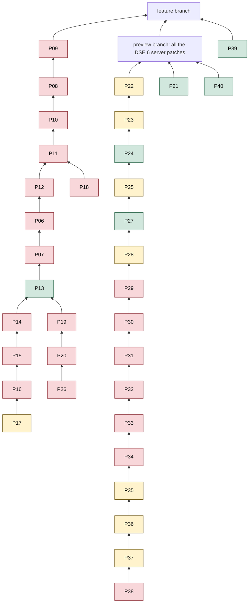

<!--
Copyright IBM Corp.

Licensed under the Apache License, Version 2.0 (the "License");
you may not use this file except in compliance with the License.
You may obtain a copy of the License at

http://www.apache.org/licenses/LICENSE-2.0

Unless required by applicable law or agreed to in writing, software
distributed under the License is distributed on an "AS IS" BASIS,
WITHOUT WARRANTIES OR CONDITIONS OF ANY KIND, either express or implied.
See the License for the specific language governing permissions and
limitations under the License.
-->

# Reviewer triage guide: the in-place upgrade from DSE to HCD 2.0 (HCD-608)

This directory is a working aid for the review of the HCD-608 patch series. It is temporary: it lives on the feature
branch while the review runs and is deleted before the feature branch is merged into `main`.

The series is too large to read line by line with the same attention everywhere. This guide says, for each open
patch, how much risk it carries, where in the patch that risk is, why the existing code it modifies was written the
way it was, what can go wrong on a failure or a rollback, and how far its tests really exercise the risky part. The
aim is that reviewers spend their time on the patches and the methods where a mistake would cost the most.

It is a triage, not a review: it does not approve anything, and every statement in it is open to correction. A
reviewer who disagrees with a tier or a finding changes it in this directory, with a pull request against the feature
branch that touches only this directory.

## 1. How to use it

1. Read sections 2 to 6 of this page (ten minutes).
2. Review in the order of section 5, not in the order of the stack.
3. For a Tier 1 or Tier 2 patch, open its brief in the group file first, read "Where to look", "Modified or deleted
   existing code" and "Test integrity", and then read the flagged methods in the diff. Read the rest of the diff
   afterwards, as far as the tier deserves.
4. For a Tier 3 patch, confirm what the brief says (no production path changed, tests really run) and stop: five to
   ten minutes each. A Tier 3 brief is short: it leaves out "Where to look" and the sections that do not apply.
5. When you find something this guide missed, add it to section 8 as a rule. The remaining patches are then checked
   again against that rule.

Every brief has the same layout: the tier and what decides it; size and shape; gating (what switches the new
behaviour on, and what changes without DSE); where to look; modified or deleted existing code, with the history of
the original lines; failure and rollback risks; test integrity; questions for the reviewer. Each group file ends
with notes that span its patches. The briefs anchor by file, class and method, not by line number, because the
patches are rebased after each merge. "Not established" marks a point the code alone does not settle.

## 2. The tiers

A patch has the tier of its riskiest part; the brief says which files carry it and which can be skimmed. The tier
follows what the patch touches, never its size.

| Tier | Meaning | Open patches |
|---|---|---|
| 1 | Behaviour changes on data on disk (sstables, commit log, hints, system and schema tables, format versions), on the wire (message serialization, handshake, framing, gossip), on startup ordering or concurrency, or in existing code that also runs on clusters that never ran DSE | 21 |
| 2 | New upgrade-only logic behind a switch (a compatibility mode, DSE peers or DSE-written files): checks, refusals, tools. A mistake means a refused start or a refused operation, not silently damaged data | 8 |
| 3 | Tests, fixtures, documentation, isolated additions with no runtime path unless explicitly invoked | 6 |

The column "Without DSE" in section 4 answers a second question, independent of the tier: does the patch change
anything for a cluster that never ran DSE and never sets a compatibility mode?

* **yes**: an observable behaviour changes in every mode (section 6 lists each one);
* **minor**: only always-on plumbing with the same result (a mode check on a path, a helper that returns its
  argument), a log or refusal text, or one more line in `nodetool compatstatus`;
* **no**: nothing runs without the mode, or the patch has no production change.

## 3. The stack

Patches P00 to P05 are merged on the feature branch and are not covered here. The 35 open patches are stacked as
below; an arrow points from a patch to the patch it is based on. Only the patch at the bottom of a stack can be
merged, so the merge order follows the arrows even when the review order does not.



Red is Tier 1, yellow Tier 2, green Tier 3. The preview branch (pull request
[#2754](https://github.com/datastax/cassandra/pull/2754)) is not a patch: it holds the DSE 6 server patches P06 to
P20 and P26 together, so that the preflight tool, the two test-only patches and the DSE 5.1 series have a base. It is
never merged; the patches above it are rebased onto the feature branch once the server patches are in.

The DSE 5.1 series (P27 to P38) sits on top of the whole DSE 6 series, and much of what it modifies was added by the
DSE 6 patches. Its briefs say so where it applies.

## 4. Every open patch

| Patch | Pull request | Group | Tier | Without DSE | What decides the tier |
|---|---|---|---|---|---|
| P06 | [#2741](https://github.com/datastax/cassandra/pull/2741) | [F](group-F.md) | 1 | yes | Parsing of every `system_auth.role_permissions` row in every mode; schema validation and loading of index classes |
| P07 | [#2742](https://github.com/datastax/cassandra/pull/2742) | [D](group-D.md) | 1 | yes | Sstable read path and the header every sstable writer is built with, in every mode |
| P08 | [#2744](https://github.com/datastax/cassandra/pull/2744) | [C](group-C.md) | 1 | minor | Renames commit log segments after replay; converts, writes and deletes hints files during the start |
| P09 | [#2743](https://github.com/datastax/cassandra/pull/2743) | [E](group-E.md) | 1 | minor | Startup check that fixes the SAI on-disk version of every index file written in the mixed phase |
| P10 | [#2745](https://github.com/datastax/cassandra/pull/2745) | [B](group-B.md) | 1 | yes | Internode message encoding; serializer, read and write paths that run on every node |
| P11 | [#2748](https://github.com/datastax/cassandra/pull/2748) | [B](group-B.md) | 1 | yes | Handshake on both sides, framing, reconnection, and the handshake timeout of every node |
| P12 | [#2749](https://github.com/datastax/cassandra/pull/2749) | [B](group-B.md) | 1 | minor | Gossip state serialization, the echo and mark-alive path, the published messaging version |
| P13 | [#2751](https://github.com/datastax/cassandra/pull/2751) | [G](group-G.md) | 3 | no | Test harness and build scripts only |
| P14 | [#2752](https://github.com/datastax/cassandra/pull/2752) | [A](group-A.md) | 1 | minor | Schema pull and push answers; setup of the replicated system keyspaces at startup |
| P15 | [#2755](https://github.com/datastax/cassandra/pull/2755) | [A](group-A.md) | 1 | yes | Guards on startup, topology, repair and sstable operations of every cluster; a schema-freeze test on every DDL |
| P16 | [#2757](https://github.com/datastax/cassandra/pull/2757) | [F](group-F.md) | 1 | minor | Two checks in the daemon startup sequence, one blocking after the node joined; a periodic cluster-wide read |
| P17 | [#2758](https://github.com/datastax/cassandra/pull/2758) | [F](group-F.md) | 2 | minor | A mode-only refusal at startup for traces of non-core DSE features |
| P18 | [#2750](https://github.com/datastax/cassandra/pull/2750) | [B](group-B.md) | 1 | no | Port dialled by outbound connections, a TLS-only listener, no plain-text fallback |
| P19 | [#2753](https://github.com/datastax/cassandra/pull/2753) | [C](group-C.md) | 1 | yes | Batchlog replay loop and decoding of `system.paxos` rows, for every cluster |
| P20 | [#2756](https://github.com/datastax/cassandra/pull/2756) | [D](group-D.md) | 1 | minor | Serialization of read commands, responses, digests and partition updates with DSE peers |
| P21 | [#2763](https://github.com/datastax/cassandra/pull/2763) | [G](group-G.md) | 3 | no | Seven new in-JVM test classes |
| P22 | [#2759](https://github.com/datastax/cassandra/pull/2759) | [H](group-H.md) | 2 | no | New read-only offline tool, run only when invoked |
| P23 | [#2760](https://github.com/datastax/cassandra/pull/2760) | [H](group-H.md) | 2 | no | Schema and access-control checks inside the tool |
| P24 | [#2761](https://github.com/datastax/cassandra/pull/2761) | [H](group-H.md) | 3 | no | Reads JSON reports, writes one JSON file |
| P25 | [#2762](https://github.com/datastax/cassandra/pull/2762) | [H](group-H.md) | 2 | no | Never writes to the node, but its output protects open Paxos rounds on a rollback |
| P26 | [#2764](https://github.com/datastax/cassandra/pull/2764) | [D](group-D.md) | 1 | no | Decoding of stored DSE view mutations in commit log replay, batchlog replay and hints conversion |
| P27 | [#2781](https://github.com/datastax/cassandra/pull/2781) | [I](group-I.md) | 3 | no | Fixtures and test helpers |
| P28 | [#2782](https://github.com/datastax/cassandra/pull/2782) | [I](group-I.md) | 2 | minor | The new `DSE_5_1` mode: refused starts and settings; refactors shared DSE 6 code |
| P29 | [#2783](https://github.com/datastax/cassandra/pull/2783) | [I](group-I.md) | 1 | yes | Transaction log records, commit log segment handling, start refusals, one hints read path in every mode |
| P30 | [#2784](https://github.com/datastax/cassandra/pull/2784) | [I](group-I.md) | 1 | yes | Definitions of `system.local` and `system.peers` in every mode; row deserialization; startup order |
| P31 | [#2785](https://github.com/datastax/cassandra/pull/2785) | [I](group-I.md) | 1 | yes | Opens the pre-4.0 wire path to `DSE_5_1`; decoding of stored batch and Paxos rows at versions 10 and 11 with `NONE` |
| P32 | [#2786](https://github.com/datastax/cassandra/pull/2786) | [I](group-I.md) | 1 | minor | Handshake version choice, gossip states, TLS port choice, no plain-text fallback, for `DSE_5_1` |
| P33 | [#2787](https://github.com/datastax/cassandra/pull/2787) | [I](group-I.md) | 1 | minor | Startup refusals before the schema loads and after the node joined; row-filter deserialization, `GRANT` |
| P34 | [#2788](https://github.com/datastax/cassandra/pull/2788) | [I](group-I.md) | 1 | yes | Sstable write path: version selection, component layouts, deletion-time encoding; a new storage mode |
| P35 | [#2789](https://github.com/datastax/cassandra/pull/2789) | [J](group-J.md) | 2 | no | Offline, read-only inspection of DSE 5.1 nodes in the tool |
| P36 | [#2790](https://github.com/datastax/cassandra/pull/2790) | [J](group-J.md) | 2 | no | DSE 5.1 schema checks and report aggregation in the tool |
| P37 | [#2791](https://github.com/datastax/cassandra/pull/2791) | [J](group-J.md) | 2 | minor | Read-only rollback check and the DSE 5.1 path of the Paxos rollback |
| P38 | [#2806](https://github.com/datastax/cassandra/pull/2806) | [I](group-I.md) | 1 | minor | Hints write path: file version, messaging version of buffered hints, hints refused before buffering |
| P39 | [#2807](https://github.com/datastax/cassandra/pull/2807) | K (section 7) | 3 | no | Documentation only |
| P40 | [#2817](https://github.com/datastax/cassandra/pull/2817) | [E](group-E.md) | 3 | no | One test class and fixture notes |

## 5. Recommended review order

The review order front-loads the patches that can affect a cluster that never ran DSE, then the rest of Tier 1. The
merge order stays the order of the stack (section 3), so some patches will be reviewed before the ones below them are
merged; that is intended.

1. **Read first, as background (30 minutes):** the brief of P13 in [group G](group-G.md). It says what the
   mixed-cluster tests of the whole series really run, which every "Test integrity" note below depends on.
2. **Tier 1 with a behaviour change in every mode, DSE 6 series:** P10, P11 (wire), P07 (sstable read), P19
   (batchlog, Paxos), P06 (permissions, indexes), P15 (guards).
3. **Tier 1, rest of the DSE 6 series:** P09, P08, P12, P18, P14, P16, P20, P26. Read P14 with P15: the briefs explain
   why neither is complete without the other.
4. **Tier 1, DSE 5.1 series:** P30, P29, P34 (each changes something without DSE), then P31, P32, P33 read together
   at the state of P33 (the three swap gates back and forth; P31 changes something without DSE too), then P38.
5. **Tier 2:** P25 first (its `PaxosRollback` planning methods deserve Tier 1 depth), then P17, P28, P22, P23, P35,
   P36, P37.
6. **Tier 3, time-boxed:** the rest of P13 (its brief was read in step 1), P21, P24, P27, P40, P39.

## 6. What changes for a cluster that never ran DSE

These are the observable changes that apply with `internode_compatibility_mode: NONE`, the default, as established
from the code of each patch. They are the first thing to confirm or refute; the briefs give the methods.

* **P06.** Unknown permission names and unknown resource types in `system_auth.role_permissions` are skipped with a
  warning instead of raising an exception. `UPDATE` with `TRUNCATE` on a data resource is read as `MODIFY`, and either
  alone is dropped; rows of unknown resource types no longer appear in `LIST PERMISSIONS`. `REVOKE MODIFY` on a data
  resource also removes stored `UPDATE` and `TRUNCATE` names, with a client warning when one was held alone. `GRANT`
  and `REVOKE` no longer fail on a row with no permissions. One DSE index class name resolves to SAI, and a missing
  `com.datastax.bdp.*` index class gets its own refusal text. `IndexMetadata.validate` accepts an unknown custom class
  whenever the existing ignore-unknown-index property is set.
* **P07.** A view sstable whose header names an unknown non-static column `.<c>`, where `<c>` is a view primary-key
  column that is a regular column of the base table, of the same type, is read with DSE's hidden-column liveness rule
  instead of being refused with an unknown-column error. Other unknown columns starting with `.` are still refused,
  with a new message. The header of every sstable written from such an input drops that column.
* **P10.** The post-4.0 message serializer obtains the payload serializer through a lookup that falls back to the
  request's callback when the verb has none. Below version 4.0 the codec entry points raise an error even with
  assertions disabled.
* **P11.** When the handshake times out before a first message arrived, the socket is now closed; before, the
  timeout raised a null pointer exception and left it open. The handshake `Initiate` message compares the requested
  version in `equals`. A new MBean attribute lists DSE peers (empty without the mode), and `nodetool compatstatus`
  prints one more line for it.
* **P15.** The guarded operations (decommission, move, rebuild, repair, removenode and its force, assassinate,
  bootstrap resume, `nodetool join` before the bootstrap completes, upgradesstables, recompress_sstables, refresh,
  import, resetlocalschema, and a switch of `paxos_variant` to a v2 variant) call an upgrade-in-progress test that is
  also true without the mode when a peer is recorded at a pre-4.0 or DSE messaging version; the same test refuses a
  bootstrap or a replacement at startup. The join refusal of the shadow round and a new startup check (which does
  nothing unless its property is set) run in every mode. Every DDL evaluates the schema-freeze test; the wrapper that
  can refuse it applies only in `DSE_6` without `allow_ddl`. Whether a cluster without DSE can ever record such a peer
  version is the open question of that brief.
* **P19.** A batch is kept and skipped until the next start, instead of ending the replay cycle, when its mutations
  fail to decode with a runtime error or an assertion, or when its version is missing, is not 4 bytes or is an unknown
  value of the DSE range. A batch stored below version 4.0 that fails with an I/O error is kept instead of dropped; an
  I/O error or an unknown table in a batch stored at 4.0 or later still drops it. A batch with no mutations is
  removed. A Paxos row with no ballot yields no commit state (`getCommitState` returns null).
* **P29.** A missing hints statistics file is logged at WARN instead of ERROR. A start without a mode is refused when
  a DSE 5.1 upgrade marker or peers record is present.
* **P30.** `system.local` and `system.peers` record five DSE 5.1 columns as dropped columns in every mode. That adds
  ten rows (five per table) to `system_schema.dropped_columns`, deleted and rewritten at every start, and changes
  `DESCRIBE … WITH INTERNALS` of both tables.
* **P31.** Batch and Paxos rows stored at messaging versions 10 and 11 are decoded at version 4.0 with `NONE` and in
  `DSE_5_1`; before, they were decoded at their stored version. `DSE_6` keeps the pre-4.0 layout for them.
* **P34.** The bloom filter of a legacy-format sstable, when rebuilt, is saved in the old layout: the assertion that
  forbade writing it is removed. (The storage compatibility enum also gains `DSE_5_1`, major 3, to which every
  existing `isBefore(5)` rule applies; it is accepted only with `internode_compatibility_mode: DSE_5_1`, so it changes
  nothing here.)

Changes that the briefs class as minor (same result, text only) are listed under "Gating" in each brief.

## 7. Observations across the series

**What plays the DSE side in the tests.** No test in the series runs a DSE process. The evidence is of three kinds,
and each brief says which one a test uses:

* files written by real DSE nodes and committed as fixtures (sstables, commit log segments, hints, system tables):
  the strongest evidence, used by P07, P27 and the patches that read those fixtures;
* bytes captured from real DSE nodes on the wire (P10, P11, the DSE 5.1 messaging patches);
* this software playing both sides: the in-JVM mixed cluster of P13 runs HCD 1.2 nodes at messaging version 11, with
  messages delivered in the JVM, so handshake, framing, connections and gossip are not exercised, and those nodes are
  not classified as DSE peers. Round trips through the serializers under test are in this category too.

Where a behaviour of DSE itself matters (what DSE reads after a rollback, what a DSE coordinator accepts), the
repository cannot prove it. Those points are marked "not established" in the briefs and rest on upgrade runs against
real DSE clusters, which are outside this repository.

**The mixed-cluster tests are not in a CI pipeline.** P13 moves every mixed-cluster test class out of the regular
in-JVM test split into a new build target, and that target is not referenced by `.jenkins/Jenkinsfile`. The
`ds/Jenkinsfile` delegates to an external pipeline library, so whether the pull request gate runs these tests cannot
be established from this repository. Without the HCD 1.2 jar the tests skip.

**Earlier decisions that the series reverses on purpose.** Each is stated by its patch; the reviewer should confirm
the reason still holds:

* P08 renames replayed DSE commit log segments even when they hold mutations of unknown tables, against the
  keep-the-segment rule of CNDB-15916;
* P10 drops the reconciliation flag towards DSE replicas, giving up the protection of CASSANDRA-19018 for SAI reads
  above consistency level ONE during the upgrade;
* P12 replaces the pre-4.0 gossip translation of HCD-241, stops sending all of the node's own states to DSE peers
  (CASSANDRA-19983) and repeats echo requests in the mode (CASSANDRA-18866);
* P18 and P11 bring back code removed by CASSANDRA-18314 (legacy port selection, legacy framing);
* P34 writes the old bloom filter layout (CASSANDRA-17056) and replaces the zero-delta LIVE deletion time of
  CNDB-17045 in old-format sstables;
* P38 makes the messaging version of a hints file depend on the storage mode, where it depended only on the hints
  version since CASSANDRA-6230.

**Existing tests changed on purpose.** No brief reports an assertion weakened by accident. The deliberate changes to
check: P12 (`EndpointStateDeserializationEdgeCasesTest` expectations reversed, one `EndpointStateIndexStatusTest`
assertion inverted), P16 (`Dse6GossipTest` needs a new property to restart one node at a time), P23 (the list of threads
the tool may leave behind grows from 1 to 12), P28 (one startup-check test narrowed), P31 and P33 (assertions of earlier
patches of the series reversed with the behaviour).

**Rollback.** Several patches state that returning a node to DSE after this code ran loses something or needs a
manual step: hints not yet dispatched (P08), replayed batches (P19), views to rebuild (P07), sstables and commit log
segments DSE 5.1 cannot read (P29). Moving forward, the grants index must be rebuilt by hand after the switch to
`NONE` (P06). The briefs list these under "Failure and rollback risks"; the operator documents of P39 are where they
must also appear.

**Patches to read together.** P14 with P15; P31, P32 and P33; P12 and P18 (siblings on P11 that both edit
`DseHandshakeTest`). One question spans P10 and P11: P10's refusal of verbs a DSE peer does not know reads the peer's
version through a call that caps it at the current version, while P11 reads the raw value.

**Group K, P39.** Documentation only, Tier 3: six operator documents and no code, test or build change. The check
that matters is not in the diff: every rollback consequence and every refusal text the other briefs list should be
found in those documents.

## 8. Rules found during review

When a reviewer finds a rule of the existing code that this guide did not apply, it is added here in two lines, and
the patches not yet reviewed are checked again against it. Format:

```
R<n>. <the rule, in one or two lines>
      Found in <Pnn> by <reviewer>, <date>. Re-checked: <patches, or "pending">.
```

No rule recorded yet.

## 9. Keeping the guide current

* A brief describes its patch at the time it was written. When a patch changes after review comments, its brief is
  refreshed in the same round; when a patch is merged, its row in section 4 is marked merged and its brief stays for
  reference until this directory is deleted.
* Statements marked "not established" are open questions, not findings. Answer them in the pull request of the patch
  and update the brief.
* Commit ids in the history notes are those of the product history (`main` and Apache Cassandra) and do not change.
  Patches of this series are cited by label, because their commits are rewritten at each rebase.
